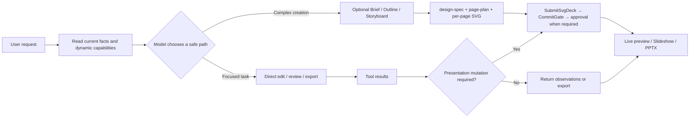
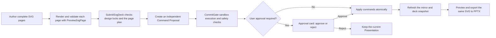

# Agent Harness

[中文](./README.md) · [Docs](./docs/README.en.md) · [文档索引](./docs/README.md)


This project is evolving from a presentation application into a general-purpose Agent Harness: model-neutral execution, tool/plugin composition, authorization, canonical history, and recovery. The generic execution package is `@agent-harness/core`; diagnostics are independently provided by `@agent-harness/logs`. PPT is an optional business capability to integrate through public protocols, not the kernel's identity.

## Existing Electron/PPT host

The production UI and legacy Agent still form a local-first presentation workspace; they have not switched to the new Harness. The screenshots and PPT usage below describe that retained host, not completed generic-kernel adoption. Its product name, appId, `.agent-ppt` data directory, and `AGENT_PPT_DATA_DIR` remain unchanged for compatibility.

That host is useful when you want to:

- Generate a report, proposal, class deck, or product presentation from scratch (SVG-native full-page authoring)
- Add slides, rewrite copy, or unify style on an existing deck (via agent skills and approvals)
- Track brief, outline, storyboard, design-spec, export history, and conversation context as local project files
- Study reliable AI document editing with tool calls, approvals, risk control, and visual review loops

## Screenshots

Three-column workspace: sessions and project files on the left, agent progress and approvals in the center, live slide preview on the right. Generated decks can enter slideshow mode directly, and preview and export share the same SVG visual source; Settings manages models, search and networking, submission and approval, usage and billing, and more. Screenshots below show the default UI shell and sample agent output.

<table>
  <tr>
    <td width="50%"><br/><sub>Three-column workspace</sub></td>
    <td width="50%"><br/><sub>Settings: usage and billing</sub></td>
  </tr>
  <tr>
    <td width="50%"><br/><sub>Slideshow sample: structured page</sub></td>
    <td width="50%"><br/><sub>Slideshow sample: dark creative cover</sub></td>
  </tr>
</table>

## Workbench theme customization

Workbench chrome is separate from the slide DesignSystem: drop a pack at `~/.agent-ppt/themes/<name>/theme.css` to restyle the app without changing SVG paper or PPTX export. The image below is a promotional shot of the built-in Catnip theme (not the default look).

<p align="center">
  
</p>

<p align="center"><sub>Catnip: folder CSS theme example · see the <a href="./docs/user-manual/css-themes.md">CSS theme guide</a></sub></p>

## What Makes It Different

**It is model-driven tool collaboration, not a fixed stage machine.**

The runtime gives the model current workspace facts, available skills, and a dynamic tool set. Complex creation jobs can optionally load upstream skills (brief / outline / storyboard / research; knowledge-only, written via WriteFile) then lock `design-spec` and per-page `page-plan` files; local edits, reviews, and exports can take a short path. Interaction pauses only for missing critical constraints, risky changes, or an explicitly requested comparison.

When creating a full deck, the agent locks a Design System from audience, topic, and delivery context, authors each page as a complete `1280 × 720` SVG, then submits through `PreviewSvgPage` → `SubmitSvgDeck` into a single proposal. It does not ask you to pick “standard layout” or “creative decoration” after a content draft, unless you explicitly want a content-only draft.

**The model does not directly mutate the deck.**

All real slide changes pass through `CommitGate`: schema validation, sandbox execution, diff generation, and risk evaluation. Changes can be auto-applied only when safe; otherwise the UI asks for your approval.

**The product create path is SVG-native.**

Each slide’s visual authoring source is a validated full-page SVG shared by preview and export. PPTX export uses a hybrid strategy: a text-stripped SVG becomes the slide background image, while title and body `<text>` nodes are lifted into editable PowerPoint text boxes. Charts and decoration stay in the image layer; they are not decomposed into native shapes or charts.

**The process is preserved, not just the result.**

The local workspace can contain task-specific artifacts such as `brief.md`, `outline.md`, `slides/storyboard.json`, `design/design-spec.json`, `slides/page-plan.json`, `slides/svg/*.svg`, and `deck/snapshot.json`. Dedicated persistence services retain history, checkpoints, transcripts, and export records for review and recovery.

## Workflow



## SVG-Native Full-Deck Generation

When creating or redesigning an entire presentation, the agent can use the SVG-native workflow and author every slide as a complete `1280 × 720` SVG. The SVG itself contains the title, body copy, background, charts, images, page number, and decoration; the preview and export layers do not add a second set of visual styling that could drift from the source.

Key workspace files:

- `design/design-spec.json`: locked communication contract and Design System
- `slides/page-plan.json`: slide order, final copy, and per-slide narrative intent
- `slides/svg/P01.svg`, etc.: complete slide visual sources
- `deck/snapshot.json`: the Presentation snapshot already approved and applied by the user

The submission path is:



Three completion states must remain distinct:

| State | Meaning |
|---|---|
| SVG workspace files complete | The page sources exist, but the current slides have not changed |
| Proposal created | Replacement commands passed preview and safety checks and are waiting for approval |
| Presentation applied | `CommandBus` executed the commands atomically and persisted the deck snapshot |

A successful `SubmitSvgDeck` result means that the Proposal was created; it does not mean the slides were already replaced. When approval is required, the SVG pages take effect only after the user approves the current proposal, the apply operation succeeds, and the right-side mirror reloads the authoritative Presentation.

Each agent run creates an independent proposal card. If one conversation thread produces several deck proposals, a later proposal cannot inherit the earlier proposal's “applied” state. When loading sessions created by an older version, the app also detects a resolved action that belongs to a different run and reactivates that proposal for review instead of reporting unapplied commands as complete.

## In The App

- Start a new chat from the centered AI input box with a natural-language request
- Switch between Agent Workspace, Project Files, and session search in the left panel
- Review briefs, outlines, combined content/visual proposals, and tool approval cards in the chat stream
- Inspect task plans, stage progress, tool calls, and sub-agent traces
- Inspect reasoning and tools through one process disclosure: opening it reveals thought text directly. Manual disclosure choices survive later run events, and long-text expansion survives closing and reopening. Duration belongs to the whole message; team details list execution records directly.
- Read Markdown replies with tables, task lists, references, and footnotes; new replies appear progressively with a subtle ink-clearing effect, while history appears immediately and received text finishes displaying after streaming ends
- Respect system reduced-motion preferences and pause progressive display in background tabs; text stays selectable, export links open the corresponding folder, and finishing visual effects do not keep the Agent busy
- Keep the same reply instance and layout when streaming ends or process records arrive late, without clearing and replaying text; returning from team details preserves the main conversation's reveal progress
- Pause automatic following as soon as you scroll up, preserving a reading anchor through content growth and folds; resume with “回到最新” (Back to latest) or by scrolling down to the bottom, with viewport and composer resizing handled while following
- Use the right-side PPT mirror to select slides, present, export, or go fullscreen
- Configure models (OpenAI / Anthropic-compatible endpoints), runtime limits, and CommitGate approval policy in Settings
- Set a Tavily API key under **Settings -> 搜索与联网** for optional web research
- Review tokens, estimated cost, task success rate, and per-model breakdown under **Settings -> 用量与费用**
- Browse local Design System presets under presentation preferences (these do not write Agent `design-spec`)
- Use the slash menu to insert **prompt templates** (fills the input only; does not mutate the deck)

## Example Prompts

```text
Create an 8-slide product launch presentation for enterprise customers. Keep it professional but high-impact.
```

```text
Turn slide 3 into a left-right comparison: pain points on the left, our solution on the right.
```

```text
Apply a business blue theme across the whole deck and check for overflowing text.
```

```text
Export the current presentation as PPTX.
```

## Quick Start

```powershell
npm.cmd install
npm.cmd run dev
```

After launch, open **Settings -> 模型** in the desktop app to configure the provider, API key, endpoint, timeout, output limits, and fallback models.

Model and search API keys are owned by the Main-process `agent-configuration` module and encrypted in the application-data directory by Electron `safeStorage` when a secure backend is available. Renderer persistence, `localStorage`, and agent-run IPC payloads contain no secrets: the Renderer holds a key only while it is being entered, uses configuration commands with explicit keep/replace/remove actions, and cannot read stored plaintext keys. The Linux `basic_text` backend remains usable but is explicitly reported as `degraded`. Plaintext keys from legacy v1 `localStorage` records are not imported automatically; after upgrading, re-enter the keys and rotate the old ones. Development environments can still use the `OPENAI_API_KEY`, `ANTHROPIC_API_KEY`, and `TAVILY_API_KEY` fallbacks; an environment key is sent only to an official endpoint or one explicitly bound by the matching `OPENAI_BASE_URL`, `ANTHROPIC_BASE_URL`, or `TAVILY_SEARCH_ENDPOINT`. Remote credential-bearing endpoints must use HTTPS, with HTTP allowed only for loopback development services. Developer diagnostics and CI overrides are documented in [.env.example](./.env.example).

For optional web research, set a Tavily API key under **Settings -> 搜索与联网**. You can also set `TAVILY_API_KEY` in development; search results return as title, URL, and snippet to the main agent and task-graph teammates.

Usage and billing live under **Settings -> 用量与费用**; metrics are stored in the local application-data directory.

## Commands

```powershell
npm.cmd run dev
npm.cmd test
npm.cmd run typecheck
npm.cmd run build
npm.cmd run preview
```

Platform packaging:

```powershell
npm.cmd run build:win
npm.cmd run build:mac
npm.cmd run build:linux
```

## Tech Stack

- Electron + electron-vite
- React 19 + TypeScript
- OpenAI SDK + Anthropic SDK
- pptxgenjs
- Zustand + Zod
- Vitest

## Architecture

```text
Renderer UI
  ChatWorkspace / PPTMirror / SettingsConsole
        |
        v
Preload IPC boundary
        |
        v
Main process
  Agent runtime -> Gateway -> OpenAI / Anthropic
  Tool registry -> Core tools + Skills
  CommitGate -> CommandBus -> Presentation snapshot
  ProjectFileService -> project artifacts and snapshots
  Conversation DB / Runtime stores -> history, checkpoints, transcripts
        |
        v
PPTX exporter (hybrid: SVG background + editable text)
```

Key areas:

- `app/renderer/`: React workspace, chat stream, live PPT mirror, settings console; `app/renderer/src/App.tsx` directly owns the shared layout and workspace/settings view selection
  - Container-driven layout: the root bounds the window height and Flex/Grid allocates the remaining space. `useWorkbenchLayout` owns panel-width CSS variables and observes the actual container with `ResizeObserver`. Panels scroll independently and local responsive rules use container queries; shrinking the window preserves the saved preview-width preference. SVG previews retain their 16:9 ratio and 1280×720 authoring coordinates.
  - Panel resizing uses `app/renderer/src/components/ResizeHandle.tsx` with controlled `value/min/max/onValueChange`, an `axis` for horizontal or vertical movement, and a `direction` for growth. It owns idle/hover/dragging/disabled feedback, pointer capture, global cursors, and cleanup; arrow keys adjust by 10px and Home/End select bounds. Cancellation retains the last size. Disabling, blur, capture loss, unmounting, or changed bounds ends the drag; sizing policy and persistence remain in the layout layer.
- `packages/harness/`: private npm workspace package `@agent-harness/core@0.1.0`, Node >=24 and ESM-only, independently emitting JS and declarations with Zod as its only runtime dependency. Normal consumers use exact exported subpaths, never source or private dist paths. Production UI still runs `app/main/agent/`.
  - `src/agent/application/agent-application.ts`: `createAgentApplication()` is exposed through `@agent-harness/core/application/agent-application`. Its internal factory installs plugins, binds a model, publishes only ready instances, and rolls back failures. Closing rejects creation, interrupts and drains execution, then releases owned resources. Consumers never call the default factory directly. The directories below are inside `src/agent/`, not importable package subpaths.
  - `scope/`: Application → Agent → Run resource ownership, reverse-order disposal, and registration handles. Borrowed host services outlive individual Agents.
  - `runtime/`: mutually exclusive `run/resume`, independent event observation, Query checkpoint coordination, and model/tool turns. New queries accept user messages without forcing them into a business Task; Steps update snapshots at commit boundaries.
  - `model/`: neutral messages, capability declarations, private replay state, and model factories registered by provider ID. Adding a provider does not add a branch to the loop.
  - `tools/`: registration, input/output validation, mandatory host authorization, approval, and continuation. Plugins capture business services in closures; business results, model content, and presentation projections are persisted separately.
  - `session/`: conditional history appends with idempotent batch receipts, versioned checkpoints, writer leases, fencing generations, and explicit takeover. `extensions/` owns plugin installation, model/tool/prompt contributions, and scoped cleanup.
- `cli/host/`: the independent Node host owns configured model selection, SQLite, capability assembly, session discovery and shutdown, without importing Electron, app or root src.
  - `createSqliteAgentStores(filePath)` persists canonical history, batch receipts, checkpoints and leases in the CLI's own database; it does not migrate desktop storage.
  - `createAgentHost()` binds threads to canonical workspaces, tool modes, model-connection fingerprints, definitions, plugin versions and step budgets. `prepareConfiguredModel()` consumes issued plans and resolved credentials, routing MiMo, OpenAI Chat Completions, OpenAI Responses and Anthropic Messages through the models package. Unknown explicit adapter IDs reject before credential resolution; execution never falls back to the legacy Gateway.
- `cli/`: terminal commands, secure model-configuration wizard, and TUI/print/JSONL execution. Production and development use the same independent Node entry. The wizard supports the four native adapter routes and existing compatible connections.
- `app/preload/` and `app/shared/ipc.ts`: desktop IPC bridge and contracts. File capabilities are consumed through the tools package; remaining shared/domain modules keep their actual ownership rather than treating the former `src/` as one Electron application.
- `packages/models/`: one private `@agent-harness/models@0.1.0` package, not one package per vendor. The `models` entry exposes lazy `createModelProvider(options, signal)`; `model-profiles` supplies browser-safe metadata, `model-contract` owns public types, and `model-errors` owns safe common errors. Implemented IDs: `mimo-token-plan-cn`, `openai-chat-completions`, `openai-responses`, `anthropic-messages`. The latter three accept configurable base URLs and custom model IDs; capabilities describe protocol support, not guaranteed remote model availability. MiMo retains its fixed CN endpoint and known-model allowlist. All adapters support generation, streaming, tools, discovery and private replay. Core owns execution protocols/registration; the host owns credential sources, configuration and recovery fingerprints. New adapters have real SDK/local HTTP/SSE and CLI evidence, not remote-provider certification; see the [protocol integration record](docs/next-steps/models-package.md#13-旧-gateway-协议接入新模型端口).
  - `npm run build:models` builds the model package and its workspace prerequisites; `npm run verify:models-package` installs real tarballs offline outside the repository and exercises the actual SDK against local HTTP/SSE plus declaration/error contracts. Metadata never loads the SDK or Node factory. Providers leave borrowed loggers open. Old source factory/error paths have been removed; legacy production Gateway dependencies remain.
- `packages/tools/`: private `@agent-harness/tools@0.1.0`, Node >=24 and ESM-only. The `tools` entry exposes `createTools({ workspaceRoot, mode }, logger?)` and strict `prepareWorkspaceRoot()`. `tools-contract` and `tools-errors` are browser-safe type/error entries. Read-only is the default; read-write adds mutators without approving them. Schemas, individual tool factories, Workspace, and path/commit mechanisms remain private.
  - `read` uses UTF-16 windows (up to 4000 units by default), with `expectedVersion` required for later windows. Replacing or editing requires observing the complete unchanged version. `write` distinguishes explicit `create` from version-checked `replace`; `edit` uses exact text matching. Observations are installation-local and require rereading after restart.
  - `glob` supports `*`, `**`, and `?`; `grep` performs literal line searches, not regex or shell execution. Traversal, file bytes, aggregate search bytes, and results are bounded. Incomplete scans report `truncated`; binary/oversized files are explicitly skipped. Discovery and search do not authorize mutations.
  - `atomic-files` supplies host-owned JSON/text atomic I/O; `workspace-files` retains the existing WorkspaceFileService and required types. These trusted Node APIs are not model tools: JSON/service reads may create directories, lock, and recover writes, unlike the new read-only tools. New mutations revoke observations; legacy mutations renew receipts. Safety primitives, locks, and error identities remain single-instance, without imposing plugin budgets globally. Old source paths are removed; production PPT contracts and business commits remain unchanged.
  - `npm run build:tools` builds the package and prerequisites; `npm run verify:tools-package` checks real offline-installed tarballs, declarations, and actual filesystem behavior outside the repository. The plugin remains `tools/1`, preserving waiting approvals, bindings, and recovery formats. Loggers remain borrowed.
- `packages/logs/`: private workspace package `@agent-harness/logs@0.1.0`, Node >=24, ESM-only, and no runtime dependencies. It is independent of Harness in both directions. Exact entries are `@agent-harness/logs/log-contract`, `@agent-harness/logs/logs` (`createLogs`), and `@agent-harness/logs/node-logs` (`createNodeLogs`); internal paths are not exported.
  - Consumers borrow a narrow Logger. The host owns configuration, output management, and shutdown. Bounded snapshots and credential masking precede output; exporter failures do not replace execution outcomes. Node outputs include stderr, instance-owned daily JSONL files, and recent records. Configuration persistence, legacy loggers, Gateway archives, and production log UI are unchanged.
  - `npm run build:packages` builds Core, logs, models, and tools before application/test/development consumption; dev waits for all four initial emits and watches changes. `npm run verify:logs-package` checks a real tarball installed outside the repository, native Node behavior, and generic declaration consumers. No global container or service discovery is introduced.
- `app/main/agent/`: Agent runtime, tool registry, model gateways, commit gate, sub-agents
- `app/main/agent-configuration/`: `createAgentConfiguration()` exposes separate `management` and `runtime` operations, not stores, credential bindings, or decryption APIs.
  - Renderer management IPC reads secret-free snapshots, initializes settings, saves/deletes vendors, saves execution preferences, updates search credentials, and discovers remote models. Vendor saves publish committed state only after completion. Browser migrations read legacy data without rewriting it and clear it after Main initialization succeeds.
  - Runs select a model by `modelId`: `loadExecutionPlan(modelId)` captures the model and preferences; after admission, `resolveRuntime(plan)` loads matching credentials and applies environment fallbacks. Gateways and search services no longer read environment configuration. Missing optional search/fallback keys do not eagerly block the primary model.
  - Saved-connection discovery accepts only `vendorId`; Main determines both destination and key. Draft connections require a temporary key. Editing the protocol or address never rebinds an old key to the new connection.
  - Existing `agent-settings.json`, `credentials.v2.json`, migrations, and credential locks are retained. Whole management operations are serialized, without claiming atomic transactions across both files. Other modules import only the public entry point.
- `src/design-system/`: DesignSystemV2 schema, presets, and resolution
- `src/shared/`: remaining presentation, command, configuration, and session contracts pending ownership refinement. Desktop IPC lives in `app/shared/ipc.ts`; this directory is not an unrestricted public package.
- `app/main/project/`: local project sandbox, artifact IO, diffs, dependency status
- `app/main/storage/`: SQLite data access organized by object (`session/`, `checkpoint/`, `ppt-job/`, etc.), with colocated DO, DTO, and Mapper files where needed.
  - `init(connection)` owns tables, indexes, connection settings, and existing checkpoint-column migrations; repeated calls preserve data.
  - `createStorage(filePath)` opens and initializes one connection, assembles all mappers, and provides synchronous `transaction()` and `close()` methods. Business code receives no raw connection or SQL API. Repositories borrowing the same Storage do not close it.
  - Mappers own parameterized SQL, record mapping, named queries, and conditional writes. Business services retain run transitions, lease takeover, idempotency decisions, artifact validation, stale propagation, and recovery rules.
  - Session and Presentation lifecycle writes share the connection and nested SAVEPOINTs; memory, notifications, and workspace mirrors are published after the database commit. JSON settings, project files, and filesystem Blob storage remain unchanged; no CRUD was added for the unused `blobs` table.
- `app/main/deck/`: thumbnails, export history, PPTX export services
- `skills/`: core create `ppt-workflow` → `ppt-design` → `ppt-design-layout` → `ppt-build`; short paths `ppt-edit` / `ppt-beautify` / `ppt-review` / `ppt-export`; optional upstream skills (`ppt-brief` / `ppt-outline` / `ppt-storyboard` / `ppt-research`) are knowledge-only and written via ReadFile/WriteFile — not lifecycle hard locks
- `tests/`: coverage for Agent behavior, export, context compaction, approvals, and project artifacts

### General Agent lifecycle contract

The host explicitly supplies `AgentServices` (model factory, authorization policy, history, and checkpoints), calls `createAgentApplication(services)`, then provides a definition, model selection, step budget, and plugins to `application.agents.create()`. Business tools register in plugin `setup()`; the kernel calls protocols rather than reading Presentation, workspace services, or provider configuration. Close `application.close()` before closing host-owned stores and connections.

For a fixed Thread and host-owned recovery binding, import `createSessionHost({ services, agent, threadId, binding })` from `@agent-harness/core/session-host`. It awaits the required `binding.ensure()` before creating an Agent through the public Application entry. Definitions, models, plugins, and authorization are explicit; `plugins: []` needs neither a workspace nor Electron. SessionHost owns only its Application, leaves borrowed ports open, and never forwards takeover leases from `resume()`. The Electron composition root selects file capabilities, instructions, and approval policy through `workspace-configuration.ts`, retaining existing v2 bindings without changing the CLI or production PPT path.

The public subpath inventory is in [M2-B](docs/next-steps/m2-b-package-boundary.md#m2-b-独立包边界与实际消费); current names and cutover evidence are in [Generic package identities](docs/next-steps/package-identities.md#通用包身份修正). `PluginContext.scope` exposes only `PluginScope.signal/own()`, not resource-tree creation or disposal. `@agent-harness/core/protocol-errors` owns the single `AgentError` identity; `@agent-harness/core/protocol-values` supplies lossless JSON snapshots and value comparison. `ToolCompletion` remains public event/storage data; `ToolExecutor` and the execution pipeline remain internal. There is no root export, wildcard export, source alias, or old-package compatibility layer.

`npm run check:agent-boundaries` checks the package and both application compiler projects, including source/declaration closures, dependency direction, exact public subpaths, resolved targets, triple-slash references, and exported type origins. Only designated behavior tests may import exact white-box dist modules from the same runtime graph. `typecheck` and `build` include this check; it is not a malicious-plugin sandbox.

Dependency installation establishes the workspace link. `npm run build:harness` builds the package independently; application builds, tests, the development CLI, and preview build it before consumption. `npm run dev` waits for the initial successful emit, then watches package sources and Main's emitted JS dependencies. `npm run verify:harness-package` packs and installs a real tarball outside the repository, offline, checking native Node behavior and NodeNext/Bundler declaration consumers. `npm run test:integration:harness` runs the two existing Electron CLI integration files. Nothing was published to npm or switched in production UI/PPT.

- An Agent admits only one `run()` or `resume()` at a time, without an implicit queue. `handle.events` is single-consumer observation; skipping or leaving the stream does not cancel execution.
- `waiting` persists the interaction and continuation, ends the current Run, and releases its lease. Answers must match the stored interaction, and resuming requires a fresh `runId`, never a client-reconstructed execution snapshot. New queries cannot bypass unfinished work on the thread.
- User cancellation is `cancelled`; instance/application shutdown is resumable `interrupted`. Already persisted waits remain `waiting`. Cancellation does not undo external effects.
- History and checkpoints need not share a transaction: persist append intent, then commit history with a stable batch ID. Recovery reconciles receipts. Dispatched calls or consumed answers without durable results become `unknown`, without automatically repeating side effects. External operations are not claimed to be exactly once.
- Streams require an authoritative completion response; provisional deltas are not canonical history. Truncation, missing completion, and persistence failure never count as success. Incompatible definition, plugin, or continuation changes require corresponding version increments.

`tests/base-tools.test.ts` and `tests/general-agent-*.test.ts` cover real files, SQLite, Gateway/SDK transport to local HTTP endpoints, lifecycle, tool authorization, and recovery boundaries. Remote inference needs separately configured credentials; local verification is not a claim of remote LLM or production-UI cutover validation.

### Independent UI preview

```powershell
npm.cmd run ui:dev
npm.cmd run ui:build
npm.cmd run ui:typecheck
```

Open `http://127.0.0.1:5178/`. This browser-only entry neither starts Electron/builds Harness nor replaces the production desktop. Following the supplied DeepSeek Harness / Cursor references, it opens on a workspace and conversation view: a centered composer for empty threads, messages above a bottom composer after local submission, and per-thread drafts/model choices retained across settings navigation.

“设置” (Settings) manages example models shown in the composer, connection examples, and appearance. Deterministic fault controls are under “验收工具 → 连接交互检查”. Connections accept only `demo-key`; no model calls, real directory access, or credential storage occur. State resets on reload and outputs stay under `.vite/ui-preview/`. See [R2 implementation and local verification](docs/next-steps/ui-design-system.md#124-r2-会话工作区与分类设置实施记录), including the outstanding full-suite CLI failures. Full U3–U5 remain unverified.

### Production Node CLI

Node >=24 is required. Production and development share the independent Node entry, without Electron or an IPC input bridge:

```powershell
npm.cmd run build:cli
npm.cmd run agent
npm.cmd run agent:dev -- --help
npm.cmd --silent run agent -- --prompt "Summarize this workspace" --output jsonl
npm.cmd run agent -- --prompt "Hello" --tools none --print
```

Interactive setup saves a connection, securely collects its credential, discovers supported models, and selects the CLI default. Windows CurrentUser DPAPI protects credentials; unavailable secure input or protection fails before collecting a secret. MiMo Token Plan CN, OpenAI Responses, OpenAI Chat Completions-compatible, and Anthropic Messages connections use native model adapters. `--model` takes a configured model ID, not a remote model name.

The TUI separates committed history, provisional streaming output, the draft editor, selectors, and status. `/model` or Alt+M opens model selection; changing models creates a confirmed, separately bound session, never migrates an old Query. `/new`, `/resume`, `/tools`, `/tools-output`, `/status`, and `/help` use the real host. Enter sends only while idle; Alt+Enter inserts a newline, Esc closes local UI, Ctrl+O expands safe tool metadata, and empty Ctrl+D exits. Drafts survive menu cancellation.

Model selection initially focuses the current model and distinguishes local readiness from unavailability reasons. Selecting the current model does not create a session; unavailable entries cannot activate. Cancelling a change preserves the current binding and draft. The footer separates model/configuration state, execution or switching activity, and workspace/session/capabilities. Local readiness is not proof of remote connectivity, authentication, or remaining quota.

The model panel groups entries by saved vendor connection, with an All models scope and search. Wide terminals use a provider/model split view; narrow terminals switch between panes. Left/Right or Tab changes pane focus, Up/Down selects, and Enter confirms. The panel always offers an add/configure connection action. `/connect` reopens the same secure setup wizard even when a default model already exists. Saving a connection also saves the CLI default; switching the active session requires a separate confirmation. Cancelling that switch keeps the saved configuration but leaves the current session unchanged. Desktop connections are not automatically imported.

The default capability is read-only; `--tools none` disables business plugins and `--tools read-write` enables writes requiring explicit approval. The workspace follows the process working directory; there is no `--workspace` flag. Tool inputs, raw results, reasoning, credentials, and private replay data are not printed.

Print and JSONL never open setup or approval menus. JSONL stdout contains only versioned records, not banners, ANSI, or provisional deltas; use direct Node or `npm --silent` for machine consumers. EOF during approval preserves `waiting` and exits 3; cancellation does not preserve a wait. Resume in the original workspace:

```powershell
npm.cmd run agent -- --thread saved-thread-id --resume saved-query-id
```

Recovery reads authoritative checkpoints with a fresh Run ID and requires the original model connection, workspace, capability, definition/plugin versions, and budget. Changed bindings are rejected; same-connection key rotation is allowed. Abandoned leases are not automatically taken over.

Production data defaults to `~/.agent-harness/cli`; development uses `~/.agent-harness/cli-development`. `AGENT_HARNESS_CLI_DATA_DIR` overrides either. Configuration, protected credentials, `sessions.sqlite`, and logs remain separate from desktop data, without automatic migration or desktop-key import. Shutdown drains execution before releasing models, stores, and logs.

Exit codes: 0 success, 1 failure, 2 arguments, 3 waiting, 130 user cancellation, 143 host termination, 141 broken output pipe. MiMo has no application/SDK retries or paid fallback; Node Fetch may internally retransmit HTTP 421.

```powershell
npx.cmd vitest run tests/cli-terminal-controller.test.ts tests/cli-terminal-input.test.ts tests/cli-terminal-rendering.test.ts
npm.cmd run test:integration:harness
```

Evidence distinguishes controlled behavior tests, real SDK transport to local HTTP/SSE, Windows ConPTY, and remote calls. See the [CLI implementation record](docs/next-steps/cli-terminal.md#84-生产直切实施与验收记录); local checks do not establish remote-provider compatibility or a desktop/PPT cutover.

## Local Files And Privacy

Agent PPT is local-first by default:

- Project artifacts and deck snapshots stay in the workspace; history, checkpoints, transcripts, usage metrics, and some settings may live in the local application-data directory
- API keys are managed by the Main-process Electron `safeStorage` credential store, not Renderer `localStorage` or agent-run IPC; development environment-variable fallbacks remain supported
- The model can affect a deck only through registered tools and structured commands
- Risky or non-auto-applicable changes require user approval

## Documentation

- [docs/README.md](./docs/README.md): documentation index
- [Architecture overview](./docs/architecture/overview.md): current layers, data flow, and state boundaries
- [Engineering capability map](./docs/architecture/engineering-capabilities.md): current capability mappings, maturity, and gaps
- [Query and Agent Loop](./docs/agent/query.md): QueryParams, State, Workspace, events, and recovery
- [Tools and file operations](./docs/agent/tools.md): dynamic capabilities, permissions, and Read/Write/Edit contracts
- [System Prompt and Context](./docs/agent/system-context.md): section registry and stable/dynamic boundaries
- [Presentation workflow](./docs/presentation/workflow.md): artifacts, proposals, CommitGate, and delivery states

## Status

The current focus is generic Harness boundaries and real host consumption. Execution and diagnostics are independent packages; model and tool capabilities continue to evolve behind explicit interfaces. The retained PPT workspace is not the standard for kernel generality. Production cutover, business plugins, and the pending reliability plan have separate acceptance criteria in the project plan.
