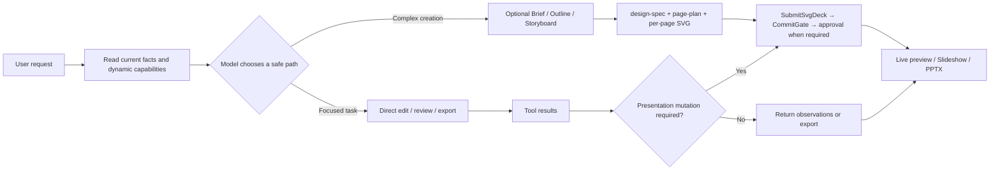
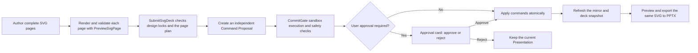

# Agent PPT

[中文](./README.md) · [Docs](./docs/README.en.md) · [文档索引](./docs/README.md)


Agent PPT is a local-first AI workspace for presentations. It creates reviewable briefs, outlines, storyboards, SVG pages, and PPTX exports when the task calls for them, making the model a tool-using, traceable presentation partner instead of a one-shot black box.

It is useful when you want to:

- Generate a report, proposal, class deck, or product presentation from scratch (SVG-native full-page authoring)
- Add slides, rewrite copy, or unify style on an existing deck (via agent skills and approvals)
- Track brief, outline, storyboard, design-spec, export history, and conversation context as local project files
- Study reliable AI document editing with tool calls, approvals, risk control, and visual review loops

## Screenshots

Three-column workspace: sessions and project files on the left, agent progress and approvals in the center, live slide preview on the right. Generated decks can enter slideshow mode directly, and preview and export share the same SVG visual source; Settings manages models, search and networking, submission and approval, usage and billing, and more. Screenshots below show the default UI shell and sample agent output.

<table>
  <tr>
    <td width="50%"><br/><sub>Three-column workspace</sub></td>
    <td width="50%"><br/><sub>Settings: usage and billing</sub></td>
  </tr>
  <tr>
    <td width="50%"><br/><sub>Slideshow sample: structured page</sub></td>
    <td width="50%"><br/><sub>Slideshow sample: dark creative cover</sub></td>
  </tr>
</table>

## Workbench theme customization

Workbench chrome is separate from the slide DesignSystem: drop a pack at `~/.agent-ppt/themes/<name>/theme.css` to restyle the app without changing SVG paper or PPTX export. The image below is a promotional shot of the built-in Catnip theme (not the default look).

<p align="center">
  
</p>

<p align="center"><sub>Catnip: folder CSS theme example · see the <a href="./docs/user-manual/css-themes.md">CSS theme guide</a></sub></p>

## What Makes It Different

**It is model-driven tool collaboration, not a fixed stage machine.**

The runtime gives the model current workspace facts, available skills, and a dynamic tool set. Complex creation jobs can optionally load upstream skills (brief / outline / storyboard / research; knowledge-only, written via WriteFile) then lock `design-spec` and per-page `page-plan` files; local edits, reviews, and exports can take a short path. Interaction pauses only for missing critical constraints, risky changes, or an explicitly requested comparison.

When creating a full deck, the agent locks a Design System from audience, topic, and delivery context, authors each page as a complete `1280 × 720` SVG, then submits through `PreviewSvgPage` → `SubmitSvgDeck` into a single proposal. It does not ask you to pick “standard layout” or “creative decoration” after a content draft, unless you explicitly want a content-only draft.

**The model does not directly mutate the deck.**

All real slide changes pass through `CommitGate`: schema validation, sandbox execution, diff generation, and risk evaluation. Changes can be auto-applied only when safe; otherwise the UI asks for your approval.

**The product create path is SVG-native.**

Each slide’s visual authoring source is a validated full-page SVG shared by preview and export. PPTX export uses a hybrid strategy: a text-stripped SVG becomes the slide background image, while title and body `<text>` nodes are lifted into editable PowerPoint text boxes. Charts and decoration stay in the image layer; they are not decomposed into native shapes or charts.

**The process is preserved, not just the result.**

The local workspace can contain task-specific artifacts such as `brief.md`, `outline.md`, `slides/storyboard.json`, `design/design-spec.json`, `slides/page-plan.json`, `slides/svg/*.svg`, and `deck/snapshot.json`. Dedicated persistence services retain history, checkpoints, transcripts, and export records for review and recovery.

## Workflow



## SVG-Native Full-Deck Generation

When creating or redesigning an entire presentation, the agent can use the SVG-native workflow and author every slide as a complete `1280 × 720` SVG. The SVG itself contains the title, body copy, background, charts, images, page number, and decoration; the preview and export layers do not add a second set of visual styling that could drift from the source.

Key workspace files:

- `design/design-spec.json`: locked communication contract and Design System
- `slides/page-plan.json`: slide order, final copy, and per-slide narrative intent
- `slides/svg/P01.svg`, etc.: complete slide visual sources
- `deck/snapshot.json`: the Presentation snapshot already approved and applied by the user

The submission path is:



Three completion states must remain distinct:

| State | Meaning |
|---|---|
| SVG workspace files complete | The page sources exist, but the current slides have not changed |
| Proposal created | Replacement commands passed preview and safety checks and are waiting for approval |
| Presentation applied | `CommandBus` executed the commands atomically and persisted the deck snapshot |

A successful `SubmitSvgDeck` result means that the Proposal was created; it does not mean the slides were already replaced. When approval is required, the SVG pages take effect only after the user approves the current proposal, the apply operation succeeds, and the right-side mirror reloads the authoritative Presentation.

Each agent run creates an independent proposal card. If one conversation thread produces several deck proposals, a later proposal cannot inherit the earlier proposal's “applied” state. When loading sessions created by an older version, the app also detects a resolved action that belongs to a different run and reactivates that proposal for review instead of reporting unapplied commands as complete.

## In The App

- Start a new chat from the centered AI input box with a natural-language request
- Switch between Agent Workspace, Project Files, and session search in the left panel
- Review briefs, outlines, combined content/visual proposals, and tool approval cards in the chat stream
- Inspect task plans, stage progress, tool calls, and sub-agent traces
- Inspect reasoning and tools through one process disclosure: opening it reveals thought text directly. Manual disclosure choices survive later run events, and long-text expansion survives closing and reopening. Duration belongs to the whole message; team details list execution records directly.
- Read Markdown replies with tables, task lists, references, and footnotes; new replies appear progressively with a subtle ink-clearing effect, while history appears immediately and received text finishes displaying after streaming ends
- Respect system reduced-motion preferences and pause progressive display in background tabs; text stays selectable, export links open the corresponding folder, and finishing visual effects do not keep the Agent busy
- Keep the same reply instance and layout when streaming ends or process records arrive late, without clearing and replaying text; returning from team details preserves the main conversation's reveal progress
- Pause automatic following as soon as you scroll up, preserving a reading anchor through content growth and folds; resume with “回到最新” (Back to latest) or by scrolling down to the bottom, with viewport and composer resizing handled while following
- Use the right-side PPT mirror to select slides, present, export, or go fullscreen
- Configure models (OpenAI / Anthropic-compatible endpoints), runtime limits, and CommitGate approval policy in Settings
- Set a Tavily API key under **Settings -> 搜索与联网** for optional web research
- Review tokens, estimated cost, task success rate, and per-model breakdown under **Settings -> 用量与费用**
- Browse local Design System presets under presentation preferences (these do not write Agent `design-spec`)
- Use the slash menu to insert **prompt templates** (fills the input only; does not mutate the deck)

## Example Prompts

```text
Create an 8-slide product launch presentation for enterprise customers. Keep it professional but high-impact.
```

```text
Turn slide 3 into a left-right comparison: pain points on the left, our solution on the right.
```

```text
Apply a business blue theme across the whole deck and check for overflowing text.
```

```text
Export the current presentation as PPTX.
```

## Quick Start

```powershell
npm.cmd install
npm.cmd run dev
```

After launch, open **Settings -> 模型** in the desktop app to configure the provider, API key, endpoint, timeout, output limits, and fallback models.

Model and search API keys are owned by the Main-process `agent-configuration` module and encrypted in the application-data directory by Electron `safeStorage` when a secure backend is available. Renderer persistence, `localStorage`, and agent-run IPC payloads contain no secrets: the Renderer holds a key only while it is being entered, uses configuration commands with explicit keep/replace/remove actions, and cannot read stored plaintext keys. The Linux `basic_text` backend remains usable but is explicitly reported as `degraded`. Plaintext keys from legacy v1 `localStorage` records are not imported automatically; after upgrading, re-enter the keys and rotate the old ones. Development environments can still use the `OPENAI_API_KEY`, `ANTHROPIC_API_KEY`, and `TAVILY_API_KEY` fallbacks; an environment key is sent only to an official endpoint or one explicitly bound by the matching `OPENAI_BASE_URL`, `ANTHROPIC_BASE_URL`, or `TAVILY_SEARCH_ENDPOINT`. Remote credential-bearing endpoints must use HTTPS, with HTTP allowed only for loopback development services. Developer diagnostics and CI overrides are documented in [.env.example](./.env.example).

For optional web research, set a Tavily API key under **Settings -> 搜索与联网**. You can also set `TAVILY_API_KEY` in development; search results return as title, URL, and snippet to the main agent and task-graph teammates.

Usage and billing live under **Settings -> 用量与费用**; metrics are stored in the local application-data directory.

## Commands

```powershell
npm.cmd run dev
npm.cmd test
npm.cmd run typecheck
npm.cmd run build
npm.cmd run preview
```

Platform packaging:

```powershell
npm.cmd run build:win
npm.cmd run build:mac
npm.cmd run build:linux
```

## Tech Stack

- Electron + electron-vite
- React 19 + TypeScript
- OpenAI SDK + Anthropic SDK
- pptxgenjs
- Zustand + Zod
- Vitest

## Architecture

```text
Renderer UI
  ChatWorkspace / PPTMirror / SettingsConsole
        |
        v
Preload IPC boundary
        |
        v
Main process
  Agent runtime -> Gateway -> OpenAI / Anthropic
  Tool registry -> Core tools + Skills
  CommitGate -> CommandBus -> Presentation snapshot
  ProjectFileService -> project artifacts and snapshots
  Conversation DB / Runtime stores -> history, checkpoints, transcripts
        |
        v
PPTX exporter (hybrid: SVG background + editable text)
```

Key areas:

- `src/renderer/`: React workspace, chat stream, live PPT mirror, settings console; `src/renderer/src/App.tsx` directly owns the shared layout and workspace/settings view selection
  - Container-driven layout: the root bounds the window height and Flex/Grid allocates the remaining space. `useWorkbenchLayout` owns panel-width CSS variables and observes the actual container with `ResizeObserver`. Panels scroll independently and local responsive rules use container queries; shrinking the window preserves the saved preview-width preference. SVG previews retain their 16:9 ratio and 1280×720 authoring coordinates.
  - Panel resizing uses `src/renderer/src/components/ResizeHandle.tsx` with controlled `value/min/max/onValueChange`, an `axis` for horizontal or vertical movement, and a `direction` for growth. It owns idle/hover/dragging/disabled feedback, pointer capture, global cursors, and cleanup; arrow keys adjust by 10px and Home/End select bounds. Cancellation retains the last size. Disabling, blur, capture loss, unmounting, or changed bounds ends the drag; sizing policy and persistence remain in the layout layer.
- `src/agent/`: independent general-purpose contracts and a default execution implementation, not yet wired into production UI; the existing `src/main/agent/` remains active. This area has no PPT, Electron, application-storage, or provider-SDK dependency and no `index.ts` barrel.
  - `application/agent-application.ts`: the supported `createAgentApplication()` entry. Its internal default factory installs plugins, binds a model, publishes only ready instances, and rolls back failures. Closing rejects creation, interrupts and drains execution, then releases owned resources. Consumers do not call the default factory directly.
  - `scope/`: Application → Agent → Run resource ownership, reverse-order disposal, and registration handles. Borrowed host services outlive individual Agents.
  - `runtime/`: mutually exclusive `run/resume`, independent event observation, Query checkpoint coordination, and model/tool turns. New queries accept user messages without forcing them into a business Task; Steps update snapshots at commit boundaries.
  - `model/`: neutral messages, capability declarations, private replay state, and model factories registered by provider ID. Adding a provider does not add a branch to the loop.
  - `tools/`: registration, input/output validation, mandatory host authorization, approval, and continuation. Plugins capture business services in closures; business results, model content, and presentation projections are persisted separately.
  - `session/`: conditional history appends with idempotent batch receipts, versioned checkpoints, writer leases, fencing generations, and explicit takeover. `extensions/` owns plugin installation, model/tool/prompt contributions, and scoped cleanup.
- `src/main/agent-host/`: host adapters for the new kernel, without reverse business imports from the kernel.
  - `createSqliteAgentStores(filePath)` persists history, batch receipts, and checkpoints in separate SQLite tables without migrating or replacing production storage. Standalone Node execution requires `node:sqlite` support (Node 22.13+; development uses Node 24).
  - `createGatewayModelFactory(resolve)` binds the existing Gateway after the host resolves credentials and connections. A stable `replayScope` identifies the connection; private replay checks model, transport, and canonical content. Legacy stream indices cannot guarantee final content positions, so this adapter publishes only authoritative `completed` events, not invented real-time deltas. Legacy Chat images, remote image URLs, and incompatible private reasoning replay are rejected rather than silently degraded.
  - `createAgentHost()` binds threads to canonical workspaces, tool modes, model-connection fingerprints, definitions, plugin versions, and step budgets in the independent database. `prepareConfiguredModel()` reuses issued configuration plans and real credential resolution, binding only the primary model without automatic fallback.
- `src/models/`: `createMimoTokenPlanCN()` owns native Responses, discovery, real streaming, tools, and versioned private replay for the fixed China Token Plan connection, without the old Gateway. Known conversation capabilities cover `mimo-v2.6-flash`, `mimo-v2.6-pro`, and `mimo-v2.6-pro-ultraspeed`; unknown discovery entries are explicitly unsupported, not guessed from their names.
- `src/tools/`: the conventions, default implementations, and composition of `read`, `write`, `edit`, `glob`, and `grep`. `createTools({ workspaceRoot, mode })` returns a plugin, defaulting to `read-only`; `read-write` additionally installs mutators but never approves its own calls. Each named file owns its schemas, tool definition, and model projection. Internal path guards, stable snapshots, scoped observations, bounded search, and atomic publication have no PPT or application-host dependency.
  - `read` uses UTF-16 windows (up to 4000 units by default), with `expectedVersion` required for later windows. Replacing or editing requires observing the complete unchanged version. `write` distinguishes explicit `create` from version-checked `replace`; `edit` uses exact text matching. Observations are installation-local and require rereading after restart.
  - `glob` supports `*`, `**`, and `?`; `grep` performs literal line searches, not regex or shell execution. Traversal, file bytes, aggregate search bytes, and results are bounded. Incomplete scans report `truncated`; binary/oversized files are explicitly skipped. Discovery and search do not authorize mutations.
  - Extracted safety and atomic-persistence primitives under `internal/` also serve existing production consumers, without old-path aliases. Production PPT tool names and business commits are unchanged. Atomic I/O limits are explicitly opted into by new tools, not imposed globally on legacy persistence.
- `src/main/agent/`: Agent runtime, tool registry, model gateways, commit gate, sub-agents
- `src/main/agent-configuration/`: `createAgentConfiguration()` exposes separate `management` and `runtime` operations, not stores, credential bindings, or decryption APIs.
  - Renderer management IPC reads secret-free snapshots, initializes settings, saves/deletes vendors, saves execution preferences, updates search credentials, and discovers remote models. Vendor saves publish committed state only after completion. Browser migrations read legacy data without rewriting it and clear it after Main initialization succeeds.
  - Runs select a model by `modelId`: `loadExecutionPlan(modelId)` captures the model and preferences; after admission, `resolveRuntime(plan)` loads matching credentials and applies environment fallbacks. Gateways and search services no longer read environment configuration. Missing optional search/fallback keys do not eagerly block the primary model.
  - Saved-connection discovery accepts only `vendorId`; Main determines both destination and key. Draft connections require a temporary key. Editing the protocol or address never rebinds an old key to the new connection.
  - Existing `agent-settings.json`, `credentials.v2.json`, migrations, and credential locks are retained. Whole management operations are serialized, without claiming atomic transactions across both files. Other modules import only the public entry point.
- `src/design-system/`: DesignSystemV2 schema, presets, and resolution
- `src/shared/`: presentation model, command model, session and IPC types
- `src/main/project/`: local project sandbox, artifact IO, diffs, dependency status
- `src/main/storage/`: SQLite data access organized by object (`session/`, `checkpoint/`, `ppt-job/`, etc.), with colocated DO, DTO, and Mapper files where needed.
  - `init(connection)` owns tables, indexes, connection settings, and existing checkpoint-column migrations; repeated calls preserve data.
  - `createStorage(filePath)` opens and initializes one connection, assembles all mappers, and provides synchronous `transaction()` and `close()` methods. Business code receives no raw connection or SQL API. Repositories borrowing the same Storage do not close it.
  - Mappers own parameterized SQL, record mapping, named queries, and conditional writes. Business services retain run transitions, lease takeover, idempotency decisions, artifact validation, stale propagation, and recovery rules.
  - Session and Presentation lifecycle writes share the connection and nested SAVEPOINTs; memory, notifications, and workspace mirrors are published after the database commit. JSON settings, project files, and filesystem Blob storage remain unchanged; no CRUD was added for the unused `blobs` table.
- `src/main/deck/`: thumbnails, export history, PPTX export services
- `skills/`: core create `ppt-workflow` → `ppt-design` → `ppt-design-layout` → `ppt-build`; short paths `ppt-edit` / `ppt-beautify` / `ppt-review` / `ppt-export`; optional upstream skills (`ppt-brief` / `ppt-outline` / `ppt-storyboard` / `ppt-research`) are knowledge-only and written via ReadFile/WriteFile — not lifecycle hard locks
- `tests/`: coverage for Agent behavior, export, context compaction, approvals, and project artifacts

### General Agent lifecycle contract

The host explicitly supplies `AgentServices` (model factory, authorization policy, history, and checkpoints), calls `createAgentApplication(services)`, then provides a definition, model selection, step budget, and plugins to `application.agents.create()`. Business tools register in plugin `setup()`; the kernel calls protocols rather than reading Presentation, workspace services, or provider configuration. Close `application.close()` before closing host-owned stores and connections.

The exact supported paths are listed in the [M1 public API plan](docs/next-steps.md#m13-公开路径与协议闭包). `PluginContext.scope` exposes only `PluginScope.signal/own()`, not resource-tree creation or disposal. `protocol-errors.ts` owns the single `AgentError` identity; `protocol-values.ts` supplies lossless JSON snapshots and value comparison. `ToolCompletion` remains public event/storage data, while `ToolExecutor` and the execution pipeline remain internal. The old `protocol-utils.ts` path has been removed without compatibility exports.

`npm run check:agent-boundaries` resolves modules using both compiler projects to enforce exact public entries, protocol closures, dependency direction, and narrowly scoped white-box test exceptions. `typecheck` and `build` include it automatically. This is a source dependency constraint, not a sandbox for computed loading or malicious plugins; the module is not yet an independently published package.

- An Agent admits only one `run()` or `resume()` at a time, without an implicit queue. `handle.events` is single-consumer observation; skipping or leaving the stream does not cancel execution.
- `waiting` persists the interaction and continuation, ends the current Run, and releases its lease. Answers must match the stored interaction, and resuming requires a fresh `runId`, never a client-reconstructed execution snapshot. New queries cannot bypass unfinished work on the thread.
- User cancellation is `cancelled`; instance/application shutdown is resumable `interrupted`. Already persisted waits remain `waiting`. Cancellation does not undo external effects.
- History and checkpoints need not share a transaction: persist append intent, then commit history with a stable batch ID. Recovery reconciles receipts. Dispatched calls or consumed answers without durable results become `unknown`, without automatically repeating side effects. External operations are not claimed to be exactly once.
- Streams require an authoritative completion response; provisional deltas are not canonical history. Truncation, missing completion, and persistence failure never count as success. Incompatible definition, plugin, or continuation changes require corresponding version increments.

`tests/base-tools.test.ts` and `tests/general-agent-*.test.ts` cover real files, SQLite, Gateway/SDK transport to local HTTP endpoints, lifecycle, tool authorization, and recovery boundaries. Remote inference needs separately configured credentials; local verification is not a claim of remote LLM or production-UI cutover validation.

### Independent general Agent development entry

First save a tool-capable model in the app's Settings. `--model` is the configured model ID from `agent-settings.json`, not the remote model name. The launcher builds a separate Electron Main entry without creating windows or starting the old Agent, Renderer, or PPT services:

For MiMo, select the “MiMo Token Plan 中国” preset, discover and select models using its saved credential, and choose reasoning effort in advanced settings. The default omits `reasoning`; explicit values pass through unchanged. The fixed endpoint is `https://token-plan-cn.xiaomimimo.com/v1`, without other providers' environment-key fallback. Existing custom connections are not automatically upgraded. Native MiMo is available to this development host only; production chat rejects it before admission, without creating a session or falling back to the old Gateway.

Separate evidence covers the actual Electron settings component, local SDK/HTTP/SSE, and real CN `mimo-v2.6-flash` with `high`: conversation, stream cancellation, file approval, and cross-process recovery. This does not validate Pro, other remote effort levels, or production chat. See the [MiMo implementation record](docs/mimo-token-plan-cn.md#11-实施与验收记录2026-10-31).

```powershell
npm.cmd run agent:dev -- --model configured-model-id --workspace E:\work\notes --prompt "Read notes.txt and summarize it"
```

Omit `--prompt` for line-oriented conversation; `/exit` exits. The default `read/glob/grep` tools require `yes`, `no`, or `cancel` for every call. Pass `--tools read-write` to additionally install `write/edit`, still subject to per-call approval. Only regular UTF-8 workspace files are supported, up to 64 KiB by default; oversized files are rejected, not truncated. Reading, discovery, and search create no directories or locks and never recover interrupted writes. No PPT project artifacts are initialized.

```powershell
npm.cmd run agent:dev -- --model configured-model-id --workspace E:\work\notes --tools read-write --prompt "Read all of notes.txt, then append a line of explanation"
```

Execution facts and results use newline-delimited JSON (apart from build logs and interactive input echo), with thread/query/run IDs, public execution facts, and final text, not raw SDK exceptions, full tool results, reasoning, or private replay state. Gateway diagnostics remain in local logs under the underlying logging policy but are not mirrored to the terminal; this entry disables full Gateway IO archives. The Node launcher owns terminal/piped input and forwards it over parent-child IPC because Windows Electron Main cannot reliably receive stdin.

The development host owns `NodeLogs`, lending Logger instances to models and tools. Shutdown drains Agents, then closes the provider, stores, and Logs. Diagnostics use `agent-development-logs/<instanceId>/diagnostic-YYYY-MM-DD.jsonl` below the configuration root and exclude model text, tool payloads, and credentials, including `tp-` / `ttp-` patterns. `ModelCallContext` correlates Run/request/step diagnostics without entering request bodies or checkpoints.

MiMo has no application or SDK retries (`maxRetries=0`), endpoint switching, or paid fallback. Node Fetch may still internally retransmit HTTP 421 according to the Fetch standard; this is not a guarantee of zero transport-level retransmission.

EOF during approval preserves `waiting`. Resume with the IDs from the output:

```powershell
npm.cmd run agent:dev -- --model configured-model-id --workspace E:\work\notes --thread saved-thread-id --resume saved-query-id
```

Resuming displays the stored interaction before accepting an answer; each activation gets a fresh `runId`. Ctrl+C cancels the current query (exit 130). Graceful shutdown interrupts execution and preserves stored waits. Completed/waiting exit 0, execution failure 1, invalid arguments 2, and interruption 143; exit 0 does not mean a waiting query completed—check the result `status`.

Configuration uses `getApplicationDataRoot()`: `~/.agent-ppt` by default, or `AGENT_PPT_DATA_DIR` for isolated development configuration. The command never initializes missing configuration or writes default settings. History, checkpoints, and host bindings use `agent-development.sqlite`, not production storage. Recovery requires the same Agent, workspace, tool mode, model connection, definition/plugin versions, and budget; writable sessions also require `--tools read-write` when resuming. Legacy `ReadFile` bindings are explicitly rejected without automatic migration: start a new thread. Same-connection key rotation is allowed; changed connections or workspaces require a new thread. Abandoned writer leases are never automatically stolen, and there is no forced-takeover flag.

In addition to `npm run typecheck` and `npm test`, run the real Electron/encrypted-credential/local-HTTP regression separately (no remote provider key required; Linux requires a graphical environment):

```powershell
npx.cmd vitest run tests/general-agent-development-cli.integration.test.ts tests/mimo-development-cli.integration.test.ts
```

## Local Files And Privacy

Agent PPT is local-first by default:

- Project artifacts and deck snapshots stay in the workspace; history, checkpoints, transcripts, usage metrics, and some settings may live in the local application-data directory
- API keys are managed by the Main-process Electron `safeStorage` credential store, not Renderer `localStorage` or agent-run IPC; development environment-variable fallbacks remain supported
- The model can affect a deck only through registered tools and structured commands
- Risky or non-auto-applicable changes require user approval

## Documentation

- [docs/README.md](./docs/README.md): documentation index
- [Architecture overview](./docs/architecture/overview.md): current layers, data flow, and state boundaries
- [Engineering capability map](./docs/architecture/engineering-capabilities.md): current capability mappings, maturity, and gaps
- [Query and Agent Loop](./docs/agent/query.md): QueryParams, State, Workspace, events, and recovery
- [Tools and file operations](./docs/agent/tools.md): dynamic capabilities, permissions, and Read/Write/Edit contracts
- [System Prompt and Context](./docs/agent/system-context.md): section registry and stable/dynamic boundaries
- [Presentation workflow](./docs/presentation/workflow.md): artifacts, proposals, CommitGate, and delivery states

## Status

This is a fast-moving experimental desktop app. The current focus is reliable AI-assisted presentation production: requirement shaping, content generation, layout design, visual review, approval, preview, and PPTX export. Current architecture and unfinished roadmap work are documented separately.
