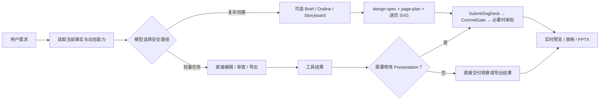
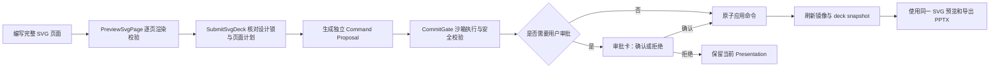

# Agent Harness

[English](./README.en.md) · [文档索引](./docs/README.md) · [Docs (EN)](./docs/README.en.md)


本项目正在从演示文稿应用演进为通用 Agent Harness：提供模型中立执行、工具与插件装配、授权、规范历史及恢复能力。通用内核为 `@agent-harness/core`，诊断日志为独立的 `@agent-harness/logs`；PPT 是后续按公开协议接入的可选业务能力，不是内核定位。

## 现有 Electron/PPT 宿主

现有生产 UI 与旧 Agent 仍是本地优先的演示文稿工作台，尚未切换到新 Harness。下方界面、PPT 功能与使用说明描述这一保留宿主，不代表通用内核已经完成生产接入。宿主的产品名、appId、`.agent-ppt` 数据目录和 `AGENT_PPT_DATA_DIR` 暂时保持兼容。

该宿主适合这些场景：

- 从零生成一套汇报、方案、课程或产品介绍 PPT（SVG-native 整页作者路径）
- 在已有稿件上追加页面、改写文案或统一风格（经聊天中的 Agent / Skill，如 `ppt-beautify`）
- 用本地项目文件追踪 Brief、大纲、分镜、设计规格、导出记录和对话过程
- 研究“AI 如何可靠地参与文档编辑”，包括工具调用、审批、风险控制和视觉质检

## 界面一览

三栏工作台：左侧管理会话与项目文件，中间查看 Agent 过程与审批，右侧实时预览幻灯片。Agent 生成的演示可直接进入放映，预览与导出共用同一套 SVG 视觉源；设置台可管理模型、搜索与联网、提交与审批、用量与费用等。下方样张为默认界面与 Agent 产出示例。

输入框右下角的模型名称同时是思考设置入口：点击先打开思考强度卡片，点击卡片中的模型名称进入模型列表，选中后返回思考卡片而不关闭浮层。滑块使用模型支持的离散档位；“默认”沿用模型配置及现有网关默认值。覆盖值按模型在当前页面内保留，仅用于后续请求，不修改厂商配置，重载页面后重置。模型页按 Esc 返回思考页，再按 Esc 关闭；点击浮层外部直接关闭全部层级。不支持调节的模型显示说明，仍可进入模型列表。当前调节限于已识别的 OpenAI Responses 推理模型，不代表所有兼容端点均已验收；原生 MiMo 仍未接入生产聊天。

<table>
  <tr>
    <td width="50%"><br/><sub>三栏工作台</sub></td>
    <td width="50%"><br/><sub>设置：用量与费用</sub></td>
  </tr>
  <tr>
    <td width="50%"><br/><sub>放映示例：结构化页面</sub></td>
    <td width="50%"><br/><sub>放映示例：深色创意封面</sub></td>
  </tr>
</table>

## 工作台主题定制

工作台外观与幻灯片 DesignSystem **分离**：在 `~/.agent-ppt/themes/<名>/theme.css` 放置主题包即可换肤，不改变 SVG 纸面与 PPTX 导出。下方为内置 Catnip 定制主题的宣传示意（非默认外观）。

<p align="center">
  
</p>

<p align="center"><sub>Catnip：文件夹 CSS 主题示例 · 详见 <a href="./docs/user-manual/css-themes.md">CSS 主题指南</a></sub></p>

## 为什么不一样

**不是固定阶段机，而是模型驱动的工具协作。**

Runtime 向模型提供当前 workspace 事实、可用 Skill 和动态工具。复杂创建任务可以按需经可选上游 Skill（brief / outline / storyboard / research；无专用工具，用 WriteFile 写文件）再锁定 `design/design-spec.json` 与 `slides/page-plan.json` 并写作逐页 SVG；局部编辑、审查或导出可以直接走短路径。只有缺少关键约束、发生高风险变更或用户明确要求比较方案时才暂停交互。

新建整套 PPT 或批量创建页面时，Agent 默认依据受众、主题和交付场景自主选择 Design System 与逐页构图意图，经 `PreviewSvgPage` → `SubmitSvgDeck` 合并为一个 proposal；不会在内容草稿后要求用户再选“标准排版”或“创意装饰”。用户明确只要内容草稿时除外。

**不是让模型直接改文件，而是让模型提交结构化命令。**

所有真实幻灯片修改都会进入 `CommitGate`：先做 schema 校验、沙箱执行、diff 摘要和风险评估，再自动应用或请求用户确认。你能看到模型想改什么，也能拒绝它。

**产品作者路径是 SVG-native：整页 SVG 即预览与导出的共同视觉事实源。**

每一页以经过校验的 `1280 × 720` SVG 作为视觉作者源；预览器与 PPTX 导出消费同一份 markup。导出采用混合策略：去文字后的 SVG 作为底图，标题与正文提升为可编辑文字框；图表与装饰仍留在底图中，不拆成原生 shape/chart。`design-spec` / DesignSystem 锁定整套语气，但不替代页面 SVG。

**不是只保留最终结果，而是保留制作过程。**

本地 workspace 会按任务产生 `brief.md`、`outline.md`、`slides/storyboard.json`、`design/design-spec.json`、`slides/page-plan.json`、`slides/svg/*.svg`、`deck/snapshot.json` 等 artifact；History、checkpoint、transcript 和导出记录由各自的持久化服务维护，便于复盘、调试和继续迭代。

## 工作流一览



## SVG-native 整套生成

新建或重做整套演示文稿时，Agent 可以使用 SVG-native 流程，把每一页完整设计为一份 `1280 × 720` SVG。标题、正文、背景、图表、图片、页码和装饰都由 SVG 自身提供，预览器和导出器不会再补一套可能不一致的视觉样式。

工作区中的关键文件：

- `design/design-spec.json`：沟通契约与 Design System 锁定文件
- `slides/page-plan.json`：页面顺序、文案和逐页叙事意图
- `slides/svg/P01.svg` 等：完整页面视觉源
- `deck/snapshot.json`：用户已经确认并应用的 Presentation 快照

提交链路如下：



这里有三个不同的完成状态：

| 状态 | 含义 |
|---|---|
| SVG 工作文件完成 | 页面源文件已经生成，但尚未改变当前幻灯片 |
| Proposal 已生成 | 替换命令已通过预览和安全校验，正在等待审批 |
| Presentation 已应用 | 命令已经由 `CommandBus` 原子执行，并写入 deck snapshot |

`SubmitSvgDeck` 返回成功只表示 Proposal 已建立，不等于幻灯片已经替换。需要审批时，只有用户在当前提案卡点击确认、应用返回成功，并且右侧镜像重新读取权威 Presentation 后，新的 SVG 页面才算真正生效。

每次 Agent Run 产生的 Proposal 都有独立审批卡。同一对话线程连续生成多套方案时，后一个提案不会继承前一个提案的“已应用”状态。对于旧版本曾错误复用审批卡的会话，应用重新加载时会检测审批动作与提案 Run 不一致的记录，并把该卡恢复为待审核，避免把未执行的替换误报为已完成。

## 你能在应用里做什么

- 用居中的 AI 输入框新建对话，输入自然语言需求开始生成
- 在左侧切换 Agent 工作区、浏览项目文件、搜索历史会话
- 在聊天流里审阅 Brief、大纲、一体化内容与视觉方案，以及必要的工具审批卡
- 查看 Agent 的任务计划、阶段进度、工具调用和子任务执行痕迹
- 在统一的过程区查看思考与工具记录：展开后直接阅读思考正文；手动开合选择不会被后续运行事件覆盖，收起再展开会保留长内容的阅读状态。整轮耗时在消息级展示，团队详情直接列出执行记录。
- 阅读支持表格、任务列表、引用和脚注的 Markdown 回复；新回复以轻微墨迹渐清效果逐步显示，历史消息直接呈现，传输结束后仍会完整显示已接收内容
- 尊重系统“减少动态效果”设置，后台页面暂停逐步显示；文本保持可选择，导出链接可直接打开对应文件夹，回复的视觉收尾不会延长 Agent 的忙碌状态
- 流式结束或过程记录补齐时保持正文实例和版式，不清空重播；切换团队详情后返回主会话继续原来的显示进度
- 上翻立即暂停自动跟随，内容增长和折叠时按阅读锚点补偿位置；通过“回到最新”或主动滚到底部恢复跟随，视口和输入区尺寸变化也会同步贴底
- 打开右侧 PPT 镜像：选页、放映、导出、全屏
- 在 Settings 配置模型（OpenAI / Anthropic 兼容端点）、运行参数、提交与审批策略
- 在 **Settings -> 搜索与联网** 配置 Tavily，让 Agent 可做联网调研
- 在 **Settings -> 用量与费用** 查看 Token、预估费用、任务成功率与按模型分摊
- 在演示偏好中查看/选择本地 Design System 预设（不影响 Agent 写入的 `design-spec`）
- 使用斜杠菜单插入**提示词模板**（只填入输入框，不会直接改 deck）

## 示例指令

```text
帮我做一份 8 页的产品发布会演示，面向企业客户，语气专业但有冲击力。
```

```text
把第 3 页改成左右对比结构，左边讲现状痛点，右边讲我们的解决方案。
```

```text
将整套演示统一成商务蔚蓝主题，并检查文字是否溢出。
```

```text
导出当前演示文稿为 PPTX。
```

## 快速开始

```powershell
npm.cmd install
npm.cmd run dev
```

启动后，在桌面应用里打开 **Settings -> 模型**，配置模型供应商、API Key、端点、超时、输出上限和 fallback 模型。

模型与搜索 API Key 由 Main 的 `agent-configuration` 模块托管，并由 Electron `safeStorage` 的正常后端加密后保存在应用数据目录。Renderer 的持久化设置、`localStorage` 和 Agent run IPC 不含 Secret；Renderer 只在录入时短暂持有 Key，通过配置管理命令明确执行保留、替换或清除操作，不能读取已保存的明文。Linux 的 `basic_text` 后端仍可使用，但会明确标记为 `degraded`。旧版 v1 `localStorage` 中的明文 Key 不会自动导入；升级后需要重新录入，并建议轮换旧 Key。开发环境仍支持 `OPENAI_API_KEY`、`ANTHROPIC_API_KEY` 和 `TAVILY_API_KEY` fallback；环境 Key 只会发送到官方端点，或与对应 `OPENAI_BASE_URL`、`ANTHROPIC_BASE_URL`、`TAVILY_SEARCH_ENDPOINT` 明确绑定的端点。携带凭据的远程端点必须使用 HTTPS，只有 loopback 开发服务可使用 HTTP。开发诊断和 CI 覆盖项可以参考 [.env.example](./.env.example)。

如需让 Agent 联网调研，请在 **Settings -> 搜索与联网** 填写 Tavily API Key。开发环境也可设置 `TAVILY_API_KEY`；搜索结果会以标题、URL 和摘要返回给主 Agent 及任务图 teammate。

用量与费用可在 **Settings -> 用量与费用** 查看；数据保存在本机应用数据目录。

## 常用命令

```powershell
npm.cmd run dev
npm.cmd test
npm.cmd run typecheck
npm.cmd run build
npm.cmd run preview
```

平台打包：

```powershell
npm.cmd run build:win
npm.cmd run build:mac
npm.cmd run build:linux
```

## 技术栈

- Electron + electron-vite
- React 19 + TypeScript
- OpenAI SDK + Anthropic SDK
- pptxgenjs
- Zustand + Zod
- Vitest

## 架构要点

```text
Renderer UI
  ChatWorkspace / PPTMirror / SettingsConsole
        |
        v
Preload IPC boundary
        |
        v
Main process
  Agent runtime -> Gateway -> OpenAI / Anthropic
  Tool registry -> Core tools + Skills
  CommitGate -> CommandBus -> Presentation snapshot
  ProjectFileService -> project artifacts and snapshots
  Conversation DB / Runtime stores -> history, checkpoints, transcripts
        |
        v
PPTX exporter (hybrid: SVG background + editable text)
```

关键模块：

- `src/renderer/`：React 工作台、聊天流、实时 PPT 镜像、设置台；`src/renderer/src/App.tsx` 直接承载公共布局与工作台/设置页切换
  - 布局由容器分配空间：根节点限定窗口高度，主体通过 Flex/Grid 伸展；栏宽由 `useWorkbenchLayout` 的 CSS 变量统一控制，并通过 `ResizeObserver` 按实际容器尺寸适配。内部面板独立滚动，局部响应式使用容器查询；窗口缩小时不会覆盖用户保存的预览宽度。SVG 预览保持 16:9，作者坐标仍为 1280×720。
  - 面板尺寸拖拽统一使用 `src/renderer/src/components/ResizeHandle.tsx`：受控 `value/min/max/onValueChange`，`axis` 选择左右或上下拖动，`direction` 决定增减方向。组件统一管理 idle/hover/dragging/disabled、指针捕获、全局光标和清理；支持方向键（10px）、Home/End。取消保留最后尺寸，禁用、失焦、失去捕获、卸载或边界变化时结束拖拽；尺寸约束和持久化仍由布局层负责。
- `packages/harness/`：私有 npm workspace 包 `@agent-harness/core@0.1.0`，Node >=24、ESM-only；独立生成 JS 与声明，运行时仅依赖 Zod。普通消费方使用包的精确子路径，不直接引用源码或私有 dist 文件；未接入生产 UI，现有 `src/main/agent/` 继续运行。
  - `src/agent/application/agent-application.ts`：公开 `@agent-harness/core/application/agent-application` 的 `createAgentApplication()`；内部默认工厂安装插件、绑定模型、就绪后发布实例，失败回滚。应用关闭先拒绝新创建、打断并排空执行，再释放拥有的资源；调用方不直接使用默认工厂。以下子目录均位于 `src/agent/` 内，不代表可导入路径。
  - `scope/`：Application → Agent → Run 的资源所有权、逆序释放与注册句柄；借用的宿主服务不随 Agent 关闭。
  - `runtime/`：单实例单激活的 `run/resume`、独立事件观察通道、Query 检查点协调，以及模型步/工具步。新请求只接收用户消息，不强制转换为业务 Task；Step 在提交边界更新快照。
  - `model/`：模型中立消息、能力声明、私有重放状态、按 provider ID 注册的模型工厂；增加厂商不在循环中新增分支。
  - `tools/`：注册、输入/输出校验、宿主强制授权、审批与续传；业务依赖由插件闭包捕获，业务结果、模型内容、展示投影分别持久化。
  - `session/`：历史条件追加与幂等批次收据、版本化检查点、写租约、世代围栏和显式接管；`extensions/`：插件安装、模型/工具/提示词贡献及作用域清理。
- `src/main/agent-host/`：新内核的宿主适配，不从内核反向导入业务。
  - `createSqliteAgentStores(filePath)` 使用独立 SQLite 表持久保存历史、批次收据和检查点，不迁移或替换旧生产数据库。独立 Node 运行需要支持 `node:sqlite` 的版本（Node 22.13+；项目开发使用 Node 24）。
  - `createAgentHost()` 在独立数据库中绑定会话、规范工作目录、工具模式、模型连接摘要、执行定义、插件版本和步数预算；`prepareConfiguredModel()` 只接受已签发且已接入的原生适配器，当前为 `mimo-token-plan-cn`。其他配置在凭据解析前以 `MODEL_ADAPTER_UNSUPPORTED` 拒绝，不再提供 Gateway 桥接或备用模型回退。
- `src/models/`：`createMimoTokenPlanCN()` 提供固定中国 Token Plan 连接的原生 Responses、模型发现、真实流式、工具和版本化私有重放，不依赖旧 Gateway。已知对话能力覆盖 `mimo-v2.6-flash`、`mimo-v2.6-pro`、`mimo-v2.6-pro-ultraspeed`；其他发现项显示未支持，不按名称猜能力。
- `src/tools/`：基础工具 `read`、`write`、`edit`、`glob`、`grep` 的约定、默认实现与装配。`createTools({ workspaceRoot, mode })` 返回插件，默认 `read-only`；`read-write` 再安装写入和编辑工具，不自行批准调用。各同名文件拥有输入/输出 schema、工具定义与模型投影；内部共享路径守卫、稳定快照、观察记录、有界搜索与原子发布，不依赖 PPT 或当前宿主。
  - `read` 按 UTF-16 单元分页（默认最多 4000 单元），后续窗口必须携带 `expectedVersion`；完整观察同一文件版本后才能替换或编辑。`write` 显式区分 `create` 与带版本的 `replace`，`edit` 使用精确文本匹配。读取记录按安装隔离，重启丢失记录后要求重新读取。
  - `glob` 支持 `*`、`**`、`?`；`grep` 只做字面量逐行搜索，不执行正则或 Shell。遍历、文件字节数、搜索总字节数与结果都有上限，未完成扫描明确报告 `truncated`，二进制/过大文件明确列为跳过；搜索不授予修改资格。
  - `internal/` 中迁出的安全读写与原子持久化原语也继续服务旧生产调用方，没有旧路径别名；旧 PPT 工具名称和业务提交链路未切换。原子 I/O 限制只由新工具显式启用，不对旧持久化调用新增全局限制。
  - 可用 `createTools(options, logs.getLogger("tools"))` 注入窄 Logger；省略时不创建日志实例。执行日志关联当前 Agent/Thread/Query/Run 与工具调用 ID，只记录工具名、状态、影响、耗时和分类错误码，不采集路径、正文、搜索词或编辑载荷；审批未通过时不记录“已执行”。开发宿主已注入 Logger；工具释放不关闭借用的日志系统。
- `packages/logs/`：私有 workspace 包 `@agent-harness/logs@0.1.0`，Node >=24、ESM-only、无运行依赖，与 Harness 并列且互不依赖。通过 `@agent-harness/logs/logs` 的 `createLogs()` 创建通用实例，通过 `@agent-harness/logs/node-logs` 的 `createNodeLogs()` 使用 stderr、按日 JSONL、近期环形缓冲与管理；窄协议由 `@agent-harness/logs/log-contract` 提供，不导出内部路径。尚未替换旧 logger、Harness 埋点或现有日志面板。
  - Logger 只负责记录与绑定上下文；输出配置、清理与关闭归宿主。记录先做有界快照和凭据遮蔽再分发，单个输出失败不阻止其他输出，日志不能替代规范历史或检查点。
  - 文件写入显式根下的 `<instanceId>/diagnostic-YYYY-MM-DD.jsonl`，日期使用 UTC；保留与清理仅处理当前实例的托管旧日文件，不读写旧日志、应用设置或 Gateway 归档。
  - `npm run build:packages` 构建 Harness 与 logs；应用/测试/开发入口在消费前构建，dev 等待两个包首次 emit 并持续监听。`npm run verify:logs-package` 验证真实 tarball 的仓库外独立安装、原生 Node 行为及通用声明闭包；日志包不管理应用配置持久化，不提供全局单例或自动服务发现。
- `src/main/agent/`：Agent runtime、工具注册、模型网关、审批门禁、子任务
- `src/main/agent-configuration/`：通过 `createAgentConfiguration()` 提供 `management` 和 `runtime` 两套操作，不公开 Store、凭据绑定或解密接口。
  - Renderer 只使用管理 IPC：读取无密钥快照、初始化、保存/删除厂商、保存执行偏好、修改搜索凭据、发现远程模型。厂商保存完成后才发布已提交状态；历史浏览器配置只读迁移，Main 初始化成功后清理。
  - 运行请求只按 `modelId` 选模：`loadExecutionPlan(modelId)` 固化本次模型和执行偏好，受理后 `resolveRuntime(plan)` 读取匹配凭据并应用环境回退；网关和搜索服务不再自行读取环境配置。缺失的可选搜索/备用密钥不提前阻塞主模型。
  - 已保存连接的模型发现仅接收 `vendorId`，地址与密钥由 Main 决定；连接草稿必须提供临时 Key。修改协议或地址不会将旧 Key 重新绑定到新连接。
  - 保留 `agent-settings.json`、`credentials.v2.json` 及原有迁移和凭据锁；整项管理操作串行协调，但不承诺两个文件之间的原子事务。模块外只能导入公共入口。
- `src/design-system/`：DesignSystemV2 schema、预设与解析
- `src/shared/`：演示文稿模型、命令模型、会话与 IPC 类型
- `src/main/project/`：本地项目沙箱、产物读写、diff 和依赖状态
- `src/main/storage/`：SQLite 数据访问层，按数据对象目录内聚（如 `session/`、`checkpoint/`、`ppt-job/`），目录内按需放置 DO、DTO、Mapper。
  - `init(connection)` 集中管理表、索引、连接配置和已有检查点字段迁移，可重复调用且保留数据。
  - `createStorage(filePath)` 创建并初始化单个连接，装配所有 Mapper，提供同步 `transaction()` 和 `close()`；业务不接触原始连接或 SQL。借用同一 Storage 的业务仓库不关闭它。
  - Mapper 负责参数化 SQL、记录映射、具名检索和条件写入；运行状态、租约接管、幂等解释、产物关联校验、失效传播及恢复规则仍由业务服务负责。
  - 会话与 PPT 生命周期共享连接和嵌套 SAVEPOINT；数据库提交成功后才发布内存状态、通知及工作区镜像。JSON 配置、项目文件和文件型 Blob 存储保持原有实现，未为闲置的 `blobs` 表新增 CRUD。
- `src/main/deck/`：缩略图、导出历史、PPTX 导出服务
- `skills/`：核心创建 `ppt-workflow` → `ppt-design` → `ppt-design-layout` → `ppt-build`；短路径 `ppt-edit` / `ppt-beautify` / `ppt-review` / `ppt-export`；可选上游 Skill（`ppt-brief` / `ppt-outline` / `ppt-storyboard` / `ppt-research`）仅知识包，经 ReadFile/WriteFile 写入，非 lifecycle 硬锁
- `tests/`：Agent、导出、上下文压缩、工具审批和项目产物测试

### 通用 Agent 的生命周期约定

宿主显式装配 `AgentServices`（模型工厂、授权策略、历史和检查点），调用 `createAgentApplication(services)`，通过 `application.agents.create()` 提供定义、模型选择、步数预算和插件。业务工具在插件 `setup()` 中注册；内核只调用协议，不读取 Presentation、workspace 服务或厂商配置。关闭顺序为先 `application.close()`，再关闭宿主拥有的存储和连接。

需要固定 Thread 并校验宿主恢复边界时，从 `@agent-harness/core/session-host` 导入 `createSessionHost({ services, agent, threadId, binding })`：先等待必需的 `binding.ensure()`，再从公开 Application 创建 Agent。定义、模型、插件和授权均显式提供；`plugins: []` 不依赖工作区或 Electron。SessionHost 只拥有自己的 Application，关闭后不释放借用端口，`resume()` 不接受接管租约。当前 Electron 组合根通过 `workspace-configuration.ts` 选择文件能力、指令和审批策略，继续保存原 v2 绑定；CLI 使用方式与生产 PPT 链路不变。

完整包子路径见 [M2-B 清单](docs/next-steps/m2-b-package-boundary.md#m2-b-独立包边界与实际消费)，当前名称与切换证据见[通用包身份修正](docs/next-steps/package-identities.md#通用包身份修正)。`PluginContext.scope` 只提供 `PluginScope.signal/own()`，不暴露内部资源树的创建与关闭；错误使用 `@agent-harness/core/protocol-errors` 的同一 `AgentError`，无损 JSON 快照与值比较由 `@agent-harness/core/protocol-values` 提供。`ToolCompletion` 是事件/存储公共数据，`ToolExecutor` 与执行管线仍为内部协议。没有根导出、通配导出、源码别名或旧包名兼容层。

`npm run check:agent-boundaries` 在包自身、node/web 三个 TypeScript 项目中校验源码与声明闭包、反向依赖、精确子路径及实际解析目标；只有指定行为测试可白盒导入同一 dist 实体。三斜线引用、继承和泛型条件类型的来源也参与检查。`typecheck` 和 `build` 自动包含该检查；它不是恶意插件沙箱。

安装依赖会建立 workspace 链接；`npm run build:harness` 独立构建包。应用构建、测试、开发 CLI 和 preview 在消费前构建包，`npm run dev` 等待首次成功 emit 后持续监听包源码及 Main 使用的 JS 产物。`npm run verify:harness-package` 打包 tarball，在仓库外离线安装并验证原生 Node 行为及 NodeNext/Bundler 声明消费；`npm run test:integration:harness` 运行现有两个真实 Electron CLI 集成文件。本轮未发布 npm registry，也未切换生产 UI/PPT。

- 同一 Agent 同时只接受一次 `run()` 或 `resume()`，不隐式排队。`handle.events` 仅供单消费者观察；不消费或退出事件流都不会取消执行。
- `waiting` 会保存交互和续传数据，结束本次 Run 并释放租约。回答只能匹配持久化交互，恢复必须提供新的 `runId`；不接收前端重建的执行快照。线程有未完成 Query 时，新请求不能越过它。
- 用户取消为 `cancelled`；实例/应用关闭为可恢复的 `interrupted`。已保存的等待保持为 `waiting`。取消不会撤销外部副作用。
- 历史与检查点不假设共享事务：先保存追加意图，再按稳定批次 ID 提交历史。崩溃后先对账；工具已派发或回答已消费、但没有持久结果时记为 `unknown`，不自动重做副作用。这不承诺外部操作恰好一次。
- 模型流必须有权威完成响应，临时增量不作为规范历史；截断、缺失完成响应、存储失败不会被报告为成功。定义、插件或续传契约改变时必须升级相应版本。

新链路的回归入口为 `tests/base-tools.test.ts`、`tests/mimo-token-plan-cn.test.ts` 与 `tests/general-agent-*.test.ts`，覆盖真实文件、SQLite、原生 SDK 到本地 HTTP/SSE 的传输、生命周期、工具授权与恢复边界。远程厂商推理需要另外配置凭据；这些本地验证不代表已经完成远程 LLM 或生产 UI 的切换验证。

### 独立通用 Agent 开发入口

启动循环对话，或使用 `--prompt` 执行一次任务：

```powershell
npm.cmd run agent:dev
npm.cmd run agent:dev -- --prompt "读取 notes.txt 并概括内容"
```

只保留 `--prompt`、`--help`（`-h`）启动参数。工作区为启动命令所在目录，不需要手填模型或会话 ID。没有可用的 CLI 默认模型时自动进入逐行向导：选择厂商/已有连接 → 输入 API Key → 选择该厂商的模型 → 保存连接与 CLI 默认模型。已有连接可直接选择已保存模型或发现远程模型，新增连接先发现、选定后保存。配置完成后继续原 `--prompt`，或进入循环；非交互输入缺少默认模型时明确退出，不把管道内容当作凭据。

API Key 按当前交互约定明文回显，会留在终端滚动记录中；不另写明文配置，不记录到执行历史或诊断，保存仍经过现有配置模块与加密凭据存储。“本地配置就绪”不表示远程鉴权、额度或生成已验证。向导仅显示已接入的厂商，当前为“MiMo Token Plan 中国”，固定使用 `https://token-plan-cn.xiaomimimo.com/v1`；其他连接（包括同 URL 的 custom）不会自动升级，也不回退旧 Gateway。新入口不创建窗口、不启动 Renderer 或 PPT 服务。

循环内的操作：

| 命令 | 行为 |
| --- | --- |
| `/model` | 按厂商选择/配置模型，保存 CLI 默认选择；确认后新建会话，旧历史保留 |
| `/new` | 按当前模型和工具模式新建会话 |
| `/resume` | 选择当前工作区的历史会话，加载公开文本和原绑定；有未完成 Query 时恢复它 |
| `/tools` | 选择只读或读写；实际变更需确认并新建会话，不改写旧绑定 |
| `/help`、`/exit` | 显示帮助、退出 |

默认只读，安装 `read/glob/grep`；循环中使用 `/tools` 选择读写后增加 `write/edit`。两种模式下，工作区内 `read/glob/grep` 均自动允许；`write/edit` 仍逐次要求 `yes` / `no` / `cancel`，未启用读写模式时不可调用。自动允许不绕过路径、UTF-8、大小或版本校验：只允许工作目录内的常规 UTF-8 文本文件，默认单文件最多 64 KiB，超限不截断；分页读取、发现和搜索不创建目录、锁或恢复旧写入事务，也不初始化 PPT 项目产物。

既有真实厂商证据仍限于实际 CN `mimo-v2.6-flash` 的 `high` 问答、流式取消、文件审批与新进程恢复；本次向导和命令切换的验证使用真实 Electron/safeStorage 与本地 HTTP/SSE，不代表增加了 Pro、其他档位或生产聊天的远程验收。具体既有证据见 [MiMo 实施记录](docs/mimo-token-plan-cn.md#11-实施与验收记录2026-10-31)。

执行事实与结果保留逐行 JSON，包含 thread/query/run ID、公开事实和最终文本；向导、菜单、输入提示和终端回显为可读文本。不打印原始 SDK 异常、完整工具结果、reasoning 或私有重放状态。新链路不加载旧 Gateway、旧 logger 或 Gateway IO 归档。Node 启动器拥有输入，通过父子 IPC 传入 Electron，并传递启动目录和终端信息，避免 Windows Main 丢失标准输入。

宿主拥有 `NodeLogs`，模型与 tools 仅借用 Logger；按 Agent 排空 → provider → stores → Logs 顺序关闭。新诊断写入配置根下 `agent-development-logs/<instanceId>/diagnostic-YYYY-MM-DD.jsonl`，不记录模型正文、工具载荷或凭据，且遮蔽 `tp-` / `ttp-` 形态。模型日志通过 `ModelCallContext` 关联 Run/request/step，不将诊断上下文写进请求体或检查点。

MiMo 不做应用层或 SDK 重试（`maxRetries=0`），不换域名或降级；Node Fetch 仍可能按 HTTP 规范内部重传 421，不能承诺底层绝无重传。

写入等待审批时关闭输入（EOF）会保留 `waiting`。重启进入循环后输入 `/resume`，按编号选择原会话；无需手工携带 Thread 或 Query ID。权限调整前已经持久化的只读审批仍需回答一次，不会被新策略自动批准；后续只读调用不再询问。

恢复会重新展示已存储的交互，再接收回答；每次激活生成新 `runId`。Ctrl+C 取消当前请求（退出码 130）；正常关闭中断执行，已保存等待不丢失。完成/等待退出码为 0，执行失败为 1，参数错误为 2，中断为 143；退出码 0 不代表 `waiting` 已完成，应检查结果的 `status`。

配置根沿用 `getApplicationDataRoot()`：默认 `~/.agent-ppt`，可通过 `AGENT_PPT_DATA_DIR` 指向独立开发配置。CLI 首次设置会初始化配置，默认模型保存在 `agent-settings.json` 的 `cli.defaultModelId`，不改变生产 UI 当前选择。历史、检查点与宿主绑定保存在该根目录的 `agent-development.sqlite`，不写生产会话库。恢复加载原模型和工具模式，精确匹配连接指纹，保持原 Agent、工作目录、定义/插件版本和预算；不会用当前默认值覆盖原绑定。现有 v2 绑定继续支持，不靠原生模型名称猜配置 ID。同连接密钥轮换允许，连接或目录变化需新建会话。旧版 `ReadFile` 绑定仍明确拒绝。异常强杀留下的活跃租约不自动接管。

除 `npm run typecheck`、`npm test` 外，可单独运行真实 Electron/加密凭据/本地 HTTP 回归（不需要远程厂商 Key；Linux 需要图形环境）：

```powershell
npx.cmd vitest run tests/general-agent-development-cli.integration.test.ts tests/mimo-development-cli.integration.test.ts
```

## 本地文件与隐私

Agent PPT 的默认运行方式是本地优先：

- 项目产物与 deck snapshot 保存在 workspace；History、checkpoint、transcript、用量统计和部分设置也可能保存在本机应用数据目录
- API Key 由 Main 的 Electron `safeStorage` 凭据存储托管，不保存在 Renderer `localStorage`，也不随 Agent run IPC 传递；开发环境变量 fallback 仍受支持
- 模型只能通过已注册工具和结构化命令影响演示文稿
- 高风险或不可自动应用的变更会要求用户审批

## 文档

- [docs/README.md](./docs/README.md)：文档索引
- [架构总览](./docs/architecture/overview.md)：现行分层、数据流与状态边界
- [工程能力地图](./docs/architecture/engineering-capabilities.md)：当前能力落点、成熟度与缺口
- [Query 与 Agent Loop](./docs/agent/query.md)：QueryParams、State、Workspace、事件和恢复
- [Tools 与文件操作](./docs/agent/tools.md)：动态能力、权限、Read/Write/Edit 契约
- [System Prompt 与 Context](./docs/agent/system-context.md)：Section Registry 与稳定/动态分区
- [Presentation 工作流](./docs/presentation/workflow.md)：Artifact、Proposal、CommitGate 与交付状态

## 当前状态

当前重点是通用 Harness 的模块边界与实际宿主消费：已独立通用执行和日志包，模型及工具能力继续按明确边界演进。现有 PPT 工作台保持运行，但不作为内核通用性的标准；生产切换、业务插件接入及尚未执行的可靠性计划分别验收，见项目规划。
