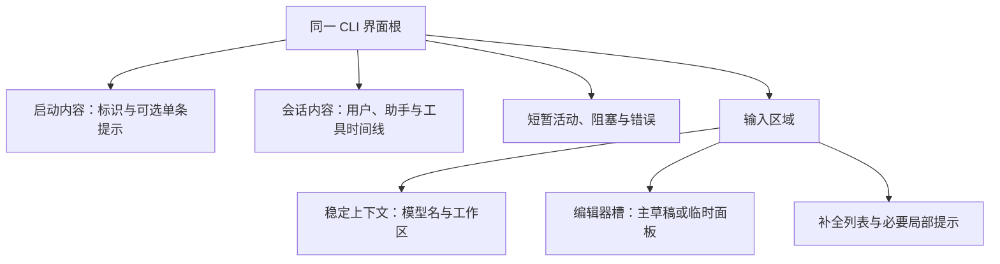
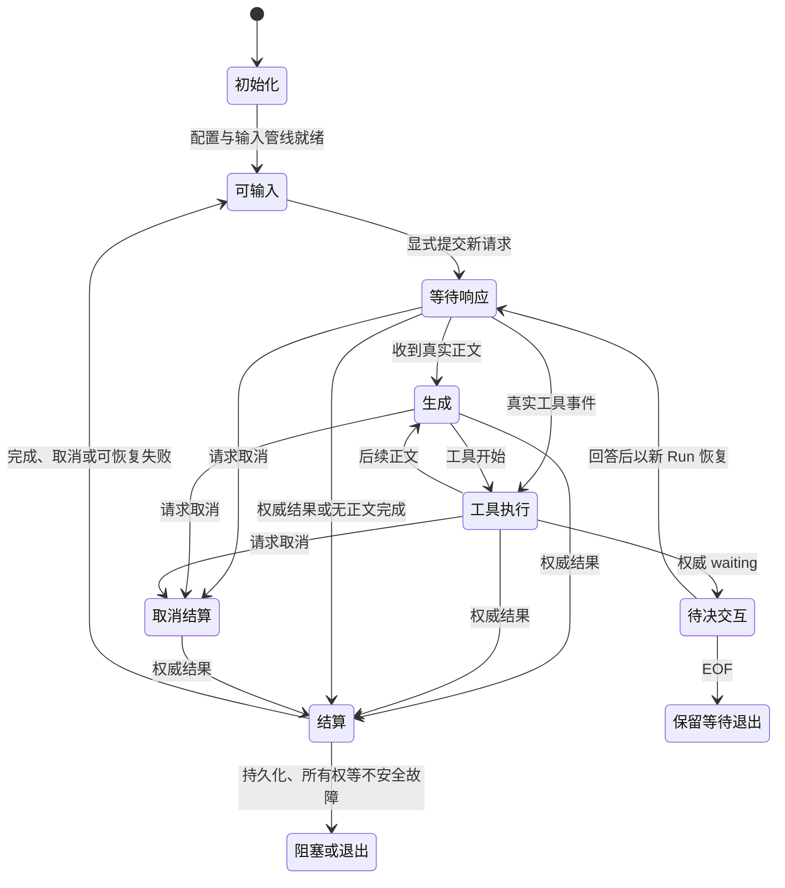

# CLI 前端整体交互方案

状态：F0–F4 已实施并完成本地技术验收；具体证据和限制见[执行记录](next-steps.md#7-交付和证据记录)。用户对默认风格与信息密度的认可仍需单独复核，不以测试通过替代。

## 1. 定位与范围

CLI 前端由 `cli/terminal/` 和 `cli/commands/` 承担，`cli/main.ts` 是启动入口，`cli/host/` 提供宿主端口及适配。本目录是 CLI 前端文档，不是桌面 React UI、Harness 内核或宿主存储的设计中心。

本次目标：启动到对话连续、输入归属明确、执行反馈及时、状态展示克制、会话切换无残留。复用现有 inline TUI、单输入 owner、列宽/字素处理、真实增量和公开协议，不换 React/Ink，不另建通用组件框架或执行状态机。

不包含 steering/follow-up、隐式排队、自动重试、后台续跑、子 Agent、上下文压缩、鼠标、附件、默认全屏备用屏幕，以及数据库迁移、生产桌面 UI 切换和 PPT 接入。

本轮范围、完成门槛及实际证据见[执行计划与记录](next-steps.md)；前序实现和验收保留在[历史终端方案](../../docs/next-steps/cli-terminal.md)。

## 2. 调研事实与问题基线

### 2.1 OMP 的实际机制

参考工作副本：`E:/Coding/oh-my-pi`。以下为源码调查，不是完整参考 CLI 的运行验收。行号仅用于定位本次阅读版本，不是长期依赖契约。

| 机制 | 事实及主要定位 |
| --- | --- |
| 启动预绘 | 满足条件时先创建真实 Composer、Editor 和可选缓存状态，再加载重模块；并非所有 argv 都经过预绘。`packages/coding-agent/src/cli.ts:80–98,526–574`、`modes/startup-composer.ts:69–134` |
| 输入交接 | 启动与 InteractiveMode 复用同一编辑器；输出接管、raw 输入启用、允许提交是不同阶段。`ComposerLease.adopt()` 不 stop/start；订阅和提交处理器就绪后才解除 `disableSubmit`。`modes/startup-composer.ts:43–65`、`modes/interactive-mode.ts:2896–2920` |
| 页面组织 | 首页不是独立路由；同一树挂载 header、transcript、working/error、editor slot、status。运行树装配保留 header。`modes/interactive-mode.ts:2458–2539`、`packages/tui/src/prompt/composer.ts:1263–1283` |
| 欢迎内容 | 不因首次发送立即卸载；动画结束后，在内容超屏或 flush 时先退入终端历史。quiet 才卸载当前组件，且不自动擦除已经输出的历史。`prompt/composer.ts:1025–1049,1180–1189,1316–1326` |
| 提交反馈 | 先显示乐观用户消息和 Working，用后续事件对账；真实 assistant `message_start` 才创建正文块。`modes/interactive-mode.ts:3892–3949`、`controllers/event-controller.ts:1342–1362` |
| 流式与工具 | 累计快照更新同一正文块，工具按调用 ID 原位更新；平滑显字只消费已经收到的内容。消息结束不等于整轮结束。`controllers/event-controller.ts:1570–1725,1797–1964,1968–2283,2537–2594` |
| 面板与焦点 | selector 临时替换 editor slot，完成后恢复原组件和焦点；全屏 overlay 才借用备用屏幕。`controllers/selector-controller.ts:305–325`、`packages/tui/src/tui.ts:1311–1372,3902–4003` |
| 运行中输入 | OMP 支持 steering/follow-up 和队列，Ctrl+C 与 Esc 也有不同语义。这些不是纯视觉能力，不在本项目照搬范围内。`controllers/input-controller.ts:1335–1463,1661–1707,2043–2185` |

表中 `modes/` 相对 `packages/coding-agent/src/`，`controllers/` 相对该目录的 `modes/`，`prompt/` 相对 `packages/tui/src/`。

借鉴的是稳定界面身份、分阶段 readiness、原位更新和焦点归还；不复制 OMP 的完整扩展生态、输入队列、授权缓存或终端协议栈。尤其不能照搬其 cooked 输入预绘来处理本项目的秘密输入：安全输入仍须由现有 raw owner 隐藏。

### 2.2 实施前问题基线（保留历史对照）

| 实施前行为 | 位置及影响 |
| --- | --- |
| 正常空闲仍像诊断界面 | [status-line.ts](../terminal/status-line.ts) 拼接状态、连接标签、工具模式和路径；[terminal-controller.ts](../terminal/terminal-controller.ts) 持续提供教学文案 |
| 首帧与首页不是连续布局 | 欢迎区只在 ready idle 等条件满足时插入；初始化时先显示一组状态、输入及等待提示 |
| 区域顺序随输入组件有无变化 | [interactive-renderer.ts](../terminal/interactive-renderer.ts) 在有 composer 时将主上下文放上方，无 composer 时放到面板下方；缺少稳定槽位 |
| 工具多处显示 | started/completed 各追加历史，`latestTool` 又绘制活动卡；完成后仍有重复展示 |
| 会话展示缺少重置边界 | renderer 的 `hasConversation`、工具跟踪等属于实例级状态；绑定新 Thread 没有统一的展示交接 |
| 完成正文分次撤换 | controller 先清 preview，再投影最终结果；存在中间空帧窗口，是否肉眼闪烁取决于实际时序 |
| 故障不分级 | 执行结果 failed 请求停止进程，尚未区分可继续交互的模型失败与必须阻塞的持久化/所有权故障 |

已有单输入 owner、输入世代防护、真实预览、历史与 viewport 分离、审批和恢复端口继续保留。不是推倒重写。

实施前调查曾运行构建版 renderer，在真实 Windows TTY 用原生字符单元观察九个阶段：启动、首页、补全、selector、等待首字、流式、工具、完成及新会话绑定。观察到启动输入行从第 2 行变为第 9 行、工具重复展示、组件级切换后的活动卡残留。该演练使用受控 view/record，不是完整 controller、模型或审批端到端证据。临时文件已移除。OMP 完整 CLI 未运行：独立 `bun` 命令不可用。

### 2.3 当前实现

- `TerminalView.scene` 区分 startup/home/conversation；controller 保存展示上下文快照。`bindSession` 一次交接目标上下文与历史，失败保留原绑定，显式恢复不闪启动欢迎。
- `beginRun` 绑定完整观察身份；同 Query 恢复使用新 Run，保留已知工具影响并过滤旧 Run。终端历史和规范持久状态仍相互独立。
- `projectTerminalSettlement` 只投影公开文本位置和工具 callId；`settle` 在同一 writer 批次内撤预览、按规范顺序结算正文/工具并重绘，不改 JSONL record 字段。
- 工具使用完整 invocation identity，状态原位更新；重复 callId 按当前 Query 中已观察调用的顺序匹配，不猜 previewId。未能匹配规范位置的工具明确归档为位置未确认的观察记录，影响不丢失。
- 上下文、活动、提示分别投影；正常空闲只有模型名/路径与输入。欢迎块一次退休，工具简短显示；确认/审批只有超出视口时才归档完整副本，避免正常情况下重复堆叠。
- 权威模型失败仅对白名单公共错误码允许交互继续，新输入创建新 Query；未知、协议、持久化/所有权和 rejected completion 仍安全停止。one-shot 失败保持非 0，不自动重试。
- 新建与恢复使用不同确认后果；原审批、取消、EOF waiting、秘密输入和主草稿契约不变。退出等待时保留必要的等待说明，不把尚未完成的预览归为成功。

## 3. 状态与所有权

### 3.1 三个正交维度

| 维度 | 来源与职责 | 不得承担的职责 |
| --- | --- | --- |
| 执行 | 现有 `TerminalPhase`、权威结果、待决交互及宿主活动；说明是否可执行、是否等待/取消/结算 | 不决定整个页面重建，不根据 loader 是否存在判断 Run 真值 |
| 场景 | 当前绑定 Thread、已装载历史、当前请求；区分空会话、已有对话、配置过程 | 不使用进程级“曾经聊过”布尔值代替会话身份 |
| 焦点 | 现有 composer、补全、selector、text/secret、interaction 及输入 generation | 不改变 Query 结果，不凭焦点文案推断执行状态 |

在 CLI 自有视图契约内具名表达这些信息；不要求复制一套 Core 状态枚举或新增全局容器。`phase` 和结果仍是执行真值，局部 UI 只拥有展示和焦点。

### 3.2 生命周期边界

- Application：终端输入/输出所有者和基础显示资源；退出负责恢复 raw、paste、cursor 等状态。
- 绑定 Thread：会话场景、显示历史及相关工具索引。绑定成功后才切换，失败保留原会话与草稿。
- Query/Run：活动正文、工具状态、等待及取消展示，按完整身份隔离；恢复 Query 使用新 runId，旧 Run 的迟到更新不得覆盖新视图。
- 面板：保存并归还合法焦点及主草稿；输入世代淘汰旧按键。秘密输入不复制到主草稿或展示历史。

## 4. 稳定的界面区域

以下是逻辑区域，不是新增类体系，也不承诺输入区固定在屏幕某一行。

### 4.1 正常空闲：只保留有用上下文与输入

- 常驻模型名与工作区，模型用已有结构化 `modelName`，不解析“厂商 / 模型”标签。
- 删除常驻“就绪”、厂商/套餐、工具模式前缀和 Enter/Alt+Enter 教学。
- 厂商留在模型目录分组和 `/status`；能力留在 `/tools`、`/status` 及必要的权限变更反馈。
- 上下文是编辑器的稳定上沿；selector 开合不把它挪到整个面板下方。
- 窄屏先缩路径及次要字段，不能挤掉当前操作或唯一错误。长路径优先保留可辨认尾部，按实际列宽预算，不靠字段逐项换行。
- 细分隔线只承担视觉分隔，不伪造上下文占比。无权威来源时不增加费用、token、分支等统计或启动扫描。

### 4.2 欢迎区与启动

- 第一帧与 ready 后使用同一根布局、同一主编辑器；启动完成不再突然插入一整块欢迎内容。
- 初始化可编辑草稿但禁止提交；提前 Enter 不清空草稿、不排队、不触发模型。初次配置使用现有 setup 端口，需要时由明确配置场景接走焦点，不伪造 ready 或模型信息。
- 欢迎内容按启动展示块管理，发送时不突然删除，随正文自然滚走。可在稳定边界一次转入终端历史，不要求复制 OMP 完整的 capacity-retirement 协议。
- 初始化时只显示一条必要的活动提示，不同时堆“暂不能发送”“等待当前操作”“草稿不排队”。短暂阶段可以合并刷新，不能掩盖长期阻塞。
- 初次接管仍清理启动前旧屏和旧滚动缓冲；普通刷新不重复清屏。不为首页/聊天切换启用备用屏幕。

### 4.3 活动态、补全和面板

- 活动行独立于模型/路径上下文，按真实活动显示等待响应、生成、工具执行、等待审批或取消结算，不把同一含义在正文、状态行和脚注重复显示。
- 非阻塞活动通知直接参考 OMP Loader 与 classic shimmer：活动指示符每 80ms 推进，文字以灰色为底、浅紫色加粗为峰值；六列半宽的余弦扫光按 30 列/秒移动，30fps 请求刷新。按实际经过时间推进，长短通知使用同一速度；渲染前为指示符预留两列，字素与输入光标不受影响。无色、plain/print/JSONL、等待审批、选择器、安全输入及阻塞错误保持静态；结算、绑定切换和关闭停止旧动画。下一帧在当前写出完成后安排，不积压；输出故障走既有端口。当前固定浅紫 ANSI 256 色，不宣称已接入 OMP 的主题系统。
- `/` 补全在开放式输入区下方，直接参考 OMP SelectList：命令列在 12–32 列间自适应，选中项整行强调、未选中说明低对比；说明最多两行，续行按说明列缩进，更长内容省略。窄到无法保留可读说明时只显示命令；最多十个视觉行，按整项围绕选中候选滚动，右侧滑块反映视觉行位置。移除原来的计数/“查看更多命令”和常驻按键教学，不另起搜索输入或边框。Enter/Tab 仍仅接受候选，再次显式提交才执行；Esc 关闭并保留草稿。
- `/model` 对照 OMP `model-hub.ts` / `hub-frame.ts` / `model-browser.ts` 使用独立全屏 Models 面板：进入备用屏幕，退出恢复聊天主屏、历史、草稿与光标，不再把目录嵌进聊天编辑区。完整圆角外框、贯穿主体的连接侧栏、右侧范围标题及独立搜索区、固定配置动作/两行详情/底部按键栏占满安全视口；模型只有一项或搜索为空也不缩成短列表。宽度不足 80 列时按焦点显示单栏；低于 TUI 最小尺寸时退出备用屏幕并使用原编号选择，恢复尺寸后重新打开面板。侧栏显示真实配置计数，模型行显示连接/模型名和当前/不可用标记；仅强调焦点所在栏，选择跟随滚动。聊天状态栏、上下文未知、欢迎正文及旧 notice 不进入面板；模型状态只在选中项详情表达，错误反馈留在固定位置。保留原有两级 Esc、搜索、切换确认及配置安全边界，不添加未实现的角色、分类、价格或上下文统计。面板关闭及进程正常退出归还主屏；期间追加的日志在离开后归档到主屏，不写进目录。
- `/model` 与 `/connect` 共用同一面板；`/connect` 只把焦点放到连接侧栏。侧栏同时列出已有连接（包括零模型连接）及 MiMo Token Plan 中国、OpenAI Responses、OpenAI Chat Completions 兼容、Anthropic Messages 的新建入口；公共配置接口接收明确连接目标，不再重复弹出厂商选择页。选中已有连接可在右区配置或发现模型，选中新建入口直接在右区完成地址、隐藏 Key、模型发现和选择；切换会话确认也留在面板内。取消配置或切换返回目录，已保存配置不回滚，当前绑定不隐式改变。配置提示不归档到聊天历史，隐藏 Key 不显示内容或长度；配置编辑器与控制器共享正文列宽，窄屏仍保留确认输入的最后一行。
- 选中新建连接入口但尚未进入配置时，右区只保留连接标题，其余留白；不重复展示类型、名称、流程说明或“Enter 开始配置”。进入后只显示当前实际配置字段，按键说明统一留在底栏。
- 运行中可以改下一份草稿，但 Enter 不消费草稿、不排队；不常驻反复教学，完整规则放 `/help`、`/hotkeys`。
- 普通 selector 可以临时占用 editor slot，不能替换会话内容或创建新的主草稿所有者；关闭恢复原对象、字素光标和合法焦点。
- 正常取消模型选择或连接配置静默返回，保留当前会话与草稿，不新增取消 notice。配置错误仍保留阻塞反馈，实际保存成功仍报告保存结果。
- 审批优先保证安全摘要和选项可达；没有显式选择不批准，Esc 不隐式拒绝，拒绝、取消、保持 waiting/EOF 是不同操作。窄屏可让非关键区域让位，不能以保持布局为由裁掉风险或返回路径。
- 焦点处理一层一次；同一次 Esc 不同时关补全和取消执行。详情、主输入、审批及选择器沿用本项目契约，不复制 OMP 的双击退出或“打字拒绝并 steering”。

### 4.4 对话消息块

- 交互 TUI 不再用 `You:` 或恢复历史的 `Assistant:` 前缀区分角色。用户消息使用低对比深色底和配套浅色前景、左右内边距、上下留白；助手正文使用终端默认背景与独立块间距。
- 用户块使用配对前景/背景，Markdown 样式只作用于助手正文；每个样式片段独立复原，不能染到工具、上下文或下一次输入。当前不是自动跟随所有终端主题的设计系统。
- 关闭颜色时不输出颜色 SGR，保留留白及用户块左侧细竖线，不能仅靠颜色识别角色。文本按扣除内边距后的列宽换行，保留终端安全末列。
- 实时发送和恢复历史复用 `message-block.ts`；流式与最终助手正文采用同一外间距。间距不改变规范消息、文本去重身份、工具顺序或存储内容。
- 助手正文参考 OMP 的语法节点渲染方式，由 `terminal-markdown.ts` 复用现有 Micromark 引擎；支持标题、粗体/斜体/删除线、行内代码、引用、有序/无序/任务列表及嵌套悬挂缩进。链接显示标签和可复制地址，不发 OSC 超链接；HTML 仅作文字。
- GFM 表格按终端列宽分配单元格、保留列对齐并折行；窄到无法容纳边框和完整字素时回退安全的 Markdown 文字。宽度只度量正文，不把样式转义计入列数。
- 流式、最终与恢复历史复用同一渲染路径。代码块保留围栏和正文，不为未闭合流式代码凭空添加结束围栏；视口按字素硬换行，归档代码行保留 Tab 和空格并交给终端软换行。当前代码使用统一前景色，不是按语言 token 的语法高亮。
- 用户文本仍走控制字符防护、字素和 Tab 展开；Markdown 解析前与文字输出前均做控制字符防护，实体解码也不能引入终端指令。无色模式保留结构但不输出 SGR。
- 公开思考与最终答案分开：默认是一行无边框的折叠标题，展开后用低对比斜体、缩进正文及页尾提示，不复用工具卡框。Ctrl+T 打开最新块、翻页并在末页收起，`/thinking` 选择当前绑定会话的已保存块；Esc 只关闭本地详情。失败/取消丢弃未提交思考，不从私有 replayState 补全。思考、工具详情互斥，不替换主草稿；secret 和审批焦点不受该快捷键接管。
- 历史展示以数据库批次与检查点确认的提交前缀为依据；按规范顺序恢复用户、公开思考、正文与工具调用位置。工具结果更新对应调用，不再追加一张重复卡；Query 边界隔离相同 callId。缺失旧工具展示正文、版本和副作用元数据时，只显示结果已记录/错误结果/缺少结果，不把原始输入输出当展示兜底。
- 本次 Run 结束或 waiting 时显示一次统计：已观察步骤、独立工具调用、完整有效模型响应数量、这些响应的实际模型耗时及提供方返回的输入/输出 token。恢复用新 Run 单独统计；缺失用量明确标识，部分已知用量单独注明，不估算价格、上下文占用、TTFT 或端到端耗时。
- plain/print stdout 仍只有最终回答，不加入思考、统计、背景或消息留白。JSONL 新增具名 `assistant.reasoning` 和 `model.completed` 记录，沿用 version 1 并在输出边界白名单重建，不序列化原始响应或私有重放。真实终端呈现不等于复杂 emoji、IME 或所有字体已经认证。

### 4.5 工具调用卡片

- 移植 OMP 的完整边框/分区布局到 `output-block.ts`，保留上游 MIT 许可；不引入其 Bun、组件框架或原生 UI 协议。标题嵌入上沿，正文左右边框等宽对齐，Output/Summary 使用横向分区线，底部完整闭合。
- 卡片独立呈现工具名、权威状态、目标与外部影响；执行前显示安全选项，完成后展示已确认结果。统计信息不占正文额度。默认 read 十二行、glob 八项、grep/write 六行、edit 旧/新替换片段各四十行；隐藏量按实际显示行计数并提示 Ctrl+O。
- Ctrl+O 展开最新工具并逐页浏览，末页再次按下收起；Escape 只收起详情。`/tools-output` 可选择当前绑定期间观察过的调用，选择项包含目标摘要。详情固定状态和目标上沿，不能因折叠预览与展开布局不同而漏掉参数或结果行。
- 同一 Query 内两个及以上连续、受认可的 read 调用按组紧凑呈现；正文、思考、非 read 和 Query 边界断组。默认优先最近目标，保留逐项失败/未知结果及 applied/unknown 影响；有限视口放不下必要风险时回退最新单卡，不能裁断边框。分组不合并调用身份，Ctrl+O 仍查看最新单项，`/tools-output` 可逐个选择。
- 视口按完整工具块取舍；最近卡片过高时缩短正文，不再对所有工具行直接尾部裁剪。详情按扣除框线、目标、警示与分页脚注后的实际行数分页，跨页重画分区线；极小到无法容纳闭合卡片的空间不输出半框。历史归档仍保留工具的默认内容量，不跟随小视口永久缩减。
- 当前白名单是文件插件 read/glob/grep/write/edit、工具实现版本 `1` 与 `tools.<name>@1` 展示载荷。read 展示读取窗口、正文；glob 展示匹配路径；grep 展示文件/行号/文本与跳过统计；write/edit 展示提交摘要及本次写入/替换片段，不把片段称为完整文件 diff。
- 文件工具将有界展示副本随结果持久化，不额外读取文件。正文最多二百行，每行/标题最多二千 UTF-16 code units；终端标题、参数、统计、正文和换行合计最多 128 KiB UTF-8，截断不拆 surrogate pair。参数最多十六行、统计最多八行，显式标识展示截断；工具搜索不完整与卡片折叠分别表达，详情不是完整结果导出。
- 未知工具或版本只显示原有状态；已知调用没有合法、匹配的展示结果时明确预览不可用，不从原始 output/modelContent 或重放状态兜底。失败/未知与 applied/unknown 外部影响警告继续独立显示。
- 正常 CRLF/LF 在展示生产者拆行，兼容旧展示行末 CR；孤立 CR 采用最后覆盖段，其余控制字符继续转义。正文不解释为终端转义，边框/标签独立复原颜色；无色模式不输出颜色 SGR。
- print/plain 不向助手 stdout 添加工具正文或边框；工具目标进入既有诊断摘要。JSONL 工具记录沿用可选安全 `display`，新增可选 `summary` 统计行，旧记录没有该字段仍可展示；不增加原始输入、输出、凭据或私有重放字段。Core 执行、授权、审批、恢复和存储入口不变。

### 4.6 输入框边界、内容与光标

- 直接参考 OMP `packages/tui/src/components/composer/band.ts`：状态栏在上，正文用 `╰─ ` 引导，不绘制左右及底部边框；启动时也预留状态栏行，避免就绪后移动光标。工具卡仍使用独立完整边框。
- 状态带参考 OMP 的分段展示：灰色项目标识 `s` 与分隔符、青色模型标识/名称、文件夹图标、低对比父目录与加粗末级目录。按纯文本列宽分配后再加颜色，长路径优先保留末级目录，宽屏不补满横线。当前宿主没有提供模型上下文容量或当前用量，隐藏该段，不再显示 `—%`、“上下文未知”或占位刻度，也不拿输出预算或累计 token 冒充真实上下文。
- 输入区上方保留一行呼吸间距，与真实活动行共用位置；初始化结束后由留白接替。
- 状态带由 renderer 独立绘制，`composer-frame.ts` 仅拥有草稿正文及滚动提示的展示，不再接收/重转义状态文字。启动到就绪仍保留状态带槽位；分段样式各自复原，不污染输入前景或光标。正文保持终端默认前景、无背景；不显示空输入占位文字，也不从 stdin 猜测输入法的预编辑状态。
- 主输入和 text/secret 提示共用正文宽度。`composerContentWidth()` 供 controller 导航与 renderer 布局共同使用，扣除三列 gutter 和 EOL 光标格；renderer 另保留终端安全末列。中文、Tab、控制字符转义后的显示列与硬件光标位置一致。
- 正文最多六行，围绕光标滚动；只有滚动时才在独立下一行显示隐藏行数。resize 保持文本及字素光标，重排后丢弃旧首选显示列。
- 命令补全在输入区下方，光标留在正文；selector 临时占用原 editor slot，关闭后恢复同一草稿与焦点。安全提示、审批风险仍在输入区上方，窄屏保留审批摘要和选项。
- secret 不布局原始文本，不显示掩码或长度/行数；字符数量和换行不能改变展示几何或光标。低于 40×12 的 TUI 仍沿用 plain 降级，print/JSONL 不加入输入区样式。

### 4.7 终端窗口标签

- `terminal-title.ts` 参考 OMP `title-generator.ts` 的应用标识、状态分隔符和标题栈机制，展示 `s > 主题`；空闲为 `>`，执行/结算为静态 `:`，等待审批或提示输入为 `!`。不修改输入区模型/路径栏、终端 profile 图标或 Windows Terminal 设置。
- 当前没有独立会话命名协议：只取首条已提交公开用户消息的首行，最多八十个显示列；后续消息不重命名。空会话回退工作区目录名，恢复从目标公开历史重新取题。草稿、秘密提示、审批回答和工具结果不参与标题，不发额外模型请求。
- 内容经过终端/双向控制字符防护和 Unicode 截断。只有可用 TUI 首次绘制才取得标题栈，重复主题/状态不写出；plain/print/JSONL 与初始窄屏降级不取得标题。标题输出与正文共享 renderer 队列，关闭后迟到更新无效。
- 退出先清除本程序标题，再弹出原标题栈。不引入 OMP 的 Bun FFI 原生 Windows API，也不做逐帧标签动画；支持 xterm 标题栈的终端可恢复原名，不支持时仅保证清除程序标签。本次原生 Windows console 实测属于后者，不能声称恢复了任意原始自定义标题。
- 同一窗口 owner 参考 OMP `ProcessTerminal.setProgress()` 接管 OSC `9;4` 原生运行指示：`3` 启用不定进度，`0` 清除。提交、运行、取消与结算期间启用；等待用户交互、空闲和关闭清除，不代表百分比完成度。Windows Terminal 对重复写出会重启动画，因此只在状态变化时输出，不加入逐帧更新或保活计时器。
- 初始窄屏或非交互输出不取得窗口状态；已取得后即使缩小到降级尺寸，仍同步等待/结束状态，避免残留运行指示。关闭先清除指示条再交还标题，部分写出失败仍尝试清理，关闭后不允许重新激活。

## 5. 从发送到最终展示

下图是目标呈现流程，不是新增 Core Query/Run 状态机。

### 5.1 提交与草稿

显式提交后及时显示本次用户消息与一条活动反馈；不能等首字才响应。清理的只是已提交草稿，后续事件不得再次无条件清空正在编辑的新草稿。本地命令不伪装成发送给模型的消息。启动和激活失败均须明确“尚未开始”还是“执行结果不确定”，不能虚构成功。

### 5.2 正文和工具是一条有序时间线

- 使用公开身份关联同一轮内容；不解析 opaque previewId，也不把它当最终 contentIndex。
- 同一工具调用从开始到结束更新一张卡。未能确定相对正文顺序的内容先留在可变区域，不抢先归档后再尝试重排终端历史。
- 若现有 CLI projection 丢失公开结果中的顺序，应在 CLI 投影补齐；不得导入模型适配器私有字段或新增内核展示 DTO 来绕过边界。
- 只有稳定且顺序已确定的展示前缀进入终端历史；不将 UI 退休当作规范提交。受控预览继续受现有 64 KiB UTF-8 预算约束，截断只影响显示且需说明。
- 工具成功默认短摘要，详情显式展开。失败、已发生影响和结果未知必须可见；可以改成人类可读说明，不能因去掉 `effects=...` 原文而隐藏其语义。
- 规范结果到达后，协调替换临时块和最终内容，避免先清 preview、稍后补最终答案；只结算一次。所谓协调更新仅指终端 writer/视图，不声称与数据库共享事务。
- 完成的工具可作为历史内容继续可见；要移除的是重复活动副本和失效状态，不是无条件删除全部卡片。

### 5.3 结束、错误与等待

- 最终与取消按权威结果结算；取消请求不等于已取消，不撤销外部影响。
- 本轮活动结束后撤下 working，不追加机器式结束标记或切回一张空首页。
- 可恢复模型失败保留说明并回主输入，后续显式输入创建新 Query；不自动重试失败 Query，不自动重做工具。
- 存储、租约、绑定不确定及关闭故障须阻塞或安全退出；分类只能依据公开错误和宿主结果，不能凭错误字符串猜测安全性。
- 持久 waiting 结束当前 Run；回答只匹配权威交互，以新 Run 恢复，不把“同意”提交为新问题。EOF 保留 waiting，不替换成取消。

## 6. 新建与恢复会话

会话绑定和显示交接应是一项协调操作，而不是仅改一条 context 后继续使用旧的临时内容。

- `/new`：宿主新绑定成功后，重置旧会话活动预览、默认工具详情等临时关联，进入新空会话场景；主草稿按已有确认契约保留，不顺带改变进程内输入历史的召回策略。旧会话存储不删除。
- `/resume`：准备目标历史，校验本次切换仍有效；一次交接上下文、历史和输入场景，避免逐条回放期间反复露出半成品。未完成 Query 仍从宿主权威检查点恢复。
- 切换失败保留原绑定、草稿和展示；不得先清空旧视图再等失败。
- 工具详情和索引不得把旧 Thread 的卡片当作当前活动。若保留可回看的终端历史，须与“当前会话活动”分开。
- 本轮不复制 OMP `/new`、`/resume` 的显式 ED3 清历史策略；沿用本项目普通会话切换不破坏既有滚动历史的约束。新会话欢迎内容是新的展示块，恢复已有历史不重放启动欢迎。

## 7. 实现归属与边界

| 文件/区域 | 计划职责 |
| --- | --- |
| [renderer-contract.ts](../terminal/renderer-contract.ts) | CLI 自有场景、焦点、活动与协调展示契约；具名类型，不泄露具体实现类型 |
| [terminal-controller.ts](../terminal/terminal-controller.ts) | readiness、提交、结果分类、会话/面板交接及输入 generation；执行真值继续来自现有句柄/宿主 |
| [interactive-renderer.ts](../terminal/interactive-renderer.ts) | 稳定区域、时间线更新、历史退休与协调绘制；不根据教学文案猜状态 |
| [status-line.ts](../terminal/status-line.ts)、[welcome.ts](../terminal/welcome.ts) | 克制上下文和启动块，复用列宽、安全文本及无色处理 |
| [terminal-projection.ts](../terminal/terminal-projection.ts)、[tool-card.ts](../terminal/tool-card.ts) | 有序、安全的公开结果投影与工具摘要；不渲染原始参数、SDK 异常或私有重放 |
| [node-terminal.ts](../terminal/node-terminal.ts)、[composer.ts](../terminal/composer.ts) | 保留单 stdin/raw owner、世代、字素光标、粘贴和退出恢复，不另建输入链 |
| `cli/host/` | 仅在展示交接所需的现有窄端口内配合；不改模型绑定、安全配置、SQLite 或恢复含义 |

公开契约变更前检查引用，同轮迁移全部 CLI 调用方；删除失效的全局空态、重复卡片、旧拼接和旧默认提示路径，不保留兼容别名。print/plain/JSONL 按各自现有用途验证，不让 TUI 新的场景或临时预览污染自动化输出。

## 8. 验收原则

先验证启动、发送、运行、结束和切换的连续路径，再判断静态外观。测试通过不能替代真实终端观察，也不能替代用户对信息密度和风格的判断。

永久回归只覆盖消费者可见的状态、顺序、草稿、权限、结果与安全边界；不锁源码词句、导入数量、文件布局或某个装饰符号。真实 TTY、受控模型 HTTP 和远程厂商是不同证据，不能相互替代。本轮的具体场景与证据见[执行记录](next-steps.md#7-交付和证据记录)。
