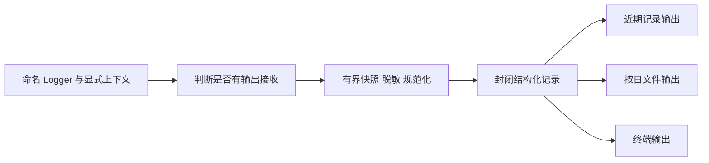

# 下一步计划：M1 公开面收敛与 M2-A 通用宿主装配

状态：第一轮 M1 的两项审核门禁缺陷已修复，补充证据见 M1.13；第二轮 M2-A 已实施并完成本地回归、实际 Node 消费和 Electron 旧 v2 会话恢复验收，证据见 M2-A.12。M1.1–M1.11、M2-A.1–M2-A.11 保留为各轮设计依据；MiMo、CLI 与 logs/tools 记录保留为历史。独立包边界仍属后续工作；本轮未切生产入口、未改变持久化版本、未调用远程厂商。整体方向见 [项目整体规划](project-plan.md)，持续约束见 [AGENTS.md](../AGENTS.md)。

## M1.1 目标、范围与非目标

本轮将现有 `src/agent/` 收敛为可受控消费的公开功能与扩展协议，不重新实现运行时，不新建 `Harness` 或 `Assistant` 空壳，不引入 IoC 容器。交付同时包含公开面、调用方迁移、资源能力收窄、静态依赖约束和运行证据；只有入口文件而没有约束与实际消费，不算完成。

纳入范围：

1. 明确现有具名入口及其公开符号，拆开公共协议与内部执行协议。
2. `PluginContext.scope` 改为公开的窄 `PluginScope`，安装器不再传出完整资源树对象。
3. 明确错误、无损协议快照和值比较的公共语义，迁移全部新内核相关调用方，删除失效路径。
4. 用解析到真实目标文件的静态检查维护内外依赖方向，并接入现有类型检查与构建链。
5. 迁移外部消费测试，保留有明确目的的白盒覆盖；运行公开入口消费烟测与现有恢复回归。

不纳入范围：

- 不分离工作区指令、插件选择、按工具名授权和宿主生命周期；这是第二轮装配工作。
- 不改变 `HostSessionBinding` v2、检查点 v1、数据库结构、模型重放格式、交互载荷及定义/插件版本。
- 不切生产 UI，不迁移生产历史，不删除旧 Agent/Gateway，不迁移 PPT、Skill 或子 Agent。
- 不新增 provider、重试、并行调度、压缩、动态插件依赖、热更新、服务定位器、扫描或配置语言。
- 不新增包/workspace，不承诺可独立发布；Node `exports` 和独立消费属于 M2。本轮不批量搬目录或改名。

## M1.2 实施前现状与必须保留的机制

| 代码位置 | 已核实事实 | 本轮处理 |
| --- | --- | --- |
| `application/agent-application.ts`、`application/default-agent-factory.ts` | 默认装配已在 Agent 内部；顺序安装插件、绑定模型、seal 后发布，失败回收 | 保留实现和顺序，只明确前者为受支持功能入口、后者为内部实现 |
| `extensions/plugin-contract.ts`、`extensions/plugin-manager.ts` | 插件拿到具体 `ResourceScope`，可见 `child()`、`dispose()` | 改公开能力协议与传入对象，不改资源树算法 |
| `tools/tool-contract.ts` | 工具扩展定义与 `ToolExecutor` 混在同一文件；`ToolCompletion` 被公开事件与持久数据引用 | 只拆出内部执行协议，公共类型依赖保持闭合 |
| `protocol-utils.ts` | 同时承担具名错误、安全投影、JSON 快照与值比较；宿主确实使用这些语义 | 分到具名公共协议文件，不复制、不静默替换算法 |
| `src/main/agent-host/` | 七个文件消费 `protocol-utils`；通过 Application 创建 Agent | 迁移公共操作的来源，不改变宿主行为 |
| `src/models/`、`src/tools/` | 已消费具名模型、插件和工具协议 | 合法入口保持原路径；只随协议拆分调整受影响处 |
| `biome.json`、node/web tsconfig | 有部分导入限制，但没有基于目标文件的 Agent 封装门槛 | 增加一个定向依赖检查，不将目录或 tsconfig include 冒充访问控制 |
| 现有测试 | 恢复测试仍直接用默认工厂；基础工具取消测试需观察工具完成而非 Agent 终态 | 前者改公开 Application；后者保留精确白盒例外 |

资源所有权仍按 Application → Agent → Run 管理；宿主提供的模型工厂、历史与检查点端口是借用对象。Agent 拥有模型 binding、插件资源和注册；Run 拥有本次取消及临时资源。Thread/Query/Step 的持久事实不进入资源树。

## M1.3 公开路径与协议闭包

下表是实施后的完整受支持源码入口集合，不是待新增的一组转发文件。路径均相对 `src/agent/`；已有入口保持位置。第一轮以这些精确路径维护边界，不允许按整个目录开放。

| 受支持入口 | 公开内容 | 运行时属性 |
| --- | --- | --- |
| `application/agent-application.ts` | `createAgentApplication`、`AgentApplication` | 功能入口，内部拥有默认创建/关闭装配；不转导出默认工厂 |
| `agent-contract.ts` | `Agent`、`AgentDefinition`、`AgentRunInput`、`AgentResumeInput`、`AgentRunHandle`、`AgentRunResult` | 纯类型 |
| `agent-factory.ts` | `AgentCreationOptions`、`AgentServices`、`AgentFactory` | 纯类型，保留具名端口，不引用具体内部类 |
| `protocol-values.ts` | 现有 JSON、版本载荷、身份、交互、`Disposable` 类型；移入 `snapshot`、`sameValue` | 无宿主依赖的值操作；校验函数不导出 |
| `protocol-errors.ts`（新增） | 从旧文件移动 `AgentError`、`asProtocolError` | 唯一公共错误实现，纯平台无关运行时代码 |
| `extensions/plugin-contract.ts` | `AgentPlugin`、`PluginContext`、`PluginScope`、`PromptContext`、`PromptContribution`、`PromptRegistrar` | 纯类型，不再引用资源树类 |
| `model/model-contract.ts` | 现有模型选择、内容、消息、请求/响应/流、能力、调用上下文、client/binding/factory/registrar 全部导出类型 | 纯类型，重放状态仍对内核不透明 |
| `tools/tool-contract.ts` | 上下文、授权、影响、结果、挂起、即时/可恢复工具定义、工具联合与 registrar，以及 `ToolCompletion` | 纯类型；保留 `ZodType` 的 type-only 依赖 |
| `session/session-contract.ts` | 现有历史与存储、工具调用/完成持久记录、inflight/pending 数据、`AgentCheckpoint` 全部导出类型 | 存储适配扩展协议，不是允许宿主覆盖恢复快照 |
| `session/checkpoint-contract.ts` | 现有 key/lease/acquire/save/store 全部导出类型 | 纯类型，保留 CAS、围栏和显式接管语义 |
| `session/session-events.ts` | `RuntimeFactEvent`、`RuntimeStreamEvent`、`RuntimeEvent` | 纯类型，观察事件不升级为持久事件日志 |

其中 `ToolCompletion` 必须公开：`RuntimeEvent` 和 `StoredToolCompletion` 都引用它。检查点及其嵌套记录必须可由存储适配器表达；不能为了缩小导出数量而隐藏这些协议，或将其改为 `unknown`。公开不意味着可向终端直接序列化私有重放状态。

`ToolExecutor` 与 `ToolExecutionResult` 移到新内部文件 `tools/tool-executor.ts`；该文件只含内部协议。`tool-pipeline.ts`、`DefaultAgent`、运行控制器和必要白盒测试改用新来源。旧 `tool-contract.ts` 不保留重导出、兼容别名或重复定义。

`ToolDefinitionFields`、`AgentCheckpointBase` 等未导出的组成类型无需机械改成导出。公共签名的类型依赖可以在同一受支持协议模块内表达，但不得沿声明依赖链进入资源树、Registry、管线或默认实现。

## M1.4 插件生命周期能力

在 `extensions/plugin-contract.ts` 定义：

```ts
export interface PluginScope {
  readonly signal: AbortSignal;
  own(resource: Disposable): void;
}
```

`PluginContext.scope` 使用该接口；`models/tools/prompts` 三个 registrar 保持现状。不新增服务获取、父作用域访问、子作用域创建或容器管理方法。

安装器为每次插件安装创建独立窄对象：

```ts
const pluginScope: PluginScope = {
  signal: scope.signal,
  own(resource) {
    scope.own(resource);
  },
};
```

`setup()` 接收 `scope: pluginScope`，而不是将 `ResourceScope` 仅做类型断言后原样传入。每次安装只构造一次能力对象，不在工具调用热路径上包装或分配。

保持以下契约：

- 插件可以托管其已经取得所有权的资源；不能通过注入就接管共享宿主服务。
- 插件仍可取得注册返回的 `Disposable`，仅撤销自己的注册；整个插件作用域由安装器管理。
- 同一插件对象的不同安装具有独立资源归属，不能共享可变作用域。
- setup 失败回收整次安装已取得的资源；setup 中取消、关闭重入、晚到模型绑定的处理不退化。
- scope 已关闭时 `own()` 继续拒绝；不得改成静默接受或替插件自动关闭未知借用对象。
- 关闭前先中断并排空执行，再释放依赖；不照搬上游并发 disposer 完成顺序。
- 窄对象不是恶意插件沙箱，不阻止受信任进程内代码通过其他引用执行操作。

不增加插件生命周期状态机或 `start/stop/refresh` 钩子；保留“安装贡献 → 绑定模型 → seal → 发布”和创建失败回滚。

## M1.5 错误与协议值操作的迁移

从 `protocol-utils.ts` 移动实现，不重新实现：

- `AgentError`、`asProtocolError` → `protocol-errors.ts`；所有内外调用方使用同一个类。未知原生异常仍投影为既有通用失败，不泄露 SDK 异常、路径、密钥或堆栈。
- `snapshot`、`sameValue` 及私有校验辅助函数 → `protocol-values.ts`；后者可值导入 `AgentError`，`protocol-errors.ts` 仅 type-import `ProtocolError`，不形成值循环。
- `snapshot` 保留既有无损 JSON 拒绝规则及 detached snapshot 行为；`sameValue` 保留现有比较语义，不改成直接 `JSON.stringify` 比较。使用方仍需满足协议值前提，不新增一套任意 JavaScript 对象比较规范。

迁移完全部引用后删除 `protocol-utils.ts`，不保留旧路径重导出。凭据解析、MiMo 安全错误转换、历史批次去重与绑定比较只改 import，不改变行为和错误码。

## M1.6 调用方与测试迁移

| 消费侧 | 实施动作 |
| --- | --- |
| `src/agent/**` | 错误/值操作切换来源；内部执行协议切换；插件管理器使用窄对象 |
| `src/main/agent-host/` | `configured-model-factory`、`create-agent-host`、`development-command`、`development-runner`、`development-setup`、`host-session-binding`、`sqlite-agent-stores` 迁移错误/值操作 import；保留现有 Application 入口 |
| `src/models/**`、`src/tools/**` | 已合法的协议路径不改；工具资源清理继续经 `scope.own()`，不要求新工厂或别名 |
| shared/Renderer/preload 的间接类型消费 | 保持模型及值协议无 Node/Electron/SDK 依赖；核验 web 类型检查，不把功能入口引入浏览器协议链 |
| `general-agent-runtime.test.ts` | 改用 `createAgentApplication(...).agents.create(...)`；登记并关闭 Application，保留持久恢复、未知副作用、丢失收据、步数、流完成与错误隐私断言 |
| `general-agent-lifecycle.test.ts` | Agent 生命周期行为改用 Application 创建；事件通道的实现测试仅保留对 `runtime/event-stream.ts` 的白盒访问 |
| `general-agent-infrastructure.test.ts` | 保留资源、注册、安装回滚与工具管线的实现测试，内部类型改来源；不将这些依赖提升为公共 API |
| `base-tools.test.ts` | 主要消费已有公开 Application；取消测试仍允许直测管线，以区分工具是否响应取消，不能用 Agent cancelled 终态替代真实工具结果 |
| MiMo、宿主、存储及 CLI 测试 | 迁移受影响 import，不重写无关场景，不重新钉住源码措辞 |

白盒例外按“具体测试文件 → 具体目标文件”登记：

- `general-agent-infrastructure.test.ts`：`extensions/plugin-manager.ts`、`extensions/prompt-registry.ts`、`model/model-registry.ts`、`scope/resource-scope.ts`、`tools/tool-pipeline.ts`、`tools/tool-registry.ts`，以及拆分后确需的 `tools/tool-executor.ts`。
- `general-agent-lifecycle.test.ts`：仅 `runtime/event-stream.ts`。
- `base-tools.test.ts`：取消结果观察所需的 plugin manager、prompt/model/tool registries、resource scope、tool pipeline，以及 `tools/tool-executor.ts`。

这些例外不允许向普通源码转导出内部符号。实施时若发现其他直接消费者，必须按行为职责迁移或说明具体白盒目的，不能给 `tests/**` 整体豁免，也不能借机删除有意义的边界覆盖。

## M1.7 静态封装的实现选择

新增 `scripts/check-agent-boundaries.mjs`，复用已有 TypeScript 开发依赖，作为定向依赖检查器，不建设通用架构规则框架。原因：新 `src/agent/`、旧 `src/main/agent/` 和 Renderer 的 `agent/` 目录重名；当前 Biome 字符串 glob 不能替代按 tsconfig 解析后的模块身份。避免用 `**/agent/**` 误伤旧链路或通过另一条相对路径绕过。

检查器要求：

1. 使用 TypeScript config API 读取 node/web tsconfig，按各自编译选项解析模块；合并去重源码身份。使用平台一致的绝对规范路径与大小写规则，识别实际位于本仓库 `src/agent/` 的目标，不能靠 `startsWith("src/agent")` 误匹配其他目录。
2. 分析静态 import、type-only import、re-export、import type 表达式、字面量动态 import 和字面量 require。检查器覆盖编译项目内源码及测试；同一文件在两个项目中的不同解析结果都要校验。
3. Agent 外部只能依赖 M1.3 精确入口；拒绝经相对路径、别名或转导出进入内部实现。白盒例外仅允许指定源/目标组合，不扩成前缀开放。
4. Agent 内部只允许模块内部依赖及当前已有 `zod` 依赖；拒绝宿主、业务、Electron、Node builtin、具体数据库、厂商 SDK 等反向依赖。不顺带给其他模块建立新的依赖体系。
5. 公共纯类型协议只能 type-import 其他公共协议和 `zod` 类型；`protocol-values/errors` 可以有相互之间的受控 type/value 依赖，但不得带入默认运行时。功能入口可依赖内部实现，不适用纯协议规则。
6. 对本模块及公共协议闭包的未解析导入明确失败，不静默跳过；不将无关旧模块的解析问题包装为 Agent 边界错误。非字面量模块加载不能宣称已静态证明：本轮禁止 Agent 内部使用，并要求所有指向 Agent 的依赖使用可解析字面量；这不是任意 JavaScript 加载行为的安全隔离。
7. 输出源文件、位置、解析目标和违反规则，退出非零；允许集合只有一份，不再用 Biome 复制同一套 Agent 白名单。现有配置模块、tools 的 Biome 限制保持有效。

增加 `npm run check:agent-boundaries`，将其接入 `typecheck` 的前置步骤；现有 `build` 依赖 `typecheck`，因此构建自动执行约束，不重复增加另一条检查链。不改默认测试排除策略，不把开发测试/夹具混进生产 `out/**`。

实施中用临时小消费程序验证检查器：合法公共 type import 通过；私有值/type import、re-export、动态字面量导入、别名绕过和内核反向依赖失败；现有旧 `main/agent` 导入仍通过；白盒例外不得传播到普通源码。临时程序置于隔离目录，验证后删除。不写源码字符串、导出数量或 import 次数断言。

## M1.8 实施顺序与文件落点

按依赖顺序完成，所有代码改完后集中运行验证，不在每次移动后全量跑检查：

1. **协议拆分**：新增 `protocol-errors.ts`、内部 `tools/tool-executor.ts`；迁移公共值操作；完成内核及外部引用迁移，删除旧 utils 路径与旧内部类型导出。
2. **插件边界**：在 plugin contract 定义 `PluginScope`，plugin manager 传窄对象；保持默认工厂与资源回收机制不变。
3. **消费测试**：运行时与生命周期测试改从公开 Application 创建；保留上节明确的内部覆盖，不增加生产兼容路径。
4. **静态约束**：实现定向脚本与 npm 接线；验证合法、非法及旧链路边界，不把扫描文件数量当验收结果。
5. **集中验收**：依次运行相关行为、node/web 类型与依赖检查、静态检查、全量单测、实际入口/恢复烟测；失败先定位，不用删除行为断言让检查变绿。
6. **交付记录**：仅在验收后更新本计划和整体规划的实际状态，记录命令、场景、通过/跳过/失败及证据限制；不提前标记 M1 完成。

现有 `application/agent-application.ts` 被明确支持后无需搬到根目录或增加包装工厂。`src/main/agent-host/` 在本轮仍是固定工作区运行配置；这不阻止通过公开 Application 验收无插件配置，但不能据此宣布 M2 已完成。

## M1.9 验证方案与通过条件

### 行为回归

优先复用现有 `general-agent-infrastructure`、`general-agent-lifecycle`、`general-agent-runtime`、`base-tools`、`general-agent-host`、`general-agent-host-binding`、`general-agent-development-host`、`general-agent-development-sessions`、`mimo-token-plan-cn` 等测试。只为新增的不确定边界补行为测试，不重复既有路径；安装失败回收、关闭排空和错误隐私断言不得缩成“未抛错”。

| 验收面 | 必须观察的结果 |
| --- | --- |
| 无业务插件消费 | `plugins: []` 通过公开 Application 运行普通对话；模型拿不到未安装工具，主动请求未安装工具也不能执行 |
| 资源边界 | setup 失败和 Agent/Application 关闭回收已托管资源，借用端口不被误关；同一插件多次安装互不污染；创建取消不留下可运行实例 |
| 类型边界 | 临时外部插件无需导入/实现 `ResourceScope`；`scope.child/dispose` 无法通过公共类型调用；模型、工具、存储协议可从支持路径完整消费 |
| 存储与恢复 | Query 不变、新 Run；待决回答匹配且不重复消费；步数不重置；CAS/围栏、丢失历史收据、unknown/applied 语义保持 |
| 错误与值 | 单一 `AgentError` 身份及安全投影保持；无损 JSON 拒绝和快照隔离保持；历史 batchId 同内容幂等、不同内容冲突保持 |
| 授权与文件 | 只读自动允许、写入逐次审批；批准前不写，未安装/越界访问拒绝；文件版本与 UTF-8/大小校验不弱化 |
| 静态约束 | 公开路径通过，私有导入与反向依赖失败，旧 Agent 同名路径不误伤，白盒例外不外泄 |

集中验证命令如下；本轮实际执行结果见 M1.12，不引用前序验收数字代替：

```text
npx vitest run tests/general-agent-infrastructure.test.ts tests/general-agent-lifecycle.test.ts tests/general-agent-runtime.test.ts tests/base-tools.test.ts tests/general-agent-host.test.ts tests/general-agent-host-binding.test.ts tests/general-agent-development-host.test.ts tests/general-agent-development-sessions.test.ts tests/mimo-token-plan-cn.test.ts
npm run typecheck
npx biome check <本轮修改的受支持代码文件>
npm test
npx vitest run tests/general-agent-development-cli.integration.test.ts tests/mimo-development-cli.integration.test.ts
npm run agent:dev -- --help
```

Windows 使用对应 `npm.cmd`、`npx.cmd`。Electron 集成被环境条件跳过不算通过，须明确记录并以可运行的等价实际场景补证；不能把旧 `test:integration:agent` 当成新宿主验收。

### 实际运行，不以单测或帮助代替

使用临时工作区、临时数据库与既有受控模型方式，不调用远程厂商、不触碰生产配置或数据库：

1. 临时独立消费程序仅从公开入口创建 Application，先不安装业务插件；执行一次对话并观察规范历史与关闭。随后在独立 Agent 安装 `createTools`，观察实际随机校验码文件读写和工具结果，不以模型自述代替文件核对。
2. 实际 Node 启动器 → Electron 开发宿主 → 原生 MiMo SDK → 本地 HTTP/SSE，执行 glob/grep/read 后请求写入；只读零审批，EOF 保留 waiting，批准前目标文件不存在。
3. 新进程恢复原 Query，使用新 runId 回答权威待决交互；批准后内容匹配校验码，记录规范消息与最终检查点，并确认无活动租约。拒绝和取消分别在独立临时会话覆盖。
4. 补一次关闭中断与依赖排空观察；取消不当作关闭，Ctrl+C 不当作 EOF 恢复。若既有实际入口集成已覆盖某场景，可复用该证据，不再重复远程调用。
5. 仅清理本次进程、临时脚本、会话、工作区与构建缓存。报告受控模型、本地真实 SDK/HTTP 与远程厂商三类证据，不混称真实模型验收。

M1 完成要求：上述功能/扩展入口可用且内部绕过受约束，全部相关调用方迁完，无旧路径 shim，无业务插件与文件插件两类公开消费成立，既有执行和恢复语义保持。模块可独立发布、宿主配置可组合及生产切换都不属于本轮完成声明。

## M1.10 参考来源与取舍

- [DeepSeek Harness 架构与 Session log](https://deepseek-harness.github.io/deepseek-harness/en/reference/)：区分持久事实、运行事件和能力扩展；不直接采用其 SessionEvent 格式或恢复算法。
- [固定版本 plugin 生命周期实现](https://github.com/deepseek-ai/deepseek-harness/blob/ce7073d51254c26cd63b22a60835b8f948deb447/vendor/cordis/src/fiber.ts) 与 [vendoring 说明](https://github.com/deepseek-ai/deepseek-harness/blob/ce7073d51254c26cd63b22a60835b8f948deb447/vendor/README.md)：借鉴贡献归属与初始化发布；不引入动态依赖重装、配置 HMR 或整个 fork，不将其异步回收顺序替代本项目契约。
- [Spring Framework 依赖注入](https://docs.spring.io/spring-framework/reference/core/beans/dependencies/factory-collaborators.html)、[生命周期](https://docs.spring.io/spring-framework/reference/core/beans/factory-nature.html)：借鉴显式工厂参数、完整初始化及依赖者优先停止；不建立 BeanFactory，不把 Bean scope 映射为 Query。
- [Spring Boot 自动配置](https://docs.spring.io/spring-boot/reference/features/developing-auto-configuration.html)：默认实现由模块内聚，显式选择在组合边界完成；本轮不实现条件装配或扫描，第二轮再处理具体配置。
- [Fowler：配置与使用分离](https://www.martinfowler.com/articles/injection.html#SeparatingConfigurationFromUse)、[Ports & Adapters](https://alistair.cockburn.us/hexagonal-architecture)：用于约束依赖方向，不增加空壳适配层。
- [Node package exports](https://nodejs.org/docs/latest-v24.x/api/packages.html#main-entry-point-export)：未来包边界仍需配合相对路径约束；本轮不以新增 exports 冒充独立包。

## M1.11 方案设计记录（实施前）

方案设计阶段只更新实施方案及整体规划，没有将设计当作验收。已核对公开签名、宿主/模型/tools 消费、现有行为测试及静态检查能力；LSP 无可用语言服务器，调用方盘点使用定向导入检索与相关代码阅读。实施时再次查询引用仍返回无语言服务器，随后通过定向导入盘点、编译和边界检查完成迁移验证。

## M1.12 实施与验收记录（2026-11-01）

### 实际变更

- 已按 M1.3 精确路径收敛消费边界，保留现有 Application 功能入口，没有新增包装工厂、聚合入口或容器。
- 新增 `protocol-errors.ts`，唯一错误类与安全投影原样迁移；快照、JSON 校验与值比较迁入 `protocol-values.ts`。内核、七个宿主文件和相关测试已迁移，旧 `protocol-utils.ts` 已删除，无兼容重导出。
- 新增内部 `tools/tool-executor.ts`，移入 `ToolExecutor/ToolExecutionResult`；`ToolCompletion` 留在公共协议，事件及检查点载荷没有变化。
- 插件得到独立的 `PluginScope` 窄对象，仅有 `signal/own()`；资源树、注册回滚与关闭顺序保持原机制。新增行为回归验证同一插件多次安装的取消/资源归属互不污染，以及关闭后托管拒绝且不误关未接收资源。
- 运行时与 Agent 生命周期回归改由公开 Application 创建并登记回收；保留方案列出的精确白盒访问。
- 新增 `scripts/check-agent-boundaries.mjs` 与 `check:agent-boundaries`，接入 `typecheck`；`build` 经现有链包含检查。按两份 tsconfig 解析实际目标，核查公共协议闭包、反向依赖和白盒导出泄漏。类型来源按声明/符号身份去重，避免展开递归泛型导致栈溢出；不是任意 JavaScript 值流或计算加载的安全分析器。
- `tsconfig.web.json` 补入新增错误协议，保证公共值操作的浏览器编译闭包；Biome 仅显式纳入这一个新 `.mjs` 检查脚本，没有扩大到其他旧脚本或复制 Agent 白名单。中英文 README 已补充消费边界。

### 本轮执行结果

| 检查/场景 | 实际结果 |
| --- | --- |
| M1.9 所列九个相关行为回归文件 | 152 项通过，1 项按既有条件跳过 |
| `npm.cmd run typecheck` | 模块边界检查及 node/web 两个 TypeScript 项目全部通过 |
| Biome：新脚本、package/config、Agent、开发宿主与四个受影响测试文件 | 42 个受支持文件通过；迁移产生的三处格式差异已修复 |
| `npm.cmd test` | 191 个文件、1609 项通过，2 项按既有条件跳过；没有运行远程厂商集成 |
| 两个独立 Electron CLI 集成文件 | 2 项通过、无跳过；覆盖凭据重开、原生 SDK/本地 HTTP/SSE、EOF waiting、新进程恢复、拒绝、取消、配置变更拒绝与租约释放 |
| `npm.cmd run agent:dev -- --help` | 实际 Node 启动器构建并启动 Electron 帮助成功；没有启动生产 UI |
| 独立公开消费程序 | 无插件普通对话完成；模型看不到未安装工具，主动调用缺失工具被拒绝；借用 SQLite 端口在 Application 关闭后仍可读取 |
| 公开消费类型检查 | 外部结构对象可实现 `PluginScope`，无需内部类；`child/dispose` 的负向类型断言成立 |
| 独立公开文件消费与关闭烟测 | 实际 glob→grep→read→write；批准前无文件；重新打开存储后批准，随机校验码匹配、原 Query/新 Run、完成检查点和释放租约均核验；关闭返回 interrupted，先排空模型再关闭 binding 与插件资源 |
| 独立 Electron → SDK → 本地 SSE 烟测 | 一次模型发现、三次模型请求；实际 glob/grep/read 零只读审批，写入 EOF waiting；新进程批准后文件内容匹配随机校验码，Query 不变、Run 更新、完成检查点无活动租约 |
| 隔离依赖反例矩阵 | 25 个场景通过，包括合法公开消费/旧同名目录、私有值/类型/重导出/import type/动态字面量/require/别名、未解析 Agent 依赖、内核反向依赖与非字面量加载、协议闭包、精确白盒及别名/实例/包装导出泄漏、node/web 不同解析 |

测试条件跳过不视为已验收对应平台行为。本轮两项既有跳过均保留原条件；实际 Electron 集成及独立烟测没有跳过。静态反例和公开消费使用临时程序，不新增锁定源码措辞、导出数量或文件布局的永久测试。

没有读取或修改生产会话数据、没有复制或打印真实 Key、没有调用远程厂商；本地真实 SDK/SSE 结果不能作为远程模型新验收。生产打包与跨包发布未在本轮执行。临时程序使用独立数据库、工作区与构建目录，仅清理本次创建的资源。

原始交付结论（修复前）：M1 当时报告完成，M2-A 尚待实施。随后审核发现导出类型图及三斜线引用两项门禁漏检；不以本节原有通过数字证明它们已覆盖，修复和补充验收见 M1.13。当前第二轮交付见 M2-A.12，旧生产 Agent、PPT、Gateway 继续独立运行。

## M1.13 审核问题修复与门禁补充验收（2026-11-01）

已修复审核的两项 P2：

1. **白盒导出类型图遗漏**：补查导出类/接口基类型，以及未实例化泛型条件类型的判断、约束和分支；对相关 mapped/indexed 类型与泛型默认值同样沿类型来源分析。按类型、符号、声明和本地类型语法节点去重，不展开外部 Zod 声明造成无界递归。白盒导出派生内部类或条件类型别名不再通过。
2. **三斜线依赖遗漏**：提取 SourceFile 的 types/path/lib 引用指令，按 TypeScript 实际目标解析后复用依赖规则；缺失目标在受管模块明确失败。允许合法公共路径与标准 Web/ES lib，拒绝 Node types、main 声明或私有 Agent 路径；不是一律禁用三斜线。

同一检查器增加 M2-A 的精确 `src/agent-host/` 模块边界及 `session-host.ts` 入口。没有新增重复检查链、包导出白名单或扩大白盒例外。

本轮临时隔离矩阵实际通过 **47 个场景**：包括两项原始漏检、合法引用、未解析引用、白盒泛型/继承/包装导出、原私有导入及反向依赖、旧同名目录，以及 host 的公共消费、私有路径、main/tools/models/logs/Node/Electron/非字面量加载正反例。矩阵调用真实边界检查器，不通过源码措辞或导入数量断言；临时脚本及其隔离目录已删除。最终 `npm.cmd run typecheck` 再次通过边界及 node/web 编译检查。

本补充只证明所述静态约束，不声称能阻止任意计算值流或隔离恶意进程内插件。运行时、实际消费和恢复验证共用 M2-A.12 所列本轮证据。

## M2-A.1 第二轮目标、前置条件与非目标

第二轮交付“平台无关的会话宿主装配”：固定一个 Thread 的执行入口，先确认宿主持久绑定，再通过公开 Application 创建 Agent；具体指令、插件与授权由调用方显式提供。它是 M2 的通用装配切片，不等于 M2 的独立包、构建与发布门槛已经完成。

前置条件：M1 的公共协议闭包、窄 PluginScope、调用方迁移和定向依赖检查已落地并完成相应验收。第二轮设计可以先行，但实施必须先重读第一轮实际结果；如路径或契约发生变化，先修订本方案，不新增旧入口 shim，也不覆盖第一轮正在进行的改动。M1 不包含本节工作，M1 完成也不能自动标记 M2-A 完成。

纳入范围：

1. 新增 `src/agent-host/session-host.ts`，内聚线程固定、发布前绑定确认、Application 创建与关闭；只消费 M1 公开入口。
2. 将现有工作区定义、文件插件选择、工具授权和审批载荷解释集中到当前宿主的具体配置文件；不进入通用模块。
3. 工作区组合根继续创建并拥有模型、SQLite、日志，通过必需的窄绑定端口连接通用宿主。
4. 保持工作区 v2 绑定及原会话可恢复，证明不安装文件能力也可以使用同一个通用宿主。
5. 迁移受影响调用方、补齐依赖约束，提供实际 Node 无 Electron 消费及原开发入口恢复证据。

不纳入范围：

- 不新增 Harness/Assistant 类、BeanFactory、全局 Context、依赖 token、拓扑解析器、扫描、配置语言、动态插件或 HMR。
- 不新建包/workspace，不新增 package exports；不宣称脱离仓库安装消费、独立发布或完整 M2 验收。
- 不泛化 SQLite 绑定格式、历史查询或配置注册体系；不新增 v3，不改表结构，不迁移历史行。
- 不改变检查点 v1、模型重放、连接指纹算法、工作区定义/插件版本、审批 v1、工具安全或执行状态机。
- 不改变 CLI 默认配置、命令和选择流程，不增加 profile/插件选择菜单；不接入额外 provider。
- 不切换生产 UI、不迁生产历史、不迁 PPT/Skill/子 Agent，不删除旧 Agent/Gateway。

## M2-A.2 当前职责与切分决策

本节依据当前调用链；M1 实施中的错误/值操作 import 迁移不再列为第二轮待修问题。

| 位置 | 当前职责 | 第二轮归属 |
| --- | --- | --- |
| `main/agent-host/create-agent-host.ts` | 指令、tools、按工具名授权、模型/存储/日志、绑定及执行包装 | 保留具体资源组合根，通用执行包装迁到新模块，工作区配置另行内聚 |
| `agent/application/agent-application.ts` | Agent 创建占位、取消、关闭与排空 | 完整复用，不复制其实例表、资源树或生命周期算法 |
| `main/agent-host/host-session-binding.ts` | 严格工作区 v2 格式与快照 | 原位保留，是宿主适配协议，不成为通用宿主 schema |
| `main/agent-host/sqlite-agent-stores.ts` | 历史/检查点/绑定的真实 SQLite 实现与工作区列表投影 | 原位保留，由组合根借出端口；不因使用 Node API 就声称已完成独立适配模块 |
| `main/agent-host/configured-model-factory.ts` | 已签发计划、凭据解析、原生模型准备与连接指纹 | 原位保留，依赖当前应用配置的代码不进入通用模块 |
| `main/agent-host/development-runner.ts` | Electron、输入队列、命令、观察投影、审批、会话选择 | 继续调用工作区组合根；不变成通用运行容器 |
| `main/agent-host/development-sessions.ts` | 当前工作区的只读会话枚举 | 保持工作区特定用途，不新增全局通用会话目录 |

不另建“运行配置对象系统”。具体配置首先就是有明确返回类型的 TypeScript 工厂；依赖由参数/闭包提供。无插件消费直接显式传 `plugins: []`、定义和授权策略，不必注册一种新的助手类别。

## M2-A.3 通用会话宿主的公开协议

新增具名入口 `src/agent-host/session-host.ts`，定义以下受支持契约并内聚默认创建逻辑；不新增 `index.ts` 或单纯转发工厂。类型引用均来自 M1 公开协议。

```ts
export interface SessionBindingPort {
  ensure(): Promise<void>;
}

export interface SessionHostOptions {
  readonly services: AgentServices;
  readonly agent: AgentCreationOptions;
  readonly threadId: string;
  readonly binding: SessionBindingPort;
}

export type SessionRunInput = Omit<AgentRunInput, "threadId">;
export type SessionResumeInput = Omit<AgentResumeInput, "threadId" | "takeover">;

export interface SessionHost extends Disposable {
  run(input: SessionRunInput): Promise<AgentRunHandle>;
  resume(input: SessionResumeInput): Promise<AgentRunHandle>;
  close(): Promise<void>;
}

export function createSessionHost(options: SessionHostOptions): Promise<SessionHost>;
```

上述签名已实施；这里的函数声明仅描述公共 API，实际入口包含完整创建与回收实现。

契约要求：

- `AgentServices`、`AgentCreationOptions` 继续由 Agent 模块拥有，不复制一套 model/history/checkpoint/plugin 类型，不把具体函数的 ReturnType 作为公共协议。
- `services.authorizeTool` 必须显式提供，即使 `plugins: []` 也不默认允许；插件不可移除或替换宿主策略。原型外的意外缺项应在创建阶段拒绝，不能静默补默认实现。
- `binding` 必须提供，不默认空 ensure，不增加可选关闭回调或服务定位方法。其实现确认这一份固定装配与权威恢复边界一致；不符合则拒绝创建。
- 通用模块不接收 `AgentConfiguration`、密钥、SDK、路径、ToolsMode、数据库连接、NodeLogs 或整个宿主对象；不读取进程环境。
- 不向通用 SessionHost 暴露绑定内容或具体资源；工作区外壳可以继续提供自己的 `binding` getter。
- 一个 SessionHost 创建一个 Application 和一个 Agent，保持当前资源隔离粒度；不在本轮引入共享 Application、多 Agent 调度或隐式排队。
- `SessionRunInput/SessionResumeInput` 的省略仅描述调用协议；实现仍显式构造转发字段，不能靠 TypeScript 类型阻止运行时夹带 threadId/takeover。

## M2-A.4 创建、执行与关闭顺序

通用实现只负责以下实际机制，不复制 Loop、恢复协调或 Application 的资源管理：

1. 在首个 await 前校验 threadId，并固定 services 中的端口引用、agentId/maxSteps/signal、definition/model 的 detached 协议快照和插件数组副本。创建参数不得在等待绑定后重新从可变 options 读取；插件是受信任对象，不深拷贝其函数或承诺隔离恶意改写。
2. 检查创建信号，等待 `binding.ensure()`，完成后再次检查取消。失败不得安装插件、创建模型 binding 或发布可运行宿主。外层已经创建的 provider、SQLite、日志不属于这里的“尚未创建资源”。
3. 通过 `createAgentApplication(services)` 和 `application.agents.create(fixedAgentOptions)` 创建实例；完整保留 M1 入口。应用创建成功才进入本宿主所有权。
4. 创建后再次检查信号；已取消则回收 Application，不发布半初始化实例。创建失败回收已取得的 Application；执行错误和清理错误必须保留并安全投影，不用清理成功掩盖原失败。
5. `run()` 固定创建时的 threadId，显式转发 queryId/runId/input/signal；`resume()` 固定 threadId，仅转发 queryId/runId/response/signal。不接受 takeover，不把前端重建快照传给内核。Query/Run 身份及待决回答的合法性继续由内核检查。
6. `close()/dispose()` 共享幂等关闭 Promise；开始关闭时同步停止受理，再调用 Application 关闭并等待执行静止。不维护第二张 Agent/Run 表，也不额外实现取消状态机。
7. 关闭只释放本宿主创建的 Application/Agent；不 dispose 借用的 models/history/checkpoints/authorizeTool/binding，也不直接关闭 provider、日志或数据库。

新通用实现沿用现有 `HOST_OPTIONS_INVALID`、`HOST_CLOSED` 等可公开宿主错误语义；工作区组合根继续负责既有 `HOST_CLOSE_FAILED`、`HOST_START_AND_CLOSE_FAILED` 的安全报告。不可将原始 AggregateError、SDK 异常或内部堆栈直接输出到终端。新增错误如确有必要，在实施中具名定义并补相应调用方行为，不通过字符串别名维持两套实现。

Query 等待仍结束当前 Run；关闭已持久 waiting 不应改成 cancelled/interrupted。活动执行关闭是 interrupted，用户取消是 cancelled。新的包装不能改变这些内核语义。

## M2-A.5 工作区配置与 Electron 组合根

新增 `src/main/agent-host/workspace-configuration.ts`，集中当前工作区配置：

```ts
export interface WorkspaceConfigurationOptions {
  readonly workspaceRoot: string;
  readonly toolMode?: ToolsMode;
  readonly logger?: Logger;
}

export interface WorkspaceConfiguration {
  readonly definition: AgentDefinition;
  readonly plugin: ToolsPlugin;
  readonly authorizeTool: ToolAuthorizationPolicy;
}

export function createWorkspaceConfiguration(
  options: WorkspaceConfigurationOptions,
): Promise<WorkspaceConfiguration>;
```

`createTools()` 保持工具模块的公开创建入口，返回的实际 canonical workspaceRoot、effective mode 和工具清单是绑定与授权的来源。该配置工厂不创建模型、SQLite 或日志，不启动执行。未安装文件能力的配置不调用此工厂，无需伪造工作区。

从原组合根移动而非复制以下逻辑：

- `workspaceDefinition()` 及原 instructions，保持 `general-workspace-assistant` 的 ID、version 和内容不变；本轮不借拆分改变模型提示词。
- tools 创建、read-only 默认值、已安装工具集合、workspaceId 的 SHA-256 计算。
- 原按工具名解释 path/pattern/glob 的授权规则、只读允许和写入逐次审批。
- 原 `host-permissions`、`workspace-tool:<queryId>:<callId>`、`host.workspace-tool` v1 及 `{ tool, path, workspaceId }`，保持可解释旧只读待决交互。

在同一具体配置模块导出具名 `WorkspaceApproval` 和 `parseWorkspaceApproval(interaction: InteractionRequest): WorkspaceApproval`，移动 runner 原 owner/type/version 与严格 payload 检查，不新建交互处理器 Registry。未知交互仍以 `CLI_INTERACTION_UNSUPPORTED` 失败并保持 waiting；既有已识别载荷的无效内容继续安全拒绝。runner 只负责显示、yes/no/cancel 输入和调用 resume，不再定义第二份工具名/载荷 schema。

`create-agent-host.ts` 继续作为当前开发入口的具体组合根，公开名称不因这一轮统一命名而更换：

1. 创建 NodeLogs、工作区配置、PreparedConfiguredModel、SqliteAgentStores。
2. 用同一份固定配置生成工作区 v2 绑定和 ensure 闭包，调用通用 `createSessionHost()`。
3. 向通用模块提供实际 definition、`[plugin]`、model/maxSteps 和独立 authorizeTool；不让通用模块解释工具名。
4. 返回现有工作区 AgentHost，保留 detached `binding` getter。其类型以 `extends SessionHost` 表达执行能力，不再重复声明 HostRunInput/HostResumeInput；旧无调用方类型删除，不保留兼容 re-export。
5. 关闭顺序是 SessionHost/Application 排空 → prepared model → SQLite stores → logs。某个关闭失败仍尝试后续资源，报告不能确认清理；configuration runtime 仍为借用对象。

资源归属：组合根拥有上述具体资源；通用宿主只拥有其 Application；Agent 拥有模型 binding、插件注册与其自有资源；Run 拥有本次执行资源。插件不能因为获得 Logger 或窄端口就承担整个共享服务的关闭责任。

## M2-A.6 恢复绑定：保留 v2，不做格式泛化

决策：通用机制不解释持久绑定，所以解除工作区耦合不要求 v3。`HostSessionBinding`、严格字段白名单、SQLite 表/SQL、只读列表投影、旧版本拒绝和现有 snapshot 校验保持原样；不新增泛型 JSON metadata 袋、绑定 codec 注册器或读时规范化。

工作区组合根在第一个相关异步边界前固定其选项；准备资源后，从同一组固定值构造 detached v2 候选和 Agent 创建参数：

- threadId/agentId；definition ID/version；插件 ID/version 及顺序。
- 实际 tools 的 canonical workspaceRoot/effective toolMode。
- 同一个 prepared model 的 selection、connectionFingerprint 和 maxSteps。
- 原 resume 标志，不在 ensure 中重新读取当前 UI/配置。

绑定端口闭包只执行当前语义：

```ts
async ensure() {
  if (resume && !(await stores.bindings.read(binding.threadId))) {
    throw new AgentError("HOST_SESSION_NOT_FOUND", "找不到已绑定的开发会话，不能恢复。");
  }
  await stores.bindings.ensure(binding);
}
```

这是具名端口的实现约定，不是新增存储 API。闭包捕获的 binding 与传给通用宿主的实际配置必须来自同一份快照；零参数接口本身无法证明绑定 A 与运行 B 一致，组合根对此负责。等待 ensure 期间不得发生重新拼装、模型选择漂移或修改创建选项。

必须保持：

| 情形 | 结果 |
| --- | --- |
| resume 且绑定不存在 | `HOST_SESSION_NOT_FOUND`，不补建绑定 |
| 首次创建、无绑定且无任何 thread 持久状态 | 事务写入原 v2 |
| 无绑定但已有 history head（含空批次）或任何 checkpoint 行（含已释放占位） | `HOST_BINDING_MISSING`，不认领旧状态 |
| 已有绑定，任一字段、插件顺序或可选 effort 表达不同 | `HOST_BINDING_CHANGED`，不覆盖原行 |
| 未知 schemaVersion | 沿用 unsupported 错误，不猜测兼容 |
| 原 Query 已有活动写租约 | 内核报告 busy，不自动接管 |

恢复仍由 CLI 选择原 summary.toolMode，并用原 connectionFingerprint 匹配当前签发计划；再次打开必须完整 read/ensure，列表不是授权快照。Key 轮换不改变连接身份；model/endpoint/effort/output budget/步骤预算变化的现有拒绝行为保持。不对已存 root 重新 canonicalize、不补历史默认值、不重新计算历史 fingerprint。

无插件或其他配置的消费者须提供自己的权威绑定实现，确认其权限环境与执行版本；通用模块不提供无校验默认。临时内存实现可用于确定性消费烟测，但必须真正记录并比较绑定候选；它只证明进程内装配，不构成跨进程持久恢复证据。未来如要统一不同配置的列表/持久格式，再单独设计版本化协议，不以本轮预建框架。

## M2-A.7 文件落点、调用方与依赖约束

| 文件/消费侧 | 实施动作 |
| --- | --- |
| `src/agent-host/session-host.ts`（新增） | 公开协议及完整通用装配实现；只依赖 M1 公共入口与标准语言/Web 类型 |
| `src/main/agent-host/workspace-configuration.ts`（新增） | 内聚工作区定义、tools、授权和审批载荷解释；不成为 Agent 内核默认配置 |
| `src/main/agent-host/create-agent-host.ts` | 实际调用新模块，移走重复 Application/执行包装和工作区策略；保留具体资源组合、v2 绑定、getter 与外层关闭 |
| `src/main/agent-host/development-runner.ts` | 继续调用原工作区组合根，审批解析改用具体配置模块；不直接绕过组合根 |
| `host-session-binding.ts`、`sqlite-agent-stores.ts`、`development-sessions.ts` | 保留格式、存储、列表语义，不为本轮修改 SQL/表结构或迁移历史 |
| `configured-model-factory.ts`、`development-setup.ts`、`development-command.ts`、`scripts/run-agent.mjs` | 不改变行为；仅在确有类型/帮助说明受影响时修改，不新增参数或支持范围 |
| `tests/general-agent-development-host.test.ts`、`tests/mimo-token-plan-cn.test.ts` | 仍消费工作区组合根，验证它实际转入通用机制；保留 SDK/本地 HTTP、文件、审批与恢复行为 |
| `tests/general-agent-host.test.ts`、`general-agent-host-binding.test.ts` | 现有主要是 SQLite/绑定回归，不因名称含 host 就整体改为新 SessionHost 测试 |
| `tests/general-agent-development-sessions.test.ts`、两项 CLI integration | 保留只读列表和真实 Electron 跨进程覆盖，不改成纯模型 mock 替代 |
| `tests/general-agent-session-host.test.ts`（新增） | 只消费公开入口，覆盖新边界的配置隔离、绑定拒绝/等待、固定 thread、所有权及创建取消 |
| `tsconfig.node.json` | 明确包含 `src/agent-host/**/*.ts`；不把功能模块加入 web include，不新增项目/workspace |
| M1 `scripts/check-agent-boundaries.mjs` | 扩展同一个定向检查器的模块规则与临时验证，不另建重复检查链 |

边界约束实施要求：

1. `src/agent-host/` 是 `src/agent/` 外部消费者，只能访问 M1 精确公共入口，不给其默认工厂、资源树等内部例外。
2. 为新模块限定精确入口 `session-host.ts`；如以后拆内部文件，其他消费者不得直接进入。该入口可以实现功能，不要求再套转发层。
3. 新模块禁止导入 main/shared/renderer/preload/ppt/tools/models/logs、Electron、Node builtin、厂商 SDK、具体数据库和任意其他运行依赖；其平台独立性由真实依赖图和实际 Node 消费证明，不由文件名或 node tsconfig 中全局 Electron 类型证明。
4. Agent 内核不得反向依赖 agent-host。使用 M1 已有的 tsconfig 模块解析、规范路径和目录包含判断，不能以字符串 `startsWith("src/agent")` 把 `src/agent-host` 误认为内核。
5. 补临时正负消费：host → 公共 Application 通过；host → 默认工厂失败；Agent → host 失败；host → main/tools/Node builtin 失败；旧 main/agent 同名目录仍不误伤。沿用 M1 对 type/re-export/dynamic literal/require 等的覆盖，不以源码字符串测试代替解析。

公开符号有变化前按可用语言服务查 references；当前环境仅配置 Biome，不能宣称它提供 TypeScript 引用分析。实施若无相应服务，使用定向导入检索并阅读全部相关调用方，不能仅凭当前表格遗漏新增消费者。

## M2-A.8 实施顺序

1. **承接 M1**：核对其实际公开入口、资源契约、错误迁移及检查器；记录基线，不重做或绕过第一轮约束。
2. **新增通用实现**：落实 SessionHost 的固定快照、绑定确认、公开 Application 创建、显式转发和幂等关闭；先完成行为，不建空包装。
3. **提取具体配置**：移动工作区指令、tools 装配、授权与批准解析；同一次切换修改 runner 的解释来源，保持原载荷。
4. **组合根切换**：用同一固定装配生成 v2 binding/ensure 与 SessionHost 参数；删除旧重复执行包装，保留当前外部工作区入口和资源所有权。
5. **约束与消费覆盖**：接入新源码 include、已有检查器规则及必要行为测试；保留存储/审批/恢复测试，不扩大白盒例外。
6. **集中验收**：相关行为 → 类型/边界 → 静态检查 → 全量单测 → 实际 Node 消费与 Electron 本地协议/恢复。禁止用放宽 schema、跳过边界、删除有效断言来使检查通过。
7. **证据交付**：验收后才更新状态与命令/场景结果；标记 M2-A 完成时仍将独立包构建、exports、安装消费等 M2 剩余门槛列为未完成。

## M2-A.9 行为验收矩阵

优先复用已有覆盖，只为新风险补确定性测试；不得新增转发 mock 回声、import 数量、源码措辞或文件布局锁定断言。

| 验收面 | 必须观察的结果 |
| --- | --- |
| 显式装配 | 自定义 definition/model/maxSteps、`plugins: []` 可完成对话；模型不可见文件工具，主动请求未安装工具也不能执行 |
| 能力与策略独立 | 同一通用入口安装显式测试能力，宿主策略拒绝时没有副作用；批准场景 waiting/resume 后消费真实结果 |
| 绑定发布顺序 | ensure 挂起期间不能取得可执行宿主，插件 setup/模型 binding 尚未发生；拒绝后无半初始化实例，借用端口仍可使用 |
| 配置快照 | ensure 等待期间修改原 options/definition/model/插件数组不能使实际执行配置漂移；与权威绑定的固定值一致 |
| Thread/恢复边界 | 额外 runtime threadId 不能覆盖固定线程；夹带 takeover 不能接管忙租约；同 Query、新 Run，回答只消费匹配待决交互 |
| 资源所有权 | 创建失败/取消回收已取得插件和 binding；关闭先排空执行；借用 provider/history/checkpoints/绑定端口不被关闭；重复关闭不重复释放 |
| v2 会话兼容 | 使用本轮前的原始 v2 payload/待决记录重开并批准成功，不重写绑定；root/mode/model/预算/版本变化仍拒绝 |
| 持久与列表 | 空历史/占位 checkpoint 仍禁止无绑定认领；只读枚举不创建 DB、不改绑定/检查点、不拿租约；历史幂等/CAS/围栏覆盖保留 |
| 工作区行为 | 两种模式下读取零审批；write/edit 批准前不写，拒绝/取消不写；未安装、越界、文件版本、UTF-8/大小校验不弱化 |
| 平台与隐私 | 新模块实际依赖图无 Electron/main/工具等；SDK 安全错误、终端投影、密钥/reasoning/工具正文隐私保持 |

以下为实施验收命令清单，实际执行组合、结果和证据限制见 M2-A.12，不引用历史数字代替本轮结果：

```text
npx vitest run tests/general-agent-session-host.test.ts tests/general-agent-host.test.ts tests/general-agent-host-binding.test.ts tests/general-agent-development-host.test.ts tests/general-agent-development-sessions.test.ts tests/mimo-token-plan-cn.test.ts
npm run check:agent-boundaries
npm run typecheck
npx biome check <本轮修改的受支持代码文件>
npm test
npx vitest run tests/general-agent-development-cli.integration.test.ts tests/mimo-development-cli.integration.test.ts
npm run agent:dev -- --help
```

Windows 使用 npm.cmd/npx.cmd；命令以 M1 实际接线为前提。Electron 集成按环境跳过必须单列，不能将 skip 计为通过。若首项已有某场景的完整行为覆盖，不额外复制相同测试。

## M2-A.10 实际消费烟测与证据分级

单测或帮助不能证明通用装配已被真正消费。实施需完成两类实际路径：

**A. 普通 Node、无 Electron 的源码公开消费**

- 使用临时入口、临时 Vite SSR 构建目录，`spawn(process.execPath, [builtEntry])` 运行真实 Node 子进程，不用 Electron 或 Vitest 进程内 import 冒充。
- 入口消费 `src/agent-host/session-host.ts` 和 M1 公开协议，显式注入确定性模型、内存历史/检查点及有真实比较逻辑的绑定端口。先 `plugins: []` 完成预期文本，再通过独立会话安装一个非文件临时能力，观察宿主审批、waiting、新 Run resume、预期结果与关闭后借用历史仍可读。
- 构建依赖图不得包含 main/Electron，不能配置 Electron alias/mock 或只把它 external 后宣称无依赖。使用已有定向检查器的解析目标约束并观察 Node 成功执行；不写源码文本断言。
- 此证据证明源码公开消费、机制无固定文件业务依赖和 Node 可运行；不证明跨进程内存恢复、远程模型、独立包或脱离仓库安装。临时能力仅作验收夹具，不新增生产插件。

**B. 原 Node 启动器 → Electron → 原生 SDK/本地 HTTP/SSE**

- 复用现有测试传输适配，仅将固定厂商 URL 转发本地服务；运行真实 Electron/safeStorage、配置模块、工作区组合根、新 SessionHost、SQLite 与 tools。不复制 runner，不扩大远程调用。
- 自建临时工作区与随机校验码，实际 glob→grep→read 后请求 write/edit；批准前文件不存在/不变，EOF 退出时检查 status=waiting 且租约释放。
- 新进程选择原会话，保持原 Query 并使用新 runId，批准后核对真实文件和模型消费结果；独立覆盖拒绝、取消、关闭中断与恢复配置变更拒绝。
- 至少一条恢复路径使用保留的旧 v2 payload 及原 `host.workspace-tool` v1 待决交互，核对恢复前后绑定行未被“升级”；普通 Key 轮换允许，身份/effort/预算/权限环境变化仍拒绝。
- 核对最终检查点、规范历史、租约与错误隐私，不只看退出码或模型自述；EOF、Ctrl+C 和应用关闭不是等价动作。

CLI 无参数/--prompt/--help、/model /new /resume /tools、默认只读、工作区来源、session.ready/逐行 JSON、退出码及 Windows 父子 IPC 握手保持原样；不在 ESM 顶层等待 app.whenReady。help 仍不解析凭据或建宿主。仅清理本轮临时脚本、构建、进程、数据库和工作区，不删除共享记录，不写入生产 out/**。

M2-A 完成要求：通用入口被当前组合根实际消费，无业务插件和显式能力配置均成立；具体配置不进入通用模块；原持久恢复与工作区行为保持，借用资源所有权正确，依赖约束和两类实际证据齐备。独立包、生产 UI/PPT 与动态装配继续列为未实施。

## M2-A.11 参考取舍与方案设计记录（实施前）

- [DeepSeek Harness 架构](https://deepseek-harness.github.io/deepseek-harness/en/reference/) 与 [固定版本生命周期实现](https://github.com/deepseek-ai/deepseek-harness/blob/ce7073d51254c26cd63b22a60835b8f948deb447/vendor/cordis/src/fiber.ts)：借鉴注册归属、初始化完成后发布、持久事实与运行对象分离；不引入 Cordis Context、动态依赖重装、热更新或并发 disposer 完成语义。
- [Spring Framework DI](https://docs.spring.io/spring-framework/reference/core/beans/dependencies/factory-collaborators.html)、[生命周期](https://docs.spring.io/spring-framework/reference/core/beans/factory-nature.html)、[Bean scope](https://docs.spring.io/spring-framework/reference/core/beans/factory-scopes.html)：使用显式工厂参数与闭包，区分借用和所有权，依赖者先停止；不将 Bean scope 映射为 Thread/Query/Run。
- [Spring Boot 自动配置](https://docs.spring.io/spring-boot/reference/features/developing-auto-configuration.html)：模块提供完整默认实现，宿主显式选择；本轮直接程序化组合，不建条件注解、扫描/发现，也不允许注册冲突静默覆盖。
- [Fowler 配置与使用分离](https://www.martinfowler.com/articles/injection.html#SeparatingConfigurationFromUse)、[Ports & Adapters](https://alistair.cockburn.us/hexagonal-architecture)：支撑宿主配置与机制拆分，不增加空壳服务定位层。
- [Node package exports](https://nodejs.org/docs/latest-v24.x/api/packages.html#main-entry-point-export)：独立包边界留待后续；本轮目录、静态约束和 Node 烟测不能冒充发布验收。

方案设计阶段只更新计划文档，尚未实施 SessionHost 或运行验收；当时已核对组合根、runner、v2 绑定事务/列表、模型指纹、相关测试和 tsconfig。实施阶段承接 M1 的实际公开入口，语言服务引用查询返回无可用服务，随后通过定向调用方盘点、node/web 编译、依赖检查与行为验收完成迁移；实际交付见下一节。

不选择 v3 的理由是当前范围只要求宿主机制可组合，不要求统一管理任意配置的历史目录或序列化格式；保留具体适配边界比引入版本迁移更小、更可核验。若实施发现必须变更格式/权限语义/CLI 支持范围，先修订方案并明确范围，不将其作为接口提取的隐含副作用。

## M2-A.12 实施与验收记录（2026-11-01）

### 实际变更

- 新增 `src/agent-host/session-host.ts`：复用公开 Application，await 前固定配置及端口引用，先确认必需绑定再创建 Agent；固定 Thread、显式转发 run/resume 且不接收 takeover；幂等关闭同步停止受理，只回收自建 Application，不关闭借用服务。
- 新增 `src/main/agent-host/workspace-configuration.ts`：移动原工作区 instructions、tools、workspaceId、授权和 v1 审批解释。未改变定义 ID/version、提示词内容、插件版本或权限行为；runner 复用唯一载荷解释器。
- 当前 `create-agent-host.ts` 已实际消费通用宿主，创建前固定选项，用同一装配产生 v2 binding 与 ensure 闭包；保留原工作区公开入口、binding 快照、模型/SQLite/日志所有权和排空后关闭顺序。原重复执行包装和无消费者 HostRunInput/HostResumeInput 删除，没有旧路径 shim。
- 保留 `host-session-binding.ts`、SQLite 表/SQL、连接指纹、检查点 v1 与私有重放协议，无 v3、无历史迁移。CLI 命令、默认工具模式、工作区来源及生产链路不变。
- 新增 `general-agent-session-host.test.ts`，覆盖新边界的 23 项行为；node tsconfig 明确包含新模块。边界规则同时维护平台独立性；中英文 README 补充实际公开消费与所有权说明。

### 实际执行结果

| 检查/场景 | 本轮观察结果 |
| --- | --- |
| 边界隔离矩阵 | 47 个独立场景通过；修复两项 P2 并验证 M2-A 正反向依赖 |
| 新 SessionHost 行为回归 | 修正后 23 项全部通过；覆盖无插件/缺失工具、必需授权/绑定、ensure 等待与配置快照、审批/拒绝/取消、固定 Thread/禁止接管、创建回滚、晚到 binding 和活动关闭排空 |
| 原相关行为回归 | 首轮 10 文件运行中原 9 文件全部通过；新增文件有两处断言错误，修正后单独及全量通过，未修改原行为以适配断言 |
| `npm.cmd run typecheck` | 最终边界检查及 node/web 两个 TypeScript 项目通过 |
| Biome | 本轮 7 个代码/配置文件检查通过，命令同时修复 4 个文件的格式 |
| `npm.cmd test` | 192 个文件、1632 项通过，2 项按既有条件跳过 |
| 两个真实 Electron CLI 集成文件 | 2 项通过、无跳过；配置/真实 safeStorage 重开、本地原生 SDK/HTTP/SSE、EOF waiting、新进程恢复、拒绝/取消、配置变更拒绝与租约释放 |
| `npm.cmd run agent:dev -- --help` | 真实 Node 启动器构建并启动 Electron 帮助成功，未启动生产 UI |
| 实际普通 Node 公开消费 | Vite 构建依赖图无 main/Electron；spawn(process.execPath) 完成无插件对话和非文件 ledger 能力 waiting→resume→completed，真实余额为 11；宿主关闭后借用历史仍可读取 |
| 旧 M1 产物跨进程恢复 | 从提交 `2519fc9` 加载原 runner/组合根留下真实 v2 waiting，再由当前实现新进程批准；一次发现、三次模型请求，实际 glob/grep/read 零读取审批、写入一次审批；批准前无文件，批准后随机校验码匹配 |
| 原 v2 权威记录不变 | 上一场景直接检查 SQLite：原 `host.workspace-tool` v1 待决交互被消费，绑定 payload 原文字节不变、Query 不变而 Run 更新，最终检查点 completed 且无活动租约 |

新增测试首轮的两处错误断言没有驱动生产行为变更：工具结果应核对规范历史，不能误认为 assistant 输出投影包含工具消息；创建取消不锁定内部异常码，改为验证不发布实例、已取得资源释放且借用端口仍可用。不重新钉住工具错误措辞或内部取消表示。

Node 烟测使用确定性模型与有比较/回执/CAS/围栏语义的进程内夹具，只证明通用源码装配；不声称内存端口具有跨进程持久性。持久恢复证据来自真实 Electron/原生 SDK 到本地 HTTP/SSE 及真实 SQLite，包括旧提交留下的权威记录。上述本地证据均不代表远程模型新验收。

临时边界矩阵、Node 入口/构建、旧版消费脚本、子进程、临时工作区与数据库均已清理；没有访问或迁移生产会话，没有打印真实凭据、没有调用远程厂商，未将夹具写入生产 out/**。

结论：两项 M1 审核缺陷已修复，M2-A 源码级通用装配切片完成。M2 的独立包构建、受控 exports、脱离仓库安装消费仍未实施；M3 扩展通用验收与 M4 生产/PPT 消费迁移不由本轮宣布完成。宿主绑定端口是受信任组合根的校验责任，不是恶意插件沙箱。

以下为历史记录，不构成本轮实施验收。

## 前序已完成切片：MiMo 与 CLI

状态：MiMo 原生接入已实现并完成本地协议、真实 Electron 设置组件/开发入口及小范围实际 CN 验收；完整方案与分层证据见 [mimo-token-plan-cn 具体实施方案](mimo-token-plan-cn.md#11-实施与验收记录2026-10-31)。未切换生产聊天或迁移 PPT 能力、生产会话；已有自定义连接不自动升级。

1. `src/models/` 原生 provider：固定 CN 连接、发现、generate/stream、有序内容/函数调用、私有 output 重放、取消及关闭；52 项真实 SDK/本地 HTTP/SSE 回归通过。
2. 连接预设、发现选择、模型级 `reasoningEffort`、签发 adapter/effort 与生产受理前保护贯通；真实 Electron 设置组件经管理 IPC/safeStorage 验证本地与实际 CN 发现、保存及重开。
3. 开发宿主显式路由 MiMo，模型/tools 借用 Logger；真实 Electron 本地入口覆盖 EOF waiting、审批、新进程恢复、拒绝/取消、预算/强度变更拒绝与租约释放。
4. 实际 CN 仅验收 `mimo-v2.6-flash` / `high`：普通问答、流式取消、文件工具等待后新进程恢复与取消；`/models` 返回 6 项，ASR/TTS 明确未支持。Pro 与其他 effort 的远程行为未验收。
5. 审核发现的三项 Bug 已修复：旧配置不按 URL 隐式升级原生 MiMo，宿主保留安全模型错误分类，MiMo 预算上限不影响其他厂商。修复与本地/CLI 验证证据见[审核后修复](mimo-token-plan-cn.md#115-审核后修复)；本轮未切换 UI 或移除旧 Gateway。
6. 新执行链已删除 Gateway 桥接工厂及兼容执行、日志包装和归档开关；仅支持显式原生适配器，未接入配置在解析凭据前以 `MODEL_ADAPTER_UNSUPPORTED` 拒绝。开发宿主与 Electron 集成的文件/审批/恢复场景迁到原生 SDK/本地 SSE，旧生产链路保持独立；本次证据见[删除 Gateway 兼容路径](mimo-token-plan-cn.md#116-删除-gateway-兼容路径)。
7. 历史切片曾新增 `--list-models`，以管理快照展示已保存模型及本地状态；当时类型检查、7 个文件 Biome、189 个文件/1587 项回归及 2 个 Electron 集成通过。该启动参数及命令示例已由下一项交互入口取代，保留模型可用性投影供向导复用。
8. CLI 参数收敛为无参数循环、`--prompt` 单任务和帮助。无可用默认模型时按厂商/连接 → 明文 Key → 模型引导配置，复用现有加密凭据与模型发现，保存 `cli.defaultModelId` 后继续原任务；非 TTY 缺配置明确失败。循环支持 `/model`、`/new`、`/resume`、`/tools`，配置变更新建会话，恢复按连接指纹匹配原配置，保留现有 v2 绑定。真实 Electron/safeStorage 到本地 HTTP/SSE 已覆盖首次向导、重启复用、EOF waiting、批准/拒绝/取消、预算/强度变更拒绝；独立运行烟测额外观察到一次发现、三次模型执行、两轮历史恢复及原 prompt 仅执行一次。实际 Node 启动器帮助和非交互缺配置退出均已运行。类型检查、17 个代码文件 Biome 和全量 191 个文件/1605 项回归通过，2 项按既有条件跳过。本轮未增加远程厂商调用或 UI/PPT 迁移。
9. CLI 工作区权限统一为两种工具模式下 `read/glob/grep` 自动允许、已启用的 `write/edit` 逐次审批；未安装工具和工作区外访问仍拒绝，路径/UTF-8/大小/版本校验不变。已有 v2 绑定和待决交互格式不变，旧只读待决仍需匹配回答一次。真实 Electron/safeStorage 到本地 HTTP/SSE 覆盖自动读取、写入 EOF waiting、新进程批准/拒绝/取消和租约释放；独立烟测实际执行 glob→grep→read，零次只读审批，写入批准前无文件、批准后内容匹配随机校验码。类型检查与 4 个文件/33 项相关回归通过；本轮不调用远程厂商、不更改生产 UI 或旧 Agent 授权策略。

本次权限切片补充验证：全量回归为 191 个文件、1608 项通过，2 项按既有条件跳过；5 个受影响代码文件通过 Biome，实际 Node 启动器帮助显示新权限。临时烟测文件、数据库、工作区和构建目录已清理。

范围、具名接口、文件落点、请求与流式映射、重放载荷及恢复兼容性仍以[完整实施方案](mimo-token-plan-cn.md)为准。后续业务切片不由本轮自动授权；M1 公开面整轮收敛不是此次前置条件。以下第 1–11 节保留 logs/tools 切片的设计和历史证据，不扩大本次迁移范围。

## 1. 已完成 logs/tools 切片与边界

已完成 `src/logs/` 的通用创建、结构化记录、安全快照、输出过滤、失败隔离及 Node 默认管理，并为 `createTools(options, logger?)` 增加诊断接入。该切片的公开消费烟测与回归保留在第 10 节。

此前 logs/tools 切片未替换 `src/main/agent/logger.ts`，未改变旧日志文件、日志面板、IPC、应用设置、模型归档或生产数据。本轮 MiMo 仅在开发宿主拥有 NodeLogs 并向模型/tools 注入 Logger，不迁移旧消费侧。

Harness 公开面收敛仍是整体规划 M1 的目标，但不作为日志设计或第一个日志实现切片的前置条件。不借日志工作改写 Loop、消息历史、检查点、授权、恢复或执行身份，也不提前迁移 PPT。

## 2. 参考来源与当前事实

### 2.1 DeepSeek Harness 的取舍

参考固定版本，避免将后续上游变更当成本方案依据：

- [Cordis LoggerService 与 Logger](https://github.com/deepseek-ai/deepseek-harness/blob/ce7073d51254c26cd63b22a60835b8f948deb447/vendor/cordis/src/logger.ts)：命名 logger、结构化 Message、多个 exporter、输出级别过滤、随作用域释放的 exporter 注册。
- [ConsoleExporter](https://github.com/deepseek-ai/deepseek-harness/blob/ce7073d51254c26cd63b22a60835b8f948deb447/vendor/logger-console/src/shared.ts)：输出格式由 exporter 拥有，而不是调用方拼接终端文本。
- [Harness 架构与 Session log](https://deepseek-harness.github.io/deepseek-harness/en/reference/#session-log)：权威交互历史与诊断 logger 是不同职责。

采用日志服务、记录器、结构化记录和输出端的分工。不引入 Cordis、Fiber、服务定位器、动态发现或全局容器，不照搬上游数值级别、可变参数格式化和输出错误处理。本方案自行规定安全处理、输出失败隔离和显式所有权。

### 2.2 仓库现状

| 位置 | 已有行为 | 对设计的影响 |
| --- | --- | --- |
| `src/main/agent/logger.ts` | 模块级单例，包含异步上下文、过滤、序列化、控制台、按日文件、近期记录、设置与清理 | 不能只搬目录；需要区分通用机制和宿主配置，但现在保持不动 |
| `src/shared/logging.ts` | 日志面板使用的平铺条目、设置、状态与 Renderer 上报协议 | 是现有应用协议，不直接充当新模块的通用记录协议 |
| `src/main/index.ts`、`src/preload/index.ts`、日志面板 | 日志管理 IPC、Renderer 上报、查看、设置与清理 | 属于未来消费侧切片，不是本次设计的实现项 |
| `src/main/agent-host/configured-model-factory.ts` | 只创建已接入的原生模型，并借用 models Logger；已删除旧 Gateway 日志包装 | 不再需要旧日志上下文或 Gateway IO 开关 |
| `src/main/agent/gateway/gateway-io-log.ts` | 独立请求/响应正文归档，默认开启，与日志目录和上下文耦合 | 正文归档不能直接塞进普通 LogRecord；本轮不改变其行为 |
| `src/agent/session/session-events.ts` | 区分执行观察事件与临时模型增量，不承诺每个 fact 已持久提交 | 不把事件流原样转成日志，更不能用日志恢复执行 |

以上是代码核对，不是本次运行验收。既有能力不会因写入本方案而被宣布已经迁移。

## 3. 模块职责与依赖

logs 是通用诊断基础设施，不是模型可调用工具，也不要求作为 `AgentPlugin` 安装。未装业务插件时也可以记录诊断。

| 层次 | 拥有内容 | 不应依赖 |
| --- | --- | --- |
| 日志协议与通用实现 | Logger、记录格式、过滤、规范化、脱敏、分发、输出故障状态与关闭 | Agent 内部类、应用配置、旧 Gateway、Electron、PPT、Renderer |
| Node 默认实现 | stderr、按日文件、近期记录及其管理；必要时提供异步上下文适配 | 当前应用目录解析、模型正文结构、生产 IPC |
| 宿主组合 | 日志实例、输出选择、目录、级别、生命周期、环境变量和设置的解析与保存 | 日志内部缓冲和文件实现细节 |
| 消费方 | 命名 logger、安全诊断字段、必要执行身份 | 文件清理、全局配置和整个日志系统的关闭权 |

已实现的受支持入口为 `src/logs/log-contract.ts`、`src/logs/logs.ts`、`src/logs/node-logs.ts`：分别承担公开协议、通用创建、Node 默认功能。`internal/` 内聚运行机制、安全投影、设置和输出实现；没有新增 `index.ts`、独立包或可发布声明。

默认实现与内部装配由 logs 内聚；宿主调用一个完整的 Node 创建入口，不自行拼序列化器、缓冲区和轮转器。Node API 不迫使通用实现放进 `main`。

## 4. 公开协议

以下列出通用核心契约；完整协议（含具名 Node 选项和管理结果）见 [log-contract.ts](../src/logs/log-contract.ts)。所有类型由 logs 拥有，不借用 Agent 的 JSON 辅助类型或用具体工厂的 ReturnType 作为协议。

```ts
export type LogLevel = "debug" | "info" | "warn" | "error";

export type LogValue =
  | null
  | boolean
  | number
  | string
  | readonly LogValue[]
  | { readonly [key: string]: LogValue };

export interface LogContext {
  readonly operation?: string;
  readonly sessionId?: string;
  readonly agentId?: string;
  readonly threadId?: string;
  readonly queryId?: string;
  readonly runId?: string;
  readonly step?: number;
  readonly requestId?: string;
  readonly toolCallId?: string;
}

export type LogInput = Readonly<Record<string, unknown>>;
export type LogData = Readonly<Record<string, LogValue>>;

export interface LogRecord {
  readonly schemaVersion: 1;
  readonly timestamp: string;
  readonly instanceId: string;
  readonly sequence: number;
  readonly level: LogLevel;
  readonly name: string;
  readonly event: string;
  readonly context: LogContext;
  readonly data?: LogData;
}

export interface Logger {
  child(context: LogContext): Logger;
  isEnabled(level: LogLevel): boolean;
  debug(event: string, data?: LogInput): void;
  info(event: string, data?: LogInput): void;
  warn(event: string, data?: LogInput): void;
  error(event: string, data?: LogInput): void;
}

export interface LogExporter {
  export(record: LogRecord): void;
  close(): Promise<void>;
}

export interface LogOutput {
  readonly id: string;
  readonly minimumLevel: LogLevel;
  readonly exporter: LogExporter;
}

export interface LogsOptions {
  readonly outputs: readonly LogOutput[];
}

export interface LogOutputStatus {
  readonly id: string;
  readonly failureCount: number;
  readonly lastFailure?: {
    readonly timestamp: string;
    readonly operation: "export" | "close";
  };
}

export interface LogsStatus {
  readonly state: "open" | "closing" | "closed";
  readonly lateWriteCount: number;
  readonly outputs: readonly LogOutputStatus[];
}

export interface Logs {
  getLogger(name: string): Logger;
  getStatus(): LogsStatus;
  close(): Promise<void>;
}

export declare function createLogs(options: LogsOptions): Logs;
```

### 4.1 协议约束

- `getLogger(name)` 只创建命名记录器，不创建目录或启动独立资源。名称和事件使用稳定点分标识，不拼接正文、路径、凭据或用户原始输入。
- `LogInput` 是调用侧输入，允许传入需要安全投影的值；`LogData` 是经过规范化的 JSON 数据。二者不是同一契约。
- `isEnabled()` 表示当前是否至少一个输出接收该级别；调用方可用它避免构造昂贵摘要，不承诺下一次输出一定成功。
- `createLogs()` 校验配置：输出 ID 必须唯一，同一个 exporter 实例不能重复装配；至少配置一个输出，不能因忘记配置而静默丢弃全部日志。
- 创建成功后，exporter 所有权交给该 Logs；创建校验失败则仍归调用者。动态注册/卸载不是初始协议，需要时再设计，不预建插件框架。
- `export()` 是同步、有限工作的接口，不允许返回 Promise 或留下未经管理的异步写入。初始版本不包含后台队列、重试、远程发送和批量刷新。
- 输入对象在记录调用返回后可由调用方继续使用；日志不保留其可变引用。安全快照在调用期间建立，各输出共享只读记录；导出实现不得改写它，运行时封闭记录避免一个输出污染其他输出。
- `getStatus()` 返回只读状态快照，不暴露原始异常、目录权限信息或可变 exporter 对象。`lastFailure` 只表示发生过输出故障，不用后续写入成功抹去累计失败。

### 4.2 Node 默认功能

`createNodeLogs(options)` 已实现为异步创建入口，返回具名的 `NodeLogs`，提供上述 Logs 功能及近期记录查询、文件状态、更新输出设置和清理自身文件的管理能力。

Node 创建选项由具名 `NodeLogsOptions` 定义：显式目录、终端启用与级别、文件启用与级别、保留天数、近期记录级别与容量。默认近期容量 300、保留 7 天、最低级别 info；保留天数限 1–90，其他无效配置在创建或管理调用时明确拒绝。终端和文件必须显式选择是否启用，不读取应用环境变量。近期记录默认启用；不能禁用全部输出。

管理协议为 `getSettings()`、`getRecentEntries(query?)`、`getFileStatus()`、`updateSettings(patch)`、`clearFiles()` 和 `close()`；具体类型从 Node 入口或协议入口取得：

| 能力 | 契约 |
| --- | --- |
| 查询近期记录 | 按最低级别筛选，返回最新在前的只读记录；限制在配置容量内；首轮仅查询当前实例内存，不扫描旧日志 |
| 查询文件状态 | 只统计该实例目录中的托管日志，区分文件启用与输出失败；关闭后仍可查询 |
| 更新设置 | 显式异步管理操作，串行执行；失败向宿主报告，不能声称已保存；未成功更新项不改变有效设置 |
| 清理文件 | 串行清理该实例已完成的旧日文件，保留当日活动文件；不清空近期记录、不删除设置、会话或 Gateway 归档，返回实际删除数量 |
| 关闭 | 与管理操作串行；进入 closing 后拒绝新管理写操作，先完成已受理管理，再关闭输出 |

通用 Logs 不提供应用设置持久化；Node 设置更新只改变当前实例，保存到当前应用配置由宿主负责。Node 创建失败须回收其已创建资源；不能返回半就绪对象或自动切换到另一个目录。当前 IPC 的平铺条目、跨重启查询和“清理全部”行为不由这些新管理语义自动覆盖，面板迁移时须单独处理差异。

## 5. 记录、上下文与排序

- `timestamp` 为 UTC ISO 8601 时间，用于展示和时间检索；时间回拨不影响实例内序号。
- `instanceId` 在每次创建 Logs 时生成；`sequence` 对实际受理的记录递增，从 1 开始，关闭或过滤掉的调用不分配序号。
- 各输出看到同一记录的同一身份；经过级别过滤或输出失败后，某个文件中出现序号缺口是正常情况。序号不是业务提交编号，不保证跨进程或跨实例全序。
- `name` 表示来源，如 `agent.runtime`、`gateway`、`main.window`；`event` 表示稳定诊断动作，如 `model.request.failed`。不新增强制全仓事件枚举。
- `context` 与 `data` 分开存放；`data.runId` 无法覆盖 `context.runId`。保留宿主 `sessionId` 但不把它视为 `threadId` 的别名。
- `child(context)` 创建独立绑定，合并时子级已提供字段优先，undefined 不清空父字段。不修改父 logger；调用方应从 Agent 或 Thread 基础 logger 为每次 Run 建立新的子记录器，而不是从旧 Run 派生新 Run。
- 恢复保持 Query、更新 Run；恢复历史工具时，当前 `runId` 与 `toolCallId` 分别表达本次激活和原调用，不能把整条日志归到旧 Run。
- 初始设计以显式 child 传递为主，不要求实现 AsyncLocalStorage。将来有具体深层调用需要时，可在 Node 子路径提供异步上下文适配；不得把 `console: false` 等输出控制放进 LogContext。

## 6. 处理流程、安全与输出



### 6.1 安全处理

1. 输出过滤发生在快照和序列化前；未接收的调用不遍历输入。调用方已执行的字符串拼接无法由日志模块省去，昂贵计算使用 `isEnabled()`。
2. 所有输出接收同一份安全记录，内存缓冲不能保留另一份未脱敏输入。名称、事件、上下文和数据都受长度与敏感值处理约束。
3. 敏感键匹配忽略大小写和常用分隔符，覆盖 API Key、authorization、password、secret、access/refresh token 等；命中时整值替换为 `[REDACTED]`，包括对象和数组，不保留凭据前后缀。纯统计字段如 tokenCount 不因包含 token 子串而全部遮蔽。
4. 文本中的 Bearer、已知 Key 形态和含凭据的 URL 做兜底处理；它们不能证明任意文本没有秘密。调用方仍不得传入凭据、完整运行配置、SDK 请求/响应或含秘密的任意对象。
5. 默认不采集完整 prompt、模型正文、文件内容、工具输入输出或私有重放状态。debug 是记录级别，不是解除正文和凭据限制的授权。
6. Error 默认只提取规范化的 name 与安全的标量 code，不展开 SDK 对象、cause、请求头、请求体、原始 message 或 stack。调用方需要解释错误时，提供自己拥有且已分类的安全 reason/code；正文与堆栈不由本轮协议自动放开。
7. 遍历有界，不调用任意对象的 toJSON 或属性 getter。循环、不可读取字段、二进制数据和超限项使用固定标记，不能把序列化异常原文再写回日志。特殊对象、代理等导致快照失败时生成最小安全记录并继续分发。
8. 初始上限：深度 6、数组元素 50、对象键 50、字符串 16,384 个字符；记录 JSON 编码的 UTF-8 总大小不超过 64 KiB。超过总预算时用固定摘要替换 data，并限制信封字段，保留合法 JSON；不能截断最终 JSON 字节制造坏行。截断标记不包含被丢弃正文。

脱敏和规范化是诊断防护，不是任意恶意插件沙箱。Exporter 是受信任进程内实现；不得绕过安全记录再访问调用输入。

### 6.2 输出策略

- 级别按 debug < info < warn < error 理解，各输出独立设置最低级别。不能先用一个较高的全局阈值丢弃文件或近期记录想接收的日志。
- 终端输出默认写 stderr，业务/协议输出保留 stdout；是否渲染颜色属于终端输出实现，不影响结构化记录。初始不支持逐调用输出开关。
- 文件采用 UTF-8 JSONL，每条记录一行；目录由宿主显式提供，不读取 AGENT_LOG_DIR 或应用数据根。日期按 UTC 划分，与 timestamp 一致。
- 为避免新旧写入和不同进程相互轮转，文件写入 `<root>/<instanceId>/diagnostic-YYYY-MM-DD.jsonl`，一实例一子目录；实例内使用同步追加，不共享活动文件，不承诺 fsync 或进程崩溃零丢失。
- 保留策略仅处理该实例目录内、按约定命名的旧日文件；保留天数包含当天。首轮不跨实例自动清理，旧实例目录的磁盘治理留给后续宿主管理切片，不能声称一个实例已管理整个 root。
- 不跟随符号链接或目录联接执行清理，不递归清理未知目录。日志目录由受信任宿主绑定；这不提供对本地恶意进程的文件系统隔离。
- 近期记录采用有界缓冲，满时淘汰最早记录。它是查询输出，不是向所有消费方广播的持久消息系统。

## 7. 失败与生命周期

### 7.1 日志失败不能变成执行失败

- `debug/info/warn/error` 不因输入快照、序列化或 exporter 异常而抛出；一个 exporter 抛错时继续向其他输出分发，失败计数按输出独立记录。
- 输出失败不报告为写入成功，也不自动重试、切目录或把文件输出替换为终端输出。下一次正常记录仍可尝试既定输出；这不是重放失败的上一条记录。
- 记录调用返回 void，只代表诊断调用结束，不证明落盘，不提供业务持久性收据。
- 输出故障通过 `getStatus()` 暴露，不用同一个 logger 递归记录自身故障，不将原始输出异常公开给 UI。
- `createLogs/getLogger` 的配置错误、Node 初始化失败、管理操作失败与 `close` 失败可明确抛出或拒绝；它们不是普通记录方法的失败语义。

### 7.2 所有权与关闭

- 每个应用进程可拥有一个 Logs；多个 Agent 借用 Logger，共享输出不随单个 Agent 关闭。协议不要求全局单例，也不要求所有进程共用同一个实例。
- 模块载入不访问磁盘、不读取应用配置、不隐式初始化默认实例。宿主在创建消费方前完成日志实例装配，通过构造参数或工厂闭包传入 Logger。
- 应用停止受理并排空执行后，最后关闭日志。日志可以观察其他服务的关闭，但不能在自身关闭后继续承诺记录这些事件。
- `close()` 幂等，同一次关闭返回相同结算结果；先进入 closing、停止受理新记录，再逐一关闭全部输出。一个输出关闭失败仍尝试其他输出，最后聚合失败，状态进入 closed。
- closing/closed 后的记录不输出、不抛异常，增加 `lateWriteCount` 以暴露生命周期误用；状态查询仍可使用。这是关闭协议，不是无实现的静默 fallback。
- `LogExporter.close()` 释放该输出拥有的资源，不关闭共享 stderr 等借用的进程设施。没有资源的输出允许完成关闭，不由它接管宿主生命周期。

## 8. 与 Harness、宿主和模型归档协作

### 8.1 Harness 的未来接入

未来选择 Harness 切片时，通过具名服务选项注入窄 Logger 协议；本轮不增加 AgentServices 字段，不修改 PluginContext，不要求插件通过通用上下文查找日志服务。

诊断可覆盖 Run 开始与结算、等待、已接受的恢复回答、Step 持久提交、工具派发/结算和模型请求结算。只选择安全标识、状态、耗时和分类错误，不逐 token 落盘，不保存完整工具调用或结果。

`step.committed` 只能在权威提交之后记录。若从公开事件做诊断投影，不能把每个 fact 都解释为已持久成功；投影退出、消费变慢或日志输出失败均不得驱动执行或改变取消语义。

### 8.2 当前宿主的未来接入

宿主负责解析环境变量、应用目录与设置，再传给 Node 创建入口；打开目录、IPC 和 Renderer 日志上报继续由 Electron 适配承担。Renderer 上报不能自行设置可信 Run 身份，宿主绑定来源信息。

面板消费自己的公开 DTO，不直接取得 Logs 管理实例。未来迁移面板时再确定展示映射、旧文件读取、跨实例聚合和清理提示；现在不增加映射层或承诺原样兼容新旧记录。

### 8.3 模型正文归档边界

Gateway 请求/响应归档保持现有实现和开关。本设计不创建归档端口、不移动其文件、不改变默认采集策略。

以后迁移该能力时，由模型适配边界拥有正文结构与采集授权；普通日志最多保留 requestId、状态、安全摘要及已生成的归档引用。不得把完整消息、工具定义或重放状态塞入 data，也不能让 logs 依赖旧 Gateway 类型。归档的保留和清理不由普通文件 exporter 代管。

## 9. 渐进采用规则

“实现独立 logs”切片已完成，选定调用模块 `src/tools/` 已支持宿主显式注入 Logger；现有宿主的装配尚未启用。其他行仍是后续工作边界，不规定必须连续执行的全量替换顺序。

| 后续切片 | 可以改变 | 必须保持不动 | 该切片的独立验收 |
| --- | --- | --- | --- |
| 实现独立 logs | 新模块及其真实消费烟测 | 所有现有日志调用、IPC、UI、历史文件 | 模块无需 Electron/旧 Agent 即可记录、读回和关闭 |
| 接入一个选定调用模块 | 该模块的日志依赖与外层装配 | 其他未迁移模块 | 选定模块实际路径、上下文和输出正确；无重复记录 |
| 接入新 Harness | 选定的服务协议与诊断埋点 | 恢复历史、检查点、业务插件语义 | 并发和跨 Run 关联正确，日志失败不影响执行 |
| 接入日志管理界面 | 宿主 DTO、IPC、面板展示与管理 | 未纳入切片的旧记录器和模型正文归档 | 实际界面查询、设置、清理及差异提示正确 |
| 迁移归档或退出旧日志 | 各自明确范围内的旧能力 | 尚有调用方的路径与数据 | 对应调用方全部迁出、数据处理和关闭规则有证据 |

共存约束：

1. 旧 `src/main/agent/logger.ts` 及其调用继续运行，不先替换成转发壳，也不先做全仓 import 改写。
2. 同一诊断事件由选定调用链的一个记录器负责；不默认双写，不把新旧系统互相接成 exporter，以免递归或重复采集。不同层次的不同事件可以分别记录。
3. 新日志使用独立实例目录；不读写旧 settings.json，不扫描、删除或重写旧日志及 Gateway 文件。旧面板暂时只展示旧日志是明确的过渡限制，不伪装成全局视图。
4. 每个迁移切片内部更新其全部受影响调用契约，不为已经迁移的同一功能保留永久别名；这不要求本轮把其他模块一起迁完。
5. 旧实现没有剩余消费者、管理和归档依赖也有归属后，才另行删除。设计阶段没有删除旧代码的交付要求。

## 10. 实现状态与验证证据

### 10.1 已完成的独立模块

- `createLogs()` 提供显式输出装配、命名 Logger、独立阈值、封闭快照、输出失败状态与幂等关闭。
- 安全投影使用共享遍历预算（2,048 个值节点、48,000 字节的数据预算），并遵守深度、宽度、单字符串及最终 64 KiB 记录限制；不读取属性 getter、不调用输入 toJSON。
- `createNodeLogs()` 提供同步 stderr/JSONL 输出、有界近期环形缓冲、UTC 跨日保留、实例内清理及串行设置/关闭。
- Node 管理采用显式的 `NodeLogsOptions/NodeLogsSettingsPatch`；环境变量、应用设置、旧日志读取和 UI 未接入。
- `tsconfig.node.json` 已包含 `src/logs/**/*.ts`。通用入口可针对浏览器平台打包；这证明没有 Node/Electron 打包依赖，不代表已验证浏览器运行界面或独立发布。

### 10.2 独立 logs 实施时的验证

| 检查 | 实际结果 |
| --- | --- |
| `npx vitest run tests/logs.test.ts tests/log-safety.test.ts tests/node-logs.test.ts` | 3 个文件、31 条回归通过；覆盖过滤、上下文、隐私边界、真实文件输出、环形缓冲、UTC 保留、链接拒绝、失败隔离与生命周期 |
| `npm run typecheck` | Node 与 Web 两套 TypeScript 检查通过 |
| `npx biome check src/logs tests/logs.test.ts tests/node-logs.test.ts tests/log-safety.test.ts tsconfig.node.json` | 12 个文件通过，无剩余诊断 |
| `npm test` | 188 个文件通过，1,436 条通过、2 条跳过；此命令不包含集成测试 |
| 临时公开消费程序 | 实际写入并读回 JSONL；验证凭据遮蔽、Query/Run 关联、输出独立级别与近期查询 |
| 临时文件故障与清理 | 用目录阻塞当日文件，确认文件故障计数增加、近期记录仍收到日志；清理自建旧日文件且旧 logger/归档哨兵不变 |
| 自建 Node 子进程 | stdout 仅业务输出，stderr 收到实际诊断；没有接入或替换现有开发 CLI |
| 通用入口浏览器平台打包 | 不依赖 Node/Electron 即可完成打包；只检查打包，不声称实际浏览器消费已验收 |
| 临时数据回收 | 烟测临时工作区已移除，临时消费者脚本不保留在仓库 |

上述证据不包含真实厂商调用、生产 UI、Electron 日志管理面板或既有开发宿主的日志迁移；未运行这些场景，也没有改变其日志行为。

### 10.3 后续迁移时另行验收

- 当前已在受控模型下验证工具审批等待、原 Query 的新 Run 恢复和日志失败下的真实写入；尚未验证跨进程日志恢复、Harness 全生命周期诊断或生产入口的日志装配，不扩大到这些场景。
- 开发入口接入后，再验证其实际 stdout 协议、取消和关闭顺序；本次仅使用独立 Node 子进程。
- 面板接入后，在真实界面验证查询、设置、统计、旧日志可见范围与清理提示；不能以当前内存查询证明已有面板迁移。
- 跨实例磁盘治理、历史文件读取和模型正文归档仍未迁移，不扩大当前清理范围。
- 后续继续以实际入口烟测和消费者可见行为回归为准，不建立源码字符串、文件数量或简单转发测试。真实模型调用前另行说明范围与用量。

### 10.4 tools 诊断接入

`createTools(options, logger?)` 的第二参数是借用的公开 Logger，不是 Logs 管理对象；JSON 配置仍只包含原工作区与工具选项。未传 Logger 时不创建输出或默认单例，既有开发宿主调用保持不变；工具版本、输入输出和检查点协议未变。

日志位于五个默认工具的执行回调内，输入校验、授权拒绝或审批等待不会提前进入；安装和释放只管理原有工具资源，不关闭 Logger。新 `internal/tool-logging.ts` 不访问工具输入和输出正文：

| 事件 | 级别与字段 | 含义 |
| --- | --- | --- |
| `tools.execution.started` | debug；toolName | 已获准进入工具体，不表示工具成功或提交 |
| `tools.execution.completed` | 成功 info，failed/unknown 为 warn；toolName、status、effects、durationMs，失败附分类 code | 工具体已返回，保留其 reported effects；不等于模型投影、规范历史或检查点已提交 |
| `tools.execution.failed` | error；toolName、durationMs、固定 code `TOOL_EXECUTION_THROWN` | 工具体意外抛出；不展开原异常、不推断影响，原异常仍交回执行边界 |

每次调用通过 child 绑定当次 `agentId/threadId/queryId/runId/toolCallId`，覆盖宿主 Logger 中可能残留的旧 Run 身份；不虚构未提供的 Step。日志不包含绝对或相对路径、文件版本、完整输入输出、glob/grep 表达式、匹配行、编辑文本或取消原因。

本次证据：

- `tests/base-tools.test.ts` 新增两条消费者回归，覆盖五工具真实文件操作、输出故障下已发生影响的保留、借用资源生命周期、审批前无执行记录、拒绝和校验失败无记录、新 Run 的调用关联及正文隐私。
- 工具、日志与开发宿主相关的 5 个测试文件运行结果：70 条通过、1 条跳过；项目类型检查与 3 个修改 TypeScript 文件的 Biome 检查通过。
- `npm test`：188 个文件通过，1,438 条通过、2 条跳过；没有运行真实厂商或 Electron 集成测试。
- 临时公开消费程序通过 `createAgentApplication + createTools + createNodeLogs` 实际执行五工具、审批等待与恢复，读回真实 JSONL 核验元数据和隐私；用目录阻塞日志文件后，工具写入仍返回 applied 且文件内容正确。Agent 关闭后 Logs 保持 open，由宿主另行关闭。
- 模型为本地受控实现，不是远程厂商；工作区、SQLite、日志文件与临时构建目录均为本次创建并已清理，临时消费者不保留。


## 11. 后续路线保留

本方案调整的是当前工作顺序，不宣布 M1–M4 已完成或取消：

- M1 继续收敛 Harness 功能入口与扩展端口，复用 createAgentApplication，处理 ResourceScope 和 protocol-utils 泄漏，迁移相应消费者，以相对路径/别名正反向消费验证约束边界，并验证无业务插件与文件插件的既有行为和恢复兼容性。
- M2 分离具体运行配置、宿主机制与适配器，实际验证独立包边界；不能用重导出入口冒充独立消费完成。
- M3 验证扩展组合与可靠性，M4 按宿主需求迁移消费侧；日志切片不自动启动这些工作。
- PPT 仍是独立可选业务插件工作线，不把 Presentation、PPT 状态或 UI 当前选择加入通用日志协议或 Loop。
