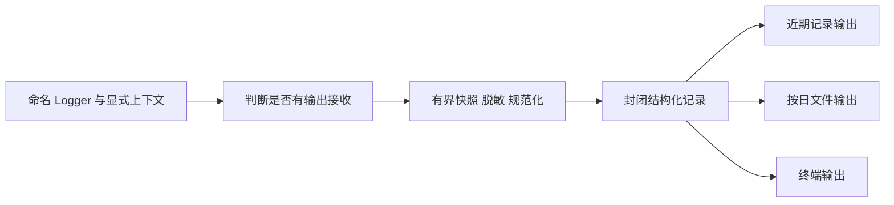

# 下一步计划：独立 logs 与渐进接入

状态：独立模块已实现，`src/tools/` 已支持显式注入 Logger，并完成受控模型、真实工具与 JSONL 消费验证。现有宿主尚未启用该注入，旧 logger、UI 和归档仍保持原样。本文保留设计约束并记录实现证据；后续调用方、UI 和归档迁移按独立切片推进，不由本文自动授权。整体方向见 [项目整体规划](project-plan.md)，持续约束见 [AGENTS.md](../AGENTS.md)。

## 1. 本轮交付与非目标

已实现 `src/logs/` 的通用创建、结构化记录、安全快照、输出过滤、失败隔离及 Node 默认管理；本次再为 `createTools(options, logger?)` 增加诊断接入。公开消费烟测与回归见第 10 节。

不替换 `src/main/agent/logger.ts`，不改变现有宿主的日志装配，不迁移旧日志文件，不更改日志面板、IPC、应用设置、模型归档或生产数据。独立模块及工具注入接口完成，不等于宿主或全量日志迁移完成。

Harness 公开面收敛仍是整体规划 M1 的目标，但不作为日志设计或第一个日志实现切片的前置条件。不借日志工作改写 Loop、消息历史、检查点、授权、恢复或执行身份，也不提前迁移 PPT。

## 2. 参考来源与当前事实

### 2.1 DeepSeek Harness 的取舍

参考固定版本，避免将后续上游变更当成本方案依据：

- [Cordis LoggerService 与 Logger](https://github.com/deepseek-ai/deepseek-harness/blob/ce7073d51254c26cd63b22a60835b8f948deb447/vendor/cordis/src/logger.ts)：命名 logger、结构化 Message、多个 exporter、输出级别过滤、随作用域释放的 exporter 注册。
- [ConsoleExporter](https://github.com/deepseek-ai/deepseek-harness/blob/ce7073d51254c26cd63b22a60835b8f948deb447/vendor/logger-console/src/shared.ts)：输出格式由 exporter 拥有，而不是调用方拼接终端文本。
- [Harness 架构与 Session log](https://deepseek-harness.github.io/deepseek-harness/en/reference/#session-log)：权威交互历史与诊断 logger 是不同职责。

采用日志服务、记录器、结构化记录和输出端的分工。不引入 Cordis、Fiber、服务定位器、动态发现或全局容器，不照搬上游数值级别、可变参数格式化和输出错误处理。本方案自行规定安全处理、输出失败隔离和显式所有权。

### 2.2 仓库现状

| 位置 | 已有行为 | 对设计的影响 |
| --- | --- | --- |
| `src/main/agent/logger.ts` | 模块级单例，包含异步上下文、过滤、序列化、控制台、按日文件、近期记录、设置与清理 | 不能只搬目录；需要区分通用机制和宿主配置，但现在保持不动 |
| `src/shared/logging.ts` | 日志面板使用的平铺条目、设置、状态与 Renderer 上报协议 | 是现有应用协议，不直接充当新模块的通用记录协议 |
| `src/main/index.ts`、`src/preload/index.ts`、日志面板 | 日志管理 IPC、Renderer 上报、查看、设置与清理 | 属于未来消费侧切片，不是本次设计的实现项 |
| `src/main/agent-host/configured-model-factory.ts` | 用 `withLogContext({ console: false })` 避免旧 Gateway 日志干扰开发终端 | 新设计将终端路由放到输出配置，不把开关放进执行身份 |
| `src/main/agent/gateway/gateway-io-log.ts` | 独立请求/响应正文归档，默认开启，与日志目录和上下文耦合 | 正文归档不能直接塞进普通 LogRecord；本轮不改变其行为 |
| `src/agent/session/session-events.ts` | 区分执行观察事件与临时模型增量，不承诺每个 fact 已持久提交 | 不把事件流原样转成日志，更不能用日志恢复执行 |

以上是代码核对，不是本次运行验收。既有能力不会因写入本方案而被宣布已经迁移。

## 3. 模块职责与依赖

logs 是通用诊断基础设施，不是模型可调用工具，也不要求作为 `AgentPlugin` 安装。未装业务插件时也可以记录诊断。

| 层次 | 拥有内容 | 不应依赖 |
| --- | --- | --- |
| 日志协议与通用实现 | Logger、记录格式、过滤、规范化、脱敏、分发、输出故障状态与关闭 | Agent 内部类、应用配置、旧 Gateway、Electron、PPT、Renderer |
| Node 默认实现 | stderr、按日文件、近期记录及其管理；必要时提供异步上下文适配 | 当前应用目录解析、模型正文结构、生产 IPC |
| 宿主组合 | 日志实例、输出选择、目录、级别、生命周期、环境变量和设置的解析与保存 | 日志内部缓冲和文件实现细节 |
| 消费方 | 命名 logger、安全诊断字段、必要执行身份 | 文件清理、全局配置和整个日志系统的关闭权 |

已实现的受支持入口为 `src/logs/log-contract.ts`、`src/logs/logs.ts`、`src/logs/node-logs.ts`：分别承担公开协议、通用创建、Node 默认功能。`internal/` 内聚运行机制、安全投影、设置和输出实现；没有新增 `index.ts`、独立包或可发布声明。

默认实现与内部装配由 logs 内聚；宿主调用一个完整的 Node 创建入口，不自行拼序列化器、缓冲区和轮转器。Node API 不迫使通用实现放进 `main`。

## 4. 公开协议

以下列出通用核心契约；完整协议（含具名 Node 选项和管理结果）见 [log-contract.ts](../src/logs/log-contract.ts)。所有类型由 logs 拥有，不借用 Agent 的 JSON 辅助类型或用具体工厂的 ReturnType 作为协议。

```ts
export type LogLevel = "debug" | "info" | "warn" | "error";

export type LogValue =
  | null
  | boolean
  | number
  | string
  | readonly LogValue[]
  | { readonly [key: string]: LogValue };

export interface LogContext {
  readonly operation?: string;
  readonly sessionId?: string;
  readonly agentId?: string;
  readonly threadId?: string;
  readonly queryId?: string;
  readonly runId?: string;
  readonly step?: number;
  readonly requestId?: string;
  readonly toolCallId?: string;
}

export type LogInput = Readonly<Record<string, unknown>>;
export type LogData = Readonly<Record<string, LogValue>>;

export interface LogRecord {
  readonly schemaVersion: 1;
  readonly timestamp: string;
  readonly instanceId: string;
  readonly sequence: number;
  readonly level: LogLevel;
  readonly name: string;
  readonly event: string;
  readonly context: LogContext;
  readonly data?: LogData;
}

export interface Logger {
  child(context: LogContext): Logger;
  isEnabled(level: LogLevel): boolean;
  debug(event: string, data?: LogInput): void;
  info(event: string, data?: LogInput): void;
  warn(event: string, data?: LogInput): void;
  error(event: string, data?: LogInput): void;
}

export interface LogExporter {
  export(record: LogRecord): void;
  close(): Promise<void>;
}

export interface LogOutput {
  readonly id: string;
  readonly minimumLevel: LogLevel;
  readonly exporter: LogExporter;
}

export interface LogsOptions {
  readonly outputs: readonly LogOutput[];
}

export interface LogOutputStatus {
  readonly id: string;
  readonly failureCount: number;
  readonly lastFailure?: {
    readonly timestamp: string;
    readonly operation: "export" | "close";
  };
}

export interface LogsStatus {
  readonly state: "open" | "closing" | "closed";
  readonly lateWriteCount: number;
  readonly outputs: readonly LogOutputStatus[];
}

export interface Logs {
  getLogger(name: string): Logger;
  getStatus(): LogsStatus;
  close(): Promise<void>;
}

export declare function createLogs(options: LogsOptions): Logs;
```

### 4.1 协议约束

- `getLogger(name)` 只创建命名记录器，不创建目录或启动独立资源。名称和事件使用稳定点分标识，不拼接正文、路径、凭据或用户原始输入。
- `LogInput` 是调用侧输入，允许传入需要安全投影的值；`LogData` 是经过规范化的 JSON 数据。二者不是同一契约。
- `isEnabled()` 表示当前是否至少一个输出接收该级别；调用方可用它避免构造昂贵摘要，不承诺下一次输出一定成功。
- `createLogs()` 校验配置：输出 ID 必须唯一，同一个 exporter 实例不能重复装配；至少配置一个输出，不能因忘记配置而静默丢弃全部日志。
- 创建成功后，exporter 所有权交给该 Logs；创建校验失败则仍归调用者。动态注册/卸载不是初始协议，需要时再设计，不预建插件框架。
- `export()` 是同步、有限工作的接口，不允许返回 Promise 或留下未经管理的异步写入。初始版本不包含后台队列、重试、远程发送和批量刷新。
- 输入对象在记录调用返回后可由调用方继续使用；日志不保留其可变引用。安全快照在调用期间建立，各输出共享只读记录；导出实现不得改写它，运行时封闭记录避免一个输出污染其他输出。
- `getStatus()` 返回只读状态快照，不暴露原始异常、目录权限信息或可变 exporter 对象。`lastFailure` 只表示发生过输出故障，不用后续写入成功抹去累计失败。

### 4.2 Node 默认功能

`createNodeLogs(options)` 已实现为异步创建入口，返回具名的 `NodeLogs`，提供上述 Logs 功能及近期记录查询、文件状态、更新输出设置和清理自身文件的管理能力。

Node 创建选项由具名 `NodeLogsOptions` 定义：显式目录、终端启用与级别、文件启用与级别、保留天数、近期记录级别与容量。默认近期容量 300、保留 7 天、最低级别 info；保留天数限 1–90，其他无效配置在创建或管理调用时明确拒绝。终端和文件必须显式选择是否启用，不读取应用环境变量。近期记录默认启用；不能禁用全部输出。

管理协议为 `getSettings()`、`getRecentEntries(query?)`、`getFileStatus()`、`updateSettings(patch)`、`clearFiles()` 和 `close()`；具体类型从 Node 入口或协议入口取得：

| 能力 | 契约 |
| --- | --- |
| 查询近期记录 | 按最低级别筛选，返回最新在前的只读记录；限制在配置容量内；首轮仅查询当前实例内存，不扫描旧日志 |
| 查询文件状态 | 只统计该实例目录中的托管日志，区分文件启用与输出失败；关闭后仍可查询 |
| 更新设置 | 显式异步管理操作，串行执行；失败向宿主报告，不能声称已保存；未成功更新项不改变有效设置 |
| 清理文件 | 串行清理该实例已完成的旧日文件，保留当日活动文件；不清空近期记录、不删除设置、会话或 Gateway 归档，返回实际删除数量 |
| 关闭 | 与管理操作串行；进入 closing 后拒绝新管理写操作，先完成已受理管理，再关闭输出 |

通用 Logs 不提供应用设置持久化；Node 设置更新只改变当前实例，保存到当前应用配置由宿主负责。Node 创建失败须回收其已创建资源；不能返回半就绪对象或自动切换到另一个目录。当前 IPC 的平铺条目、跨重启查询和“清理全部”行为不由这些新管理语义自动覆盖，面板迁移时须单独处理差异。

## 5. 记录、上下文与排序

- `timestamp` 为 UTC ISO 8601 时间，用于展示和时间检索；时间回拨不影响实例内序号。
- `instanceId` 在每次创建 Logs 时生成；`sequence` 对实际受理的记录递增，从 1 开始，关闭或过滤掉的调用不分配序号。
- 各输出看到同一记录的同一身份；经过级别过滤或输出失败后，某个文件中出现序号缺口是正常情况。序号不是业务提交编号，不保证跨进程或跨实例全序。
- `name` 表示来源，如 `agent.runtime`、`gateway`、`main.window`；`event` 表示稳定诊断动作，如 `model.request.failed`。不新增强制全仓事件枚举。
- `context` 与 `data` 分开存放；`data.runId` 无法覆盖 `context.runId`。保留宿主 `sessionId` 但不把它视为 `threadId` 的别名。
- `child(context)` 创建独立绑定，合并时子级已提供字段优先，undefined 不清空父字段。不修改父 logger；调用方应从 Agent 或 Thread 基础 logger 为每次 Run 建立新的子记录器，而不是从旧 Run 派生新 Run。
- 恢复保持 Query、更新 Run；恢复历史工具时，当前 `runId` 与 `toolCallId` 分别表达本次激活和原调用，不能把整条日志归到旧 Run。
- 初始设计以显式 child 传递为主，不要求实现 AsyncLocalStorage。将来有具体深层调用需要时，可在 Node 子路径提供异步上下文适配；不得把 `console: false` 等输出控制放进 LogContext。

## 6. 处理流程、安全与输出



### 6.1 安全处理

1. 输出过滤发生在快照和序列化前；未接收的调用不遍历输入。调用方已执行的字符串拼接无法由日志模块省去，昂贵计算使用 `isEnabled()`。
2. 所有输出接收同一份安全记录，内存缓冲不能保留另一份未脱敏输入。名称、事件、上下文和数据都受长度与敏感值处理约束。
3. 敏感键匹配忽略大小写和常用分隔符，覆盖 API Key、authorization、password、secret、access/refresh token 等；命中时整值替换为 `[REDACTED]`，包括对象和数组，不保留凭据前后缀。纯统计字段如 tokenCount 不因包含 token 子串而全部遮蔽。
4. 文本中的 Bearer、已知 Key 形态和含凭据的 URL 做兜底处理；它们不能证明任意文本没有秘密。调用方仍不得传入凭据、完整运行配置、SDK 请求/响应或含秘密的任意对象。
5. 默认不采集完整 prompt、模型正文、文件内容、工具输入输出或私有重放状态。debug 是记录级别，不是解除正文和凭据限制的授权。
6. Error 默认只提取规范化的 name 与安全的标量 code，不展开 SDK 对象、cause、请求头、请求体、原始 message 或 stack。调用方需要解释错误时，提供自己拥有且已分类的安全 reason/code；正文与堆栈不由本轮协议自动放开。
7. 遍历有界，不调用任意对象的 toJSON 或属性 getter。循环、不可读取字段、二进制数据和超限项使用固定标记，不能把序列化异常原文再写回日志。特殊对象、代理等导致快照失败时生成最小安全记录并继续分发。
8. 初始上限：深度 6、数组元素 50、对象键 50、字符串 16,384 个字符；记录 JSON 编码的 UTF-8 总大小不超过 64 KiB。超过总预算时用固定摘要替换 data，并限制信封字段，保留合法 JSON；不能截断最终 JSON 字节制造坏行。截断标记不包含被丢弃正文。

脱敏和规范化是诊断防护，不是任意恶意插件沙箱。Exporter 是受信任进程内实现；不得绕过安全记录再访问调用输入。

### 6.2 输出策略

- 级别按 debug < info < warn < error 理解，各输出独立设置最低级别。不能先用一个较高的全局阈值丢弃文件或近期记录想接收的日志。
- 终端输出默认写 stderr，业务/协议输出保留 stdout；是否渲染颜色属于终端输出实现，不影响结构化记录。初始不支持逐调用输出开关。
- 文件采用 UTF-8 JSONL，每条记录一行；目录由宿主显式提供，不读取 AGENT_LOG_DIR 或应用数据根。日期按 UTC 划分，与 timestamp 一致。
- 为避免新旧写入和不同进程相互轮转，文件写入 `<root>/<instanceId>/diagnostic-YYYY-MM-DD.jsonl`，一实例一子目录；实例内使用同步追加，不共享活动文件，不承诺 fsync 或进程崩溃零丢失。
- 保留策略仅处理该实例目录内、按约定命名的旧日文件；保留天数包含当天。首轮不跨实例自动清理，旧实例目录的磁盘治理留给后续宿主管理切片，不能声称一个实例已管理整个 root。
- 不跟随符号链接或目录联接执行清理，不递归清理未知目录。日志目录由受信任宿主绑定；这不提供对本地恶意进程的文件系统隔离。
- 近期记录采用有界缓冲，满时淘汰最早记录。它是查询输出，不是向所有消费方广播的持久消息系统。

## 7. 失败与生命周期

### 7.1 日志失败不能变成执行失败

- `debug/info/warn/error` 不因输入快照、序列化或 exporter 异常而抛出；一个 exporter 抛错时继续向其他输出分发，失败计数按输出独立记录。
- 输出失败不报告为写入成功，也不自动重试、切目录或把文件输出替换为终端输出。下一次正常记录仍可尝试既定输出；这不是重放失败的上一条记录。
- 记录调用返回 void，只代表诊断调用结束，不证明落盘，不提供业务持久性收据。
- 输出故障通过 `getStatus()` 暴露，不用同一个 logger 递归记录自身故障，不将原始输出异常公开给 UI。
- `createLogs/getLogger` 的配置错误、Node 初始化失败、管理操作失败与 `close` 失败可明确抛出或拒绝；它们不是普通记录方法的失败语义。

### 7.2 所有权与关闭

- 每个应用进程可拥有一个 Logs；多个 Agent 借用 Logger，共享输出不随单个 Agent 关闭。协议不要求全局单例，也不要求所有进程共用同一个实例。
- 模块载入不访问磁盘、不读取应用配置、不隐式初始化默认实例。宿主在创建消费方前完成日志实例装配，通过构造参数或工厂闭包传入 Logger。
- 应用停止受理并排空执行后，最后关闭日志。日志可以观察其他服务的关闭，但不能在自身关闭后继续承诺记录这些事件。
- `close()` 幂等，同一次关闭返回相同结算结果；先进入 closing、停止受理新记录，再逐一关闭全部输出。一个输出关闭失败仍尝试其他输出，最后聚合失败，状态进入 closed。
- closing/closed 后的记录不输出、不抛异常，增加 `lateWriteCount` 以暴露生命周期误用；状态查询仍可使用。这是关闭协议，不是无实现的静默 fallback。
- `LogExporter.close()` 释放该输出拥有的资源，不关闭共享 stderr 等借用的进程设施。没有资源的输出允许完成关闭，不由它接管宿主生命周期。

## 8. 与 Harness、宿主和模型归档协作

### 8.1 Harness 的未来接入

未来选择 Harness 切片时，通过具名服务选项注入窄 Logger 协议；本轮不增加 AgentServices 字段，不修改 PluginContext，不要求插件通过通用上下文查找日志服务。

诊断可覆盖 Run 开始与结算、等待、已接受的恢复回答、Step 持久提交、工具派发/结算和模型请求结算。只选择安全标识、状态、耗时和分类错误，不逐 token 落盘，不保存完整工具调用或结果。

`step.committed` 只能在权威提交之后记录。若从公开事件做诊断投影，不能把每个 fact 都解释为已持久成功；投影退出、消费变慢或日志输出失败均不得驱动执行或改变取消语义。

### 8.2 当前宿主的未来接入

宿主负责解析环境变量、应用目录与设置，再传给 Node 创建入口；打开目录、IPC 和 Renderer 日志上报继续由 Electron 适配承担。Renderer 上报不能自行设置可信 Run 身份，宿主绑定来源信息。

面板消费自己的公开 DTO，不直接取得 Logs 管理实例。未来迁移面板时再确定展示映射、旧文件读取、跨实例聚合和清理提示；现在不增加映射层或承诺原样兼容新旧记录。

### 8.3 模型正文归档边界

Gateway 请求/响应归档保持现有实现和开关。本设计不创建归档端口、不移动其文件、不改变默认采集策略。

以后迁移该能力时，由模型适配边界拥有正文结构与采集授权；普通日志最多保留 requestId、状态、安全摘要及已生成的归档引用。不得把完整消息、工具定义或重放状态塞入 data，也不能让 logs 依赖旧 Gateway 类型。归档的保留和清理不由普通文件 exporter 代管。

## 9. 渐进采用规则

“实现独立 logs”切片已完成，选定调用模块 `src/tools/` 已支持宿主显式注入 Logger；现有宿主的装配尚未启用。其他行仍是后续工作边界，不规定必须连续执行的全量替换顺序。

| 后续切片 | 可以改变 | 必须保持不动 | 该切片的独立验收 |
| --- | --- | --- | --- |
| 实现独立 logs | 新模块及其真实消费烟测 | 所有现有日志调用、IPC、UI、历史文件 | 模块无需 Electron/旧 Agent 即可记录、读回和关闭 |
| 接入一个选定调用模块 | 该模块的日志依赖与外层装配 | 其他未迁移模块 | 选定模块实际路径、上下文和输出正确；无重复记录 |
| 接入新 Harness | 选定的服务协议与诊断埋点 | 恢复历史、检查点、业务插件语义 | 并发和跨 Run 关联正确，日志失败不影响执行 |
| 接入日志管理界面 | 宿主 DTO、IPC、面板展示与管理 | 未纳入切片的旧记录器和模型正文归档 | 实际界面查询、设置、清理及差异提示正确 |
| 迁移归档或退出旧日志 | 各自明确范围内的旧能力 | 尚有调用方的路径与数据 | 对应调用方全部迁出、数据处理和关闭规则有证据 |

共存约束：

1. 旧 `src/main/agent/logger.ts` 及其调用继续运行，不先替换成转发壳，也不先做全仓 import 改写。
2. 同一诊断事件由选定调用链的一个记录器负责；不默认双写，不把新旧系统互相接成 exporter，以免递归或重复采集。不同层次的不同事件可以分别记录。
3. 新日志使用独立实例目录；不读写旧 settings.json，不扫描、删除或重写旧日志及 Gateway 文件。旧面板暂时只展示旧日志是明确的过渡限制，不伪装成全局视图。
4. 每个迁移切片内部更新其全部受影响调用契约，不为已经迁移的同一功能保留永久别名；这不要求本轮把其他模块一起迁完。
5. 旧实现没有剩余消费者、管理和归档依赖也有归属后，才另行删除。设计阶段没有删除旧代码的交付要求。

## 10. 实现状态与验证证据

### 10.1 已完成的独立模块

- `createLogs()` 提供显式输出装配、命名 Logger、独立阈值、封闭快照、输出失败状态与幂等关闭。
- 安全投影使用共享遍历预算（2,048 个值节点、48,000 字节的数据预算），并遵守深度、宽度、单字符串及最终 64 KiB 记录限制；不读取属性 getter、不调用输入 toJSON。
- `createNodeLogs()` 提供同步 stderr/JSONL 输出、有界近期环形缓冲、UTC 跨日保留、实例内清理及串行设置/关闭。
- Node 管理采用显式的 `NodeLogsOptions/NodeLogsSettingsPatch`；环境变量、应用设置、旧日志读取和 UI 未接入。
- `tsconfig.node.json` 已包含 `src/logs/**/*.ts`。通用入口可针对浏览器平台打包；这证明没有 Node/Electron 打包依赖，不代表已验证浏览器运行界面或独立发布。

### 10.2 独立 logs 实施时的验证

| 检查 | 实际结果 |
| --- | --- |
| `npx vitest run tests/logs.test.ts tests/log-safety.test.ts tests/node-logs.test.ts` | 3 个文件、31 条回归通过；覆盖过滤、上下文、隐私边界、真实文件输出、环形缓冲、UTC 保留、链接拒绝、失败隔离与生命周期 |
| `npm run typecheck` | Node 与 Web 两套 TypeScript 检查通过 |
| `npx biome check src/logs tests/logs.test.ts tests/node-logs.test.ts tests/log-safety.test.ts tsconfig.node.json` | 12 个文件通过，无剩余诊断 |
| `npm test` | 188 个文件通过，1,436 条通过、2 条跳过；此命令不包含集成测试 |
| 临时公开消费程序 | 实际写入并读回 JSONL；验证凭据遮蔽、Query/Run 关联、输出独立级别与近期查询 |
| 临时文件故障与清理 | 用目录阻塞当日文件，确认文件故障计数增加、近期记录仍收到日志；清理自建旧日文件且旧 logger/归档哨兵不变 |
| 自建 Node 子进程 | stdout 仅业务输出，stderr 收到实际诊断；没有接入或替换现有开发 CLI |
| 通用入口浏览器平台打包 | 不依赖 Node/Electron 即可完成打包；只检查打包，不声称实际浏览器消费已验收 |
| 临时数据回收 | 烟测临时工作区已移除，临时消费者脚本不保留在仓库 |

上述证据不包含真实厂商调用、生产 UI、Electron 日志管理面板或既有开发宿主的日志迁移；未运行这些场景，也没有改变其日志行为。

### 10.3 后续迁移时另行验收

- 当前已在受控模型下验证工具审批等待、原 Query 的新 Run 恢复和日志失败下的真实写入；尚未验证跨进程日志恢复、Harness 全生命周期诊断或生产入口的日志装配，不扩大到这些场景。
- 开发入口接入后，再验证其实际 stdout 协议、取消和关闭顺序；本次仅使用独立 Node 子进程。
- 面板接入后，在真实界面验证查询、设置、统计、旧日志可见范围与清理提示；不能以当前内存查询证明已有面板迁移。
- 跨实例磁盘治理、历史文件读取和模型正文归档仍未迁移，不扩大当前清理范围。
- 后续继续以实际入口烟测和消费者可见行为回归为准，不建立源码字符串、文件数量或简单转发测试。真实模型调用前另行说明范围与用量。

### 10.4 tools 诊断接入

`createTools(options, logger?)` 的第二参数是借用的公开 Logger，不是 Logs 管理对象；JSON 配置仍只包含原工作区与工具选项。未传 Logger 时不创建输出或默认单例，既有开发宿主调用保持不变；工具版本、输入输出和检查点协议未变。

日志位于五个默认工具的执行回调内，输入校验、授权拒绝或审批等待不会提前进入；安装和释放只管理原有工具资源，不关闭 Logger。新 `internal/tool-logging.ts` 不访问工具输入和输出正文：

| 事件 | 级别与字段 | 含义 |
| --- | --- | --- |
| `tools.execution.started` | debug；toolName | 已获准进入工具体，不表示工具成功或提交 |
| `tools.execution.completed` | 成功 info，failed/unknown 为 warn；toolName、status、effects、durationMs，失败附分类 code | 工具体已返回，保留其 reported effects；不等于模型投影、规范历史或检查点已提交 |
| `tools.execution.failed` | error；toolName、durationMs、固定 code `TOOL_EXECUTION_THROWN` | 工具体意外抛出；不展开原异常、不推断影响，原异常仍交回执行边界 |

每次调用通过 child 绑定当次 `agentId/threadId/queryId/runId/toolCallId`，覆盖宿主 Logger 中可能残留的旧 Run 身份；不虚构未提供的 Step。日志不包含绝对或相对路径、文件版本、完整输入输出、glob/grep 表达式、匹配行、编辑文本或取消原因。

本次证据：

- `tests/base-tools.test.ts` 新增两条消费者回归，覆盖五工具真实文件操作、输出故障下已发生影响的保留、借用资源生命周期、审批前无执行记录、拒绝和校验失败无记录、新 Run 的调用关联及正文隐私。
- 工具、日志与开发宿主相关的 5 个测试文件运行结果：70 条通过、1 条跳过；项目类型检查与 3 个修改 TypeScript 文件的 Biome 检查通过。
- `npm test`：188 个文件通过，1,438 条通过、2 条跳过；没有运行真实厂商或 Electron 集成测试。
- 临时公开消费程序通过 `createAgentApplication + createTools + createNodeLogs` 实际执行五工具、审批等待与恢复，读回真实 JSONL 核验元数据和隐私；用目录阻塞日志文件后，工具写入仍返回 applied 且文件内容正确。Agent 关闭后 Logs 保持 open，由宿主另行关闭。
- 模型为本地受控实现，不是远程厂商；工作区、SQLite、日志文件与临时构建目录均为本次创建并已清理，临时消费者不保留。


## 11. 后续路线保留

本方案调整的是当前工作顺序，不宣布 M1–M4 已完成或取消：

- M1 继续收敛 Harness 功能入口与扩展端口，复用 createAgentApplication，处理 ResourceScope 和 protocol-utils 泄漏，迁移相应消费者，以相对路径/别名正反向消费验证约束边界，并验证无业务插件与文件插件的既有行为和恢复兼容性。
- M2 分离具体运行配置、宿主机制与适配器，实际验证独立包边界；不能用重导出入口冒充独立消费完成。
- M3 验证扩展组合与可靠性，M4 按宿主需求迁移消费侧；日志切片不自动启动这些工作。
- PPT 仍是独立可选业务插件工作线，不把 Presentation、PPT 状态或 UI 当前选择加入通用日志协议或 Loop。
