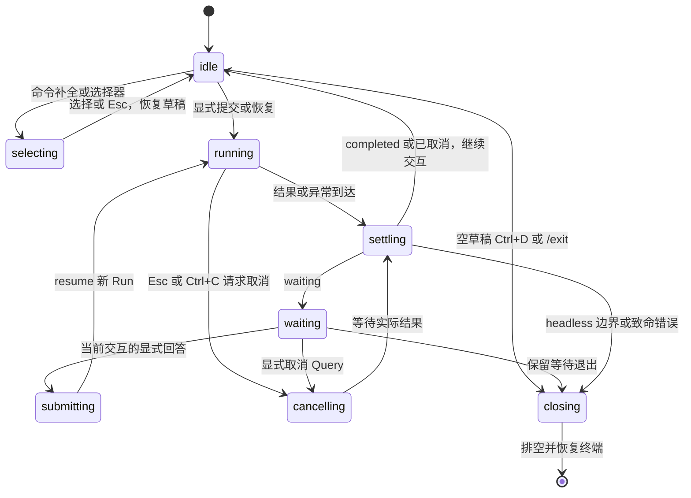

# 独立 Node CLI：终端设计与生产直切执行方案

[返回计划目录](README.md) · [项目整体规划](../project-plan.md) · [Tools 收敛](tools-package.md) · [页面 UI 方案](ui-design-system.md)

状态：C0–C4 已按第 8.3 节同轮实施并切换生产 Node CLI；不再经过 Electron，不保留旧 CLI 兼容或独立预览入口。配置包、Windows DPAPI、Node 宿主、inline TUI、print/JSONL 与持久恢复已接入，分层验证及当前仓库检查限制见第 8.4 节。桌面聊天/PPT 与既有桌面数据未切换或迁移。

## 1. 结论、目标与范围

本轮直接交付真实可用的 Node CLI：终端呈现、输入状态机、宿主配置/凭据/持久化与根入口切换一并实施，使用 Core/models/logs/tools/configuration 的受支持公开面。旧 CLI 不承担向后兼容要求，不维护预览版或双轨入口；清空根 `src/`、迁移 PPT 或完成新页面 UI 都不是前置。用户允许直接切换 CLI，不等于授权删除桌面实现、凭据或已有数据库。

终端是 Node 宿主的输入输出层，不是另一套 Agent Loop。终端调用 Core 公开执行协议，模型、配置、凭据、持久化、授权和能力装配由宿主负责。终端完成不等于纯 Node 运行时已完成；受控场景不等于真实模型或文件验收。

包含：

- OMP 风格的交互终端：会话历史、流式临时区、工具卡、多行 Composer、选择器与上下文状态栏；另有独立 print/plain 与 JSONL 输出。
- stdout/stderr 分工、明确的 JSONL 模式和退出语义。
- 单一输入所有者、多行输入、命令、等待、EOF、取消、中断与恢复交互。
- 基于现有 Core 公开协议的安全展示投影，不依赖具体工具载荷。
- 定向行为回归、真实生产终端/管道烟测及完整生产切换；本地受控场景用于验证同一套实际组件，不作为单独预览产品或交付前置。

不包含：重写 tools、PPT/文件管理界面、默认全屏备用屏幕、鼠标操作、文件/图片附件、任意补全/扩展框架、Vim 模式、外部编辑器、后台排队、自动重试、通用跨端展示协议、当前桌面配置/数据库迁移。首轮包含本地斜杠命令补全，不将其扩成文件扫描或插件发现。Node 凭据及持久化适配必须真实实现，但不在终端呈现切片中伪造或临时降级。

## 2. 设计时核对的基线（已由第 8.4 节实施替换）

| 位置 | 当前行为 | 本次设计决定 |
| --- | --- | --- |
| `cli/development-terminal.ts` | 单输入队列承载向导、聊天和审批；仍借用旧配置管理契约 | 保留单一输入所有权原则，移除终端对旧配置/具体工具的直接理解 |
| `cli/commands/development-command.ts` | 中文提示、菜单和 JSON 混用 stdout；当前只接受无参数、prompt 和帮助；过滤掉模型增量 | 交互 TUI 显示明确的临时正文预览；print 只输出权威正文，JSONL 单独编码，不混成一个输出模式 |
| `cli/configuration/development-setup.ts` | 当前 Key 使用普通明文回显输入 | 新终端凭据输入必须独立隐藏回显；无安全输入/存储能力就明确失败，不能默默明文保存 |
| `app/main/agent-host/development-runner.ts`、`scripts/run-agent.mjs` | Node 启动 Electron，父进程接收终端输入后经 IPC 转发 | 统一切换时改为 Node 直接管理进程与 stdin，不保留失效 Electron CLI 启动路径 |
| 现有两份 development CLI 集成测试 | 真实 Electron 子进程与本地 HTTP/SSE；交互通过 IPC 注入 | 可以复用行为场景，但不能作为真实 PTY 编辑、隐藏输入或 Ctrl+C 按键证据 |
| Core 的公开 agent/session/protocol/model/tool 契约 | 提供执行句柄、观察事件、完成结果、版本化交互及效果；没有终端 DTO 或会话列表服务 | 直接消费受支持协议；不预设未来后端 DTO、历史读取或交互答案 schema |

Tools 计划拥有插件工厂、纯契约/错误及受控 Node 文件支撑；宿主继续拥有能力选择、授权与审批载荷。终端不导入 tools 私有文件，不根据工具名称决定 Harness 的基础语义。

## 3. 终端形式与布局

### 3.1 默认形式：历史与可重绘区域分离

参考 OMP 的 history/viewport、Composer、工具展开和选择器设计，不再将交互模式限制为追加日志。支持终端进入 inline TUI：上方为可滚动历史，下方为活动响应/工具卡、Composer 与上下文状态栏。默认不启用备用屏幕，不在普通刷新时清空历史；print/plain 和 JSONL 不启动 TUI。

已结算消息形成终端展示历史，活动响应、输入、选择器及待决交互属于可变 viewport。终端展示历史不是 Agent 的规范存储；窗口位置、滚出屏幕或一条进度事件不能决定持久提交。历史追加与 viewport 重绘由同一输出所有者协调，不靠逐行 console.log 拼屏。

交互布局如下，是本项目的建议版式，不是 OMP 截图；数据均由实际宿主和公开事件提供：

```text
Agent Harness                                      当前会话

你
请概括这个项目的结构。

助手
这里显示已完成响应的正文。

────────────────────────────────────────────────────────────
活动响应 · 正在输出 · 临时预览
目前可以确认的模块包括……

工具活动  1 项
  > read   call-…   已返回：succeeded / none
    Ctrl+O 展开安全详情；不展示原始输入或工具结果
────────────────────────────────────────────────────────────
> 继续描述需要执行的任务……
  支持多行；执行中可编辑草稿，但不能提交或排队
────────────────────────────────────────────────────────────
项目 demo · 模型 当前模型 · 能力 只读 · 状态 运行中
Enter 发送  Alt+Enter 换行  / 命令  Esc 取消当前局部操作
```

- Composer 在空闲和运行中均可编辑，但只有就绪空闲态可提交；运行中按 Enter 不隐式排队、不形成 steering 消息，状态栏解释原因。
- 第一轮状态栏只显示工作区/会话、当前模型、实际能力模式和执行状态。token、上下文百分比、费用、Git 分支只有真实数据源存在才显示，不为了类似 OMP 填假值或额外启动扫描。
- 工具卡默认摘要，区分运行、返回、待决和结果不确定；`status`、`effects` 分列，折叠不能隐藏关键失败或 applied/unknown 提示。Ctrl+O 默认作用于最近活动卡；查看旧卡由 /tools-output 列表选择并在 viewport 打开详情，不回写已进入终端历史的摘要。
- Markdown 首轮支持段落、列表、标题、行内代码与代码块的可读排版；不执行 HTML/ANSI、不自动打开链接、不渲染图片。代码块保留内容和复制语义。
- resize 只重绘当前 viewport；默认保留旧宽度历史，不采用 OMP 可选的 rebuild/append 历史重放策略。选择器关闭后恢复原草稿、焦点与光标。

### 3.2 流式预览与最终正文

交互 TUI 消费公开 `model.delta` 的文本增量，按完整 Run 身份、step、requestId、contentIndex 关联到当前临时块；不展示 reasoning、工具参数增量或私有重放。不同请求不能拼成同一助手消息，旧 Run 的迟到事件不覆盖新实例。

- 增量只更新 mutable viewport，不写规范历史，也不提前追加为最终终端历史。`step.committed` 没有正文快照，不能据此将当前 delta 缓冲当权威消息。
- `completed.output` 到达后，撤下临时块，按权威有序助手内容结算一次；不把整个最终答案再次追加在同一份已落入历史的预览后。权威内容不同也必须展示实际结果，不能保留错误预览。
- waiting、failed、cancelled、interrupted 或完成 Promise 拒绝时撤下未完成预览，保留明确结果/不确定性说明；已经确定的工具影响不得因撤下预览被抹去。
- 首轮临时正文缓冲每个活动 Run 最多保留最近 64 KiB UTF-8 文本，在字符边界裁剪，显示“仅预览尾部，最终以完成结果为准”。这只是展示预算，不截断模型输出或规范消息；不能因超出 viewport 就偷偷提交预览历史。
- print/plain 和 JSONL 首版不输出 delta，正文仍来自权威完成结果。交互流式与自动化输出分别验收，不把临时预览编码成 assistant.message。

### 3.3 宽度、内容与安全

- renderer 统一使用终端可见列宽和字素边界测量、换行与截断，不按字符串 length 处理中文、组合字符或 emoji。40/80/120 列均可操作；代码/路径不被语义改写，非 TTY 不人为插入布局换行。
- Composer 可增长至当前视口约三分之一，超过后内部滚动；状态栏窄屏收敛为模型/状态和一行提示，工作区完整信息通过本地 /status 查看。小于 40 列或 12 行时降级 plain，不能重绘覆盖主要操作。
- 选择器及当前输入属于 viewport，不进入历史。长详情按视口分页，必要错误和完整交互身份始终可达；不靠颜色或 hover 表达操作。
- 外部内容中的 ESC/OSC、BEL、退格、控制光标的 CR 及危险双向控制字符转为可见转义；保留正文换行和受控制表符。输入按键解析与内容显示防护分开，不能把识别按键所需转义序列原样回显。
- ANSI 只由 renderer 生成。`--no-color` 或存在 `NO_COLOR` 只关闭颜色，不自动关闭编辑能力；`TERM=dumb`、无必要 TTY/游标能力或尺寸不足时降级 plain。JSONL 始终无 ANSI。
- 只展示公开安全工具摘要；有真实 owner/type/version 描述器才可展开额外详情。不能 dump 工具输入/结果、presentation.data、私有状态、原生错误或 SDK 异常；折叠展开不是解除安全边界。

### 3.4 采用 OMP 的部分与项目差异

| OMP 官方资料中的能力/机制 | 本项目决定 |
| --- | --- |
| history 与 mutable viewport 分离、差量重绘 | 采用职责分离；首轮只实现 inline 所需部分，不复制完整渲染引擎 |
| Composer、多行编辑、键盘选择器、工具展开 | 采用交互形式，具体按键与安全边界见第 5 节 |
| 独立 print 与 JSON 事件模式、确定性 gallery | 采用模式分离与确定性行为场景；不要求独立预览命令，不复制 OMP 的事件 schema 或 CLI 命名 |
| 工具输出与模型/会话选择 | 默认摘要、可展开和可搜索；只展示真实可用项，不复制模型角色系统 |
| Ctrl+C 清草稿、Esc 处理局部交互/中断 | 采用按状态分工；待决交互不能因 Esc 直接变成拒绝，见本项目取消规则 |
| follow-up 队列、retry、后台任务、Agent Hub、RPC/ACP/TSP、Vim/图片/语音 | 不纳入首轮；不能仅为外观类似而伪造或扩展 Harness 能力 |
| 会话全项目搜索、重定位及模型回退 | 不照搬；继续遵守当前绑定、权限环境与存储恢复约束 |

这里只参考交互与职责。首轮不引入 OMP 的 Bun/Rust 运行时、native addon 或整套 coding-agent，也不复制源代码。若实现评估发现终端底座依赖确有必要，应先记录 Node/Windows 兼容性、许可证、退出恢复与体积取舍，不默默改用完整 Agent 框架。

## 4. 输出模式与退出协议

### 4.1 模式选择与 stdout / stderr

模式显式区分交互 TUI、人类 print/plain 和机器 JSONL。省略 output 时为 human；stdin/stdout 均为 TTY、未指定 print 且能力满足时才启动 TUI。`--print/-p` 或 `--prompt` 选择一次性执行，具体编码仍由 output 决定；`--output jsonl` 总是非交互，不挂载选择器、不消费审批输入。非 TTY 不启动 TUI，管道任务仍按第 5.2 节处理。

| 模式 | stdout | stderr | 输入方式 |
| --- | --- | --- | --- |
| 交互 human TUI | 单 writer 输出历史、活动区、Composer、选择器与状态栏，可含受控 ANSI | 诊断不直接插屏；活跃 TUI 中经 coordinator 归并到通知区，退出后输出失败摘要 | 唯一 raw input owner，renderer 自行画回显 |
| print/plain | 权威助手正文，不加进度 JSON/编辑器控制码 | 简短进度、错误和 plain 提示；不是 TTY 时无 ANSI | print 非交互；仅能力降级的 plain 会话可经 stdin/stderr TTY 交互 |
| JSONL | 每行一个版本化安全记录，无 banner、菜单、裸正文或 ANSI | 安全诊断，不提问、不交互初始化 | argv 或整段 stdin 的新任务，或显式恢复；waiting 退出 3 |
| stdout 重定向 | 自动不启用 TUI；输出协议仍由 output 参数决定 | 不偷开其他终端读取审批 | 无输入终端时不启动向导；不以管道数据代替授权 |

帮助写 stdout，参数错误写 stderr。TUI 和 plain 的输入/回显适配分开，同一时刻只有一个显示 writer；stdout 重定向后不得残留 raw mode、编辑器回显或光标控制码。能力降级应在创建 TUI 前明确决定，运行中故障则排空并恢复终端，不能同时保留两套输入消费者。

JSONL 属于 CLI 的版本化消费协议，不是 Core 原始事件或未来 IPC 协议。C0 定稿具名 `TerminalRecord` 判别联合；首版使用 `version: 1`，投影 `session`、`progress`、`tool`、`interaction`、`assistant.message`、`query.result`、`error`、`process.finished`。有运行身份时保留完整 agent/thread/query/run ID，工具记录另保留原 invocation 身份，不能只靠 callId 关联。

每个完成 Query 的权威助手内容只结算一次；恢复结果可能包含此前 Run 产生的消息，不能拼接本地猜测历史。JSONL 不输出原始交互 data 或 delta，未知载荷仅输出 owner/type/version/interactionId 及安全说明。TUI 的键盘草稿和 viewport 缓冲都不进入此协议。

`query.result` 不等于进程成功。排空观察、完成实际结果与资源关闭后才输出 `process.finished`；完成拒绝或关闭失败仍必须非 0。stdout 失败/EPIPE 时不向坏管道递归报错，停止受理、排空执行并恢复终端状态。

### 4.2 退出码

以下是新 CLI 的选择，不是 Harness 状态字段；统一切换时同步更新帮助和消费方：

| 退出码 | 含义 |
| --- | --- |
| 0 | 帮助、无活动请求的正常退出，或请求 completed 且关闭成功 |
| 1 | 配置、执行、持久化、协议、输出或资源关闭失败；持久结果可能不确定 |
| 2 | 参数或不支持的组合错误，尚未启动执行 |
| 3 | 明确保留 waiting，未作答；不是失败，也不是 Query 完成 |
| 130 | headless 用户取消已确认，或交互用户显式中止进程；交互中只取消当前 Query 不立即退出 |
| 143 | 宿主终止/关闭中断，正常排空后退出；不冒充用户取消 |
| 141 | 下游管道关闭 EPIPE，执行已排空且没有更高优先级的关闭/持久化错误 |

关闭、持久化或输出未知结果优先于“完成/取消”成功提示；不得为了凑固定退出码掩盖实际 waiting 或提交不确定。当前旧 CLI 可以在 waiting EOF 时返回 0，新协议改为 3 是本轮生产直切中明确接受的破坏性变更，帮助、消费方与测试同步迁移，不保留旧码兼容。

## 5. 输入所有权与命令

### 5.1 唯一输入所有者与 Composer 状态

状态描述终端，不复制 Core 持久状态。Composer 的 draft/editable/submitEnabled 与执行 phase 分开：启动尚未就绪、运行中、提交交互和关闭时禁止发送；允许编辑不等于允许执行或隐式排队。



- TUI 的 raw input、plain readline 和管道 reader 互斥，聊天、选择器、secret 与交互只切换输入 owner，不创建竞争消费者。
- 输入请求绑定本地世代和用途；交互额外绑定完整 Query/Run/interaction 身份。关闭/换焦点后旧事件与回调失效，不把草稿或粘贴余行送进新审批。
- Enter 只在 submitEnabled 时提交一次；运行中 Enter 保留草稿并解释不可发送，启动前提前到达的 Enter 也不能在就绪时重放提交。
- 选择器和待决交互临时取得焦点，退出后恢复原草稿；模型/会话切换必须在空闲并明确处理当前草稿后执行，不能跟随当前选择改变已有 Query 的绑定。
- 收到过期回答、不可识别按键或输入故障时不猜测用户意图；高风险确认要求输入当前界面显示的 interactionId。bracketed paste 整块进入草稿，不执行其中斜杠命令或确认按键。
- 所有 resize、流式和进度重绘保留草稿、字素边界和光标；用户阅读旧历史时不主动清屏重放历史。

### 5.2 编辑、快捷键、多行与管道

采用动作到按键的窄映射，代码不在各组件散落硬编码。首轮不加用户 YAML 配置或 Vim 模式；/hotkeys 展示本项目当前支持的动作，不照抄 OMP 全表。

| 动作 | 首轮交互 TUI 默认 | 边界/替代 |
| --- | --- | --- |
| 发送 | Enter | 仅 idle 且就绪；补全只接受候选，不顺便发送 |
| 换行 | Alt+Enter；终端可可靠区分时另支持 Shift+Enter | /paste 为 plain/不支持修饰键终端的明确后备 |
| 命令候选 | 行首 / 触发本地命令过滤，Up/Down 选择、Tab 接受 | 首轮不扫描文件、不调用模型补全；Enter 接受候选后仍需再次明确发送 |
| 本地输入历史 | 单行草稿边界处 Up/Down | 多行内部优先移动光标；不读 reasoning、Key 或别的项目历史 |
| 工具详情 | Ctrl+O 切换当前工具详情，另提供 /tools-output | 只展开获准的安全展示；关键失败和效果不确定始终可见 |
| 模型选择 | /model；Alt+M 为便捷入口 | 搜索、Up/Down、Enter 选择、Esc 返回；仅真实已配置模型 |
| 会话选择 | /resume | 当前工作区列表与搜索；不默认跨项目或使用 OMP 的模糊首个匹配恢复 |
| 快捷键帮助 | /hotkeys | plain 也可读取；不是新的运行能力 |
| 局部取消 | Esc | 先关补全/选择器；无局部 UI 的活动 Run 请求取消并留在会话；不把待决交互当拒绝 |
| 清草稿/取消 | Ctrl+C | 编辑时清草稿并保留本次进程内可召回副本；运行/等待时请求取消 Query，结算后回到会话 |
| 正常退出 | 空草稿 Ctrl+D 或 /exit | 非空 Ctrl+D 不丢草稿；关闭失败仍非 0，不采用双 Ctrl+C 强行跳过排空 |

- Composer 原生保留多行文本。收到 bracketed paste 时保持整段、不自动发送；未支持的终端用 /paste，独立行 /end 提交、//end 表示正文 /end。plain 的未结束多行遇 EOF 不提交。
- 未提供 prompt/resume 且 stdin 非 TTY 时，整段 stdin 到 EOF 是一个用户消息，斜杠只是文本；空输入正常退出，不启动凭据向导。
- `--prompt` 不消费非 TTY stdin 作为审批答案；print/JSONL 遇 waiting 输出待决信息并退出 3。`--print` 搭配交互 stdin 不自动等待更多问题或弹出选择器。
- stdout 重定向后不进入 TUI。仅 plain 会话在 stdin/stderr 均为 TTY 时可以提问；JSONL/print 一律不提问。无支持的输入能力时不能隐藏地改从别的终端读审批。

### 5.3 首轮命令面

下表为本轮已实现的生产 CLI 接口。模型、会话和能力操作接真实宿主，不以预览选项或假成功命令占位；受控测试的场景数据不进入生产模型/会话目录。

| 命令/参数 | 行为与边界 |
| --- | --- |
| `--help`、`-h` | 无配置、无模型、无数据库、无 tools 也能显示帮助并退出 |
| `--prompt <text>`、`--print/-p` | 一次逻辑请求，权威结果边界后退出；print 不进入交互 TUI，不默认收集后续回答 |
| `--output human\|jsonl`、`--no-color` | 选择人类/结构化协议；jsonl 为非交互，颜色开关不改变执行/授权 |
| `--thread <id> --resume <queryId>` | 仅恢复已有持久 Query；两项同时需要，与新 prompt 互斥；不读取 stdin 作为新任务，不接受客户端快照 |
| `/help`、`/hotkeys`、`/status`、`/paste`、`/exit` | 终端本地命令；TUI 优先原生多行，/paste 为明确后备；/exit 不取消已持久等待 |
| `/new`、`/model` | 空闲时经真实宿主创建/选择；模型改变新建会话，不把旧检查点迁到新权限环境 |
| `/resume` | 经真实宿主目录选择已有线程/Query，再由存储恢复；Core 本身不提供会话列表，不能据终端缓存实现 |
| `/tools` | 统一接入阶段才从真实已安装能力与策略提供选项；未安装时明确显示不可用，不伪造开关 |
| `/tools-output` | 只切换安全工具卡展示，不改变 tools 安装、权限、展开数据白名单或执行状态 |

未知斜杠命令就地提示，不发给模型；输入正文以 `/` 开头时用 `//` 转义首个斜杠。/paste 内及非 TTY 正文不走命令解析。常规 Composer 多行仅在整份草稿是已知命令语法时处理为命令，其他多行正文不会逐行执行斜杠命令。首轮不执行 shell 或扩展快捷命令插件。

配置/模型选择返回终端层具名的非敏感展示项与选择结果，不让 renderer 依赖整个旧 `ConfigurationManagement`。凭据输入使用专门 secret 请求，只在有真实安全适配时启用，隐藏回显且不写历史；密码遮蔽不是凭据持久化方案。没有安全能力时不先收集 Key，更不能用环境变量自动持久化代替用户授权。

## 6. Harness 结果、交互与取消语义

### 6.1 只消费现有公开协议

终端控制器消费 `AgentRunHandle.identity/events/completed/cancel` 和 `SessionHost.run/resume/close` 所需的窄能力；projection 只消费公开 `RuntimeEvent`、`AgentRunResult`、`InteractionRequest/Response`、模型内容和工具结果元数据。终端自己的 record/input 类型具名定义，不扩充 Core 协议，不用内部实现的 ReturnType 充当契约。

每个句柄事件流只有一个消费者。观察退出不等于取消；事件消费速度不能成为驱动执行的条件。`run.completed` 是观察事实，不足以证明 lease 清理成功；以 completed 的实际履约/拒绝和关闭结果决定最终提示。

`step.committed` 可更新已提交修订，但没有正文快照；不能从 delta 合成规范历史或据该事件结算预览。最终正文只从 completed 结果投影；只有临时 viewport 可显示文本增量，恢复历史只读真实宿主的权威投影。终端历史中的消息结算与 Agent 存储是不同职责。

### 6.2 等待交互

```text
[等待回答] 请求尚未完成
事项：已支持 owner/type/version 描述器提供的安全说明
交互：完整 interactionId

  允许本次    拒绝本次    取消请求    保留等待并退出
  方向键选择，Enter 确认；初始不预选“允许”
  Esc 只退出局部详情，不替用户批准或拒绝
```

上面的选择器仅用于统一接入后确已支持的确认载荷；不假定所有 InteractionRequest 都是确认。plain 使用带 interactionId 的明确文本回答，非交互不收集答案。高风险交互须进一步输入当前 ID，不能单靠 Enter。Core 的 answer.value 由生产者解释；reject 不等于取消 Query。

- 首先等待当前 handle.completed 返回 waiting，再显示可回答提示；收到 interaction.requested 事件不能抢先 resume，当前 Run 可能仍在释放槽位和租约。
- 宿主以窄函数按 owner/type/version 描述和解释真实载荷；第一轮不建通用注册框架，不按工具名解析路径、diff 或副作用。
- 未识别的载荷只显示 owner、type、version、ID 与“不支持交互格式”；不打印 data，不猜 true、不通用 JSON 编辑、不自动拒绝。允许保留 waiting 退出；显式取消仍走 Core cancel 响应。
- 回答使用同一 Query、匹配 interactionId 和新 runId；输入只产生 InteractionResponse，不携带执行快照、检查点或客户端租约。
- 输出“已收到本地输入”和 Core 接受 interaction.resolved 是两件事；持久提交不确定时报告失败/不确定，不自动重答。
- 工具 `status` 与 `effects` 分别显示。failed + applied 不能显示“未改变”，unknown 不能显示“可安全重试”；取消不撤销已发生副作用。

### 6.3 EOF、Ctrl+C、关闭和竞态

| 输入/事件 | 必须行为 |
| --- | --- |
| 空闲 EOF、空草稿 Ctrl+D 或 /exit | 无新 Query，关闭资源并恢复 raw mode/光标后退出 0；非空草稿的 Ctrl+D 不提交或直接退出 |
| plain 多行编辑 EOF | 未显式 /end 的草稿不提交，提示后退出；TUI 管道断开也不将半份草稿自动发送 |
| 活动 Run 中 stdin EOF | 不等于取消；等待当前边界，若 waiting 则保留并退出 3 |
| waiting EOF 或选择退出 | 不构造 answer/reject/cancel；保持持久等待，关闭当前宿主 |
| 活动 Run Esc（无局部 UI）或 Ctrl+C | 请求 handle.cancel 并等待实际结果；交互结算后留在会话，headless 取消已确认才退出 130 |
| waiting Ctrl+C 或显式取消请求 | 对持久 pending interaction 以新 Run 提交 cancel；旧句柄取消不够，Esc 不自动拒绝或取消等待 |
| 取消与进入 waiting 竞争 | 若实际仍 waiting，显式消费该等待的 cancel；不把旧取消信号立即施加给负责提交取消的新激活 |
| 编辑时 Ctrl+C、选择器 Esc | 清草稿可在本进程内召回；Esc 返回原草稿，已发生的配置提交不撤销；secret 不进入历史 |
| SIGTERM/宿主关闭 | 停止受理、关闭并排空活动执行，实际状态为 interrupted；不转成用户 cancel |
| 完成 Promise 拒绝、关闭失败 | 输出安全错误及可能不确定的状态，退出非 0，不自动重试或伪造 failed 检查点 |

重复取消幂等，不以第二次按键绕过排空；退出所有路径恢复 raw mode、光标、bracketed paste 和所启用的终端模式。强杀不是优雅关闭验收。Windows 验证真实控制台按键，不用 kill(SIGINT) 冒充；下游断开也不能抹去外部影响或提前宣布成功。

## 7. 目录、依赖与并行协作

按职责使用具名文件，不预建空文件、不新增聚合 index.ts。以下为本轮已落地的主要职责；配置包与终端/宿主分别维护公开边界：

```text
cli/
  main.ts                      # 真实 Node 入口；先解析参数，按需加载宿主
  commands/
    terminal-command.ts        # argv、本地斜杠命令和帮助
  terminal/
    terminal-contract.ts       # 已有呈现/输入类型与 TerminalRecord
    terminal-controller.ts     # 单输入 owner、活动句柄、等待与退出协调
    terminal-projection.ts     # Core 公开事件/结果到安全 record
    human-renderer.ts          # print/plain
    interactive-renderer.ts    # history/viewport 的单 writer
    composer.ts                # 字素编辑、多行、提交门槛和草稿历史
    selector.ts                # 命令/模型/会话/交互的受控选择
    tool-card.ts               # 安全摘要/详情与关键效果
    status-line.ts             # 真实状态与窄屏收敛
    jsonl-renderer.ts          # TerminalRecord v1
    node-terminal.ts           # raw/readline/pipe 互斥、模式恢复及背压
  host/
    host-contract.ts           # 终端消费的非敏感窄端口
    node-host.ts               # 模型/存储/日志/能力组合与关闭
    configured-model-factory.ts # 已签发计划到 models 公开工厂
    model-setup.ts             # 隐藏输入、发现与保存真实模型配置
    model-catalog.ts           # 受支持模型的非敏感目录
    session-directory.ts       # 权威存储的安全会话投影
    create-agent-host.ts       # Core 公开 Application/SessionHost 装配
    workspace-configuration.ts # 无插件/只读/读写、授权与版本化交互解释
    sqlite-agent-stores.ts     # 复用现有 Node SQLite 实现与租约不变量
    host-session-binding.ts    # 固定权限环境，不根据 UI 选择漂移
packages/configuration/        # 从现有配置模块迁出所需协议与默认实现
```

- `cli/terminal/` 只消费 Node、Core 公开协议及 CLI 自有窄类型，不导入 app、根 src、tools、配置或存储实现；`cli/host/` 可以消费 packages 的受控 Node 入口，但依赖闭包同样不回流 app/根 src/Electron。
- 配置迁出不是为了另建容器：所属模块内聚配置管理、计划签发、凭据绑定和存储；宿主只提供路径、环境及安全保护端口。保留现有原计划对象约束，不复制一套“CLI 临时配置运行时”。详见第 8.3 节。
- 不再要求 `cli/preview/` 或独立 gallery 命令。回归用受控事件驱动实际 projection/renderer/controller；涉及真实文件的用临时工作区，不能实现返回假成功的 SessionHost。
- 生产 CLI 产物为 `cli/dist/`，开发临时构建进入独立 `.vite/cli-dev/run-*` 缓存，不混入 Electron `out/**`；独立 CLI 类型/构建与生产命令已建立。

本轮实施采用的并行职责：

| 工作线 | 所有者与交付 | 共享边界 |
| --- | --- | --- |
| 呈现线 | projection、TUI/print/JSONL、流式临时区、工具卡与安全排版 | 消费现有 TerminalRecord；不扩 Core、不解释原始工具载荷 |
| 输入线 | Composer、选择器、node-terminal、controller、取消/关闭/背压 | generation/identity/submitEnabled、宿主窄端口、单 writer |
| 宿主线 | 配置迁出、安全凭据、SQLite/会话目录、模型与能力装配 | 配置公开面、Core SessionHost、models/logs/tools 精确入口 |

集成负责人先定稿 host-contract、配置迁出边界和可运行构建，再分配上述工作；统一负责入口、调用方与旧路径删除。Tools 已验收，不再安排重抽取；消费中发现真实缺陷才定向修改，不因终端实现扩大工具 API。三个工作线在同一轮汇合，不分别发布半成品。

## 8. 分阶段执行与验收门槛

| 阶段 | 工作 | 完成门槛 | 状态 |
| --- | --- | --- | --- |
| C0：终端契约定稿 | 本文规则、record 字段白名单、输入/命令及退出矩阵，核对公开协议 | 场景无未决语义；不预设工具答案 schema 或历史 API | 已完成契约与本地编译消费验收，见 8.2 |
| C1：呈现工作包 | TUI 历史/活动区、流式预览、工具卡、状态栏、print/JSONL、安全投影 | 预览不成为提交正文，普通重绘不清历史，输出模式不串流 | 已实施；分层证据见 8.4 |
| C2：输入与生命周期工作包 | Composer、多行/粘贴、命令/选择器、单 owner、raw/TTY/管道、取消与恢复 | 真终端可编辑及逐层退出；草稿不误授权、不能排队；退出恢复正确 | 已实施；真实 ConPTY 与边界回归见 8.4 |
| C3：真实宿主工作包 | 真实 Node 配置/安全凭据/SQLite/会话发现，接 models/logs/tools | 依赖闭包无 app/根 src/Electron；无插件对话、授权文件和持久恢复成立 | 已实施；DPAPI、本地 SDK 与真实 MiMo 分开验收 |
| C4：入口与清理工作包 | 生产命令、开发命令、全部调用/测试/文档迁移；删除旧 CLI 桥接 | 实际 Node 启动、输出消费、重启恢复及完整回归通过 | 已完成生产直切与本轮验收，见 8.4 |

执行依赖调整：保留已完成的 C0；C1/C2/C3 是同轮实现工作包，不再是三个独立交付阶段，宿主与终端并行。C4 在同一轮内完成集成、根入口切换与旧代码删除；以完整生产路径验收作为最终门槛，不先交付预览、不保留运行时回退。页面 UI、PPT 迁移及 M3 其他切片不在此前置链上。

C0–C2 必须完成的任务：

- [x] 定稿 TerminalRecord 判别联合、字段白名单、input request 世代及关闭错误判定规则；不以任意 object 或全部 Core event 为对外协议，运行时处理留在 C2。
- [x] 创建独立 CLI 类型/构建配置及生产/开发 Node 命令；不以独立预览命令作为前置交付。
- [x] 实现 TUI 历史/viewport、流式临时块与最终结果校正；完成安全工具卡、状态栏、print/JSONL、颜色与控制字符防护。
- [x] 实现 Composer 原生多行、输入历史、粘贴整块和命令候选；菜单只接收明确选择，不把 Enter 顺带发送或批准。
- [x] 实现 raw/readline/管道互斥、局部焦点与输入世代、真实按键、resize、背压、实际关闭错误处理及全部退出路径的终端模式恢复。
- [x] 在实际生产 CLI 的 Windows 终端验证 40/80/120 列、流式、粘贴、工具展开、真实模型/会话选择、Esc/Ctrl+C/Ctrl+D、print/JSONL 重定向；受控场景驱动同一组件，不替代真实按键。

C3–C4 必须完成的任务：

- [x] 核对已验收 tools 精确入口，宿主选择能力和独立授权；终端仅消费安全交互描述，不复制工具 schema。
- [x] 提供真实 Node 配置、凭据、模型、持久化和会话发现；旧 Electron 加密数据不能无授权迁移或静默丢失。
- [x] 证明无插件普通对话不依赖 tools/PPT；再在临时工作区验证批准前无副作用、批准/拒绝/取消/EOF及重启恢复、unknown/applied 影响保留和租约释放。
- [x] 更新 JSONL 消费方与 waiting=3 的行为测试，旧的“过滤以 { 开头行”不能继续冒充严格 JSONL 验收。
- [x] 实际切换 Node 根入口，迁移全部调用后删除只服务旧 CLI 的 Electron 桥接/IPC和旧终端实现；桌面仍需的平台功能保留。
- [x] 完成最终构建/类型/边界/行为和真实入口验收，回写本文状态和证据，不借用旧 Electron 通过记录。

### 8.1 第一步执行方案：C0 终端契约定稿

**目标**：把第 3–6 节设计收敛成后续呈现/输入可以直接消费的具名契约、白名单和行为判定；不是先画一个静态终端，也不是把旧 CLI 包装成新入口。本节保留 C0 当时的执行安排；其“先预览后接入”顺序已由第 8.3 节的生产直切方案替代，契约规则和第 8.2 节既有证据继续有效。

#### 范围与交付

- C0 修改落点：新建 `cli/terminal/terminal-contract.ts`，同步本文的字段表、输入/退出矩阵及执行记录。仅创建实际使用的类型，不提前铺设第 7 节全部文件。
- 契约内区分三类数据：对外 `TerminalRecord`、TUI 专属临时预览、终端输入请求/动作；delta、草稿和焦点不能混进 JSONL record。
- 本步不实现 renderer、Composer、Node stdin/raw mode 或 gallery，不安装终端依赖，不创建 `cli/main.ts`，不修改 `agent:dev`、旧终端与 Electron 桥接。独立预览命令和类型检查配置留在 C1；C0 用临时独立编译消费验证类型，不依赖全仓 tools 构建。
- 不实现 Node 配置/凭据/存储，不调用真实模型，不修改 Core 协议或 tools API。模型/会话发现与交互描述只定义终端需要的非敏感窄类型，不新增无实现的宿主服务或假成功方法。

#### C0-1：锁定公开协议与缺失数据

按 `@agent-harness/core` 的精确 exports 消费构建产物；阅读源码用于核对，不在终端代码中建立源码直连。此次方案核对到的事实如下，执行 C0 时需再确认是否有并行变更：

| 公开入口 | 已有依据 | 对终端的约束 |
| --- | --- | --- |
| `agent-contract` | `AgentRunHandle` 的 identity/events/completed/cancel；`AgentRunResult` 五种结果 | 观察事件不替代完成结果；completed 拒绝是独立故障，不伪造 failed 检查点 |
| `session-host` | `SessionHost.run/resume/close`；Thread 在宿主创建时绑定，resume 不接收 takeover | 终端不提交 thread 替换、租约或快照；会话切换由真实宿主重新绑定 |
| `protocol-values` | 四段 `RunIdentity`、版本化 `InteractionRequest`、answer/reject/cancel | payload 的 data 不透明；输入回答必须匹配持久待决 ID |
| `session/session-events` | fact 与 stream；step.committed 只有 step/historyRevision；工具事件含 invocation | delta 不能结算正文；事件 Run 身份与原工具 invocation 身份分别保留 |
| `model/model-contract` | 有序助手 content、text/reasoning/tool-call 增量及私有 replayState | 只投影助手 text；保留原位置，不输出 reasoning、参数或 replayState |
| `session/session-contract`、`tools/tool-contract` | invocation 的原身份、callId/name/toolVersion/state；completion 的 status/effects | 不展开 call.input、output、modelContent 或 presentation.data；失败与影响分列 |

Core 未提供会话目录、已配置模型列表、终端工具详情描述器或凭据输入服务。C0 不从检查点、旧配置对象或工具名猜这些数据；C1 场景可展示具名受控选项，C3 才接受真实宿主来源。

#### C0-2：定稿 record 与临时展示白名单

下表已落实为 `cli/terminal/terminal-contract.ts` 的具名判别分支；未列出的字段不进入投影，不允许 `object`、任意索引签名或整份 Core event 透传。TypeScript 结构类型不是运行时过滤器，C1 必须显式构造白名单记录，不能用类型断言或对象 spread 代替安全投影。

所有 `TerminalRecord` 包含 `version: 1` 与 `type`。有执行归属的分支必须包含完整 `identity`；启动前错误和进程级记录允许没有 Run 身份，但不能补空字符串或伪造 ID。

| type | 允许的数据 | 来源与禁止项 |
| --- | --- | --- |
| `session` | 必选 threadId；可选 model（id/label）、capabilities（id/label 列表） | 不输出连接指纹、Key、完整配置或工作区外会话；未提供能力信息不等于无能力 |
| `progress` | identity、phase；run.waiting 带 interactionId，run.failed 带 error；step.started 带 step，step.committed 另带 historyRevision | 其余阶段为 run.started/completed/cancelled/interrupted；不含 delta，不把 run.completed 当作关闭成功 |
| `tool` | identity、invocationIdentity、callId/name/toolVersion、step、phase；completed 必带 status/effects，failed/unknown 必带 error | 不输出 input/output/modelContent/presentation；started 不提供虚构的 effects |
| `interaction` | identity、tool 安全引用、phase、interactionId；requested 带 owner/payloadType/payloadVersion/display，resolved 只带 responseType | resolved 事件没有原载荷描述，不要求缓存补齐；不输出 data 或 answer.value；requested 不代表现在可 resume |
| `assistant.message` | identity、messageIndex、content（原 contentIndex/text 列表） | 仅来自 completed.output 的 assistant 文本；不合并不同消息，不输出 reasoning/tool-call；无 text 不生成记录 |
| `query.result` | identity、五种 status；waiting 必带 interaction/display，failed 必带 error | 不嵌整份 output、interaction.data 或检查点；不代表进程已成功 |
| `error` | stage、error（code/message）、outcomeUncertain；可选 identity | stage 为 configuration/activation/observation/completion/persistence/protocol/input/output/close；不 stringify 原生异常 |
| `process.finished` | exitCode/reason；failure 必带 stage；可选 lastRun（identity、可选实际 status） | completed 拒绝可没有 status；排空与关闭后最多一次；stdout 损坏不写该记录 |

补齐以下展示规则，避免 C1 自行猜测：

- JSONL 与人类输出都先经过安全投影；JSON 编码不是内容防护。外部控制字符先转成可见转义，ANSI 只能由交互 renderer 生成。
- 一份 completed 结果中的助手消息按原顺序结算；工具调用位置不挤成正文，只有 reasoning/tool-call 的消息不制造空白正文。相同活动句柄的重复通知不能重复结算。
- 恢复结果按本次 completed.output 投影，不与 delta 或终端缓存拼接。宿主历史展示只结算已结束 Query；当前未完成 Query 的部分助手正文只能在 viewport，按 Query/messageIndex 替换后再结算，不能先写入滚动历史再回写。恢复后按 output 顺序结算一次，不以文本相等去重，也不改变已落入历史的工具摘要。
- TUI 临时预览单独定义 identity/step/requestId/contentIndex/text 及截尾标志；64 KiB UTF-8 限额只作用于当前 Run 的文本预览，不作用于 TerminalRecord 或最终正文。
- 工具安全详情和交互描述另用具名展示类型，只接受宿主已认可的 owner/type/version；未知载荷只显示身份和不支持说明。C0 不设通用 JSON 编辑器。

#### C0-3：定稿输入请求与命令门槛

定义 `TerminalInputRequest`、`TerminalInputAction` 及终端 phase/焦点类型，使用用途判别联合而非一份含大量可选字段的对象：

- 每次输入请求带本地递增 generation 和用途；用途至少区分 Composer、选择器、secret、待决交互。切换 owner、关闭或失焦使旧请求失效；secret 不进入草稿、历史、record 或日志。
- 交互用途还绑定完整 identity、interactionId 与 owner/type/version；只有 completed=waiting 且宿主支持当前描述器时允许作答。answer/reject/cancel 分开，未知载荷只保留等待或显式取消。
- 草稿文本/光标、editable、submitEnabled 与执行 phase 分开；启动/运行/提交/关闭禁止发送，允许编辑不建立队列。粘贴是文本动作，不拆成命令或确认动作。
- 将第 5 节按键落到具名动作；明确 Esc 的局部 UI 优先级、Ctrl+C 清草稿与取消分工、非空 Ctrl+D 不退出，以及焦点恢复和旧世代输入丢弃。
- 命令清单按“本地可用、仅受控场景、等待真实宿主”分类；C1/C2 不暴露无效的 /model、/resume、/tools 生产操作。选项接受与提交正文为两个动作。
- 用请求/动作序列描述输入不变量；C0 不实现键盘字节解析、readline 或调用 Core 的控制器。

#### C0-4：定稿退出归并与场景目录

在第 4.2、6.3 节基础上补齐“实际结果 + 退出触发原因 + 关闭/输出故障”的判定表，不按最后到达事件覆盖先前故障：

| 边界场景 | 必须定稿的判定 |
| --- | --- |
| completed 后 close 拒绝；completed Promise 拒绝但先收到 run.completed | 非 0，不能先输出成功的 process.finished；保留实际结果与清理故障的区别 |
| EOF 与 waiting；未结束 /paste 的 EOF；prompt 搭配管道输入 | waiting 保留且退出 3；半份草稿不提交；管道数据不变成审批 |
| 活动取消进入 waiting；waiting 显式取消 | 以实际 waiting 为准，用新 Run 消费 cancel；不把旧取消信号传给取消提交 |
| 用户取消与 SIGTERM、持久化失败竞争 | 区分 cancelled/interrupted；错误不能被 130/143 掩盖；不声称副作用已撤销 |
| EPIPE 与 close/持久化失败竞争 | 停止受理并排空；仅无更高错误时为 141；不向坏 stdout 写 error 或 finished |
| 同时出现多个故障或多次关闭/取消动作 | 确定主退出原因并保留安全诊断；重复动作不重复执行、不跳过排空 |

给 C1/C2 的具名场景至少覆盖：增量与最终不一致、64 KiB 截尾、旧 Run 迟到事件、恢复消息结算、failed+applied、unknown、未知交互、提前/过期 Enter、整块粘贴、waiting EOF、取消竞态、完成拒绝、关闭失败和 EPIPE。为每个场景写输入序列、允许输出、禁止输出与退出预期，不以静态截图或内部字段快照作为验收。

#### 执行顺序与完成门槛

1. 先做 C0-1，记录公开字段与数据缺口；再完成 C0-2，固定 projection/renderer 共用契约。
2. C0-3 与 C0-4 在 record 基线之后可并行细化；共享 identity、输入世代及错误类型由同一集成负责人收敛，不各建一套近似协议。
3. 用临时 TypeScript 消费样例穷尽各 record/输入分支，核对只能从受支持 Core 子路径导入；消费样例独立编译，不为类型检查改动 Core/tools。临时样例验证后删除。
4. 逐项走查上述场景；输入分支、字段来源、结果结算和退出优先级均有唯一判定后，回写本文字段表和矩阵，记录实际命令、结果及未验证项。
5. C0 只有在契约文件可被独立编译消费、白名单/模式/场景无未决语义时才能标记完成，并解锁 C1；C1/C2 的真实终端、按键、模式恢复及 C3 的存储/模型证据仍必须单独完成。

第一步已按本节实施；以下定稿规则和证据区分 C0 的契约验收与 C1/C2 尚未执行的运行时验收。

### 8.2 C0 定稿与实施证据

#### 输入与展示边界

- 新增 [terminal-contract.ts](../../cli/terminal/terminal-contract.ts)，只含类型。八类 `TerminalRecord` 与 `TerminalTextPreview`、`TerminalInputRequest/Action` 分离；Core 依赖仅为公开 `protocol-values` 与 `tools/tool-contract` 的类型，不依赖 tools workspace。
- `TerminalToolReference` 保留原 invocationIdentity；record.identity 是当前观察 Run。toolVersion 可以为 null，不凭名称猜版本。工具开始没有已确定的 effects，完成后 status 与 effects 独立保留。
- `TerminalInteractionDisplay` 为 supported/unsupported 联合；supported 有 summary、confirmation 与 choices。choice 的 id/label/responseType 由宿主认可的描述器提供，动作只提交 choiceId，不接收任意 answer JSON；转换为 `InteractionResponse` 由真实宿主负责。
- `TerminalInputRequest` 分 composer/selector/secret/interaction 四种用途，全部带 generation；interaction 请求/动作还绑定完整身份和交互描述。选择器初始 selectedId 可为 null；交互不预选允许项。secret 提交只存在于输入动作，不进入 record。
- `TerminalComposerState` 将 editable、draft 与 submission 分开；禁发原因限定为 not-ready/busy/interaction/closing。draft.cursor 为字素索引。starting/运行/提交/关闭不能设为允许提交；此跨状态不变量由 C2 验证，类型本身不执行状态机。
- generation 必须单调递增的安全整数；收到动作先匹配用途/世代，再匹配交互完整身份和 ID。unknown 描述器拒绝 choose；高风险 choose 必须精确匹配 confirmationId。optional 字段不代表放宽运行时校验。
- 局部 Esc 优先关闭补全/选择器并恢复草稿，secret 的 Esc 放弃本次安全输入；无局部 UI 的 running Esc 请求取消，waiting Esc 只关详情、不回答。Ctrl+C 在 idle 清草稿且保留本进程可召回副本，在 running/waiting 请求取消 Query。Ctrl+D 对非空草稿无提交/退出作用。
- selector.accept 只接受选项；command 补全返回草稿，不顺带发送。paste insert 只改草稿，运行中 submit 被拒且不暂存；本地命令仅在明确提交后解析。`TerminalCommandDefinition` 的 local/host/scenario 分类不代表命令已注册，场景模型/会话选择必须附 scenarioId。

#### 退出归并的唯一判定

以下从高到低处理；先停止受理、等待实际边界并完成关闭，再确定退出。多故障时保留全部安全诊断，主 failure stage 按 `persistence > close > output > completion > observation > protocol > input > activation > configuration` 选取，同阶段保留第一个错误。该顺序用于确定主错误，不暗示其他错误可以忽略。

| 优先级 | 已知事实 | 进程判定 |
| --- | --- | --- |
| 1 | 任一非 EPIPE 故障、failed 结果、completed 拒绝、关闭失败，或停止后仍没有可解释的边界 | 1 / failure；failed 结果归 completion，只有明确的持久化故障归 persistence；不伪造 Query status |
| 2 | 参数无效或组合不支持，尚未初始化资源 | 2 / arguments；不启动执行，故不与运行故障竞争 |
| 3 | stdout EPIPE，且无优先级 1 故障 | 141 / broken-pipe；排空，坏 stdout 不输出 error/finished；其他输出故障归 1 |
| 4 | 收到 SIGTERM/宿主终止，且无更高故障 | 143 / host-terminated；记录实际 Query status，落盘 waiting 仍是 waiting，不改写成 interrupted |
| 5 | 交互用户显式中止进程，且无更高故障 | 130 / user-exit；不把普通的取消当前 Query 当作此动作 |
| 6 | 实际结果 waiting，用户选择保留/EOF/headless 边界退出 | 3 / waiting；旧取消信号未成功消费等待时不能报已取消 |
| 7 | headless 用户取消，实际结果 cancelled | 130 / user-cancelled；若取消竞争中实际 completed，按 completed 处理 |
| 8 | completed 且关闭成功；help；空闲正常退出 | 分别为 0 / completed、help、idle；交互取消后继续会话，不立刻产生进程退出记录 |

`TerminalExitDecision` 固定 exitCode/reason 的合法配对；`TerminalProcessFinishedRecord.lastRun.status` 保留实际结果，不能从 reason 反推。process.finished 写入自身失败也按 output/EPIPE 处理，但不递归补写第二条 finished。C0 只定稿该决策，不声称已有退出归并函数。

#### C1/C2 具名验收场景

下表是已定稿的运行时验收输入和预期，不是本轮已运行记录。“留会话”指不输出 process.finished；其后正常空闲退出为 0。关闭均假定成功，除非场景明确注入故障。

| 场景 | 输入序列 | 允许输出/状态 | 禁止输出/动作 | 边界退出 |
| --- | --- | --- | --- | --- |
| preview-correction | 同请求 delta=A → completed.output=B | viewport 撤 A；权威 B 结算一次 | A 成为 assistant.message、重复追加 B | headless 0 |
| preview-tail | 同 Run 多块中文/emoji 文本累计超过 64 KiB → completed | 字符边界保留尾部并标截尾；最终全文 | 多块各占 64 KiB、裁剪规范输出 | headless 0 |
| late-run | Run A 结束 → B 激活 → A 的迟到 delta | B 的预览不变 | 旧事件污染 B 或按 callId 混并 | 按 B 实际结果 |
| resume-output | waiting 时仅预览当前 Query 部分正文 → 新 Run completed.output 含此前消息 | 撤临时区，按原 messageIndex/contentIndex 有序结算 | 回写滚动历史、按文本去重或拼接 delta | headless 0 |
| failed-applied | tool.completed failed/effects=applied → Query failed | 两字段及失败提示始终可见 | 折叠隐藏 applied、声称未改变 | 1 |
| unknown-effect | tool.completed unknown/effects=unknown → Query failed | 结果/效果不确定说明 | 自动重试或承诺可安全重试 | 1 |
| unknown-interaction | interaction.requested 未知载荷 → completed waiting → choose → EOF | choose 拒绝且无 resume；显示元数据 | dump data、猜 answer/reject | 3 |
| stale-enter | starting Enter → idle；或 generation 旧 Enter → 新交互 | 草稿保留、无提交；旧输入丢弃 | 就绪重放、跨世代批准 | 空闲退出 0 |
| paste-is-text | 粘贴含 /exit、allow、换行 → running Enter | 一份多行草稿，忙态拒发 | 按行命令解析、授权或排队 | 留会话 |
| selector-accept | 原草稿 → 命令候选 → accept；再打开选择器 → Esc | 接受候选不发送；Esc 恢复草稿/光标 | 接受即发给模型、丢失草稿 | 留会话 |
| secret-isolation | secret 请求 → 输入 → submit；另一路输入能力不安全 | 安全适配接收 secret；不安全时在收集前失败 | 回显、输入历史、record/日志中出现 secret | 不安全为 1 |
| waiting-eof | running EOF → completed waiting；或 waiting EOF | 等待边界、保留 pending，不构造 response | EOF 等同取消、提前 close 活动依赖 | 3 |
| paste-eof | /paste → 正文 → EOF，无 /end | 丢弃未提交草稿并安全提示 | 发送半份任务 | 0 |
| cancel-race | cancel 旧 Run → 实际 waiting → 新 Run 提交当前 interaction cancel | 同 Query、新 Run、独立取消信号 → 实际 cancelled | 重用旧 aborted signal、旧 handle.cancel 充当持久取消 | headless 130；交互留会话 |
| completion-rejected | run.completed fact → completed Promise 拒绝 | 安全错误、status 未知 | 从观察事件推出 completed、伪造 failed 检查点 | 1 |
| close-rejected | completed → close 拒绝 | query.result=completed；finished failure/close | 先输出成功 finished、吞关闭异常 | 1 |
| broken-pipe | stdout EPIPE → 排空；可选再注入持久化/关闭失败 | stderr 安全诊断、恢复终端模式 | 坏管道递归写、提前宣布完成 | 单独 141；叠加故障 1 |
| terminate-waiting | SIGTERM 与实际 waiting 竞争 → close 成功 | Query waiting 保持，进程 host-terminated | 把持久 waiting 改成 interrupted/cancelled | 143 |

#### 实际验证与限制

2026-11-01，本轮实现 C0；没有安装依赖、修改 tools 或 Core，也没有迁移旧终端调用方——新类型尚无生产调用方，切换仍在 C4。

- 临时 `consumer.ts` 通过 TypeScript `--strict --exactOptionalPropertyTypes --skipLibCheck false --target ES2022 --module NodeNext --moduleResolution NodeNext --types node` 编译；覆盖八类 record、各 progress/tool/query 分支、四种输入用途、退出码/原因配对和命令分类，并使用 `never` 检查消费端判别穷尽。
- 六个 `@ts-expect-error` 反例被编译器拒绝：delta/draft 冒充 record、工具完成遗漏 effects、失败编码为退出 0、secret 混入 selector 动作、交互 data 透传。此证据是编译边界，不声称结构类型能过滤运行时额外字段。
- 编译器 `--listFiles` 的实际闭包确认 Core 从 `packages/harness/dist` 解析，无 packages/tools、app 或根 src；本次消费命令未先构建 tools、未启动 Electron。
- 用原生 Node 运行上述编译消费产物，观察到 `C0 consumer smoke passed`；受控消费者验证 failed/applied、unknown/unknown、原 invocation 与当前 Run 分离及四类输入可消费。临时消费者不是 renderer/controller，不证明按键、投影、退出或持久化行为。验证后删除临时源文件与 emit 目录。
- `npx.cmd biome check cli/terminal/terminal-contract.ts` 通过，1 个文件无诊断；`npm.cmd run typecheck` 通过，含四包构建、四类边界门禁及 node/web 类型检查。
- 未运行全量行为测试、真实终端、模型、文件或跨进程恢复。本轮只有类型与文档变更，不新增永久的字段转发/源码锁定测试；C1 的安全投影与 gallery、C2 的实际输入/退出仍待实现，以上场景尚未执行。

### 8.3 下一步执行方案：生产 CLI 一次直切

#### 决策与交付边界

用户已明确允许 CLI 直接切换生产，不承担旧 CLI 的兼容成本。下一轮交付完整的生产入口、终端、Node 宿主、真实配置/凭据/存储及验证，不再单独交付 C1 预览，也不等外部迭代补齐宿主。C0 类型与第 3–6 节的终端 UX、安全和执行语义继续适用；本节替代原先 C1 → C2 → C3 → C4 的分轮发布安排。

“直切”取消的是兼容层和等待顺序，不是功能或安全门槛：不能先让根命令指向静态 UI、内存会话或返回假结果的模型。下一轮可在本轮实现分支中直接替换入口、边做边验证，但只有完整验收后才算交付；不发布“先切了再补配置/审批/恢复”的状态。

完整范围包含第 5.3 节所有目标命令、TUI/print/JSONL、无插件对话、默认只读文件能力、显式读写授权、跨进程恢复。保持当前唯一真实厂商 MiMo，不顺带增加厂商、PPT、Skill、子 Agent 或新的通用框架。

#### 现有实现的复用与真实缺口

| 当前落点 | 本轮处理 |
| --- | --- |
| `app/main/agent-host/sqlite-agent-stores.ts`、`host-session-binding.ts` | 已使用 Node `node:sqlite` 和公开 Core 契约；迁到 CLI 宿主并迁移全部调用方，不重写内存版存储或引入 ORM；维护 CAS、围栏、批次对账与释放顺序 |
| `create-agent-host.ts`、`configured-model-factory.ts` | 复用模型准备、原计划 resolveRuntime、绑定与关闭机制；拆除桌面路径、旧共享类型导入和“永远安装文件插件”的假设，由新 Node 组合根拥有 |
| `development-sessions.ts` 与 SQLite 会话投影 | 复用只读查询的语义；新增终端所需 Query/message 归属投影，排除当前未完成 Query 的正文结算；不创建租约、不从终端缓存重建历史 |
| `workspace-configuration.ts` | 迁移宿主配置与 owner/type/version 解释，不搬入 terminal；普通对话允许 plugins=[]；宿主独立控制 read/glob/grep 与写审批，工具内的路径/版本保护继续有效 |
| `app/main/agent-configuration/` | 管理/签发运行计划已有实现，但依赖根 shared 类型且凭据保护由 Electron 注入；迁出所需协议和默认实现，补齐真正的 Node 安全保护适配，不让 CLI 导入其内部 credential-store 或自行解密桌面数据 |
| `scripts/run-agent.mjs`、`development-runner.ts` | 当前是 Electron 子进程及 agent-dev.* IPC；直接替换 Node 启动链，移除 CLI 专用 IPC，不做转发别名或 --legacy 模式 |
| 旧 CLI 两份集成测试 | 保留授权/取消/恢复场景，改为真实 Node 子进程与 stdin/stdout；移除只服务旧桥接的 IPC 注入夹具。桌面仍需的测试保留 |

#### P1：打通构建、公开依赖与宿主契约

1. 创建 `cli/main.ts`、独立 NodeNext CLI 类型/emit 配置与 `build:cli`。生产产物在 `cli/dist/`，不借 Electron 打包或根 `src` alias；实际支持 Node >=24。参数错误和帮助在加载配置、SDK、tools 或数据库之前处理。
2. 新增生产命令 `npm run agent -- <args>`，运行构建后的 Node 入口；`npm run agent:dev -- <args>` 改为同一入口的开发构建/启动方式，不再启动 Electron。两者不同在构建和数据路径，不能有两套执行逻辑；新命令在实施前不存在。
3. 先定义 `cli/host/host-contract.ts`：只提供真实非敏感上下文/模型/会话/能力目录、创建或选择会话、run/resume/close 与已认可的交互描述/选择转换能力。不把配置对象、SDK、数据库、租约或完整宿主装进 renderer 上下文。
4. 配置模块迁至私有 `@agent-harness/configuration`，用具名精确入口承载配置创建、纯协议及 Node 凭据保护适配；把必要的类型/schema/默认实现及全部调用方一起迁移，不复制默认值、重导出旧路径或把实现留在 main。桌面仍拥有其组合适配；与 CLI 无关的 PPT/Gateway 执行实现不迁入新包。
5. 保留 `loadExecutionPlan → 同一对象 resolveRuntime` 的公开协议与模型身份检查，不让 CLI 重建计划。纯配置协议可供桌面消费，Node/凭据入口不可进入 renderer；把新包纳入 workspace、构建、声明闭包和静态依赖门禁。终端只知道展示项，配置实现不依赖 Core Loop 或 CLI。

这一步是同轮的共享前置，不单独交付空包或接口；只有真实默认实现迁入、消费者能运行后才开始并行集成。

#### P2：真实 Node 配置、凭据与持久化

**数据选择**：

- 生产 CLI 默认独立用户数据根 `~/.agent-harness/cli`，开发命令默认 `~/.agent-harness/cli-development`；允许显式 `AGENT_HARNESS_CLI_DATA_DIR` 覆盖，并在 /status 显示实际数据根。路径由 Node 宿主统一解析，不沿用桌面的 `AGENT_PPT_DATA_DIR` 作为隐式来源。
- 新根存放真实模型配置、受保护的凭据、执行 SQLite 和诊断日志。默认不导入 `.agent-ppt` 的设置、Electron 密文或 `agent-development.sqlite`；不建立旧会话兼容目录，不删除、覆盖或自动迁移旧数据。
- 旧 SQLite 算法和绑定校验可复用，不代表要读取旧库。新库保留完整 Run/Query 身份和规范内容，不用 JSONL 或可见文本代替存储；读会话目录时不创建数据库/锁/租约。

**凭据选择**：

- 本轮真实验收平台为 Windows；Node 适配使用 Windows CurrentUser DPAPI，不实现自制 AES/主密钥文件，不把“隐藏输入”冒充安全持久化。以固定 PowerShell/.NET ProtectedData 调用访问系统能力；不引入 Electron 或完整 Agent 框架。
- 子进程只接收固定受信任脚本，秘密经专用 stdin/stdout 管道传递；不得出现在 argv、环境变量、临时明文文件、日志或公开诊断。错误输出只映射具名安全错误，不能把捕获的进程 stdout/stderr 直接打印。进程取消/关闭时排空并释放管道。
- 配置模块定义与 Electron 无关的窄凭据保护端口；桌面以 safeStorage 适配，Node 以 DPAPI 适配，不伪装成 Electron 的存储后端。保护方案与密文版本明确记录在 Node 存储中，避免跨方案试解密或静默覆盖；桌面已有存储行为保持。
- 收集 Key 前先验证安全输入与 OS 保护可用；不可用则明确失败，不能退回明文文件、自动保存环境 Key 或启动 Electron。非 Windows 不宣称支持该安全存储，帮助/参数路径仍可运行；其他平台的凭据后端及终端验收不计为本轮已支持。
- 初始化通过真实配置模块保存连接与模型；secret 请求隐藏回显且不入历史。headless 缺配置时安全失败，不启动向导或借别的终端读取；JSONL/print 不能因为初始化而被菜单污染。

**运行装配**：

- 先完成 plugins=[] 的真实对话配置，再接已验收 tools 的只读/读写模式。新会话默认只读；/tools 在 idle 展示真实可选模式，变更权限时明确确认并新建绑定会话，不能改变旧 Query 权限。无插件配置也必须能经同一生产入口选择和运行。
- SQLite、logs 和 models 全部采用现有公开接口/机制，迁移所需宿主代码和所有引用，消除 app/根 src 依赖。模型准备继续校验适配器、连接指纹、执行版本；恢复不自动抢租约，不回退到其他模型/目录。
- 恢复目录由持久化查询提供；回答由当前宿主描述器生成 InteractionResponse，终端不传客户端快照。文件读取审批策略由宿主显式选择；验证用的读取审批配置同样走真实宿主策略，不修改工具来绕过权限。
- 关闭顺序保持停止受理 → 排空 SessionHost → 模型/配置绑定 → 存储 → 日志；失败全部收敛为安全错误，不能吞掉关闭异常后报成功。

#### P3：呈现与输入并行实现，直接连接真实宿主

呈现线实现白名单 projection、终端内容防护、TUI 历史/viewport、64 KiB 临时预览、工具卡/状态栏、print 与 JSONL；输入线实现 Composer、斜杠命令补全、选择器、secret、raw/readline/pipe 互斥与 controller。两线消费 C0 类型与 P1 的 host-contract，不建立第二套 record 或 Loop。

- 原生多行、整块粘贴、字素光标和宽度处理按第 3、5 节实现；宽度/ANSI 等底座若引入小型依赖，先记录 Node 24/Windows、许可证、控制字符边界与退出恢复取舍，不复制 Unicode 宽度表或默默安装整套 TUI/Agent 框架。
- 状态由真实 handle.completed 与关闭结果驱动；事件单消费者，过期 Run 与输入世代无效。取消持久 waiting 使用新 Run，输入 Enter 不抢先 resume，不排队、不自动重试。
- `/new`、`/model`、`/resume`、`/tools` 本轮接真实服务；无可用模型/会话显示真实空态，不注册假选项。`/tools-output` 只访问安全摘要/宿主认可详情，不扩大原始工具数据白名单。
- 第 8.2 节 18 个场景用于定向行为回归；真实组件可注入受控 Core 事件和窄宿主端口，但受控选项不能进入生产目录。不要求另建 gallery 命令，禁止把测试替身作为生产 fallback。
- 第 4 节的 stdin/stdout/TTY 判定、退出码和第 8.2 节故障归并全部落到实际程序；输出背压不驱动 Agent 执行，EPIPE 要排空而非直接 process.exit。

#### P4：入口直切与旧路径删除

- `npm run agent` 和 `agent:dev` 都切到 Node；开发启动器不再开 readline、不占有 stdin，不再转发 agent-dev.*。stdin/raw mode 仅由程序的 node-terminal 所有；构建日志不得混入生产 JSONL stdout。
- 全部 CLI 调用、帮助、README、npm scripts、类型/构建与测试在同一轮迁移；删除旧 `cli/development-terminal.ts`、`cli/commands/development-command.ts`、`cli/configuration/development-setup.ts` 及 `app/main/agent-host/development-runner.ts` 的失效实现。迁出宿主代码后删除原文件，不保留重导出。
- `scripts/run-agent.mjs` 可原地改成真正的 Node 开发启动器；不得保留 Electron 依赖、双实现选择或 --legacy。生产直接运行已构建产物，不在用户发出一次任务时启动 Vite/Electron。
- 删除前通过解析引用核对桌面实际消费者；桌面仍使用的配置、safeStorage、旧 Agent/Gateway、PPT 和 IPC 功能继续保留。用户允许 CLI 直切，不是删除整个 app/main/agent-host 或全部桌面凭据逻辑的授权。
- 不要求旧 stdout、waiting=0、旧输入菜单或旧 CLI 会话恢复兼容；也不在新版中伪造旧结果。入口切换失败在实现过程中修正，不增加运行时旧入口回退来掩盖缺陷。

#### P5：一次交付的验收顺序

| 顺序 | 必须实际运行的路径 | 合格证据 |
| --- | --- | --- |
| 1 | 干净临时用户数据根执行生产 `--help`、错误参数、空 stdin | 无 Key/配置/数据库/tools 初始化；帮助 0、参数 2、空输入 0；stdout/stderr 无串流 |
| 2 | Node 安全配置初始化、退出后重启读取 | 真 Windows 控制台隐藏输入；真实 DPAPI 往返与重启加载，文件中无明文；拒绝不安全能力；不触碰桌面数据根 |
| 3 | 无插件普通对话，随后 TUI 多轮与 print/JSONL | 真实 Node 进程，无 Electron；模型正文来自完成结果；JSONL 每行完整解析、无 banner/ANSI/delta；三个输出模式均实际执行 |
| 4 | 默认只读与显式读写、支持和未知交互 | 临时工作区随机校验码；审批前未读取/写入，允许后消费真实结果，拒绝/取消保持正确影响，unknown/applied 不被抹去；读取审批使用显式测试宿主策略 |
| 5 | EOF waiting → 进程退出 3 → 新进程恢复；取消 waiting | Query 不变、Run 更新、原环境绑定不变；从权威存储恢复，终态/租约实际核验；EOF 不等于 Ctrl+C/强杀 |
| 6 | 真 Windows 终端按键、粘贴、40/80/120 列与降级 | 多行/emoji/中文光标、选择器与草稿恢复、Ctrl+O、Esc/Ctrl+C/Ctrl+D；运行后 shell 回显/光标/raw/bracketed paste 正常；尺寸不足/TERM=dumb/NO_COLOR/重定向行为正确 |
| 7 | 完成拒绝、关闭失败、EPIPE、SIGTERM 与取消竞态 | 第 8.2 节实际退出/影响规则成立；安全错误不泄露秘密，不自动重做副作用，不提前报成功 |
| 8 | 全部类型/解析门禁、相关行为测试、全量回归及生产构建 | `npm run typecheck`、`npm test`、修改文件 Biome、更新后的 Node CLI 集成、`build:cli`、实际生产命令通过；配置迁出涉及的桌面配置/凭据与构建路径同步回归 |

模型验证区分受控模型、真实 SDK 到本地 HTTP/SSE、远程厂商三类。先用现有本地夹具覆盖故障与大部分流程；远程只使用已有授权配置，执行前说明普通对话和临时工作区文件/审批/恢复的小范围调用及用量，不为每个排版场景反复调用厂商，不输出 Key。没有真实厂商证据不能把本地服务通过写成远程验收。

**本轮完成定义**：P1–P5 全部完成，生产命令可直接使用，旧 CLI 无残留调用/兼容实现，所有目标命令有真实行为，秘密与持久状态可安全跨进程使用，类型/测试/构建与实际终端证据齐全。不能用“预览完成”“宿主待补”“命令已接线”结束交付；真实平台能力不可获得时明确阻塞项，不伪造可用结果。

第 8.3 节形成方案时，仅完成代码边界核对与文档修订，未创建配置包、执行 DPAPI、调用模型或切换入口；该历史记录不代表当前状态。本轮实际实施与分层证据见第 8.4 节。

### 8.4 生产直切实施与验收记录

#### 已实现与切换

- `cli/main.ts`、`cli/tsconfig.json`、`cli/build.mjs` 提供 Node >=24 的独立入口与 emit。`agent` 运行 `cli/dist/main.js`；`agent:dev` 构建同一入口至独立临时目录并使用开发数据根，不启动 Electron、不持有第二套 stdin、不修改生产 emit。帮助、参数错误和空 stdin 在宿主初始化之前返回。
- `@agent-harness/configuration` 从现有配置模块迁出，内聚纯契约、配置管理、模型发现、已签发计划和凭据存储；全部调用方迁移至精确子路径。`resolveRuntime()` 仍校验同一运行时签发的原计划对象。桌面只保留 application-data、safeStorage 与 IPC 适配。
- Node 凭据使用 Windows CurrentUser DPAPI、明确版本/保护方案与私有管道，不把 Key 放进 argv/env/stdout 或明文磁盘。真实能力探测失败时，在收集秘密之前拒绝；不提供明文或环境 Key 降级。配置变更锁覆盖完整跨进程 read-modify-write，密钥轮换不会被另一进程的偏好保存覆盖。
- `cli/host/` 组合 Core SessionHost、原生 MiMo、SQLite、logs 与能力配置，默认只读、显式读写、支持无插件。会话目录来自权威持久层；模型、工作区、定义和能力绑定改变时拒绝续传或明确新建会话，不重建客户端快照、不自动接管租约。
- `cli/terminal/` 实现单 writer 的 inline history/viewport、Run 身份隔离、64 KiB UTF-8 临时预览、权威结果结算、安全工具元数据、print/JSONL；不输出私有重放、reasoning、工具原始载荷或 SDK 错误。展开只呈现真实可用的安全元数据，不伪造详情。
- Composer、选择器、secret、bracketed paste、输入世代和本地命令共用唯一 raw owner。命令候选不顺带执行，草稿不跨菜单/审批提交；完整 interactionId 是写入确认的一部分。取消在提交/切换期间仍生效，等待 EOF 与取消分开。关闭开始后停止重绘，不再读取已关闭宿主的 context。
- 真实 ConPTY 暴露 Node 24 Windows 尺寸缓存不随窗口变化自动刷新的情况；raw owner 在 TUI 下以 250 ms 周期调用 Node TTY `_refreshSize()`，由原 resize 通道发布变化。计时器不延长进程生命，关闭时撤销；没有另建输入源或 renderer。
- 已删除旧终端、旧 development command/setup、Electron development runner 与仅服务旧入口的夹具；无重导出、兼容别名或运行时回退。CLI 与配置包的解析闭包不回流 app、根 src 或 Electron，终端不导入 tools/配置/SQLite 实现。
- 生产默认 `~/.agent-harness/cli`，开发默认 `~/.agent-harness/cli-development`；不自动迁移或删除旧 `.agent-ppt` 配置、密文和会话库。桌面生产聊天、PPT、旧 Agent/Gateway 未切换。

#### 已观察到的分层证据

| 层级 | 实际执行 | 观察与边界 |
| --- | --- | --- |
| 构建与边界 | `npm run build`；五包 build、Core/logs/models/tools/CLI/configuration 解析边界、node/web/CLI 类型检查；独立 CLI emit；Electron main/preload/renderer 构建 | 最终完整构建通过；不是 Electron ASAR 运行或安装包验收 |
| 全量行为 | `npm test`、`npm run test:integration:harness` | 最终执行 202 文件、1827 测试通过、3 跳过；独立集成 3 文件、23 测试通过。包含仓库并行增加的日志/可靠性场景，不将其归为 CLI 新增测试 |
| 关闭与真实断管 | controller、development CLI、MiMo CLI 三文件定向回归 | 14 测试通过；真实 Node 执行中关闭下游 JSONL pipe，退出 141、检查点租约释放；确认提示期间 SIGTERM 监听器注入保持 143 且 raw 恢复。另覆盖 completion 拒绝、关闭失败、切换/交互提交取消，不把 Windows 强杀当作信号或 EOF |
| 静态检查 | 修改范围 Biome，后续终端/断管修正另跑定向检查 | 均通过；不以 lint 代替运行证据 |
| 根入口 | `node cli/dist/main.js --help`、`npm run agent -- --help`、`npm run agent:dev -- --help` | 均退出 0；生产/开发使用真实 Node。机器调用用直接 node 或 `npm --silent`，避免 npm 自身 banner |
| 安全配置与真实输入 | Windows ConPTY 中首次初始化、隐藏 Key、强制重绘与重启 | 原始捕获中没有输入 Key；真实 DPAPI 加密与后续加载成功。这里的 Key 为隔离本地 SDK 场景的受控值，不冒称远程鉴权证据 |
| 80 列 ConPTY 与本地 SDK | 真实 raw TTY：中文/组合字符/emoji、多行 bracketed paste、模型/会话菜单、Esc、Ctrl+C/Ctrl+D、Ctrl+O、流式对话和读写 | 粘贴中的 `/exit`、`allow` 不会自动提交；菜单取消恢复草稿；最终正文替换临时预览；读取真实随机文件内容，写入审批前文件不存在，确认后内容匹配；EOF 等待退出 3、租约释放 |
| 40 列与原生 shell | 新进程从权威 waiting 恢复，真实 Ctrl+C，再在原生 cmd 输入并执行回显命令 | 窄屏模型/`waiting` 可见；退出 130，原 Query 为 cancelled、租约为空、待写文件不存在；cmd 正常显示并执行 `echo`，不是只检查退出码或控制序列 |
| 120 列与 NO_COLOR | 真实 ConPTY 开启能力选择器并取消，正常 Ctrl+D 退出 | 初始列数 120、行数 30，退出 0，捕获中没有 SGR 颜色；不是读屏认证 |
| 动态 resize 与尺寸不足 | 同一真实 ConPTY 无按键触发 120→40→80→32×10→120，持有中文草稿；正常退出 | 修正前原生宽度已为 40、Node 缓存仍为 120；修正后自动收敛窄屏状态。32×10 后续编辑只有追加式 plain、无 CSI 重绘；恢复 120 列重进 TUI，草稿不丢，退出 0、无模型请求 |
| TERM=dumb | 真实 80 列 ConPTY，原始输入、本地 SDK 普通对话、Ctrl+D | 使用 plain，最终正文可见且无临时 preview，退出 0；不把 ConPTY 自身产生的控制序列冒称程序的 TUI 输出 |
| 远程 MiMo | 生产 `cli/dist/main.js`、已有授权的 `mimo-v2.6-flash`；无插件普通对话，再在独立临时工作区读取随机码并创建文件，持久 waiting 后新进程审批恢复 | 共 4 次应用模型请求，单次上限 2048 output tokens；普通对话通过；审批前目标不存在、waiting 租约释放；恢复同 Query/新 Run，终态 completed、租约释放、文件逐字匹配，真实终端退出 0 |

远程验证仅借用已有授权连接，经私有进程 IPC 为隔离 Node 数据根初始化受保护凭据；不迁移桌面数据，也不记录 Key。请求计数只记录次数、不记录正文/凭据，不改变厂商地址；本轮创建的验收脚本、3 个临时数据根及隔离凭据密文已清理，诊断 SQLite 连接与终端进程已关闭。4 次应用请求不等于承诺底层 HTTP 绝无规范内重传，不泛化为其他型号、档位或厂商的兼容性验收。

#### 并行变更与未验证范围

实施期间并行的桌面日志/可靠性修改一度造成 TS6307（新日志文件未纳入 node 工程）和 TS2339（测试未收窄 ToolResult）。未覆盖这些无关改动；在对应 include 与测试收窄更新后，最终 `npm run build` 已重新通过五包构建、全部解析门禁、node/web/CLI 类型检查及桌面构建。全量回归数字包含这些并行场景，不将它们归为本轮 CLI 新增实现。

Node 安全保护当前仅 Windows 已实现；其他平台明确不安全不可用，无明文降级。终端证据来自 Windows ConPTY 与原生 cmd，不声称人工剪贴板、读屏、macOS/Linux、全部 Windows 终端程序或 Electron ASAR 已验收。现有恢复、unknown/applied 影响与权限边界的受控回归，不冒称远程厂商主动制造了这些故障。

### 8.5 页面与模型状态优化

本轮参考本地 oh-my-pi 的 `chrome/message-frame.ts`、`streaming-panel.ts`、`overlay-box.ts`、`status-line/footer.ts`，采用输入区边界、选择面板与状态栏分层，不引入其 UI 框架或改写 Harness 执行语义：

- 输入区保留字素光标与秘密输入保护；长确认说明换行，空间不足时保留目标开头和末行确认操作，避免操作口令被边框标题截断。
- 选择器显示搜索、当前位置、上下滚动提示，默认定位当前模型；菜单中隐藏普通草稿输入区，取消后恢复原草稿。
- 状态栏分离模型身份、本地配置状态、执行阶段、目录加载/切换活动与工作区/会话/工具信息，不捏造远程连接、额度或用量。
- 模型目录保留禁用、缺凭据等不可用项并展示原因；不可用项不能激活，同项不确认、不新建会话。其他模型需确认创建新绑定，不迁移旧 Query。
- 只有宿主明确确认旧绑定未开始关闭的准备失败才允许继续当前会话；资源回收或结果不确定的故障仍失败退出，不用 UI 提示掩盖生命周期错误。

本轮定向回归包含终端输入/控制器/渲染、真实配置模型路由、Node host 及生产 Node CLI 本地 HTTP/SSE，共 6 文件、103 测试通过；一次并发构建期间断管用例提前退出，待构建结束后完整定向回归通过，未据此声称已定位到唯一根因。项目类型与解析边界检查通过。

真实 Windows ConPTY 使用隔离 DPAPI 配置，在 80×24 下观察当前模型定位、同项 Enter、不允许激活禁用模型、目标确认、取消与成功切换；中文草稿保留，切换发布新会话标识，40×12、120×30、80×24 调整中草稿仍可见，NO_COLOR 无 SGR，空草稿 Ctrl+D 退出 0。此轮菜单/切换不发模型请求；本地 SDK 集成证据不等于远程厂商已验收。不声明所有终端 resize 重排、人工剪贴板或读屏通过。

最终确认提示分行修正后，控制器与渲染 2 文件、41 测试及同一真实 ConPTY 场景再次通过；10 个修改实现/测试文件 Biome 通过，生产 CLI emit 已更新。全量非 integration 回归为 205 文件、1916 测试通过、3 跳过。隔离烟测脚本、凭据密文、SQLite、日志与临时工作区已删除，未修改用户模型配置或会话。

### 8.6 厂商分组与追加连接入口

针对已有默认模型后无法重新配置厂商、模型列表只有单层条目的问题，参考本地 oh-my-pi `packages/tui/src/overlays/model-hub.ts` 的连接导航与模型主体，保留本项目 inline history/viewport：

- 按真实 `vendor.id` 而不是协议或展示标签分组；All 查看全部连接，厂商组过滤模型，模型搜索不隐藏添加/配置动作。生产目录提供独立的连接 ID、标签与模型名称，不通过拆分标签猜身份。
- 至少 80 列双栏展示厂商和模型；窄屏显示当前 pane。左右/Tab 切焦点，上下移动，Enter 明确选择，Esc 从模型返回厂商再退出。plain 使用序号/ID 以及 `/groups`、`/connect`、`/back`、`/cancel` 后备。
- `/connect` 和模型面板常驻的“添加/配置连接”都调用同一个安全配置向导，已有就绪默认模型也能重开。只借用终端单输入 owner，配置流程与 Run/会话变更互斥，不导入桌面凭据。
- 保存连接和 CLI 默认模型与切换活动会话分开：向导保存后刷新权威目录，再确认新建绑定；取消切换保留当前会话、草稿及已明确保存的配置。仅宿主签发的安全配置拒绝可继续当前会话，不吞掉关闭/不确定错误。
- 不复制 OMP 的角色分配、全部厂商目录、模型性能数字、OAuth 或后台发现；打开面板、搜索和切连接组不发模型发现请求。

定向回归覆盖配置向导、Node host、终端输入/控制器/渲染、配置模型路由及生产 Node CLI 本地 SDK/HTTP，共 7 文件、136 测试通过。14 个本次修改文件 Biome 通过。

真实 Windows ConPTY 在已有默认模型下执行 `/connect`，填写 loopback OpenAI Responses 地址、隐藏输入受控 Key、从本地 HTTP 发现模型，实际保存第二厂商与受保护凭据；取消随后会话切换后，原模型/会话保持，新连接和默认设置保留，重启使用新默认。发现共 1 次 GET，无生成请求，原始终端捕获中没有 Key。另通过左右/上下/Enter 在厂商 pane 过滤，确认 OpenAI→MiMo→OpenAI 两次切换均发布新会话标识，草稿保持，退出 0；40×12/100×24/120×30 观察到紧凑/双栏及 NO_COLOR 无 SGR。不将 resize 草稿保持证据扩称所有终端重排无残影。

项目类型与 Core/logs/models/tools/CLI/configuration 解析边界通过；全量非 integration 回归 205 文件、1945 测试通过、3 跳过；生产 CLI emit 与 `--help` 的 `/connect` 说明已更新。本轮未调用远程厂商、未修改用户数据目录或导入桌面配置；真实终端及 DPAPI 使用隔离数据根与本地服务，不是远程厂商连通性验收。

最终将厂商选中标记与 pane 焦点分开，模型 pane 获得焦点时仍能看到所属连接；渲染 33 测试、对应 Biome 与真实 ConPTY 双向切换再次通过，生产 emit 已更新。烟测进程与本地 HTTP 服务均已关闭，临时脚本、隔离配置/密文、会话、日志与工作区已删除。

### 8.7 状态与输入交互优化：T0–T3

本切片在现有生产 Node CLI 上优化状态、输入和刷新，不复刻参考截图，不引入 React/Ink、另一套 stdin 或 Agent 状态机。保留 C0–C4 的历史证据；以下阶段的运行证据单独记录，不借用前轮 ConPTY 或模型验收。

#### T0：本轮交互契约

- 执行阶段、当前输入目标、提交能力和权威请求结果分别表达。控制器统一派生当前输入用途、状态和快捷键说明，呈现层不能根据 phase 再猜一套规则。`idle` 期间若在加载/切换或焦点不属于会话输入，不显示无条件“就绪”。
- 会话草稿只有一个所有者；配置提示使用独立编辑器。运行、收尾、回答提交和取消期间不得发送或隐式排队；关闭面板不丢主草稿及光标，尺寸变化不改变输入世代。
- 命令补全属于 composer 附属面板，不替代输入区。Tab/Enter 仅接受补全，再次 Enter 才执行；Escape 关闭补全但保留文本。普通选择器、模型双栏和审批的按键按用途明确，不能用通用提示掩盖差异。
- Escape 按补全、工具详情、当前焦点返回、执行取消的适用顺序一次只处理一层。Ctrl+C 仍按执行上下文请求取消；取消中必须等待权威结算，不宣称已经撤销外部影响。
- 审批摘要与选项同屏表达，只消费宿主安全描述。未明确选择时 Enter 不批准，Tab 不提交审批；Escape 保持等待，拒绝、取消请求、保留等待退出是不同动作。写入所需完整 interactionId 不省略为可替代身份。
- 输入错误、持续阻塞和一般反馈具名分类；实际编辑清理输入纠错及已过期的一般反馈，不清理持续问题。持续反馈仅随相关操作成功或权威状态解除清除，不因 `/help` 等无关操作消失。模型/配置状态不冒充网络连接；请求结果保留在历史，回到输入就绪不抹除完成、失败、取消、中断或等待事实。本切片不改变失败后退出策略。
- 正常编辑的上下键按显示行导航，边界继续移动可进入历史；历史浏览期间多行条目也可继续前后浏览并恢复未提交草稿。实际编辑或光标定位退出浏览模式；布局、字素边界、宽字符和 Tab 测量由编辑器与渲染器共用。
- 常驻信息以模型、工作区及能力为主，当前输入动作和阻塞原因优先于完整诊断身份；完整身份仍可通过 `/status` 查看。token、费用、上下文占用与思考强度未接通权威投影时不补猜测值。
- 历史追加与可变视口分开；相同内容/光标/尺寸不写终端，纯光标变化不清正文。高频临时预览可合并，但最终记录、错误和关闭必须有确定的排空边界。resize 默认保留原生历史，不自动清屏重放。

#### 工作包与验收

| 阶段 | 落点与工作 | 完成门槛 | 状态 |
| --- | --- | --- | --- |
| T0 | 本节规则及具名视图/编辑契约 | 输入归属、提交能力、Escape/Tab/审批及反馈生命周期有唯一判定 | 契约已定，运行验收不计入本阶段 |
| T1 | controller、status-line、审批安全上下文 | 状态与实际操作一致；审批不缺摘要、不隐式授权；持续问题不随输入消失 | 已实施并通过本地行为/终端验收，范围见下 |
| T2 | Composer、共享布局、补全面板、草稿恢复 | 补全不替换输入；软换行导航、多行历史和未发草稿恢复成立 | 已实施；字素/布局回归及中文草稿真实终端验收通过，复杂 emoji 限制见下 |
| T3 | viewport 差异刷新、几何快照、预览合并 | 重复帧静默，光标/内容更新无残影；最终响应与退出后无迟到预览 | 已实施；受控回归与指定终端场景通过，不泛化为所有终端重排 |

共享视图契约由同一集成所有者维护；输入、控制器、渲染各有一个实现所有者。集成后统一执行相关行为回归、类型/边界、静态检查及全量回归，避免并发重建产物。实际终端以无远程调用的受控场景和隔离数据根验证，重点覆盖：

1. 运行中编辑但不排队；补全接受后不执行；取消模型/会话面板恢复原草稿。
2. 多行历史浏览返回未提交草稿；中文、emoji、Tab、软换行和 resize 后光标正确。
3. 审批摘要与选项可达，Tab/空 Enter 不批准，Escape 保持等待，Ctrl+C 按实际结果结算。
4. 工具详情 Escape 只收起，不顺带取消；持续问题不会被任意键清除。
5. 长流式响应合并更新，最终正文只结算一次；重复帧无输出，收缩无残影，旧历史不被普通刷新改写。
6. 小尺寸、NO_COLOR、TERM=dumb、安全提示、print/JSONL 与关闭后 shell 恢复保持原有边界。

本轮依据：[OMP history/viewport](https://github.com/can1357/oh-my-pi/blob/main/docs/tui-core-renderer.md)、[Codex Composer](https://github.com/openai/codex/blob/main/codex-rs/tui/src/bottom_pane/chat_composer.rs)及[Footer](https://github.com/openai/codex/blob/main/codex-rs/tui/src/bottom_pane/footer.rs)的职责分离；不承诺兼容其命令、品牌、全部按键或终端实现。

#### 实施与验证记录

2026-11-01：在既有 Node CLI 上完成 T0–T3。`TerminalView` 必须携带控制器派生的 input，用独立 completion 保留 composer；feedback 按输入纠错、持续问题、一般反馈分类，持续问题再绑定相关操作来源。共享 `composer-layout.ts` 为编辑器与 renderer 提供相同显示行、字素边界和光标坐标；历史浏览与正常上下导航分离。Escape 可关闭工具详情而不取消执行；审批 Tab 不提交、Escape 不决策，安全摘要与选项同时呈现。

Renderer 保留单 writer 和原生历史，缓存帧内容、尺寸及光标；临时预览用单个 16ms 定时器合并为最新内容，输出阻塞期间不追加无界刷新任务。定时输出故障通过必需的 `onOutputError` 回到原控制器失败/断管路径；最终记录、清预览和关闭使旧批次失效。print/JSONL 的 record 与退出协议未改变，权威请求结果在 TUI 历史保留。

| 检查 | 实际结果与范围 |
| --- | --- |
| 定向行为回归 | `npx vitest run tests/cli-terminal-input.test.ts tests/cli-terminal-controller.test.ts tests/cli-terminal-rendering.test.ts`：最终 3 文件、114 项通过；包含输入 owner、宽字素/Tab/软换行、历史恢复、持续反馈、窄屏返回、审批、差异刷新及异步预览故障 |
| 全量回归 | 最终 `npm test`：205 文件、1977 项通过、3 项跳过；数字包含仓库并行工作，不全归为本切片新增 |
| 本地 SDK/持久集成 | `npm run test:integration:harness`：3 文件、62 项通过；在最终窄屏短提示与 notice 生命周期修正前执行，修正后另跑定向与全量回归，不冒称再次执行全部集成 |
| 类型、边界与产物 | `npm run typecheck` 通过五包构建、解析边界和 node/web/CLI 类型检查；最终提示修正后 node、CLI 类型检查及 `node cli/build.mjs` 再次通过。未运行新的 Electron 构建或 ASAR 验收 |
| 静态检查 | 最终 11 个修改实现/测试文件 `npx biome check ...` 通过，无待修正；不把临时烟测脚本算入生产代码 |
| 真实入口 | `node cli/dist/main.js --help` 与 `npm run agent:dev -- --help` 均实际退出 0，输出本轮历史导航、补全、审批和 Escape 规则 |
| 重复帧运行烟测 | 直接运行构建版 renderer：同一 view 再次绘制新增写入 0 次；仅移动光标新增擦行 0 次。不是用源码断言证明 |
| 真实 Windows 终端 | 生产 `runCli`、实际 stdin/raw/TTY 与 NodeHost，隔离 DPAPI 配置、SQLite、工作区和 loopback Responses 服务；使用原生 `WriteConsoleInputW` 精确输入，`ReadConsoleOutputW` 观察实时字符单元，非 isTTY/setRawMode 伪造，也非人工键盘/剪贴板认证 |
| 80×24、40×12 输入与审批 | `/mod` 与 composer 同屏，Enter 仅接受 `/model`；Alt+M 打开/取消不丢中文多行草稿；多行历史返回未发草稿。Tab、空 Enter、Escape 均未批准；明确选择后真实 read 完成，后续 SDK 请求带 function_call_output。本地服务返回预设校验串，不作为模型理解文件内容的证据 |
| 执行、取消与工具详情 | 运行中输入和 Enter 不产生排队请求；Ctrl+C 后草稿保留，检查点 cancelled。另一次执行中 Ctrl+O 展开、Escape 收起，Query 最终 completed，未被误取消 |
| 真实缩放与安全输出 | 80×24 → 40×12 → 120×30 → 32×10 → 80×24，中文草稿和追加内容保留，小尺寸退为 plain 后可恢复；NO_COLOR 原始捕获无 SGR，隔离受控 Key 未进入输出 |
| 结果与资源 | 主场景 5 次本地模型请求产生 4 个 Query：3 completed、1 cancelled，全部租约释放；正常退出 0、raw 恢复。最终窄屏修正另启动零模型请求进程，实际观察 Escape 短提示可见、旧清草稿 notice 随新输入消失、只读能力完整可辨、取消面板保留草稿，退出 0、raw 恢复 |

烟测发现并修正窄屏模型提示截掉 Escape、旧“草稿已清除”常驻的问题；另将窄屏能力名称显示为“只读/读写/无”，避免 `read-only` 与 `read-write` 被截成相同前缀。相关反馈和输入回归完成后，重新运行全量回归并更新生产 CLI emit。

证据限制：复杂 emoji 的字素、布局及光标受控回归通过；原生控制台对合成 ZWJ emoji 的字符单元采样出现显示宽度差异，CLI 原始输出仍保留原 emoji、没有替换字符。因此不把该样本计为复杂 emoji 视觉验收，不宣称所有终端的复杂字素、重排或残影已解决。真实草稿交互验收以中文和 ASCII 为准；未认证真实 IME、人工剪贴板、读屏、macOS/Linux。TERM=dumb、安全提示、print/JSONL 与故障边界由本轮行为/集成回归覆盖，未新增逐项真实终端认证；关闭核验 raw 恢复和进程结果，未再执行原生 shell 回显。全部请求仅到 loopback，无远程厂商用量，无用户配置/会话改动。

三个隔离终端均已正常结束，临时配置、凭据密文、SQLite、日志和工作区随进程完成清理；6 个本轮烟测脚本/捕获文件已移除并核验不存在，不新增生产预览入口或永久模拟宿主。

文档检查：本文与计划目录共 2 份文档的 UTF-8、代码围栏配对及 42 处本地链接目标通过；未验证链接锚点与外部站点。本轮不重写或挪用其他并行切片的历史证据。

## 9. 验收矩阵与证据要求

| 维度 | 必须观察到的结果 | 证据方式 |
| --- | --- | --- |
| 无工具独立性 | 无插件配置能普通对话；terminal 层不导入 tools/配置/存储，整个 CLI 闭包不导入 app/根 src/Electron | 独立类型/解析边界、实际生产 Node 命令；不是要求宿主不能消费 tools |
| 协议分离 | TUI 为单 writer；print 正文无进度污染，JSONL 每行可解析且无菜单/回显/ANSI | 分别捕获 stdout/stderr，实际 TTY、print 与管道 |
| 输入所有权 | Enter 不跨状态发送；多行/粘贴保持一份草稿，过期输入不能批准新交互；局部 UI 优先处理 Esc | 确定性回归、真实键盘、剪贴板文本粘贴与修饰键降级 |
| 生命周期 | EOF waiting=3，取消持久等待、活动取消、宿主中断和关闭失败区别明确 | 控制器行为回归；真实接入后核验存储与租约 |
| 展示正确性 | 流式文本只在临时 viewport；最终权威内容替换预览且不重复，失败保留不确定性；status/effects 不混淆 | 增量/最终不一致、恢复、取消与工具组合场景 |
| 安全 | ANSI/OSC 注入不执行；不输出 Key/私有重放/原始 SDK 异常 | 注入样本、分流捕获、真实终端观察 |
| 终端适配 | 40/80/120 列及高度变化无错位；中文/emoji/长路径、NO_COLOR、TERM=dumb、print/JSONL 与退出后 shell 正常 | 真终端操作及无 ANSI 捕获，不冒称读屏认证；不以模式模拟替代 raw mode 恢复 |
| 故障 | completed 拒绝、EPIPE、日志/关闭失败不假成功，不自动重试副作用 | 边界回归及 throwaway pipe 场景 |
| 统一接入 | Node 无 Electron 进程，真实模型/文件/审批/恢复按权限环境工作 | 真实入口与跨进程临时工作区烟测 |

永久回归只覆盖可见行为、协议与权限/生命周期不变量，不测试源码措辞、文件数量、字段简单转发或组件内部状态。受控场景不声称工具已执行；本地 HTTP/SSE 不声称远程厂商通过；远程模型调用另行说明范围和用量，不读取/打印真实 Key。

每份证据记录阶段、场景、平台/终端、宽度、输入/命令、stdout/stderr、退出码、实际观察、持久状态核验范围和未验证项。测试通过不能代替终端操作；IPC 注入不能代替真实 Ctrl+C、输入回显与粘贴验收。

## 10. 本轮记录

本节保留设计与 C0 阶段的当时记录；当前生产切换与实际证据以第 8.4 节为准。

2026-11-01：结合当前 CLI 与 Core 公开协议并行核对终端 UX、执行结果/交互边界，形成独立设计与 C0–C4 执行方案。当前只新增本文并同步文档导航，不修改正在抽取的 tools 或 CLI 实现，不切换 agent:dev，不创建预览代码。本轮未运行终端、模型、文件、构建或行为测试；C0–C4 均未验收，不使用上轮 Electron 宿主验证作为新终端证据。

本轮文档检查通过：4 份变更文档的 UTF-8 编码有效、代码围栏配对，50 处本地链接目标存在；C0–C4 均为待执行，12 项实施任务均未勾选。未检查链接锚点、外部站点或终端运行行为，不将文档检查计为实现验收。

2026-11-01（OMP 参考修订）：核对官方 CLI reference、TUI 集成、core renderer、keybindings 和会话选择文档后，撤销“交互也只追加日志、首轮没有流式正文”的限制；明确 TUI/print/JSONL 分离、历史/viewport、临时流式预览、多行 Composer、工具卡、选择器与状态栏。交互取消后留在会话，print/JSONL 仍以实际结果和退出码结束。不改 Core 执行语义，不照搬后台排队或跨环境恢复。仅修改设计与导航，未安装/运行 OMP，未实现新终端。

本次参考修订检查：2 份文档 UTF-8 与代码围栏通过，29 处本地链接目标存在，记录 6 个已读取的上游仓库/官方文档链接；C0–C4 仍待执行，12 项实施任务未勾选。未安装或运行 OMP，也未运行本地终端、模型、tools 或构建测试；外部链接锚点和后续可用性未验证。

## 11. OMP 参考来源与采用边界

以下均为本轮读取的上游 main 分支资料，不代表固定发行版或本地运行证据。站点 ohmypi.xyz 抓取超时，改用官方仓库资料；hero 图是品牌图，models.webp 未能解码，不将其作为界面截图依据。

- [官方仓库](https://github.com/can1357/oh-my-pi)：确认项目及工具/交互总体定位，不照搬完整能力清单。
- [CLI reference](https://github.com/can1357/oh-my-pi/blob/main/docs/cli-reference.md)：交互与 print/JSON 输出分离，print 完成后输出正文、进度走 stderr；本项目保留自己的 flag 和退出码，不声称兼容 OMP CLI。
- [TUI 集成契约](https://github.com/can1357/oh-my-pi/blob/main/docs/tui.md)：编辑器区域/overlay、焦点、草稿恢复、工具展开及宽度安全；不复制扩展容器或 RPC/TSP。
- [Core renderer](https://github.com/can1357/oh-my-pi/blob/main/docs/tui-core-renderer.md)：history 与 mutable viewport、应用决定结算、普通重绘不改历史；本项目默认保留旧历史，不采用上游可选 resize replay。
- [Keybindings](https://github.com/can1357/oh-my-pi/blob/main/docs/keybindings.md)：工具 Ctrl+O、模型选择、编辑器历史/清草稿，以及 Windows 吞修饰键的边界；本项目采用动作映射与可靠后备，不照搬每个快捷键、Vim 或 follow-up 队列。
- [会话选择](https://github.com/can1357/oh-my-pi/blob/main/docs/session-switching-and-recent-listing.md)：可搜索列表、选择/取消与焦点恢复；不采用上游跨项目自动切换、模糊首个匹配、模型回退及会话文件修复策略。
