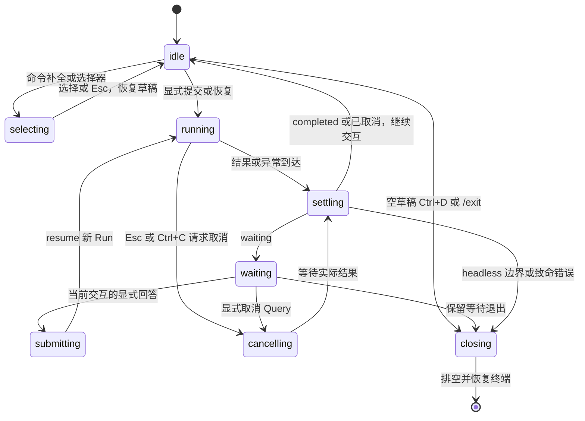

# 独立 Node CLI：终端设计与并行执行方案

[返回计划目录](README.md) · [项目整体规划](../project-plan.md) · [Tools 收敛](tools-package.md) · [页面 UI 方案](ui-design-system.md)

状态：2026-11-01 已按 Oh My Pi 官方 CLI/TUI 设计修订，并制定第一步 C0 的执行方案（第 8.1 节）；C0–C4 实施与验收仍待执行。本轮仅更新执行方案与导航，不修改现有 CLI、tools、Electron 桥接或根命令。Tools 抽取独立推进；参考不等于复刻 OMP 运行时或其功能已在本项目实现。

## 1. 结论、目标与范围

先独立完成终端呈现、输入状态机和可运行的本地场景入口，与 tools 抽取并行；待真实 Node 宿主及 tools 的受支持公开面就绪，再统一接入新的 Harness。清空根 `src/`、迁移 PPT 或完成新页面 UI 都不是本方案前置。

终端是 Node 宿主的输入输出层，不是另一套 Agent Loop。终端调用 Core 公开执行协议，模型、配置、凭据、持久化、授权和能力装配由宿主负责。终端完成不等于纯 Node 运行时已完成；受控场景不等于真实模型或文件验收。

包含：

- OMP 风格的交互终端：会话历史、流式临时区、工具卡、多行 Composer、选择器与上下文状态栏；另有独立 print/plain 与 JSONL 输出。
- stdout/stderr 分工、明确的 JSONL 模式和退出语义。
- 单一输入所有者、多行输入、命令、等待、EOF、取消、中断与恢复交互。
- 基于现有 Core 公开协议的安全展示投影，不依赖具体工具载荷。
- 本地终端场景、定向行为回归、真实终端烟测及后续统一接入门槛。

不包含：重写 tools、PPT/文件管理界面、默认全屏备用屏幕、鼠标操作、文件/图片附件、任意补全/扩展框架、Vim 模式、外部编辑器、后台排队、自动重试、通用跨端展示协议、当前桌面配置/数据库迁移。首轮包含本地斜杠命令补全，不将其扩成文件扫描或插件发现。Node 凭据及持久化适配必须真实实现，但不在终端呈现切片中伪造或临时降级。

## 2. 已核对的当前事实

| 位置 | 当前行为 | 本次设计决定 |
| --- | --- | --- |
| `cli/development-terminal.ts` | 单输入队列承载向导、聊天和审批；仍借用旧配置管理契约 | 保留单一输入所有权原则，移除终端对旧配置/具体工具的直接理解 |
| `cli/commands/development-command.ts` | 中文提示、菜单和 JSON 混用 stdout；当前只接受无参数、prompt 和帮助；过滤掉模型增量 | 交互 TUI 显示明确的临时正文预览；print 只输出权威正文，JSONL 单独编码，不混成一个输出模式 |
| `cli/configuration/development-setup.ts` | 当前 Key 使用普通明文回显输入 | 新终端凭据输入必须独立隐藏回显；无安全输入/存储能力就明确失败，不能默默明文保存 |
| `app/main/agent-host/development-runner.ts`、`scripts/run-agent.mjs` | Node 启动 Electron，父进程接收终端输入后经 IPC 转发 | 统一切换时改为 Node 直接管理进程与 stdin，不保留失效 Electron CLI 启动路径 |
| 现有两份 development CLI 集成测试 | 真实 Electron 子进程与本地 HTTP/SSE；交互通过 IPC 注入 | 可以复用行为场景，但不能作为真实 PTY 编辑、隐藏输入或 Ctrl+C 按键证据 |
| Core 的公开 agent/session/protocol/model/tool 契约 | 提供执行句柄、观察事件、完成结果、版本化交互及效果；没有终端 DTO 或会话列表服务 | 直接消费受支持协议；不预设未来后端 DTO、历史读取或交互答案 schema |

Tools 计划拥有插件工厂、纯契约/错误及受控 Node 文件支撑；宿主继续拥有能力选择、授权与审批载荷。终端不导入 tools 私有文件，不根据工具名称决定 Harness 的基础语义。

## 3. 终端形式与布局

### 3.1 默认形式：历史与可重绘区域分离

参考 OMP 的 history/viewport、Composer、工具展开和选择器设计，不再将交互模式限制为追加日志。支持终端进入 inline TUI：上方为可滚动历史，下方为活动响应/工具卡、Composer 与上下文状态栏。默认不启用备用屏幕，不在普通刷新时清空历史；print/plain 和 JSONL 不启动 TUI。

已结算消息形成终端展示历史，活动响应、输入、选择器及待决交互属于可变 viewport。终端展示历史不是 Agent 的规范存储；窗口位置、滚出屏幕或一条进度事件不能决定持久提交。历史追加与 viewport 重绘由同一输出所有者协调，不靠逐行 console.log 拼屏。

交互布局如下，是本项目的建议版式，不是 OMP 截图；数据均由实际宿主和公开事件提供：

```text
Agent Harness                                      当前会话

你
请概括这个项目的结构。

助手
这里显示已完成响应的正文。

────────────────────────────────────────────────────────────
活动响应 · 正在输出 · 临时预览
目前可以确认的模块包括……

工具活动  1 项
  > read   call-…   已返回：succeeded / none
    Ctrl+O 展开安全详情；不展示原始输入或工具结果
────────────────────────────────────────────────────────────
> 继续描述需要执行的任务……
  支持多行；执行中可编辑草稿，但不能提交或排队
────────────────────────────────────────────────────────────
项目 demo · 模型 当前模型 · 能力 只读 · 状态 运行中
Enter 发送  Alt+Enter 换行  / 命令  Esc 取消当前局部操作
```

- Composer 在空闲和运行中均可编辑，但只有就绪空闲态可提交；运行中按 Enter 不隐式排队、不形成 steering 消息，状态栏解释原因。
- 第一轮状态栏只显示工作区/会话、当前模型、实际能力模式和执行状态。token、上下文百分比、费用、Git 分支只有真实数据源存在才显示，不为了类似 OMP 填假值或额外启动扫描。
- 工具卡默认摘要，区分运行、返回、待决和结果不确定；`status`、`effects` 分列，折叠不能隐藏关键失败或 applied/unknown 提示。Ctrl+O 默认作用于最近活动卡；查看旧卡由 /tools-output 列表选择并在 viewport 打开详情，不回写已进入终端历史的摘要。
- Markdown 首轮支持段落、列表、标题、行内代码与代码块的可读排版；不执行 HTML/ANSI、不自动打开链接、不渲染图片。代码块保留内容和复制语义。
- resize 只重绘当前 viewport；默认保留旧宽度历史，不采用 OMP 可选的 rebuild/append 历史重放策略。选择器关闭后恢复原草稿、焦点与光标。

### 3.2 流式预览与最终正文

交互 TUI 消费公开 `model.delta` 的文本增量，按完整 Run 身份、step、requestId、contentIndex 关联到当前临时块；不展示 reasoning、工具参数增量或私有重放。不同请求不能拼成同一助手消息，旧 Run 的迟到事件不覆盖新实例。

- 增量只更新 mutable viewport，不写规范历史，也不提前追加为最终终端历史。`step.committed` 没有正文快照，不能据此将当前 delta 缓冲当权威消息。
- `completed.output` 到达后，撤下临时块，按权威有序助手内容结算一次；不把整个最终答案再次追加在同一份已落入历史的预览后。权威内容不同也必须展示实际结果，不能保留错误预览。
- waiting、failed、cancelled、interrupted 或完成 Promise 拒绝时撤下未完成预览，保留明确结果/不确定性说明；已经确定的工具影响不得因撤下预览被抹去。
- 首轮临时正文缓冲每个活动 Run 最多保留最近 64 KiB UTF-8 文本，在字符边界裁剪，显示“仅预览尾部，最终以完成结果为准”。这只是展示预算，不截断模型输出或规范消息；不能因超出 viewport 就偷偷提交预览历史。
- print/plain 和 JSONL 首版不输出 delta，正文仍来自权威完成结果。交互流式与自动化输出分别验收，不把临时预览编码成 assistant.message。

### 3.3 宽度、内容与安全

- renderer 统一使用终端可见列宽和字素边界测量、换行与截断，不按字符串 length 处理中文、组合字符或 emoji。40/80/120 列均可操作；代码/路径不被语义改写，非 TTY 不人为插入布局换行。
- Composer 可增长至当前视口约三分之一，超过后内部滚动；状态栏窄屏收敛为模型/状态和一行提示，工作区完整信息通过本地 /status 查看。小于 40 列或 12 行时降级 plain，不能重绘覆盖主要操作。
- 选择器及当前输入属于 viewport，不进入历史。长详情按视口分页，必要错误和完整交互身份始终可达；不靠颜色或 hover 表达操作。
- 外部内容中的 ESC/OSC、BEL、退格、控制光标的 CR 及危险双向控制字符转为可见转义；保留正文换行和受控制表符。输入按键解析与内容显示防护分开，不能把识别按键所需转义序列原样回显。
- ANSI 只由 renderer 生成。`--no-color` 或存在 `NO_COLOR` 只关闭颜色，不自动关闭编辑能力；`TERM=dumb`、无必要 TTY/游标能力或尺寸不足时降级 plain。JSONL 始终无 ANSI。
- 只展示公开安全工具摘要；有真实 owner/type/version 描述器才可展开额外详情。不能 dump 工具输入/结果、presentation.data、私有状态、原生错误或 SDK 异常；折叠展开不是解除安全边界。

### 3.4 采用 OMP 的部分与项目差异

| OMP 官方资料中的能力/机制 | 本项目决定 |
| --- | --- |
| history 与 mutable viewport 分离、差量重绘 | 采用职责分离；首轮只实现 inline 所需部分，不复制完整渲染引擎 |
| Composer、多行编辑、键盘选择器、工具展开 | 采用交互形式，具体按键与安全边界见第 5 节 |
| 独立 print 与 JSON 事件模式、确定性 gallery | 采用模式分离和独立场景预览，不复制 OMP 的事件 schema 或 CLI 命名 |
| 工具输出与模型/会话选择 | 默认摘要、可展开和可搜索；只展示真实可用项，不复制模型角色系统 |
| Ctrl+C 清草稿、Esc 处理局部交互/中断 | 采用按状态分工；待决交互不能因 Esc 直接变成拒绝，见本项目取消规则 |
| follow-up 队列、retry、后台任务、Agent Hub、RPC/ACP/TSP、Vim/图片/语音 | 不纳入首轮；不能仅为外观类似而伪造或扩展 Harness 能力 |
| 会话全项目搜索、重定位及模型回退 | 不照搬；继续遵守当前绑定、权限环境与存储恢复约束 |

这里只参考交互与职责。首轮不引入 OMP 的 Bun/Rust 运行时、native addon 或整套 coding-agent，也不复制源代码。若实现评估发现终端底座依赖确有必要，应先记录 Node/Windows 兼容性、许可证、退出恢复与体积取舍，不默默改用完整 Agent 框架。

## 4. 输出模式与退出协议

### 4.1 模式选择与 stdout / stderr

模式显式区分交互 TUI、人类 print/plain 和机器 JSONL。省略 output 时为 human；stdin/stdout 均为 TTY、未指定 print 且能力满足时才启动 TUI。`--print/-p` 或 `--prompt` 选择一次性执行，具体编码仍由 output 决定；`--output jsonl` 总是非交互，不挂载选择器、不消费审批输入。非 TTY 不启动 TUI，管道任务仍按第 5.2 节处理。

| 模式 | stdout | stderr | 输入方式 |
| --- | --- | --- | --- |
| 交互 human TUI | 单 writer 输出历史、活动区、Composer、选择器与状态栏，可含受控 ANSI | 诊断不直接插屏；活跃 TUI 中经 coordinator 归并到通知区，退出后输出失败摘要 | 唯一 raw input owner，renderer 自行画回显 |
| print/plain | 权威助手正文，不加进度 JSON/编辑器控制码 | 简短进度、错误和 plain 提示；不是 TTY 时无 ANSI | print 非交互；仅能力降级的 plain 会话可经 stdin/stderr TTY 交互 |
| JSONL | 每行一个版本化安全记录，无 banner、菜单、裸正文或 ANSI | 安全诊断，不提问、不交互初始化 | argv 或整段 stdin 的新任务，或显式恢复；waiting 退出 3 |
| stdout 重定向 | 自动不启用 TUI；输出协议仍由 output 参数决定 | 不偷开其他终端读取审批 | 无输入终端时不启动向导；不以管道数据代替授权 |

帮助写 stdout，参数错误写 stderr。TUI 和 plain 的输入/回显适配分开，同一时刻只有一个显示 writer；stdout 重定向后不得残留 raw mode、编辑器回显或光标控制码。能力降级应在创建 TUI 前明确决定，运行中故障则排空并恢复终端，不能同时保留两套输入消费者。

JSONL 属于 CLI 的版本化消费协议，不是 Core 原始事件或未来 IPC 协议。C0 定稿具名 `TerminalRecord` 判别联合；首版使用 `version: 1`，投影 `session`、`progress`、`tool`、`interaction`、`assistant.message`、`query.result`、`error`、`process.finished`。有运行身份时保留完整 agent/thread/query/run ID，工具记录另保留原 invocation 身份，不能只靠 callId 关联。

每个完成 Query 的权威助手内容只结算一次；恢复结果可能包含此前 Run 产生的消息，不能拼接本地猜测历史。JSONL 不输出原始交互 data 或 delta，未知载荷仅输出 owner/type/version/interactionId 及安全说明。TUI 的键盘草稿和 viewport 缓冲都不进入此协议。

`query.result` 不等于进程成功。排空观察、完成实际结果与资源关闭后才输出 `process.finished`；完成拒绝或关闭失败仍必须非 0。stdout 失败/EPIPE 时不向坏管道递归报错，停止受理、排空执行并恢复终端状态。

### 4.2 退出码

以下是新 CLI 的选择，不是 Harness 状态字段；统一切换时同步更新帮助和消费方：

| 退出码 | 含义 |
| --- | --- |
| 0 | 帮助、无活动请求的正常退出，或请求 completed 且关闭成功 |
| 1 | 配置、执行、持久化、协议、输出或资源关闭失败；持久结果可能不确定 |
| 2 | 参数或不支持的组合错误，尚未启动执行 |
| 3 | 明确保留 waiting，未作答；不是失败，也不是 Query 完成 |
| 130 | headless 用户取消已确认，或交互用户显式中止进程；交互中只取消当前 Query 不立即退出 |
| 143 | 宿主终止/关闭中断，正常排空后退出；不冒充用户取消 |
| 141 | 下游管道关闭 EPIPE，执行已排空且没有更高优先级的关闭/持久化错误 |

关闭、持久化或输出未知结果优先于“完成/取消”成功提示；不得为了凑固定退出码掩盖实际 waiting 或提交不确定。当前旧 CLI 可以在 waiting EOF 时返回 0，新协议改为 3 是显式破坏性变更，不能在独立场景阶段偷偷切换根命令。

## 5. 输入所有权与命令

### 5.1 唯一输入所有者与 Composer 状态

状态描述终端，不复制 Core 持久状态。Composer 的 draft/editable/submitEnabled 与执行 phase 分开：启动尚未就绪、运行中、提交交互和关闭时禁止发送；允许编辑不等于允许执行或隐式排队。



- TUI 的 raw input、plain readline 和管道 reader 互斥，聊天、选择器、secret 与交互只切换输入 owner，不创建竞争消费者。
- 输入请求绑定本地世代和用途；交互额外绑定完整 Query/Run/interaction 身份。关闭/换焦点后旧事件与回调失效，不把草稿或粘贴余行送进新审批。
- Enter 只在 submitEnabled 时提交一次；运行中 Enter 保留草稿并解释不可发送，启动前提前到达的 Enter 也不能在就绪时重放提交。
- 选择器和待决交互临时取得焦点，退出后恢复原草稿；模型/会话切换必须在空闲并明确处理当前草稿后执行，不能跟随当前选择改变已有 Query 的绑定。
- 收到过期回答、不可识别按键或输入故障时不猜测用户意图；高风险确认要求输入当前界面显示的 interactionId。bracketed paste 整块进入草稿，不执行其中斜杠命令或确认按键。
- 所有 resize、流式和进度重绘保留草稿、字素边界和光标；用户阅读旧历史时不主动清屏重放历史。

### 5.2 编辑、快捷键、多行与管道

采用动作到按键的窄映射，代码不在各组件散落硬编码。首轮不加用户 YAML 配置或 Vim 模式；/hotkeys 展示本项目当前支持的动作，不照抄 OMP 全表。

| 动作 | 首轮交互 TUI 默认 | 边界/替代 |
| --- | --- | --- |
| 发送 | Enter | 仅 idle 且就绪；补全只接受候选，不顺便发送 |
| 换行 | Alt+Enter；终端可可靠区分时另支持 Shift+Enter | /paste 为 plain/不支持修饰键终端的明确后备 |
| 命令候选 | 行首 / 触发本地命令过滤，Up/Down 选择、Tab 接受 | 首轮不扫描文件、不调用模型补全；Enter 接受候选后仍需再次明确发送 |
| 本地输入历史 | 单行草稿边界处 Up/Down | 多行内部优先移动光标；不读 reasoning、Key 或别的项目历史 |
| 工具详情 | Ctrl+O 切换当前工具详情，另提供 /tools-output | 只展开获准的安全展示；关键失败和效果不确定始终可见 |
| 模型选择 | /model；Alt+M 为便捷入口 | 搜索、Up/Down、Enter 选择、Esc 返回；仅真实已配置模型 |
| 会话选择 | /resume | 当前工作区列表与搜索；不默认跨项目或使用 OMP 的模糊首个匹配恢复 |
| 快捷键帮助 | /hotkeys | plain 也可读取；不是新的运行能力 |
| 局部取消 | Esc | 先关补全/选择器；无局部 UI 的活动 Run 请求取消并留在会话；不把待决交互当拒绝 |
| 清草稿/取消 | Ctrl+C | 编辑时清草稿并保留本次进程内可召回副本；运行/等待时请求取消 Query，结算后回到会话 |
| 正常退出 | 空草稿 Ctrl+D 或 /exit | 非空 Ctrl+D 不丢草稿；关闭失败仍非 0，不采用双 Ctrl+C 强行跳过排空 |

- Composer 原生保留多行文本。收到 bracketed paste 时保持整段、不自动发送；未支持的终端用 /paste，独立行 /end 提交、//end 表示正文 /end。plain 的未结束多行遇 EOF 不提交。
- 未提供 prompt/resume 且 stdin 非 TTY 时，整段 stdin 到 EOF 是一个用户消息，斜杠只是文本；空输入正常退出，不启动凭据向导。
- `--prompt` 不消费非 TTY stdin 作为审批答案；print/JSONL 遇 waiting 输出待决信息并退出 3。`--print` 搭配交互 stdin 不自动等待更多问题或弹出选择器。
- stdout 重定向后不进入 TUI。仅 plain 会话在 stdin/stderr 均为 TTY 时可以提问；JSONL/print 一律不提问。无支持的输入能力时不能隐藏地改从别的终端读审批。

### 5.3 首轮命令面

下表是新 CLI 的目标接口，不表示当前命令已支持。终端预览只能执行具名受控场景；C3/C4 真实接入后才开放模型、会话和能力操作，不能用无效按钮式命令或假成功占位。

| 命令/参数 | 行为与边界 |
| --- | --- |
| `--help`、`-h` | 无配置、无模型、无数据库、无 tools 也能显示帮助并退出 |
| `--prompt <text>`、`--print/-p` | 一次逻辑请求，权威结果边界后退出；print 不进入交互 TUI，不默认收集后续回答 |
| `--output human\|jsonl`、`--no-color` | 选择人类/结构化协议；jsonl 为非交互，颜色开关不改变执行/授权 |
| `--thread <id> --resume <queryId>` | 仅恢复已有持久 Query；两项同时需要，与新 prompt 互斥；不读取 stdin 作为新任务，不接受客户端快照 |
| `/help`、`/hotkeys`、`/status`、`/paste`、`/exit` | 终端本地命令；TUI 优先原生多行，/paste 为明确后备；/exit 不取消已持久等待 |
| `/new`、`/model` | 空闲时经真实宿主创建/选择；模型改变新建会话，不把旧检查点迁到新权限环境 |
| `/resume` | 经真实宿主目录选择已有线程/Query，再由存储恢复；Core 本身不提供会话列表，不能据终端缓存实现 |
| `/tools` | 统一接入阶段才从真实已安装能力与策略提供选项；未安装时明确显示不可用，不伪造开关 |
| `/tools-output` | 只切换安全工具卡展示，不改变 tools 安装、权限、展开数据白名单或执行状态 |

未知斜杠命令就地提示，不发给模型；输入正文以 `/` 开头时用 `//` 转义首个斜杠。/paste 内及非 TTY 正文不走命令解析。常规 Composer 多行仅在整份草稿是已知命令语法时处理为命令，其他多行正文不会逐行执行斜杠命令。首轮不执行 shell 或扩展快捷命令插件。

配置/模型选择返回终端层具名的非敏感展示项与选择结果，不让 renderer 依赖整个旧 `ConfigurationManagement`。凭据输入使用专门 secret 请求，只在有真实安全适配时启用，隐藏回显且不写历史；密码遮蔽不是凭据持久化方案。没有安全能力时不先收集 Key，更不能用环境变量自动持久化代替用户授权。

## 6. Harness 结果、交互与取消语义

### 6.1 只消费现有公开协议

终端控制器消费 `AgentRunHandle.identity/events/completed/cancel` 和 `SessionHost.run/resume/close` 所需的窄能力；projection 只消费公开 `RuntimeEvent`、`AgentRunResult`、`InteractionRequest/Response`、模型内容和工具结果元数据。终端自己的 record/input 类型具名定义，不扩充 Core 协议，不用内部实现的 ReturnType 充当契约。

每个句柄事件流只有一个消费者。观察退出不等于取消；事件消费速度不能成为驱动执行的条件。`run.completed` 是观察事实，不足以证明 lease 清理成功；以 completed 的实际履约/拒绝和关闭结果决定最终提示。

`step.committed` 可更新已提交修订，但没有正文快照；不能从 delta 合成规范历史或据该事件结算预览。最终正文只从 completed 结果投影；只有临时 viewport 可显示文本增量，恢复历史只读真实宿主的权威投影。终端历史中的消息结算与 Agent 存储是不同职责。

### 6.2 等待交互

```text
[等待回答] 请求尚未完成
事项：已支持 owner/type/version 描述器提供的安全说明
交互：完整 interactionId

  允许本次    拒绝本次    取消请求    保留等待并退出
  方向键选择，Enter 确认；初始不预选“允许”
  Esc 只退出局部详情，不替用户批准或拒绝
```

上面的选择器仅用于统一接入后确已支持的确认载荷；不假定所有 InteractionRequest 都是确认。plain 使用带 interactionId 的明确文本回答，非交互不收集答案。高风险交互须进一步输入当前 ID，不能单靠 Enter。Core 的 answer.value 由生产者解释；reject 不等于取消 Query。

- 首先等待当前 handle.completed 返回 waiting，再显示可回答提示；收到 interaction.requested 事件不能抢先 resume，当前 Run 可能仍在释放槽位和租约。
- 宿主以窄函数按 owner/type/version 描述和解释真实载荷；第一轮不建通用注册框架，不按工具名解析路径、diff 或副作用。
- 未识别的载荷只显示 owner、type、version、ID 与“不支持交互格式”；不打印 data，不猜 true、不通用 JSON 编辑、不自动拒绝。允许保留 waiting 退出；显式取消仍走 Core cancel 响应。
- 回答使用同一 Query、匹配 interactionId 和新 runId；输入只产生 InteractionResponse，不携带执行快照、检查点或客户端租约。
- 输出“已收到本地输入”和 Core 接受 interaction.resolved 是两件事；持久提交不确定时报告失败/不确定，不自动重答。
- 工具 `status` 与 `effects` 分别显示。failed + applied 不能显示“未改变”，unknown 不能显示“可安全重试”；取消不撤销已发生副作用。

### 6.3 EOF、Ctrl+C、关闭和竞态

| 输入/事件 | 必须行为 |
| --- | --- |
| 空闲 EOF、空草稿 Ctrl+D 或 /exit | 无新 Query，关闭资源并恢复 raw mode/光标后退出 0；非空草稿的 Ctrl+D 不提交或直接退出 |
| plain 多行编辑 EOF | 未显式 /end 的草稿不提交，提示后退出；TUI 管道断开也不将半份草稿自动发送 |
| 活动 Run 中 stdin EOF | 不等于取消；等待当前边界，若 waiting 则保留并退出 3 |
| waiting EOF 或选择退出 | 不构造 answer/reject/cancel；保持持久等待，关闭当前宿主 |
| 活动 Run Esc（无局部 UI）或 Ctrl+C | 请求 handle.cancel 并等待实际结果；交互结算后留在会话，headless 取消已确认才退出 130 |
| waiting Ctrl+C 或显式取消请求 | 对持久 pending interaction 以新 Run 提交 cancel；旧句柄取消不够，Esc 不自动拒绝或取消等待 |
| 取消与进入 waiting 竞争 | 若实际仍 waiting，显式消费该等待的 cancel；不把旧取消信号立即施加给负责提交取消的新激活 |
| 编辑时 Ctrl+C、选择器 Esc | 清草稿可在本进程内召回；Esc 返回原草稿，已发生的配置提交不撤销；secret 不进入历史 |
| SIGTERM/宿主关闭 | 停止受理、关闭并排空活动执行，实际状态为 interrupted；不转成用户 cancel |
| 完成 Promise 拒绝、关闭失败 | 输出安全错误及可能不确定的状态，退出非 0，不自动重试或伪造 failed 检查点 |

重复取消幂等，不以第二次按键绕过排空；退出所有路径恢复 raw mode、光标、bracketed paste 和所启用的终端模式。强杀不是优雅关闭验收。Windows 验证真实控制台按键，不用 kill(SIGINT) 冒充；下游断开也不能抹去外部影响或提前宣布成功。

## 7. 目录、依赖与并行协作

按职责使用具名文件，不预建空文件、不新增聚合 index.ts；以下是计划落点而非已实现结构：

```text
cli/
  terminal/
    terminal-contract.ts       # 呈现/输入能力与 TerminalRecord 具名类型
    terminal-controller.ts     # 输入所有权、活动句柄和退出协调
    terminal-projection.ts     # Core 公开事件/结果到安全 record
    human-renderer.ts          # print/plain 追加输出，不持有 TUI 光标
    interactive-renderer.ts    # history 与 mutable viewport 的单 writer
    composer.ts                # 草稿、光标、多行和就绪提交门槛
    tool-card.ts               # 安全摘要、展开与关键状态
    selector.ts                # 命令/模型/会话/确认的受控选择，不拥有业务数据
    status-line.ts             # 只展示真实上下文；窄屏降级
    jsonl-renderer.ts          # 版本化 JSONL
    node-terminal.ts           # 模式探测、raw/readline/管道互斥、信号及背压
  preview/
    main.ts                    # 明确标识的本地终端场景，不接模型或文件
    scenarios.ts               # 按 Core 公开类型构造的确定性输入序列
  main.ts                      # 后续真实 Node 组合入口，统一接入时创建
```

- 终端核心只依赖 Node 和 Core 公开契约，不导入 app、根 src、tools、旧配置或存储实现；原 cli 文件在切换阶段迁移全部调用后删除，不长期保留双实现/重导出。
- 终端 record 是 CLI 本地展示协议，不写成新的 Harness 中间层或 Electron/CLI 万能 DTO。
- 预览驱动实际 renderer/input 组件，以固定的 Core 类型事件/结果演示状态，始终标记“终端预览 / 受控场景，无真实模型或文件执行”。不实现返回假成功的 SessionHost，不伪造 SDK/凭据或已持久化证据。
- 终端预览、回归及独立类型检查不先构建 tools 或启动 Electron；缓存和临时数据限定在本次具名缓存/临时目录，不混入生产 out。

并行工作分三条线：

| 工作线 | 可以现在独立推进 | 不能替另一条线决定 |
| --- | --- | --- |
| 终端线 | C0–C2：协议、TUI/print/JSONL、流式临时区、Composer/选择器/工具卡、输入所有权与 Node 场景 | tools API、权限策略、凭据方案、数据库格式 |
| tools 线 | 按自身方案抽取插件、纯契约、文件支撑并验收 | 终端布局、输出协议、输入语义 |
| Node 宿主线 | 模型、配置/凭据、持久化、会话发现、资源装配及无业务插件对话 | 不能把桌面内部实现或整个配置对象注入终端代替窄协议 |

共享前提是 Core 当前已支持的公开协议。协调变更在统一接入前核对，不因 tools 导入路径正在迁移就修改其源码或锁定尚未验收 API。Node 凭据/存储若尚未就绪，同样是实际接入前置，不能把 tools 完成当作唯一门槛。

## 8. 分阶段执行与验收门槛

| 阶段 | 工作 | 完成门槛 | 状态 |
| --- | --- | --- | --- |
| C0：终端契约定稿 | 本文规则、record 字段白名单、输入/命令及退出矩阵，核对公开协议 | 场景无未决语义；不预设工具答案 schema 或历史 API | 待执行 |
| C1：独立呈现 | TUI 历史/活动区、流式预览、工具卡、状态栏、print/JSONL、安全投影与 gallery | 无 tools/Electron/真实配置运行；预览不变成提交正文，普通重绘不清历史，输出模式不串流 | 待执行 |
| C2：输入与生命周期 | Composer、多行/粘贴、命令补全/选择器、单 owner、raw/TTY/管道、取消与模式恢复 | 真终端可编辑及逐层退出；草稿不误授权、不能排队；EOF/取消/中断和退出恢复正确 | 待执行 |
| C3：统一真实接入 | Node 宿主公开适配、真实 models/logs/已验收 tools；移除终端旧依赖 | 无 app/根 src/Electron 依赖；先无插件对话，再授权文件和持久恢复 | 待执行 |
| C4：切换与全量验收 | 根命令、全部调用/测试/文档迁移；删除失效桥接和旧终端路径 | 真实 Node 启动、结构化消费、进程恢复及完整回归通过 | 待执行 |

执行依赖：`C0 → C1 → C2` 不等待 tools；C3 等待终端 C2、tools 自身验收和 Node 宿主所需真实适配全部就绪；C4 才切换 `agent:dev`。页面 UI 并行推进，不是 CLI 前置。

C0–C2 必须完成的任务：

- [ ] 定稿 TerminalRecord 判别联合、字段白名单、input request 世代及实际关闭错误处理；不以任意 object 或全部 Core event 为对外协议。
- [ ] 创建独立终端预览命令和类型检查配置，仅覆盖新终端/预览；明确命令在实现前不存在，预览不是生产入口。
- [ ] 实现 TUI 历史/viewport、流式临时块与最终结果校正；完成安全工具卡、状态栏、print/JSONL、颜色与控制字符防护。
- [ ] 实现 Composer 原生多行、输入历史、粘贴整块和命令候选；菜单只接收明确选择，不把 Enter 顺带发送或批准。
- [ ] 实现 raw/readline/管道互斥、局部焦点与输入世代、真实按键、resize、背压及全部退出路径的终端模式恢复。
- [ ] 用 gallery 场景运行真实渲染/输入组件；在 Windows 终端验证 40/80/120 列、流式、粘贴、工具展开、模型/会话选择、Esc/Ctrl+C/Ctrl+D、print/JSONL 重定向。

C3–C4 必须完成的任务：

- [ ] 核对已验收 tools 精确入口，宿主选择能力和独立授权；终端仅消费安全交互描述，不复制工具 schema。
- [ ] 提供真实 Node 配置、凭据、模型、持久化和会话发现；旧 Electron 加密数据不能无授权迁移或静默丢失。
- [ ] 证明无插件普通对话不依赖 tools/PPT；再在临时工作区验证批准前无副作用、批准/拒绝/取消/EOF及重启恢复、unknown/applied 影响保留和租约释放。
- [ ] 更新 JSONL 消费方与 waiting=3 的行为测试，旧的“过滤以 { 开头行”不能继续冒充严格 JSONL 验收。
- [ ] 实际切换 Node 根入口，迁移全部调用后删除只服务旧 CLI 的 Electron 桥接/IPC和旧终端实现；桌面仍需的平台功能保留。
- [ ] 完成最终构建/类型/边界/行为和真实入口验收，回写本文状态和证据，不借用旧 Electron 通过记录。

### 8.1 第一步执行方案：C0 终端契约定稿

**目标**：把第 3–6 节设计收敛成 C1/C2 可以直接消费的具名契约、白名单和行为判定；不是先画一个静态终端，也不是把旧 CLI 包装成新入口。本节是 C0 的执行安排，不代表契约代码或验收已经完成。

#### 范围与交付

- C0 修改落点：新建 `cli/terminal/terminal-contract.ts`，同步本文的字段表、输入/退出矩阵及执行记录。仅创建实际使用的类型，不提前铺设第 7 节全部文件。
- 契约内区分三类数据：对外 `TerminalRecord`、TUI 专属临时预览、终端输入请求/动作；delta、草稿和焦点不能混进 JSONL record。
- 本步不实现 renderer、Composer、Node stdin/raw mode 或 gallery，不安装终端依赖，不创建 `cli/main.ts`，不修改 `agent:dev`、旧终端与 Electron 桥接。独立预览命令和类型检查配置留在 C1；C0 用临时独立编译消费验证类型，不依赖全仓 tools 构建。
- 不实现 Node 配置/凭据/存储，不调用真实模型，不修改 Core 协议或 tools API。模型/会话发现与交互描述只定义终端需要的非敏感窄类型，不新增无实现的宿主服务或假成功方法。

#### C0-1：锁定公开协议与缺失数据

按 `@agent-harness/core` 的精确 exports 消费构建产物；阅读源码用于核对，不在终端代码中建立源码直连。此次方案核对到的事实如下，执行 C0 时需再确认是否有并行变更：

| 公开入口 | 已有依据 | 对终端的约束 |
| --- | --- | --- |
| `agent-contract` | `AgentRunHandle` 的 identity/events/completed/cancel；`AgentRunResult` 五种结果 | 观察事件不替代完成结果；completed 拒绝是独立故障，不伪造 failed 检查点 |
| `session-host` | `SessionHost.run/resume/close`；Thread 在宿主创建时绑定，resume 不接收 takeover | 终端不提交 thread 替换、租约或快照；会话切换由真实宿主重新绑定 |
| `protocol-values` | 四段 `RunIdentity`、版本化 `InteractionRequest`、answer/reject/cancel | payload 的 data 不透明；输入回答必须匹配持久待决 ID |
| `session/session-events` | fact 与 stream；step.committed 只有 step/historyRevision；工具事件含 invocation | delta 不能结算正文；事件 Run 身份与原工具 invocation 身份分别保留 |
| `model/model-contract` | 有序助手 content、text/reasoning/tool-call 增量及私有 replayState | 只投影助手 text；保留原位置，不输出 reasoning、参数或 replayState |
| `session/session-contract`、`tools/tool-contract` | invocation 的原身份、callId/name/toolVersion/state；completion 的 status/effects | 不展开 call.input、output、modelContent 或 presentation.data；失败与影响分列 |

Core 未提供会话目录、已配置模型列表、终端工具详情描述器或凭据输入服务。C0 不从检查点、旧配置对象或工具名猜这些数据；C1 场景可展示具名受控选项，C3 才接受真实宿主来源。

#### C0-2：定稿 record 与临时展示白名单

下表是本步的字段定稿基线；实现前将每行落实为具名判别分支，明确必选/可选条件、字面量和值域，不允许 `object`、任意索引签名或整份 Core event 透传。

所有 `TerminalRecord` 包含 `version: 1` 与 `type`。有执行归属的分支必须包含完整 `identity`；启动前错误和进程级记录允许没有 Run 身份，但不能补空字符串或伪造 ID。

| type | 允许的数据 | 来源与禁止项 |
| --- | --- | --- |
| `session` | threadId，以及真实宿主提供的非敏感模型/能力展示摘要 | 不输出连接指纹、Key、完整配置或工作区外会话 |
| `progress` | identity、受支持的 fact 阶段；step/historyRevision 只在对应阶段出现 | 不复制 RuntimeEvent；不含 delta，不把 run.completed 当作关闭成功 |
| `tool` | 事件 identity、原 invocation identity、callId/name/toolVersion、step、开始/完成阶段；完成时 status/effects，失败时安全错误 | 不输出 input/output/modelContent/presentation；开始时不虚构 effects=none |
| `interaction` | identity、interactionId、owner、payload type/version、请求/已接受响应阶段；可选已认可的安全说明 | 不输出 data 或 answer.value；事件请求不代表现在可以 resume |
| `assistant.message` | identity、output 中的 messageIndex、按原 contentIndex 排列的 text 内容 | 仅来自 completed.output 的 assistant 文本；不合并不同消息，不输出 reasoning/tool-call |
| `query.result` | identity、五种 status；waiting 的安全交互元数据或 failed 的安全错误 | 不嵌整份 output、interaction.data 或检查点；不代表进程已成功 |
| `error` | 具名故障阶段、稳定 code、安全 message、是否存在结果不确定性；已知时附 identity | 只使用公开 ProtocolError 或本地安全错误映射；不 stringify 原生异常 |
| `process.finished` | 最终 exitCode、具名退出原因；已知时附最后 identity/实际 Query status | 观察与资源排空、关闭结果确定后最多一次；stdout 已损坏时不尝试写此记录 |

补齐以下展示规则，避免 C1 自行猜测：

- JSONL 与人类输出都先经过安全投影；JSON 编码不是内容防护。外部控制字符先转成可见转义，ANSI 只能由交互 renderer 生成。
- 一份 completed 结果中的助手消息按原顺序结算；工具调用位置不挤成正文，只有 reasoning/tool-call 的消息不制造空白正文。相同活动句柄的重复通知不能重复结算。
- 恢复结果按本次 completed.output 投影，不与 delta 或终端缓存拼接；若恢复前已展示该 Query 的部分消息，C1 须用权威 output 的位置替换该 Query 展示，不以文本相等判断重复。
- TUI 临时预览单独定义 identity/step/requestId/contentIndex/text 及截尾标志；64 KiB UTF-8 限额只作用于当前 Run 的文本预览，不作用于 TerminalRecord 或最终正文。
- 工具安全详情和交互描述另用具名展示类型，只接受宿主已认可的 owner/type/version；未知载荷只显示身份和不支持说明。C0 不设通用 JSON 编辑器。

#### C0-3：定稿输入请求与命令门槛

定义 `TerminalInputRequest`、`TerminalInputAction` 及终端 phase/焦点类型，使用用途判别联合而非一份含大量可选字段的对象：

- 每次输入请求带本地递增 generation 和用途；用途至少区分 Composer、选择器、secret、待决交互。切换 owner、关闭或失焦使旧请求失效；secret 不进入草稿、历史、record 或日志。
- 交互用途还绑定完整 identity、interactionId 与 owner/type/version；只有 completed=waiting 且宿主支持当前描述器时允许作答。answer/reject/cancel 分开，未知载荷只保留等待或显式取消。
- 草稿文本/光标、editable、submitEnabled 与执行 phase 分开；启动/运行/提交/关闭禁止发送，允许编辑不建立队列。粘贴是文本动作，不拆成命令或确认动作。
- 将第 5 节按键落到具名动作；明确 Esc 的局部 UI 优先级、Ctrl+C 清草稿与取消分工、非空 Ctrl+D 不退出，以及焦点恢复和旧世代输入丢弃。
- 命令清单按“本地可用、仅受控场景、等待真实宿主”分类；C1/C2 不暴露无效的 /model、/resume、/tools 生产操作。选项接受与提交正文为两个动作。
- 用请求/动作序列描述输入不变量；C0 不实现键盘字节解析、readline 或调用 Core 的控制器。

#### C0-4：定稿退出归并与场景目录

在第 4.2、6.3 节基础上补齐“实际结果 + 退出触发原因 + 关闭/输出故障”的判定表，不按最后到达事件覆盖先前故障：

| 边界场景 | 必须定稿的判定 |
| --- | --- |
| completed 后 close 拒绝；completed Promise 拒绝但先收到 run.completed | 非 0，不能先输出成功的 process.finished；保留实际结果与清理故障的区别 |
| EOF 与 waiting；未结束 /paste 的 EOF；prompt 搭配管道输入 | waiting 保留且退出 3；半份草稿不提交；管道数据不变成审批 |
| 活动取消进入 waiting；waiting 显式取消 | 以实际 waiting 为准，用新 Run 消费 cancel；不把旧取消信号传给取消提交 |
| 用户取消与 SIGTERM、持久化失败竞争 | 区分 cancelled/interrupted；错误不能被 130/143 掩盖；不声称副作用已撤销 |
| EPIPE 与 close/持久化失败竞争 | 停止受理并排空；仅无更高错误时为 141；不向坏 stdout 写 error 或 finished |
| 同时出现多个故障或多次关闭/取消动作 | 确定主退出原因并保留安全诊断；重复动作不重复执行、不跳过排空 |

给 C1/C2 的具名场景至少覆盖：增量与最终不一致、64 KiB 截尾、旧 Run 迟到事件、恢复消息结算、failed+applied、unknown、未知交互、提前/过期 Enter、整块粘贴、waiting EOF、取消竞态、完成拒绝、关闭失败和 EPIPE。为每个场景写输入序列、允许输出、禁止输出与退出预期，不以静态截图或内部字段快照作为验收。

#### 执行顺序与完成门槛

1. 先做 C0-1，记录公开字段与数据缺口；再完成 C0-2，固定 projection/renderer 共用契约。
2. C0-3 与 C0-4 在 record 基线之后可并行细化；共享 identity、输入世代及错误类型由同一集成负责人收敛，不各建一套近似协议。
3. 用临时 TypeScript 消费样例穷尽各 record/输入分支，核对只能从受支持 Core 子路径导入；消费样例独立编译，不为类型检查改动 Core/tools。临时样例验证后删除。
4. 逐项走查上述场景；输入分支、字段来源、结果结算和退出优先级均有唯一判定后，回写本文字段表和矩阵，记录实际命令、结果及未验证项。
5. C0 只有在契约文件可被独立编译消费、白名单/模式/场景无未决语义时才能标记完成，并解锁 C1；C1/C2 的真实终端、按键、模式恢复及 C3 的存储/模型证据仍必须单独完成。

本次只制定第一步执行方案并核对公开声明，未创建上述类型文件或消费样例，未执行 C0 的编译与场景验收；阶段表与实施勾选项保持待执行。

## 9. 验收矩阵与证据要求

| 维度 | 必须观察到的结果 | 证据方式 |
| --- | --- | --- |
| 无工具独立性 | 新终端/预览不导入 tools、app 或根 src，不需要真实配置 | 独立类型/依赖检查、实际 Node 预览 |
| 协议分离 | TUI 为单 writer；print 正文无进度污染，JSONL 每行可解析且无菜单/回显/ANSI | 分别捕获 stdout/stderr，实际 TTY、print 与管道 |
| 输入所有权 | Enter 不跨状态发送；多行/粘贴保持一份草稿，过期输入不能批准新交互；局部 UI 优先处理 Esc | 确定性回归、真实键盘、剪贴板文本粘贴与修饰键降级 |
| 生命周期 | EOF waiting=3，取消持久等待、活动取消、宿主中断和关闭失败区别明确 | 控制器行为回归；真实接入后核验存储与租约 |
| 展示正确性 | 流式文本只在临时 viewport；最终权威内容替换预览且不重复，失败保留不确定性；status/effects 不混淆 | 增量/最终不一致、恢复、取消与工具组合场景 |
| 安全 | ANSI/OSC 注入不执行；不输出 Key/私有重放/原始 SDK 异常 | 注入样本、分流捕获、真实终端观察 |
| 终端适配 | 40/80/120 列及高度变化无错位；中文/emoji/长路径、NO_COLOR、TERM=dumb、print/JSONL 与退出后 shell 正常 | 真终端操作及无 ANSI 捕获，不冒称读屏认证；不以模式模拟替代 raw mode 恢复 |
| 故障 | completed 拒绝、EPIPE、日志/关闭失败不假成功，不自动重试副作用 | 边界回归及 throwaway pipe 场景 |
| 统一接入 | Node 无 Electron 进程，真实模型/文件/审批/恢复按权限环境工作 | 真实入口与跨进程临时工作区烟测 |

永久回归只覆盖可见行为、协议与权限/生命周期不变量，不测试源码措辞、文件数量、字段简单转发或组件内部状态。受控场景不声称工具已执行；本地 HTTP/SSE 不声称远程厂商通过；远程模型调用另行说明范围和用量，不读取/打印真实 Key。

每份证据记录阶段、场景、平台/终端、宽度、输入/命令、stdout/stderr、退出码、实际观察、持久状态核验范围和未验证项。测试通过不能代替终端操作；IPC 注入不能代替真实 Ctrl+C、输入回显与粘贴验收。

## 10. 本轮记录

2026-11-01：结合当前 CLI 与 Core 公开协议并行核对终端 UX、执行结果/交互边界，形成独立设计与 C0–C4 执行方案。当前只新增本文并同步文档导航，不修改正在抽取的 tools 或 CLI 实现，不切换 agent:dev，不创建预览代码。本轮未运行终端、模型、文件、构建或行为测试；C0–C4 均未验收，不使用上轮 Electron 宿主验证作为新终端证据。

本轮文档检查通过：4 份变更文档的 UTF-8 编码有效、代码围栏配对，50 处本地链接目标存在；C0–C4 均为待执行，12 项实施任务均未勾选。未检查链接锚点、外部站点或终端运行行为，不将文档检查计为实现验收。

2026-11-01（OMP 参考修订）：核对官方 CLI reference、TUI 集成、core renderer、keybindings 和会话选择文档后，撤销“交互也只追加日志、首轮没有流式正文”的限制；明确 TUI/print/JSONL 分离、历史/viewport、临时流式预览、多行 Composer、工具卡、选择器与状态栏。交互取消后留在会话，print/JSONL 仍以实际结果和退出码结束。不改 Core 执行语义，不照搬后台排队或跨环境恢复。仅修改设计与导航，未安装/运行 OMP，未实现新终端。

本次参考修订检查：2 份文档 UTF-8 与代码围栏通过，29 处本地链接目标存在，记录 6 个已读取的上游仓库/官方文档链接；C0–C4 仍待执行，12 项实施任务未勾选。未安装或运行 OMP，也未运行本地终端、模型、tools 或构建测试；外部链接锚点和后续可用性未验证。

## 11. OMP 参考来源与采用边界

以下均为本轮读取的上游 main 分支资料，不代表固定发行版或本地运行证据。站点 ohmypi.xyz 抓取超时，改用官方仓库资料；hero 图是品牌图，models.webp 未能解码，不将其作为界面截图依据。

- [官方仓库](https://github.com/can1357/oh-my-pi)：确认项目及工具/交互总体定位，不照搬完整能力清单。
- [CLI reference](https://github.com/can1357/oh-my-pi/blob/main/docs/cli-reference.md)：交互与 print/JSON 输出分离，print 完成后输出正文、进度走 stderr；本项目保留自己的 flag 和退出码，不声称兼容 OMP CLI。
- [TUI 集成契约](https://github.com/can1357/oh-my-pi/blob/main/docs/tui.md)：编辑器区域/overlay、焦点、草稿恢复、工具展开及宽度安全；不复制扩展容器或 RPC/TSP。
- [Core renderer](https://github.com/can1357/oh-my-pi/blob/main/docs/tui-core-renderer.md)：history 与 mutable viewport、应用决定结算、普通重绘不改历史；本项目默认保留旧历史，不采用上游可选 resize replay。
- [Keybindings](https://github.com/can1357/oh-my-pi/blob/main/docs/keybindings.md)：工具 Ctrl+O、模型选择、编辑器历史/清草稿，以及 Windows 吞修饰键的边界；本项目采用动作映射与可靠后备，不照搬每个快捷键、Vim 或 follow-up 队列。
- [会话选择](https://github.com/can1357/oh-my-pi/blob/main/docs/session-switching-and-recent-listing.md)：可搜索列表、选择/取消与焦点恢复；不采用上游跨项目自动切换、模糊首个匹配、模型回退及会话文件修复策略。
