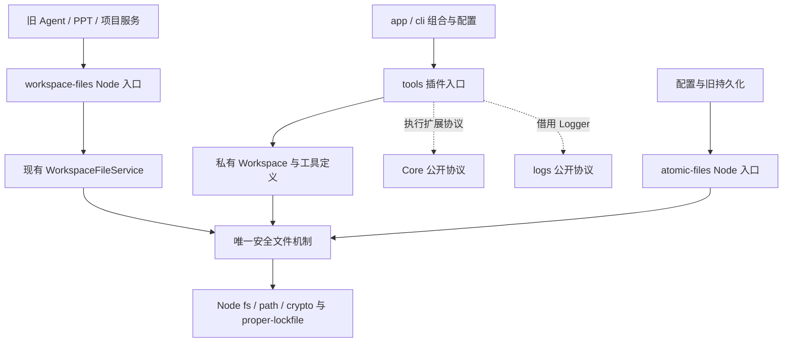

# Tools 收敛：插件公开面与共享文件支撑

[返回计划目录](README.md) · [项目整体规划](../project-plan.md)

状态：方案已设计，尚未建立 tools workspace 或实施迁移。本轮仅调研、验证现有文件语义并修改文档，不改变工具执行行为，不调用远程模型。M2-A/M2-B 的既有完成状态不变；本方案作为 M2 类型的独立收敛切片，不扩充 M3 或宿主迁移范围。

## 1. 结论与范围

建立一个私有 `@agent-harness/tools@0.1.0` workspace，目录为 `packages/tools/`。插件能力、共用安全文件机制和仍被生产使用的文件服务在同一个包内内聚，按精确子路径区分调用角色；不公开整个 internal，不另建文件底座包，不复制旧实现，也不新增工具注册中心。

本轮完成的是三种边界，而非简单搬目录：

1. 普通 Harness 消费方通过插件工厂安装文件能力，通过纯类型/错误入口消费契约，不手工拼装 Workspace 或 Core 管线。
2. 当前宿主与旧生产链通过有限 Node 入口继续使用原子 I/O 和 WorkspaceFileService，不依赖包私有路径。
3. 两套文件执行语义共享同一份安全原语、错误构造器和锁域，但不强行统一观察记录、授权、模型工具 schema 或恢复行为。

本次选择单包的原因：这些实现当前已共同依赖同一套 path/snapshot/mutation/window/atomic 机制；先拆成两个物理包会迫使更多低层 guard、快照及恢复钩子成为跨包协议。当前没有“独立配置库必须完全不安装 Core/logs”的要求，因此先用精确入口收敛，减少协议扩张。代价是该包同时拥有 Agent 文件插件和 Node 文件支撑；公共契约必须明确低层入口不是模型工具，也不是只读或授权保证。若将来确有独立文件库需求，应另立切片完整迁移其所有消费者，不能长期维护双归属和重导出别名。

不包含：新增文件工具、改变名称/默认预算、插件动态发现、通用 IoC、自动重试、并行工具、存储抽包、纯 Node CLI 化、PPT 插件迁移、生产 Agent 切换或数据迁移。宿主源码已在调研期间迁到 `app/`、`cli/`；下文按新路径列出消费者，不将这项并行迁移算作 tools 的实现或验收。

## 2. 当前代码与必须保留的差异

| 位置 | 已观察事实 | 收敛决定 |
| --- | --- | --- |
| `src/tools/tools.ts:15–28,56–118` | 已有 createTools、模式/预算和 AgentPlugin；setup 时创建独立 Workspace，scope 释放清空记录，Logger 为借用 | 保留工厂与生命周期，迁入包内；不暴露 Workspace |
| `src/tools/read.ts` 等五个定义文件 | 各自拥有模型输入/输出、schema、定义及投影；write/edit 的字节校验使用 Buffer | 输入/输出类型抽为纯契约；schema/定义/投影保留包内，不把单工具工厂和 Node schema 当公共浏览器 API |
| `internal/workspace.ts:51–66` | prepareWorkspaceRoot 异步验证现存安全目录并映射 ToolsError | 通过插件入口公开该功能，消除宿主深导入，不要求创建插件才能规范化根 |
| `internal/workspace.ts:69–128,369–409,450–472` | 新工具只读访问不恢复写入；完整读取同一快照后才可修改，成功修改撤销 observation，安装间隔离 | 保留现有语义和 effects 投影；不改用旧服务实现新工具 |
| `internal/workspace-file-service.ts:71–127,176–232,280–287,371–386` | 旧服务有独立 receipt/coverage；inspect 不授权修改，但读路径会加锁并可能恢复写入；成功修改重新登记 receipt | 作为明确 Node 服务入口保留，不宣称 effects:none，不替换旧工具协议 |
| `internal/atomic.ts:113–173,181–217` | readJsonFile 会创建事务目录、加锁、恢复；坏 JSON 可由 .bak 修复主文件；写入承担持久发布 | 提供命名清楚的受控低层入口，保留磁盘协议；不能替换新只读工具读取 |
| `internal/errors.ts:29–70` | ToolsError 与 Node 异常映射混在一起，后者依赖 atomic | 拆纯错误类与私有错误投影，纯错误入口不得加载 Node/锁库 |
| `internal/workspace-file-types.ts` | 公开 receipt/options 与私有 snapshot/guard/coverage 混合 | 精选公开结果类型，私有身份和提交机制不得进入公共声明 |

两套工具协议也不能合并：旧生产 `Glob/ReadFile/WriteFile/EditFile` 继续由 `app/main/agent/tools/files/workspace-file-tool-contract.ts` 定义 schema、权限、domain policy、结果和 formatter；新插件仍为 `glob/read/write/edit/grep`，由 Core 执行通用授权与结果提交。共享文件实现不等于模型协议或权限规则相同。

## 3. 目标依赖与所有权



- Core 继续拥有 AgentPlugin、工具注册/执行、宿主强制授权、交互、结果与 effects 协议；Core 不反向依赖 tools，未安装本包也能普通对话。
- 宿主继续拥有指令、插件选择、授权、审批载荷、工作区绑定、凭据、SQLite、日志输出与关闭。`workspace-configuration.ts` 不迁入包。
- tools 拥有五工具实现、受限工作区执行、每次安装的观察记录，以及共用安全文件机制。借用 Logger 不创建/关闭 logs，不主动调用模型。
- 旧文件服务由调用方按现有 thread/teammate/编辑器作用域持有和 clear；不变成全局单例，也不共享新插件 observation。
- 低层 Node 入口只供受信任宿主代码使用；接受宿主指定路径不代表可安全交给模型。模块边界与授权不是第三方恶意代码沙箱。

## 4. 精确公开 API

仅开放以下五个子路径，均无根入口、通配符、厂商式子包或 index.ts 聚合。默认 Node >=24、ESM-only，依赖 emitted JS/声明。

| 子路径 | 受支持内容 | 明确不公开 |
| --- | --- | --- |
| `@agent-harness/tools/tools` | `createTools(options, logger?)`、`prepareWorkspaceRoot(root)` | 单工具工厂、schema、Workspace、手工 setup/注册辅助器 |
| `@agent-harness/tools/tools-contract` | ToolsMode/ToolsOptions/ToolsPlugin；ReadInput/Output、WriteCreateInput/WriteReplaceInput/WriteInput/WriteOutput、EditInput/Output、GlobInput/Output、GrepInput/Match/SkippedFile/Output | Node 类型、Buffer、Zod schema、内部快照或锁 |
| `@agent-harness/tools/tools-errors` | ToolsError、ToolsErrorCode、ToolsEffects | safeToolsError、failedResult、Node 异常判别和原始系统错误 |
| `@agent-harness/tools/atomic-files` | readJsonFile、writeJsonFileAtomic、writeTextFileAtomic、具名 AtomicFileWriteOptions（仅 mode）、AtomicWriteConflictError 及其 sideEffects 契约 | withAtomicFileTransaction、recoverInterruptedReplacement、guard/callback、事务目录/预算/manifest/指纹内部类型 |
| `@agent-harness/tools/workspace-files` | WorkspaceFileService、WorkspaceFileError/Code、公开 read/window/write/edit options/results/receipt、canonicalizeWorkspaceRoot、globWorkspaceFiles、countOccurrences | path guard、StableFileSnapshot、ObservedFileCoverage、底层 mutation helpers |

公开函数使用所属模块的具名类型，不使用 `ReturnType<typeof 内部函数>`。tools-contract 和 tools-errors 的源码、运行 JS 与声明闭包必须无 Node/锁库/宿主依赖；contract 引用 Core/logs 时仅允许其纯公开类型。

### 4.1 入口与私有实现的处理

- `tools.ts` 为具名功能入口，工厂逻辑在私有 create-tools 中；prepareWorkspaceRoot 从 Workspace 模块独立成私有根校验功能，沿用原算法和错误映射，不新增重复的根校验。
- 五工具的数据类型集中在纯契约；同名私有定义文件继续拥有对应 schema、定义和投影。类型源唯一，不在公共文件和实现文件各声明一份。
- ToolsError 类与安全消息表在纯 errors 入口；safeToolsError/failedResult 留私有映射，引用同一 ToolsError。AtomicWriteConflictError 与 WorkspaceFileError 同样只保留一个构造器来源，Node 入口及内部调用消费同一实例。
- atomic-files 用具名公共函数签名收窄 writeTextFileAtomic 的外部 options，只支持现有宿主实际消费的 mode；内部 Workspace/旧服务仍使用完整 guard/ioLimits 路径，复用原实现，不复制 writer、锁或 AsyncLocalStorage。收窄声明不作为恶意调用隔离，不承诺私有 options 是扩展点。
- `recoverInterruptedReplacement` 仍存在于内部供已有恢复流程调用，不删除恢复功能；只是不给普通消费者额外公开测试专用入口。公共 readJsonFile/旧服务继续按原规则触发恢复。
- 新 prepareWorkspaceRoot 与旧 canonicalizeWorkspaceRoot 都保留：前者严格异步验证现存根，后者同步处理 Windows 8.3、缺失/不可访问根延迟失败，不能为了统一命名合并。

## 5. 文件落点

```text
packages/tools/
  package.json
  tsconfig.json
  build.mjs
  src/
    tools.ts
    tools-contract.ts
    tools-errors.ts
    atomic-files.ts
    workspace-files.ts
    internal/
      create-tools.ts
      workspace-root.ts
      workspace.ts
      error-projection.ts
      tool-logging.ts
      definitions/             # read/write/edit/glob/grep
      files/                   # 现有 atomic、service、guard、snapshot、mutation 等
  tests/                       # 仅确需私有事务/guard 故障注入的包内行为测试
```

files 下保留现有安全算法和一份状态实现，不借移动目录重写提交、恢复、窗口、扫描或 Windows 分支。manifest、锁映射、观察表不进入公开 API。包内测试与工具的发行 dist 分离，不作为安装产物。

正式依赖：同版本 `@agent-harness/core`、`@agent-harness/logs`，以及现有 `zod`、`proper-lockfile`；TypeScript/@types/node 为开发依赖，沿用仓库当前版本，不借抽包升级依赖。Node 原子 I/O 实际需要 proper-lockfile，不能靠根目录偶然 hoist。根依赖仍有 durable-run-store/message-bus 等直接消费者，不因打包而删除。

## 6. 所有生产调用方迁移

下表为当前直接消费清单；实施时还需以实际 TypeScript 解析图复核。文件路径不是长期白名单，也不以导入次数/文件数量作为验收。

| 当前文件或分组（每组列出全部直接消费者） | 新入口与保留职责 |
| --- | --- |
| `app/main/agent-host/workspace-configuration.ts` | tools 工厂 + tools-contract；指令、host-permissions、按名称授权继续归配置 |
| `app/main/agent-host/create-agent-host.ts`、`host-session-binding.ts`、`sqlite-agent-stores.ts`；`cli/development-terminal.ts` | tools-contract 的 ToolsMode 等；只改类型来源，不改 binding/存储/终端行为 |
| `cli/commands/development-command.ts` | tools-errors；保持 instanceof 后的安全 code/message 展示 |
| `app/main/agent-host/development-sessions.ts` | tools 的 prepareWorkspaceRoot；仍只查询已存在数据库，不因此创建历史目录/租约 |
| `app/main/agent-configuration/internal/credential-store.ts`、`settings-store.ts` | atomic-files；保留加密、签发计划、串行操作、凭据 mode:0o600 和原数据布局 |
| `app/main/agent/persistence/conversation-history-store.ts`、`durable-run-store.ts`、`durable-service-store.ts` | atomic-files；保留旧 checkpoint/envelope、revision/generation、memory/Markdown 与恢复格式 |
| `app/main/agent/task/task-store.ts` | atomic-files；任务 marker、外层锁与验证不变 |
| `app/main/agent/teammate/message-bus.ts`、`protocol-state.ts`、`spawn-teammate.ts` | atomic-files；保留 claim、inbox、请求与恢复顺序；spawn 同时迁移 workspace-files |
| `app/main/session-store.ts`、`token-usage-store.ts` | atomic-files；项目元数据、统计、备份与修复保持 |
| `app/main/agent/runtime/agent-run-factory.ts`、`runtime/tools/tool-execution-error.ts` | workspace-files；服务仍按 thread 管理；保持 WorkspaceFileError 的实例分类 |
| `app/main/agent/subagent/workspace-tools.ts`、`teammate/spawn-teammate.ts` | workspace-files；旧工具契约、服务作用域和 domain policy 保持 |
| `app/main/agent/tools/tool-definition.ts`、`tools/files/workspace-file-policy.ts`、`tools/files/workspace-file-tool-contract.ts` | workspace-files 的服务/类型/helpers；不替换旧 schema/result/权限协议 |
| `app/main/plugins/ppt/file-policy.ts`、`svg-page-loader.ts`、`tools/project-template-state.ts`、`tools/resolve-project-template.ts` | workspace-files；PPT 校验、资源加载和锁策略继续归领域 |
| `app/main/presentation-lifecycle/artifact-change-observer.ts`、`app/main/project/project-file-service.ts` | workspace-files；产物观察与编辑器独立 receipt scope 不变 |

切换完成后删除整个旧 `src/tools/`，没有源码转发、旧路径别名或 legacy 副本。`app/main/agent/tools/` 是仍在使用的旧模型工具契约，不能误删。现有 PPT `workspace-files` 行为适配入口有领域职责，也不是本轮应删的空壳。

## 7. 不变协议与安全条件

### 7.1 执行、审批与恢复身份

- 插件 `id:"tools" / version:"1"`、五工具 owner/version、definition `general-workspace-assistant / 1` 均不因 npm 包名改变。
- HostSessionBinding 仍为 schemaVersion 2；agent/thread、canonical workspaceRoot、toolMode、model/effort、connectionFingerprint、definition/plugins 和 maxSteps 原文一致。
- 审批仍用 `workspace-tool:${queryId}:${callId}`、owner `host-permissions`、payload `host.workspace-tool / 1` 及 `{tool,path,workspaceId}`；workspaceId 的 canonical-root SHA-256 不变。
- 等待结束 Run 并释放租约；EOF waiting 与取消分开。resume 从权威记录继续原 Query、新 Run，不以包迁移重建客户端快照或重发未知副作用。
- 观察记录不持久化。跨进程恢复的 create 可在批准后创建；replace/edit 缺原安装完整读取记录应 READ_REQUIRED，不能补造 receipt、自动读取后继续修改。
- 不改变模型连接指纹、私有重放、密钥轮换规则、步数预算或旧持久化版本。

### 7.2 文件与副作用

- 保留 UTF-16 分页/代理对处理、完整快照身份比较、相对路径约束、symlink/junction 拒绝、TOCTOU guard、文件/遍历/搜索预算与字面量 grep；glob/grep 不授予修改资格。
- 保留新只读路径无 mkdir/锁/恢复的语义；旧 inspect 只意味着不授予修改资格，不意味着没有文件系统副作用。
- 保留新 mutation 成功后撤销 observation、旧服务成功后更新 receipt 的差异；不把全局预算或 read-only 模式强加给旧持久化服务。
- 同一目标的 mutation lock map、原子 I/O AsyncLocalStorage、三个错误类都只有一份；Vite/ASAR 不将源码和 dist 打成两个模块实例。
- manifest version 1、`.atomic-replace.json`、`.atomic-old.`、canonical target key、事务目录、指纹 dev/ino/size/mtime/ctime/sha256、`.bak` 修复规则不变。未知外部 winner/orphan backup 保留证据并报 uncertain，不猜测覆盖。
- 原有 lock 等待参数、稳定读取重试和平台 fsync 规则原样保留，不新增业务重试。不声称 JSON backup 与主文件为整体多文件事务。
- 新工具已发布的 applied 不能因取消、校验/投影/清理失败抹去；旧普通异常与 WorkspaceFileError 的 uncertain/none 区分保持，不全量包装为同一安全错误。

## 8. 构建、发行与解析约束

沿用三个已有包的 NodeNext 独立构建和私有精确 exports；内部相对导入显式 `.js`，仅发布 dist 与必要清单，prepack 构建。

| 文件/机制 | 具体变更 |
| --- | --- |
| 根 package.json / lock | 新增第四个 workspace 与 `@agent-harness/tools:0.1.0`，增加 build:tools、verify:tools-package；不调整其他包名/产品名/生产数据目录 |
| scripts/workspace-build.mjs | 在既有依赖顺序追加 tools，等待四包首次 emit 后启动并持续监听；不新增第二套启动器 |
| electron.vite.config.ts | Main 监听 tools 的 emitted JS，继续外置真实包；不加源码 alias |
| Vitest / node tsconfig | 消费包产物，追加 tools 内部测试编译范围，删除 src/tools include；根据迁移后的 app/cli 路径使用现有别名，不回写旧 src/main 路径 |
| Biome | 将当前 src/tools 的禁止宿主/业务依赖规则迁到新包，并纳入新 build/check/verify 脚本；不扩豁免 |
| Electron files | 排除 workspace 自动链接，像前三包一样精确复制 package.json 与 dist JS/声明到 node_modules/@agent-harness/tools；不携带 src、测试、探针 |
| scripts/check-tools-boundaries.mjs | 解析包源码、emitted JS/声明、node/web 与包内测试图，并接入原 check:agent-boundaries/typecheck/build 命令 |
| scripts/verify-tools-package.mjs | 打包并在仓库外离线安装真实 tools/Core/logs 及所有实际运行依赖；执行声明与真实文件行为，不以路径文本/目录存在替代运行 |

门禁至少覆盖：

1. 外部消费者只使用五个入口，拒绝相对源码/dist、internal、单工具实现、旧 src/tools、路径别名、类型/三斜线与动态导入绕过。
2. tools 不依赖 app、cli、src/shared、PPT、design-system、Electron、models 或 Core 私有实现；Core/logs/models 不反向依赖 tools。
3. shared/renderer/preload 不加载 Node 入口；只允许纯契约/错误闭包。Node 文件支撑入口的模块闭包不引入 Core 执行器、日志实现或宿主配置，不能因同包导入插件运行链。
4. pure 源码、JS、声明闭包与实际 DOM/types:[] 消费一致；不能通过类型导入把 Buffer/NodeJS 或 Node 工厂带入资料消费。
5. 仅 tools 包内确需私有故障注入的测试可访问自身 internal，不允许根消费方借测试身份绕过，也不允许其访问其他包私有模块；不扩大 Core 的现有 white-box 例外。
6. exports/依赖清单完整，proper-lockfile 及传递依赖可在隔离安装与 ASAR 原生解析；不靠 hoist、tsx、源码 alias 或链接回退。

## 9. 测试迁移

- `base-tools.test.ts`：工厂和输出改用公开入口，保留现有公共 Agent 行为、版本/快照、权限、有界搜索、日志与 applied 回归；不为单工具 create/schema 增加公共出口。已有 Core 管线测试例外不扩大。
- `general-agent-development-host.test.ts`：ToolsMode 改契约入口；保留 binding、waiting、密钥轮换、权限与恢复行为。
- `atomic-json-file.test.ts`、`task-store.test.ts`：只用公开 atomic-files。
- `workspace-file-service.test.ts`：公开服务与错误使用 workspace-files，普通 atomic 操作使用 atomic-files。确需 withAtomicFileTransaction/recover/commitGuard 的故障窗口用例迁为 tools 包内测试；原 v1 manifest 夹具必须保留，不能改为只生成新实现格式。面向旧服务首次读取恢复的行为仍从公开服务验证。
- 其余直接服务消费者：artifact-change-observer、ppt-plugin-boundaries、presentation-lifecycle-flow-recovery、presentation-tool-capability、preview-svg-page、submit-svg-deck、svg-deck-lifecycle、svg-deck-lock-contract、tool-execution-pipeline、tool-result-data 测试，统一改公共服务入口。
- 定向回归另覆盖 project-file-editor-safety、general-agent-development-sessions、persistence-recovery、durable-run-lease、teammate-message-bus、teammate-recovery、session-run-recovery、agent-configuration、session-store、token-usage 与 task 相关套件，按真实受影响测试文件执行。

已发现 `workspace-file-service.test.ts` 对主/teammate schema/description/permission/formatter 对象身份的断言；收敛时删除这些仅 identity 的锁定断言，不重钉新对象身份，保留实际 schema、权限和结果行为。未发现工具源码文本专用测试，不编造待删项；不修改无关 runtime 源码结构测试。PPT 的真实依赖图约束保留。

新增永久测试只补尚未被现有用例覆盖的可见边界，例如公开错误跨模块分类、低层服务与新插件共同竞争目标、纯契约声明消费。包导出/安装/发行检查放入实际 verifier 与解析门禁，不用拷贝/转发/文件数量快照代替功能。

## 10. 实施顺序与每步验收

| 步骤 | 实施内容 | 完成门槛 |
| --- | --- | --- |
| T0 基线 | 迁移前封存真实工具源码入口，生成权威 v2 waiting，记录绑定/pending/Query/Run/lease；保留 v1 原子事务/JSON 备份材料及来源；核对正在并行修改的 app/cli 文件 | 基线确实来自迁移前实现，而不是迁移后手写检查点；仅自建工作区/配置/合成凭据 |
| T1 包与入口 | 建立单包与五入口，分离纯类型/错误，迁入唯一安全原语与两套 Workspace 语义 | 独立构建通过，公共声明不泄漏内部 guard/快照，不新建第二套 registry/锁域 |
| T2 调用方切换 | 一次迁移第 6/9 节的宿主、CLI、旧生产、领域、测试和夹具，删除旧 src/tools | 所有真实消费走受支持产物；旧模型协议、权限与文件格式不变，无 alias/shim |
| T3 工程接入 | 第四包构建、监听、解析门禁、测试环境和 Electron files | 正反例阻止私有绕过、反向依赖与平台污染；四包首次 emit/工具变更增量 emit 实际运行 |
| T4 独立安装 | 真实 tarball 与完整运行依赖在仓库外、独立缓存、离线且禁安装脚本安装，无 workspace 链接 | NodeNext 运行侧和 Bundler/DOM types:[]、skipLibCheck:false 声明消费通过；真实临时文件执行五工具与低层读写/恢复；无源码回退 |
| T5 宿主与旧链 | 正常 agent:dev、现有两项 Electron CLI 集成、迁移前 waiting 新包恢复、旧生产文件/项目编辑路径与实际 ASAR | 以下矩阵逐项有实际证据；模型流量仅本地，两个新旧文件语义保持，租约和进程释放 |
| T6 收口 | 相关行为、全仓类型/门禁/构建/回归、静态检查完成后记录实际结果与限制 | 当前源码和消费产物一致，更新本计划/路线/地图；移除自身临时资源，不清共享数据库，不把并行 M3/UI 结果算入本切片 |

T0 不得后补；T1–T3 是有依赖的完整切换，不让“包已创建但调用方仍消费旧源码”成为交付。迁移中遇到并行文件变化重新读取，不回退 app/cli 分类或 M3 修复。

### 10.1 行为与实际入口验收矩阵

| 场景 | 必须观察到的结果 |
| --- | --- |
| 不安装插件的普通对话 | Core 基础执行不依赖 tools，无文件工具暴露 |
| 默认只读、五工具、授权拒绝 | 只读仅三工具；读写模式才有 write/edit；宿主拒绝前无读取/观察/目录创建，策略没有进入插件 |
| UTF-8/Unicode/路径/预算 | 真实文件分页、全覆盖与版本校验正确；同内容换 inode/父目录交换拒绝；symlink/junction/越界/二进制/过大与截断保持 |
| 只读遇到旧事务材料 | 新 read/glob/grep 不恢复、不开锁、不创建目录；旧服务按原规则恢复，inspect 不授权修改 |
| 实例与影响 | 两次安装的 observation 隔离，修改后新实例须重读；旧服务成功修改可继续使用新 receipt；已发布 applied 不被投影/清理失败抹去 |
| shared 与错误 | 实际抛出的错误能被公开类 instanceof 正确分类；新旧 API 同目标竞争不会拆锁域或覆盖外部 winner；unknown/uncertain 不被改写为 none |
| 旧数据 | .bak、v1 manifest、孤立 backup、外部 winner、已有文件 mode、凭据 0o600 与旧持久化恢复不变；未知材料保留而非猜测删除 |
| 原始 waiting 恢复 | 迁移前真实读随机码→create 写审批→EOF；未批准无目标文件且 lease 释放。新包新进程批准，同 Query/新 Run、binding/pending 保持，消费真实结果，最终文件匹配随机码、completed、lease 释放 |
| 旧观察不能跨重启 | 原始 replace/edit waiting 恢复无旧 observation 时 READ_REQUIRED、无写入；不自动补读或复用另一个 Agent 的 receipt |
| 拒绝、取消与身份保护 | no/cancel/真实启动器 Ctrl+C 不产生目标文件；不能把强杀当 waiting。换工作区/模式/定义/插件版本被拒绝，checkpoint 不被覆盖；原配置仍可恢复 |
| 旧生产/实际桌面 | 旧主/子 Agent contract 与领域 policy 保持；在隔离数据根实际运行项目文件编辑器读/改/保存与外部修改后的拒绝，验证真实 IPC/文件服务，不用新 UI 预览或 mock 成功替代 |
| Electron ASAR | 真实解包可执行文件 Node 模式从 ASAR 原生加载五入口、proper-lockfile 及其依赖，在外部临时工作区执行读写和恢复；验证错误分类，不能只检查文件存在 |
| 日志与资源 | 未授权不记录已执行；不采集路径/正文/搜索词/编辑载荷；借用 logs 不关闭；关闭/EOF 后无活动租约和本轮子进程残留 |

独立包验证可使用受控模型与存储端口，但文件必须真实落盘；受控模型不登记为新的内建厂商。宿主 SDK 场景复用现有 MiMo 本地 HTTP/SSE 夹具，不新增远程用量。Windows 证据不泛化为 POSIX mode/fsync/inode 的全部平台验收；没有运行的场景单列限制。

### 10.2 实施时命令

以下为计划命令，不表示本轮已执行：

```text
npm run build:tools
npm run typecheck
npm test
npm run test:integration:harness
npm run agent:dev -- --help
npm run verify:tools-package
npx biome check <本轮修改的受支持文件>
```

另需四包 watch、原始 waiting 新进程恢复、实际生产编辑器和解包 Electron 烟测；测试通过不能替代这些入口。不可擅自运行旧 test:integration:agent 远程厂商测试。正常应用数据、用户凭据和共享历史不作为夹具。

## 11. 本轮设计验证与未验证范围

本轮静态核对了公开契约、共享原语、app/cli 直接消费者、相关测试和构建/打包机制。宿主路径在调研期间发生并行迁移，已按实际新位置复核；当前仅配置 Biome 语言服务器，无 TypeScript 导航服务，调用面通过导入/符号检索和代码阅读交叉确认，完整解析门禁仍为实施验收项。

用临时 Vite SSR 产物由真实 Node 执行现有实现、仅操作自建临时文件，实际观察到：

- readJsonFile 读取缺失 JSON 仍会创建父目录。
- 新 Workspace 读取缺失路径不会创建父目录，失败 effects 为 none。
- 两个新 Workspace 的观察记录隔离；成功修改后旧 observation 撤销。
- 旧 WorkspaceFileService.inspect 不授予写资格；read 后写成功更新 receipt，可继续用新 receipt 修改。

探针不是新包、不是独立安装或生产入口验收，也没有验证全部安全/恢复场景。本轮未运行全量测试、类型检查、打包或远程模型；没有把历史通过数字当成当前 tools 包证据。临时数据与编译产物由探针释放，探针脚本在交付前移除。方案实施后的真实结果另行追加，不能将本节升级为“tools 已抽取”。
