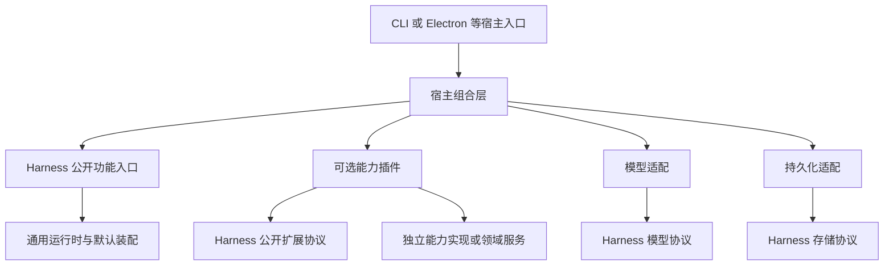

# 项目整体规划：通用 Agent Harness

状态：规划基线。本文描述目标、职责与推进门槛，不表示对应改造已经完成，也不自动扩大后续任务的执行范围。

## 1. 文档分工

- [AGENTS.md](../AGENTS.md)：持续适用的开发规范、架构约束与验证底线。
- 本文：项目整体方向、模块职责和分阶段路线。
- [下一步计划](next-steps.md)：当前待执行迭代的具体范围、改动落点与验收条件。
- [README](../README.md)：当前产品能力、使用方式和现有执行入口。

规范与计划不能代替实际实现；阶段完成后应更新状态与证据，不用修改文字掩盖未完成事项。

## 2. 项目方向与概念

项目主线是构建可独立消费、可通过协议扩展、可恢复且可验证的通用 Agent Harness，而不是以 PPT 工作台为中心抽出一个可复用的 Agent。

### 2.1 Harness、Agent、宿主与插件

- **Harness**：为模型驱动执行提供运行时、上下文与消息组织、工具与能力装配、授权接入、持久恢复、资源管理和观察协议的通用支撑体系。
- **Agent**：在该体系中，由指令定义、模型选择和已装配能力形成的执行实例。它负责一次次激活执行，不能与整个 Harness 混为一谈。
- **宿主**：提供平台环境、凭据、适配器和运行配置，并决定启用哪些能力。Electron 是当前已接入的宿主环境，不是 Harness 的固定组成。
- **能力插件**：通过公开扩展协议贡献工具、提示词等能力。文件与 PPT 是具体例子，后续能力按需求接入，不能反向塑造内核。

Harness 不等于 Loop，也不是包容所有业务的全局对象。可复用的默认实现与装配机制留在所属模块，具体助手配置和业务实现留在外部。

以上术语不要求立即增加 `Harness` 类、改名现有 `Agent*` 协议或搬迁 `src/agent/`；先形成真实职责边界，而不是做一轮命名替换。

### 2.2 PPT 的位置

PPT 只是其中一个可选插件能力，不是与 Harness 并列的项目主线，也不决定 Harness 的完成标准。它可以继续拥有完整的演示模型、版本、提案、提交、预览与导出逻辑，由插件在边界处调用。

现有 SVG-native 作者路径和 PPT 产品链路继续保留，作为后续可迁移的消费场景；保留它们是兼容现状的约束，不意味着通用路线必须依次完成“读 PPT、改 PPT、切换 PPT UI”。

## 3. 当前基线

| 方面 | 已有事实 | 尚未完成的边界 |
| --- | --- | --- |
| 通用执行 | `src/agent/` 提供 Harness 的现有执行基础，包含协议、默认工厂、Agent、Loop、工具管线及恢复协调 | 尚未形成严格受控的 Harness 公开面与独立包边界，不能据此宣称完整通用体系已完成 |
| 宿主接入 | 独立 Electron 开发入口可使用现有模型配置、凭据和 SQLite，显式选择只读或读写基础工具并逐次审批 | 宿主仍是固定工作区助手配置，尚未形成编码/PPT 等业务开关的通用组合 |
| 基础工具 | `src/tools` 已提供 `read/write/edit/glob/grep` 及独立装配，默认只读；安全原语已从旧 Agent 目录迁出，现有生产消费者同步改用迁出实现 | 工具观察记录不跨进程恢复，重启后须重新读取；不代表编码/PPT 能力或生产 UI 已迁移 |
| 端到端 | 已完成一个已配置真实模型的普通对话、读取、EOF 等待、目录变更拒绝、重启恢复、拒绝审批与取消验证 | 不代表所有厂商、业务插件或生产 UI 都已验收 |
| 现有消费侧 | 旧 `src/main/agent/` 与现有 PPT/UI 链路继续运行 | 尚未消费新执行链；PPT 接入属于业务插件迁移，不是 Harness 内核完成的前置条件 |
| 模块治理 | 已有目录分层和部分静态导入限制 | 消费方仍直连内部辅助函数，部分公开签名引用具体内部实现；具体助手配置与宿主机制尚未分开 |
| 日志能力 | `src/logs/` 提供通用记录与 Node 默认管理；`src/tools/` 已支持显式注入 Logger，真实工具/JSONL、审批恢复和输出故障烟测通过 | 现有宿主尚未启用工具 Logger，Harness 全生命周期和 UI 未接入；旧 logger、Gateway 正文归档与历史日志保持原样，跨实例治理未实现 |

长期仍需把已经运行的执行基础收敛为 Harness 的稳定公开面，再使宿主与能力配置可组合；logs 已作为独立切片完成实现，不以完成整轮公开面收敛作为前置。公开入口改造本身不等于通用 Harness 已全部完成。

### 已识别的具体问题

1. `src/main/agent-host/` 多个文件直接依赖 `src/agent/protocol-utils.ts`。需要判定哪些是正式公共能力，哪些不应跨模块使用。
2. `PluginContext.scope` 直接使用 `ResourceScope`；默认工厂也有父作用域与回收回调等参数。公开协议与内部资源树实现还没有完全分开。
3. `create-agent-host.ts` 同时承担基础环境装配和具体工作区助手配置；已从基础工具模块取得实际工具清单，但更广泛的业务能力组合仍待分离。
4. 宿主仍复用旧 Gateway；文件安全和原子持久化原语已迁到 `src/tools/internal/` 并迁移调用方。旧 Agent 的其他生产能力尚未迁移，不能直接删除。

以上是后续工作的输入；其中基础工具切片已经落地，不代表 Harness 公开面收敛或其他模块迁移已完成。此次已通过公开入口运行无插件对话、五工具真实文件操作、只读拒绝和宿主拒绝烟测，并清理临时数据；未进行远程厂商验收。

## 4. 模块设计规范

### 4.1 模块应提供完整功能

模块组织借鉴 Maven 的依赖边界与 Spring Boot 的应用装配；这些是实现 Harness 的工程手段，不是项目目标或容器建设任务：

- 模块内部内聚协议、必要默认实现、内部装配与生命周期管理。
- 依赖方使用受支持的功能入口和扩展协议，不手动拼装内部类。
- 通用默认实现留在所属模块，不因为运行于 Electron Main 就迁到 `main`。
- 工厂是稳定的创建约定，不是增加空壳转发层的理由。
- 目录、路径别名、TypeScript 的 `export` 关键字都不能单独保证模块封装。

### 4.2 职责划分

| 模块角色 | 应拥有的内容 | 不应承担的内容 |
| --- | --- | --- |
| Harness 通用模块 | Agent 创建与执行、上下文与消息组织、恢复、关闭、扩展协议，以及必要默认实现与内部装配 | 具体业务状态、应用配置、Electron、厂商凭据、具体数据库实现 |
| 模型适配 | 将具体模型协议转换为公开模型协议，维护私有重放兼容性 | 为 Loop 注入厂商分支或静默改变模型身份 |
| 持久化适配 | 实现公开存储协议的持久提交、CAS、围栏与幂等收据 | 决定业务完成状态或重放外部副作用 |
| 能力实现与业务领域 | 权威数据、业务规则、版本、一致性与提交结果 | 直接操作 Harness 调度、检查点或内部执行对象 |
| 能力插件 | 通过窄端口适配能力实现，贡献工具与提示词并定义结果投影 | 自行授权、接管整个宿主、成为领域逻辑的替代实现 |
| 运行配置与宿主组合 | 选择定义、模型与插件，提供环境绑定和授权策略，装配端口实现 | 实现 Loop、变成全部默认实现的仓库，或固定某个业务作为必装能力 |
| 入口与展示 | CLI、Electron/UI/IPC 等环境输入、凭据设施和公开事件展示 | 根据界面状态重建或覆盖权威执行状态 |

纯 Node 适配不因使用 Node API 就必须永久归入 `main`；它是否应独立成适配模块，要看可复用性和实际依赖。依赖本项目配置、旧 Gateway 或 Electron 的桥接仍由当前宿主负责。

### 4.3 目标依赖方向

下图表达目标模块依赖，不表示当前已经拆成独立包：

Harness 内部不得反向依赖具体宿主或业务。PPT 插件和其他能力插件使用相同扩展原则，不是内核的特例；领域服务也可以在不知道 Harness 的情况下继续被应用使用。

### 4.4 公开面与封装门槛

- 公开面覆盖功能入口、输入输出、事件、错误以及真正必要的扩展协议，不是导出全部内部文件。
- 使用明确命名的入口或受控子路径，不增加 `index.ts` 聚合入口，也不在入口中堆业务实现。
- 默认 Agent、Loop、Registry、执行管线与资源树如何组装，由模块内部决定。
- 对外类型不应迫使使用方依赖内部类；插件实际需要的作用域能力应以公开协议表达。
- 先收敛调用面，再以构建与静态依赖规则约束绕过行为；路径别名本身不构成封装。
- 独立包或 workspace、受控 `exports`、声明文件与构建依赖用于进一步建立可独立消费的包边界。包导出仍需配合对源码相对路径绕过的约束。
- 不为类比 Java 立即引入全仓 monorepo。只有完成相应构建与外部消费验证，才能声称模块已可独立依赖或发布。

## 5. 运行与业务协作规范

完整执行不等于业务成功。Harness 管理执行事实，能力实现或业务领域解释业务结果：

- Thread、Query、Run、Step 与资源生命周期分开；不把自然语言消息自动转换为某个业务领域的 Task。
- `waiting` 是当前激活的结束边界，恢复继续原 Query；用户回答不能变成一次新的无关请求。
- 授权是独立的宿主策略，不因插件组合变化而被绕过；领域内部校验与提交仍由领域负责。
- 工具结果、模型内容、UI 展示投影分离；状态以权威存储为准，而非前端文本和镜像。
- 先持久意图、再提交并对账；已派发但没有持久结果的副作用不能自动重做。
- 工作目录、业务对象、模型连接与版本的恢复兼容性属于明确协议，不随 UI 当前选择偷偷变化。
- 无业务插件时应能普通对话；启用插件后才暴露其能力。更换能力配置不能重定义基础执行、取消、授权与恢复语义。

详细不变量以 [AGENTS.md](../AGENTS.md) 为准，后续拆模块不得借机改写这些语义。

## 6. 通用 Harness 演进路线

| 阶段 | 状态 | 目标 | 完成门槛 |
| --- | --- | --- | --- |
| M0：独立执行闭环 | 已完成现有闭环验收 | 以新运行时、文件插件和当前宿主验证执行基础 | 真实模型完成对话、工具、等待、恢复、拒绝与取消；不据此声明整个 Harness 或生产切换完成 |
| M1：Harness 公开面收敛 | 后续待执行，非当前日志设计前置 | 基于现有 Agent 模块明确功能与扩展协议，迁移消费方，约束内部依赖 | 公开入口可完整执行；私有路径绕过被阻止；无业务插件与文件插件两类消费方式都成立，且既有恢复语义不变 |
| M2：通用装配与包边界 | 后续 | 分离可复用宿主机制、具体运行配置和适配器，验证模块独立消费 | 定义和插件清单可显式选择；不依赖固定业务或 Electron 才能使用通用模块；独立构建与消费经实际验证 |
| M3：扩展与可靠性通用验收 | 后续 | 按公开协议验证能力组合、安装失败回滚、版本兼容和副作用恢复 | 将既有机制纳入可复用的通用验收；根据实际需求选择独立能力做组合验证，不要求先接 PPT，也不声称进程内插件已具备沙箱隔离 |
| M4：宿主消费侧迁移 | 后续按宿主需求推进 | 让实际入口消费 Harness 的公开输入、事件和结果协议 | 输入、审批和恢复不穿透内核；数据与会话兼容性明确；相应旧调用迁出后删除失效路径 |

阶段按验收门槛推进，不用提前排日历日期替代依赖分析。M2 中独立包能力如果尚不满足条件，应明确保留为未完成事项，不能用一个重导出文件冒充完成。

logs 诊断能力已完成独立模块实现与本地验证，不另设已经完成的 Harness 里程碑。后续按选定模块逐步接入，不要求全量替换旧日志，也不提前改变 M1–M4 的验收门槛。

### 业务插件接入是独立工作线

具体业务按需求在公开协议上接入，不构成内核路线的必经阶段。PPT 可从读取权威演示信息开始，再按需要接入受控修改、提交与展示；这些是 PPT 插件自身的交付门槛，不是通用 Harness 的阶段定义。

插件必须说明目标与版本绑定、权限、结果投影和副作用边界。有新业务需求时先检查公开协议能否表达；只有真正跨领域的共性机制才进入 Harness，不能为了接某个工具把领域对象塞进 Loop。

上下文压缩、并行工具、子 Agent、动态插件发现等是候选演进能力，按通用执行的实际缺口单独决策，不因 Harness 名称就一次性建设，也不以某个 PPT 流程为唯一依据。

### 旧链路退出条件

只有在相关能力有替代实现、所有生产调用方已迁移、数据与恢复规则已验证、旧 Gateway/文件基础能力的剩余依赖有归属后，才能删除对应旧代码。切片迁移是过渡策略，不是长期保留两套等价运行时的理由。

## 7. 每阶段验证与交付

- Harness 通用验收：先通过公开入口运行无业务插件配置，再安装已有文件能力；证明具体插件不是基础对话的启动依赖，未安装能力也不会被暴露或执行。
- 模块边界变更：验证类型、完整构建或静态依赖规则，以及通过公开入口实际运行的消费方。
- 执行行为变更：验证状态转换、权限、持久化、失败与副作用边界；显著变化必须跑真实入口。
- 能力插件接入：对比权威能力结果；涉及领域对象时验证等待期间的对象或版本变化、拒绝和恢复。任何单一插件成功都不能代替通用性验收。
- 真实厂商调用：说明范围与 API 用量，使用已有授权配置与临时测试数据；结果按已测模型和场景报告。
- 测试清理只处理本次创建的数据、进程与缓存，不修改生产对话或删除共享库。
- 不以源码字符串、文件数量、导出数量或简单转发断言代替行为和依赖边界验证。

交付应说明本阶段完成了什么、保留了哪些依赖、哪些场景实际运行过；不能把后续规划写成当前功能。

## 8. 当前行动

当前 [独立 logs 与渐进接入方案](next-steps.md) 已完成模块实现和 tools 注入切片：五个基础工具按执行回调记录安全诊断，受控模型下的审批等待/新 Run 恢复、真实文件与日志故障烟测有证据；本次类型、静态与全量回归通过。现有宿主尚未启用 Logger 注入，旧 logger、UI/IPC、Gateway 正文归档与历史文件保持不变；后续按明确消费范围接入，不自动启动全量替换。Harness 公开面收敛及 M2–M4 仍保留为后续路线，PPT 继续作为可选插件工作线参与。
