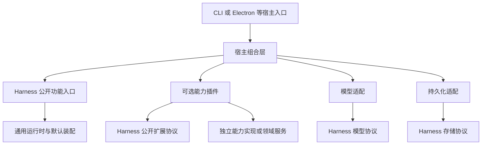

# 项目整体规划：通用 Agent Harness

状态：规划基线。本文描述目标、职责与推进门槛，不表示对应改造已经完成，也不自动扩大后续任务的执行范围。

## 1. 文档分工

- [AGENTS.md](../AGENTS.md)：持续适用的开发规范、架构约束与验证底线。
- 本文：项目整体方向、模块职责和分阶段路线。
- [下一步计划](next-steps/README.md)：当前待执行迭代的具体范围、改动落点与验收条件。
- [独立页面 UI 设计体系](next-steps/ui-design-system.md)：先建设新使用规则、组件与本地交互预览，不接后端/Harness、不改旧生产 UI；方案已设计，实施与验收待执行。
- [独立 Node CLI 终端](next-steps/cli-terminal.md)：C0–C4 已同轮实施，生产/开发入口直接运行 Node，旧 CLI/Electron 桥接已删除；真实 ConPTY、Windows DPAPI、本地 SDK 与小范围 MiMo 远程验收分开记录，不保留预览或兼容入口。
- [README](../README.md)：当前产品能力、使用方式和现有执行入口。

规范与计划不能代替实际实现；阶段完成后应更新状态与证据，不用修改文字掩盖未完成事项。

## 2. 项目方向与概念

项目主线是构建可独立消费、可通过协议扩展、可恢复且可验证的通用 Agent Harness，而不是以 PPT 工作台为中心抽出一个可复用的 Agent。

### 2.1 Harness、Agent、宿主与插件

- **Harness**：为模型驱动执行提供运行时、上下文与消息组织、工具与能力装配、授权接入、持久恢复、资源管理和观察协议的通用支撑体系。
- **Agent**：在该体系中，由指令定义、模型选择和已装配能力形成的执行实例。它负责一次次激活执行，不能与整个 Harness 混为一谈。
- **宿主**：提供平台环境、凭据、适配器和运行配置，并决定启用哪些能力。Electron 是当前已接入的宿主环境，不是 Harness 的固定组成。
- **能力插件**：通过公开扩展协议贡献工具、提示词等能力。文件与 PPT 是具体例子，后续能力按需求接入，不能反向塑造内核。

Harness 不等于 Loop，也不是包容所有业务的全局对象。可复用的默认实现与装配机制留在所属模块，具体助手配置和业务实现留在外部。

以上术语不要求立即增加 `Harness` 类、改名现有 `Agent*` 协议或搬迁 `src/agent/`；先形成真实职责边界，而不是做一轮命名替换。

### 2.2 PPT 的位置

PPT 只是其中一个可选插件能力，不是与 Harness 并列的项目主线，也不决定 Harness 的完成标准。它可以继续拥有完整的演示模型、版本、提案、提交、预览与导出逻辑，由插件在边界处调用。

现有 SVG-native 作者路径和 PPT 产品链路继续保留，作为后续可迁移的消费场景；保留它们是兼容现状的约束，不意味着通用路线必须依次完成“读 PPT、改 PPT、切换 PPT UI”。

## 3. 当前基线

| 方面 | 已有事实 | 尚未完成的边界 |
| --- | --- | --- |
| 通用执行 | 私有 workspace `@agent-harness/core` 提供通用执行协议与默认实现；独立 ESM/声明构建、精确 exports 及仓库外 tarball 消费已通过 | 不代表通用体系的所有扩展能力或生产 UI 已完成 |
| 宿主接入 | `@agent-harness/core/session-host` 提供固定 Thread、发布前绑定确认及公开 Application 装配；生产 CLI 的 `cli/host/` 负责 Node 配置、模型、SQLite、日志、能力与授权，闭包不依赖 app/根 src/Electron；已接入 MiMo 与旧 Gateway 的三种协议 | 新协议仅有本地 SDK/HTTP/SSE 与 CLI 验证，生产 UI 未迁移，异常租约不自动接管 |
| 基础工具 | 私有 `@agent-harness/tools` 已收敛插件、纯契约/错误、受控 Node 文件支撑五入口；全部新旧调用方迁移，无旧源码别名；独立安装、旧 waiting/磁盘恢复、实际编辑器和 ASAR 消费通过 | 观察记录不跨进程恢复，重启须重新读取；低层 Node 读可能恢复写入，不能当新只读工具；不代表生产聊天/PPT 已迁移 |
| 端到端 | 已完成一个已配置真实模型的普通对话、读取、EOF 等待、目录变更拒绝、重启恢复、拒绝审批与取消验证 | 不代表所有厂商、业务插件或生产 UI 都已验收 |
| 现有消费侧 | 旧 `app/main/agent/` 与现有 PPT/UI 继续运行；生产 CLI 已独立消费新执行链，具备 inline TUI、print/JSONL、审批及持久恢复；文件能力归 tools 包 | 桌面生产聊天/PPT 尚未迁移；CLI 切换不迁移或删除旧桌面配置、凭据和会话库 |
| 模块治理 | M1 公开协议/窄资源能力及门禁已落地；M2-A 分离通用 SessionHost 与工作区配置；M2-B 完成单包、声明闭包门禁、tarball 安装及实际 Electron ASAR 消费 | 未公开发布 npm，未统一不同配置的历史目录或引入动态装配，不声称完整 Harness 已完成 |
| 日志能力 | 私有 workspace `@agent-harness/logs` 提供通用记录与 Node 默认管理；开发宿主、原生 MiMo 与 tools 消费精确包子路径，宿主拥有实例，消费者借用 Logger | Harness 全生命周期和日志 UI 未迁移；旧 logger、Gateway 正文归档与历史日志保持原样，跨实例治理未实现 |
| 模型适配 | 单一 `@agent-harness/models` 包的四个公开入口内聚统一创建、纯资料、安全错误和私有适配器；已实现 MiMo、OpenAI Chat Completions、OpenAI Responses、Anthropic Messages；原包阶段的安装/Electron/ASAR 证据与本次三协议本地 SDK/CLI 证据分开记录 | 新增协议未调用远程厂商；不代表全部型号、思考档位、远程兼容端点或生产聊天已验收 |
| 配置与凭据 | 私有 `@agent-harness/configuration` 内聚配置、原计划签发/解析、模型发现与受保护存储；Node Windows CurrentUser DPAPI、桌面 safeStorage 使用明确独立方案，跨进程配置变更受锁保护 | Node 安全保护当前仅支持 Windows；不自动迁移桌面密文，无明文落盘或环境 Key 降级 |

在 M1 公开面和 M2-A 通用装配基础上，M2-B 已建立独立构建与真实安装消费边界。日志、models、tools 与 configuration 随后各自抽为独立包；SQLite 与 Electron 不进入 Harness 包。这些局部完成不等于通用 Harness 全部目标完成。

### 边界治理状态与后续问题

1. 已处理：`protocol-utils.ts` 删除，错误类/安全投影与无损协议值操作分别由具名公共协议提供，内核、宿主与测试调用方已迁移。
2. 已处理：`PluginContext.scope` 使用 `PluginScope` 窄对象；资源树、默认工厂和工具执行端口保持内部，外部访问受精确依赖检查约束。
3. 已处理：通用会话装配通过 `@agent-harness/core/session-host` 提供，工作区指令、tools 与授权仍在具体配置模块；当前 CLI 的凭据、模型、SQLite、日志和执行绑定归 `cli/host/`，通用配置归 configuration 包。原包阶段的独立构建、声明、安装消费和 ASAR 证据不自动升级为本轮 CLI 的 ASAR 验收。
4. 新宿主已删除 Gateway 兼容分支，只经 models 包调用已实现原生适配器：专用 MiMo 与按已保存 provider/openaiApiMode 路由的 Chat Completions、Responses、Messages；未知显式 ID 仍在解析凭据前拒绝。原有 Gateway 仍由旧生产 Agent 使用，不能据此删除整个旧链路。文件安全、原子持久化与旧文件服务已由 tools 包内聚，宿主、旧生产和领域消费者使用 atomic-files/workspace-files 等受控入口，旧 src/tools 已删除。

以上是后续工作的输入；基础工具切片不代表 Harness 公开面收敛或其他模块迁移已完成。此前基础工具验收通过公开入口运行无插件对话、五工具真实文件操作、只读拒绝和宿主拒绝烟测，其历史证据不包含远程厂商调用；本轮 MiMo 的新增远程证据另见实施记录。

## 4. 模块设计规范

### 4.1 模块应提供完整功能

模块组织借鉴 Maven 的依赖边界与 Spring Boot 的应用装配；这些是实现 Harness 的工程手段，不是项目目标或容器建设任务：

- 模块内部内聚协议、必要默认实现、内部装配与生命周期管理。
- 依赖方使用受支持的功能入口和扩展协议，不手动拼装内部类。
- 通用默认实现留在所属模块，不因为运行于 Electron Main 就迁到 `main`。
- 工厂是稳定的创建约定，不是增加空壳转发层的理由。
- 目录、路径别名、TypeScript 的 `export` 关键字都不能单独保证模块封装。

### 4.2 职责划分

| 模块角色 | 应拥有的内容 | 不应承担的内容 |
| --- | --- | --- |
| Harness 通用模块 | Agent 创建与执行、上下文与消息组织、恢复、关闭、扩展协议，以及必要默认实现与内部装配 | 具体业务状态、应用配置、Electron、厂商凭据、具体数据库实现 |
| 模型适配 | 将具体模型协议转换为公开模型协议，维护私有重放兼容性 | 为 Loop 注入厂商分支或静默改变模型身份 |
| 持久化适配 | 实现公开存储协议的持久提交、CAS、围栏与幂等收据 | 决定业务完成状态或重放外部副作用 |
| 能力实现与业务领域 | 权威数据、业务规则、版本、一致性与提交结果 | 直接操作 Harness 调度、检查点或内部执行对象 |
| 能力插件 | 通过窄端口适配能力实现，贡献工具与提示词并定义结果投影 | 自行授权、接管整个宿主、成为领域逻辑的替代实现 |
| 运行配置与宿主组合 | 选择定义、模型与插件，提供环境绑定和授权策略，装配端口实现 | 实现 Loop、变成全部默认实现的仓库，或固定某个业务作为必装能力 |
| 入口与展示 | CLI、Electron/UI/IPC 等环境输入、凭据设施和公开事件展示 | 根据界面状态重建或覆盖权威执行状态 |

纯 Node 适配不因使用 Node API 就必须永久归入 `main`；它是否应独立成适配模块，要看可复用性和实际依赖。依赖本项目配置、旧 Gateway 或 Electron 的桥接仍由当前宿主负责。

### 4.3 目标依赖方向

下图表达目标模块依赖，不表示当前已经拆成独立包：

Harness 内部不得反向依赖具体宿主或业务。PPT 插件和其他能力插件使用相同扩展原则，不是内核的特例；领域服务也可以在不知道 Harness 的情况下继续被应用使用。

### 4.4 公开面与封装门槛

- 公开面覆盖功能入口、输入输出、事件、错误以及真正必要的扩展协议，不是导出全部内部文件。
- 使用明确命名的入口或受控子路径，不增加 `index.ts` 聚合入口，也不在入口中堆业务实现。
- 默认 Agent、Loop、Registry、执行管线与资源树如何组装，由模块内部决定。
- 对外类型不应迫使使用方依赖内部类；插件实际需要的作用域能力应以公开协议表达。
- 先收敛调用面，再以构建与静态依赖规则约束绕过行为；路径别名本身不构成封装。
- 独立包或 workspace、受控 `exports`、声明文件与构建依赖用于进一步建立可独立消费的包边界。包导出仍需配合对源码相对路径绕过的约束。
- 不为类比 Java 立即引入全仓 monorepo。只有完成相应构建与外部消费验证，才能声称模块已可独立依赖或发布。

## 5. 运行与业务协作规范

完整执行不等于业务成功。Harness 管理执行事实，能力实现或业务领域解释业务结果：

- Thread、Query、Run、Step 与资源生命周期分开；不把自然语言消息自动转换为某个业务领域的 Task。
- `waiting` 是当前激活的结束边界，恢复继续原 Query；用户回答不能变成一次新的无关请求。
- 授权是独立的宿主策略，不因插件组合变化而被绕过；领域内部校验与提交仍由领域负责。
- 工具结果、模型内容、UI 展示投影分离；状态以权威存储为准，而非前端文本和镜像。
- 先持久意图、再提交并对账；已派发但没有持久结果的副作用不能自动重做。
- 工作目录、业务对象、模型连接与版本的恢复兼容性属于明确协议，不随 UI 当前选择偷偷变化。
- 无业务插件时应能普通对话；启用插件后才暴露其能力。更换能力配置不能重定义基础执行、取消、授权与恢复语义。

详细不变量以 [AGENTS.md](../AGENTS.md) 为准，后续拆模块不得借机改写这些语义。

## 6. 通用 Harness 演进路线

| 阶段 | 状态 | 目标 | 完成门槛 |
| --- | --- | --- | --- |
| M0：独立执行闭环 | 已完成现有闭环验收 | 以新运行时、文件插件和当前宿主验证执行基础 | 真实模型完成对话、工具、等待、恢复、拒绝与取消；不据此声明整个 Harness 或生产切换完成 |
| M1：Harness 公开面收敛 | 已实施并完成本地验收，两项审核门禁缺陷已修复，见下一步计划 M1.12–M1.13 | 基于现有 Agent 模块明确功能与扩展协议，迁移消费方，约束内部依赖 | 公开入口可完整执行；私有路径绕过被阻止；无业务插件与文件插件两类消费方式都成立，且既有恢复语义不变 |
| M2：通用装配与包边界 | M2-A、M2-B 均已实施并完成各自本地验收 | 分离可复用宿主机制、具体运行配置和适配器，验证模块独立消费 | 定义和插件清单可显式选择；不依赖固定业务或 Electron 才能使用通用模块；独立构建、真实 tarball 仓库外安装与 Electron ASAR 消费已验证 |
| M3：扩展与可靠性通用验收 | A/B/C/D 已验收；E 方案已制定、待实施，M3 尚未整体完成 | 按公开协议验证能力组合、安装失败回滚、版本兼容和副作用恢复，重点核验竞争条件下的隔离、关闭及持久写入安全 | 将既有机制纳入可复用的通用验收；核验 Thread 准入与 Query 围栏边界，补真实进程竞争及故障窗口证据；不新增并行调度，不要求先接 PPT，也不声称进程内插件具备沙箱隔离 |
| M4：宿主消费侧迁移 | 后续按宿主需求推进 | 让实际入口消费 Harness 的公开输入、事件和结果协议 | 输入、审批和恢复不穿透内核；数据与会话兼容性明确；相应旧调用迁出后删除失效路径 |

阶段按验收门槛推进，不用提前排日历日期替代依赖分析。M2 以实际 JS/声明、受控导出、独立安装消费及宿主产物运行完成验收，不以转发文件或源码编译通过代替包边界。

logs/tools 与 MiMo/CLI 能力切片的既有实现和证据保留在下一步计划的历史记录中。M1 门禁审核修复、[M2-A 通用宿主装配](next-steps/m2-a-session-host.md#m2-a12-实施与验收记录2026-11-01)及 [M2-B 独立包边界](next-steps/m2-b-package-boundary.md#m2-b-独立包边界与实际消费)已完成，保持原 v2 绑定和数据库格式；不重写 Loop、不全量替换旧日志，也不改变 M3–M4 的验收门槛。

### 业务插件接入是独立工作线

具体业务按需求在公开协议上接入，不构成内核路线的必经阶段。PPT 可从读取权威演示信息开始，再按需要接入受控修改、提交与展示；这些是 PPT 插件自身的交付门槛，不是通用 Harness 的阶段定义。

插件必须说明目标与版本绑定、权限、结果投影和副作用边界。有新业务需求时先检查公开协议能否表达；只有真正跨领域的共性机制才进入 Harness，不能为了接某个工具把领域对象塞进 Loop。

上下文压缩、并行工具、子 Agent、动态插件发现等是候选演进能力，按通用执行的实际缺口单独决策，不因 Harness 名称就一次性建设，也不以某个 PPT 流程为唯一依据。

### 旧链路退出条件

只有在相关能力有替代实现、所有生产调用方已迁移、数据与恢复规则已验证、旧 Gateway/文件基础能力的剩余依赖有归属后，才能删除对应旧代码。切片迁移是过渡策略，不是长期保留两套等价运行时的理由。

## 7. 每阶段验证与交付

- Harness 通用验收：先通过公开入口运行无业务插件配置，再安装已有文件能力；证明具体插件不是基础对话的启动依赖，未安装能力也不会被暴露或执行。
- 模块边界变更：验证类型、完整构建或静态依赖规则，以及通过公开入口实际运行的消费方。
- 执行行为变更：验证状态转换、权限、持久化、失败与副作用边界；显著变化必须跑真实入口。
- 能力插件接入：对比权威能力结果；涉及领域对象时验证等待期间的对象或版本变化、拒绝和恢复。任何单一插件成功都不能代替通用性验收。
- 真实厂商调用：说明范围与 API 用量，使用已有授权配置与临时测试数据；结果按已测模型和场景报告。
- 测试清理只处理本次创建的数据、进程与缓存，不修改生产对话或删除共享库。
- 不以源码字符串、文件数量、导出数量或简单转发断言代替行为和依赖边界验证。

交付应说明本阶段完成了什么、保留了哪些依赖、哪些场景实际运行过；不能把后续规划写成当前功能。

## 8. 当前行动

[M3-A](next-steps/m3-a-composition.md#10-后续独立复核与完成结论)与 [M3-B](next-steps/m3-b-lifecycle.md#10-后续独立审核与完成结论)均已通过独立审核并验收完成。B 已修复两个 binding 交接点的清理错误保留，补齐执行隔离、单实例准入及关闭排空；独立审核通过七文件 110 项、全仓 typecheck/四包边界、全量 193 文件/1654 项（2 项既有跳过）、原生 Node/真实 SQLite、两项真实 CLI 集成与包消费。实施当时的 tools 边界阻塞保留为历史，已不再阻塞 B；模型/工具/CLI 独立迁移与其证据不混算。

[M3-C](next-steps/m3-c-persistence.md#12-c1c3-增量实施与验收记录)已完成本轮验收：C2 原子 Thread 准入由持久化 P1/P2 交付，本轮补齐 C1 的独立进程租约/CAS/binding/batch/接管与跨表不收养竞争、第三进程持久核验，以及 C3 分层版本拒绝和原配置恢复。只读一致性、实际 Node CLI 审批恢复及 Core/tools 真实包消费通过，完整门禁与历史失败分别记录；不新增并行调度或自动接管。

[M3-D](next-steps/m3-d-recovery.md#12-本轮实施与验收记录)已完成实施与本地验收：release 双失败错误保留先失败后通过，补齐 acquire 空占位、历史/终态/租约、副作用与回答消费的 B/R 矩阵、39 个真实强杀场景及第三进程核验，以及恢复权限/累计预算。全量 205 文件、1897 项通过（3 项既有平台跳过），完整 integration 3 文件、62 项、typecheck/边界、Core/tools 包消费与静态门禁通过，无远程厂商调用或持久格式变更。下一步执行 [M3-E](next-steps/m3-e-observation.md)的有限观察/Node 入口结算验收；不把逻辑退订等同 CLI EPIPE 主动关闭，也不承诺 Windows 同步输出阻塞时 Core 必然推进。第二后端、迁移/包化及 M4/PPT 仍独立安排。

独立的[单包多厂商模型切片](next-steps/models-package.md#12-实施与验收记录)已完成原 MiMo 抽取与包边界验收；其中监听、独立安装、Electron/ASAR 和旧 waiting 恢复是原切片证据。本次另按[协议补齐记录](next-steps/models-package.md#13-旧-gateway-协议接入新模型端口)实现旧 Gateway 的 Chat Completions、Responses、Messages 三种原生适配器和 CLI 配置路由；凭据、连接指纹和步数预算继续留在宿主。未新增远程厂商用量或迁移生产聊天；并行 M3-A 的范围与证据独立保留。

独立的 [Tools 收敛切片](next-steps/tools-package.md#12-实施与验收记录)已完成实施与本地验收：一个 @agent-harness/tools 包、五个精确入口，保留两套读取恢复/receipt 语义及唯一安全实现/错误身份，全部 app/cli/旧生产/领域调用方迁移。当前四包构建/类型/门禁通过，193 文件/1654 项回归通过、2 项既有跳过，两项真实 Electron CLI 集成及 87 文件静态检查通过；18 项隔离门禁、真实 tarball 离线安装与声明/文件行为、原工具 waiting 与原子材料恢复、实际项目编辑器拒绝外部覆盖、PTY 启动取消、四包监听和原生 ASAR 消费均已运行。没有远程厂商调用，不将并行 M3/UI/CLI 设计计入本切片。

独立的[持久化 P1/P2](next-steps/persistence-backends.md#13-p1p2-实施与验收记录)已完成 SQLite 职责收敛与准入修复：写装配、只读查询/DTO、私有连接/DDL/各 store 分离，保留 history receipt、CAS/fence、binding 不收养和旧 JSON/表格式；不新增 SQL 包或 ORM。实际 Node CLI 无插件对话、读取审批、EOF waiting=3、新进程恢复同 Query/新 Run 和租约释放通过；全量 197 文件/1710 项、三文件十项集成、最终完整类型/边界、Core/tools tarball 消费通过。P3 第二后端、P4 迁移/包边界仍待执行，不迁移用户库、不承诺副作用恰好一次。

通用包身份已修正并完成该轮本地验收：`@agent-harness/core`、`@agent-harness/logs` 及根 workspace `agent-harness` 已统一，两个真实 tarball、新名实际 Electron ASAR 消费及旧名拒绝通过；全量 192 文件/1632 项通过（2 项既有跳过）、两项真实 CLI 集成通过，见[修正记录](next-steps/package-identities.md#通用包身份修正)。包身份修正阶段未开始 MiMo 抽取或 M3 实施；当时的 [M3 执行计划](next-steps/m3-reliability.md#m3-执行计划)参考 Netty 的有序执行/状态隔离和 Tomcat 的发布/停止服务/资源所有权，验证现有模型而非引入线程池或新容器。后续 C2 准入缺陷已复现并按本轮记录修复；事件观察队列仍无容量上限，不能承诺背压、内存有界或抗拒绝服务，生产消费迁移仍按 M4 独立切片。

第一轮 M1 的公开协议及插件生命周期迁移保持不变；已修复审核发现的三斜线依赖和白盒导出类型图漏检，47 项隔离门禁正反例通过，见 [M1 审核修复记录](next-steps/m1-public-api.md#m113-审核问题修复与门禁补充验收2026-11-01)。

第二轮 M2-A 通用装配及 M2-B 独立包边界已完成：当前组合根通过私有 @agent-harness/core 消费通用执行与 SessionHost；工作区配置、SQLite/Electron 仍在应用侧，模型、日志与工具各为独立包。原 M2-B 实际通过 34 项边界场景、192 文件/1632 项单测（2 项既有跳过）、类型/构建、两个 Electron CLI 集成、开发编译监听、真实 tarball 仓库外安装及 NodeNext/Bundler 声明消费；解包 Electron 实际从 ASAR 原生解析并执行包及 Zod。历史宿主源码产生的 v2 waiting 经包产物新进程恢复，绑定原文与 pending JSON 保持，Query 不变/Run 更新，最终 completed 且租约释放；历史宿主基线不等同完整旧二进制。原轮证据见 M2-B，新名称切换证据见[通用包身份修正](next-steps/package-identities.md#通用包身份修正)。生产聊天/PPT 与旧 Agent/Gateway 未迁移；其共享文件入口收敛以工具包独立记录为准。

独立能力切片 [日志包抽取](next-steps/logs-package.md#独立能力切片日志包抽取)也已完成，现包名为 `@agent-harness/logs@0.1.0`，与 Harness 并列、互不依赖，全部新日志消费者使用受控产物。原轮 18 项边界隔离场景、真实 tarball 离线安装和通用/Node 声明消费、双包监听、原生日志行为及实际 Electron ASAR 文件输出通过；全量为 192 文件/1632 项通过、2 项既有跳过，两个真实 CLI 集成通过。保留日志格式、安全处理和宿主所有权，不迁移旧 logger/日志 UI，不新增遥测、容器或内核日志协议。原轮记录保留实施当时包名，不提供旧名别名。

前序已按 [mimo-token-plan-cn 具体实施方案](mimo-token-plan-cn.md)完成原生模型 provider、发现与设置/思考强度、开发宿主 Responses/工具/流式/日志/恢复，并对实际 CN `mimo-v2.6-flash` / `high` 做小范围验收。精确证据、未验收模型与 Node Fetch 421 内部重传限制见其实施记录；这些证据不代替本轮 M1 验收。
